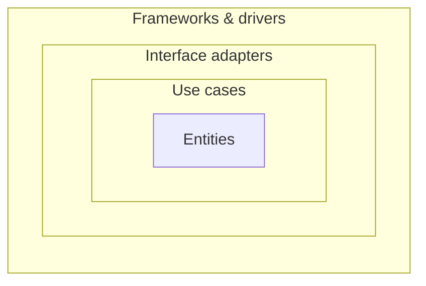
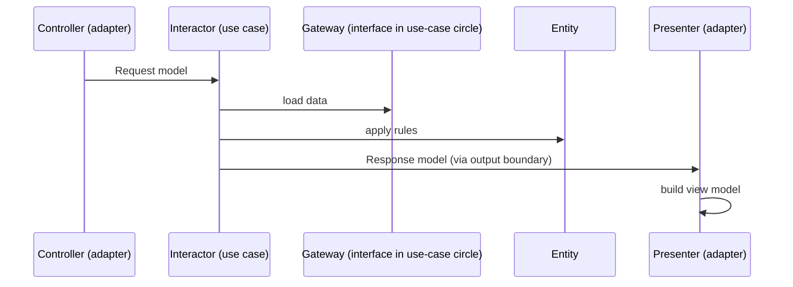

---
tags:
  - Architecture
  - Advanced
---

# Clean Architecture

<span class="badge badge--advanced">🔴 Advanced</span>
<span class="badge badge--category">Architecture</span>
<span class="badge badge--interview">Interview frequency ⭐⭐⭐⭐</span>

!!! abstract "TL;DR"
    **Arrange code in concentric circles: entities (enterprise rules) → use cases (application rules) → interface adapters (controllers, presenters, gateways) → frameworks and drivers (web, DB, UI). Source-code dependencies may only point inward.**
    Business rules don't know about the web, the database or the framework, so those can change, and the rules can be tested in isolation.

---

## 1. Intent & Problem It Solves

**The problem in plain English:** the coupon rules of a grocery app are written inside a Spring controller, read data via JPA entities, and return a JSON map. Adding a mobile app with a different response shape means duplicating the rules; upgrading Spring breaks business logic; nobody can say where "the rules" actually are.

**Definition (Robert C. Martin, *Clean Architecture*):**
> The Dependency Rule: source code dependencies must point only inward, toward higher-level policies. Nothing in an inner circle can know anything at all about something in an outer circle.

| Circle | Contains | Example |
|---|---|---|
| **Entities** | Enterprise-wide business rules | `Coupon.evaluate()`, `Account.withdraw()` |
| **Use cases** | Application-specific rules; input/output boundaries; request/response models; gateway interfaces | `ApplyCoupon.Interactor` |
| **Interface adapters** | Controllers, presenters, gateway implementations; convert data between use cases and the outside | `CouponController`, `WebPresenter` |
| **Frameworks & drivers** | Web framework, DB, UI, devices | Spring MVC, PostgreSQL, Android |

## 2. Real-World Analogy

!!! example "A country's constitution, laws and offices"
    The constitution (entities) changes rarely and doesn't mention any specific government office. Laws (use cases) build on the constitution. Government offices and forms (adapters) implement the laws for citizens, and the buildings and computers (frameworks) can be replaced without changing a single law.

## 3. Structure





**Flow of control vs. dependencies:** control flows outward (interactor → presenter), but the interactor only knows the **output boundary interface** defined in its own circle; the presenter implements it. That's dependency inversion.

## 4. Naive Approach (Without the Pattern)

```java
@PostMapping("/cart/{id}/coupon")
Map<String, Object> apply(@PathVariable String id, @RequestParam String code) {
    CartEntity cart = cartJpaRepo.findById(id).orElseThrow();
    CouponEntity c = couponJpaRepo.findByCode(code.toUpperCase());
    if (c.getExpires().isBefore(LocalDate.now())) return Map.of("error", "expired");   // rule + clock
    long discount = Math.min(c.getMax(), cart.getSubtotal() * c.getPercent() / 100);   // rule
    return Map.of("total", "₹" + (cart.getSubtotal() - discount) / 100);              // formatting
}
```

---

## 5. Three Real-World Examples

### Example 1: Apply a Coupon, Two Presenters (Grocery)

**Scenario:** The `Coupon` entity knows the rules (expiry, minimum basket, percentage, cap). The `ApplyCoupon` interactor loads data through gateway interfaces and reports a **response model** through an **output boundary**. A web presenter turns it into a detailed JSON view model; a mobile presenter into a one-line toast. The calendar is a gateway too, so the use case is deterministic in tests.

**Full Code:**

=== "Coupon.java (entity)"

    ```java
    --8<-- "code/architecture/src/main/java/com/handbook/architecture/clean/coupon/entities/Coupon.java"
    ```

=== "ApplyCoupon.java (use case)"

    ```java
    --8<-- "code/architecture/src/main/java/com/handbook/architecture/clean/coupon/usecase/ApplyCoupon.java"
    ```

    1.  **Request model**: plain data crossing the boundary; no HTTP types.
    2.  **Output boundary**: implemented by presenters in the outer circle (dependency inversion).
    3.  The entity's sealed `Outcome` lets the compiler check that every case is handled.

=== "CouponAdapters.java (interface adapters)"

    ```java
    --8<-- "code/architecture/src/main/java/com/handbook/architecture/clean/coupon/adapters/CouponAdapters.java"
    ```

    1.  The presenter owns **formatting**: currency, wording, JSON shape. The use case never formats.

=== "CleanCouponDemo.java (main)"

    ```java
    --8<-- "code/architecture/src/main/java/com/handbook/architecture/clean/coupon/CleanCouponDemo.java"
    ```

**Output:**

```text
--8<-- "code/outputs/architecture/clean/coupon/CleanCouponDemo.txt"
```

**Why Clean here:**

- Rules live in **one** place (entity), application flow in another (interactor), formatting in presenters.
- A new channel = a new presenter; no rule changes.
- Fully testable without Spring or a database (ArchUnit enforces the dependency rule in the tests).

---

### Example 2: Transfer Funds, One Response for Two Audiences (Banking)

**Scenario:** The `Account` entity enforces balance and daily-limit rules. The interactor orchestrates the transfer and produces **one response model**. The API presenter shows customer-friendly messages with HTTP codes; the audit presenter writes a detailed compliance line. Both receive the same facts.

**Full Code:**

=== "TransferFunds.java"

    ```java
    --8<-- "code/architecture/src/main/java/com/handbook/architecture/clean/transfer/TransferFunds.java"
    ```

    1.  Rules are enforced by the **entity**; the interactor only coordinates and reports.

=== "TransferDemo.java"

    ```java
    --8<-- "code/architecture/src/main/java/com/handbook/architecture/clean/transfer/TransferDemo.java"
    ```

**Output:**

```text
--8<-- "code/outputs/architecture/clean/transfer/TransferDemo.txt"
```

**Why Clean here:**

- Customer messaging and compliance logging evolve independently, without touching rules.
- Entities are reusable across apps (branch system, mobile app, batch).

---

### Example 3: Prescription Refills with a Sealed Result (Healthcare)

**Scenario:** A modern-Java variation: instead of an output-boundary callback, the use case returns a **sealed `Result`** (`Approved`, `NeedsDoctor`, `Rejected`). The outermost web layer maps each case to an HTTP status with an exhaustive `switch`. Controlled substances always go to the doctor; expired prescriptions too; other patients' prescriptions are invisible.

**Full Code:**

=== "RefillPrescription.java"

    ```java
    --8<-- "code/architecture/src/main/java/com/handbook/architecture/clean/refill/RefillPrescription.java"
    ```

    1.  The same answer for "doesn't exist" and "belongs to someone else", so the API doesn't leak which prescriptions exist.
    2.  An **exhaustive** `switch` over a sealed type: add a new result and the compiler shows every place to update.

=== "RefillDemo.java"

    ```java
    --8<-- "code/architecture/src/main/java/com/handbook/architecture/clean/refill/RefillDemo.java"
    ```

**Output:**

```text
--8<-- "code/outputs/architecture/clean/refill/RefillDemo.txt"
```

**Why this variation:**

- Simpler than presenters when there's one consumer; still no HTTP in the use case.
- Sealed results make error handling explicit and type-checked (no exceptions for expected outcomes).

---

??? example "Tests (ArchUnit enforces the dependency rule)"

    ```java
    --8<-- "code/architecture/src/test/java/com/handbook/architecture/ArchitectureRulesTest.java"
    ```

## 6. Variations & Modern Java Take

- **Output boundary vs. return values**: presenters (Example 1–2) suit multiple outputs or streaming; returning a sealed `Result` (Example 3) is simpler and idiomatic in Java 21.
- **Records** for request/response models; **sealed interfaces** for outcomes; **pattern matching** in adapters.
- **Screaming architecture**: top-level packages named after use cases and domain (`coupons/`, `transfers/`), not frameworks (`controllers/`).
- **Spring at the edge**: controllers and `@Configuration` live in the outer circle; use cases are plain classes registered as beans in configuration.
- **Cross-cutting concerns** (transactions, security, logging) as decorators around use cases (see the coding challenge).

## 7. Where It Lives in Real Frameworks

| Where | Clean Architecture |
|---|---|
| Android (Google's app architecture guide) | Domain layer with use cases, data layer with repositories |
| Spring Boot projects | Plain use-case classes + adapters; ArchUnit `onionArchitecture()` |
| jMolecules | Expresses architecture concepts (layers, ring) in code and verifies them |
| iOS (VIPER, Clean Swift) | Interactor/Presenter separation inspired by Clean Architecture |

## 8. Pros, Cons & Trade-offs

| ✅ Pros | ❌ Cons |
|---|---|
| Business rules **independent of frameworks**, UI, DB | **Boilerplate**: boundaries, request/response models, presenters |
| Very testable; fast tests | Indirection can confuse newcomers |
| Long-lived systems survive framework changes | Overkill for CRUD |
| Clear place for every kind of code | Risk of "ceremony over substance" |

## 9. Pitfalls & Anti-Patterns

!!! danger "Entities that are just JPA rows"
    If entities have only getters/setters and all rules are in interactors, you have an anemic model with extra layers. Put invariants in entities.

!!! warning "Use cases returning view models or HTTP codes"
    Then they depend on the outer circle. Return response models (or sealed results); let presenters/controllers decide formats and status codes.

!!! warning "Mapping everything three times by default"
    Request → entity → response → view model for a trivial read is ceremony. Be pragmatic about reads; apply full rigour to complex writes.

!!! warning "Frameworks imported 'just for annotations'"
    `@Transactional` in a use case looks harmless but couples it to Spring. Prefer decorators/AOP configured in the outer circle if strict independence matters to you.

## 10. Senior / Architect Deep Dive (10–15 yrs)

**Policy vs. detail.** Martin's core idea: high-level policy (rules) shouldn't depend on low-level detail (I/O). Every inward dependency arrow you protect buys the freedom to postpone or replace a detail.

**Where to be pragmatic.** Many teams allow JPA annotations on entities, or skip presenters and return DTOs, to reduce mapping. That's fine if it's a **deliberate, documented** decision enforced by tests, not an accident.

**Use cases as the unit of design.** Name them after what users do (`ApplyCoupon`, `TransferFunds`); each one is a transaction boundary, a test suite and a security boundary. This also maps neatly onto API endpoints and messages.

### Explain it in 2 minutes (system design / architecture round)

> "I'd organize the service around use cases. Entities hold invariants (account limits, coupon rules). Each use case is a plain class with request and response models and gateway interfaces for data it needs. Controllers translate HTTP into requests; presenters or the controller translate responses into views and status codes. Spring, JPA and Kafka live only in the outer circle. ArchUnit enforces that dependencies point inward. Cross-cutting concerns like transactions and authorization are applied as decorators around use cases in configuration."

!!! bug "War story: the framework upgrade that rewrote the business"
    A logistics firm's routing rules lived in Struts actions and EJB session beans. When the platform reached end of life, migrating to Spring meant rewriting 600 classes, including the rules, because rules and framework code were interleaved. The migration took two years, and several rules changed by accident.
    **What they did next time:** entities and use cases as plain Java with 2,000 fast tests; frameworks only in adapters. The next migration (Spring Boot 2 → 3, `javax` → `jakarta`) touched only adapters and took three weeks.
    **Lesson:** frameworks come and go; protect the rules from them.

## 11. Related Patterns & Comparisons

| | Clean | Hexagonal | Onion | Layered |
|---|---|---|---|---|
| Center | Entities, then use cases | Application core | Domain model | — |
| Outer things | Adapters, frameworks | Adapters on ports | Infrastructure, UI, tests | Lower layers |
| Signature idea | Presenters, request/response models | Symmetric ports | Concentric domain layers | Horizontal layers |

See [Hexagonal](hexagonal.md), [Layered](layered.md) and the in-process [Strategy](../behavioral/strategy.md)/[Decorator](../structural/decorator.md) patterns used in the challenge.

## 12. Interview Corner

=== "🟢 Beginner / Service Companies"

    **Q1. What is Clean Architecture?**

    An architecture of concentric circles (entities, use cases, interface adapters, frameworks) where dependencies only point inward.

    **Q2. What is the Dependency Rule?**

    Inner circles must not know anything about outer circles: no imports, no names, no data formats.

    **Q3. Entity vs. use case?**

    Entities hold enterprise-wide rules; use cases hold application-specific workflows that use entities.

    **Q4. What does a presenter do?**

    Converts the use case's response model into a view model for a specific UI or API.

    **Q5. Why is it testable?**

    Business rules don't depend on frameworks, databases or UIs, so they can be tested with plain unit tests.

=== "🟡 Mid-Level"

    **Q1. How does the interactor call the presenter without depending on it?**

    Through an output boundary interface defined in the use-case circle and implemented by the presenter (dependency inversion).

    **Q2. Where do Spring annotations go?**

    In the outer circles: controllers, configuration, gateway implementations. Use cases are wired as beans from configuration.

    **Q3. Clean vs. Hexagonal?**

    Same dependency principle; Clean names more circles and adds presenters and request/response models; Hexagonal focuses on ports/adapters.

    **Q4. What is "screaming architecture"?**

    The top-level structure shows what the system does (use cases, domain) rather than which framework it uses.

    **Q5. How do you handle validation?**

    Input format validation in controllers/request models; business invariants in entities; use-case preconditions in interactors.

=== "🔴 Senior / FAANG / SAP"

    **Q1. "Clean Architecture for a CRUD admin panel: yes or no?"**

    No: the ceremony costs more than it saves. Use it where rules are complex and long-lived.

    **Q2. "How do you avoid mapping fatigue?"**

    Pragmatic shortcuts for reads (query services returning DTOs directly), MapStruct for mechanical mapping, and full rigour for complex write paths.

    **Q3. "Where does the transaction boundary go?"**

    Around the use case, applied from outside (decorator/AOP) so the interactor stays framework-free.

    **Q4. "How do you introduce Clean Architecture into an existing system?"**

    Pick a high-value, high-change area; extract entities and use cases with tests; move framework code outward; enforce with ArchUnit for that package; expand gradually.

    **Q5. "Sealed results vs. exceptions for business outcomes?"**

    Sealed results make expected outcomes explicit and compiler-checked; exceptions are for unexpected failures. Java 21 pattern matching makes results ergonomic.

=== "💻 Coding Challenge"

    **Problem:** Add **transactions, logging and role checks** to use cases without putting any of that code inside the interactors. Use a generic `UseCase<I, O>` interface and decorators applied in the composition root.

    ??? success "Solution"

        === "UseCaseDecorators.java"

            ```java
            --8<-- "code/architecture/src/main/java/com/handbook/architecture/clean/crosscutting/UseCaseDecorators.java"
            ```

        === "DecoratorsDemo.java"

            ```java
            --8<-- "code/architecture/src/main/java/com/handbook/architecture/clean/crosscutting/DecoratorsDemo.java"
            ```

        **Output:**

        ```text
        --8<-- "code/outputs/architecture/clean/crosscutting/DecoratorsDemo.txt"
        ```

        **Key points to say:** decorator order matters (authorization before opening a transaction; logging outermost); the failed refund rolls back, and the denied call never opens a transaction. Spring AOP (`@Transactional`, `@PreAuthorize`) does the same with proxies.

!!! info "Behavioural tie-in (STAR) for experienced candidates"
    - **S:** Our lending app's eligibility rules were scattered across Angular, Spring controllers and stored procedures; customers saw different answers on web and mobile.
    - **T:** One authoritative implementation of eligibility rules.
    - **A:** Introduced entities (`Applicant`, `LoanProduct`) and use cases (`CheckEligibility`) as plain Java with 400 unit tests; channels became presenters; removed rule logic from the UI and procedures.
    - **R:** Channel discrepancies dropped to zero; rule changes went from 3 weeks (three codebases) to 2 days.

## 13. Quick Revision Card

!!! tip "Remember in 30 seconds"
    - **Entities → Use cases → Interface adapters → Frameworks**; dependencies point **inward**.
    - Request/response models at the boundary; presenters format.
    - Gateways are interfaces in the use-case circle, implemented outside.
    - Java 21: records + sealed results + pattern matching.
    - Cross-cutting concerns as decorators at the edge.

## Practice

- [ ] Add a `RemoveCoupon` use case and a presenter for a smartwatch (max 20 characters).
- [ ] Add a `Account.freeze()` rule and make frozen accounts reject transfers.
- [ ] Add a `Metrics` decorator that counts successes and failures per use case.

---

[:material-arrow-left: Hexagonal Architecture](hexagonal.md){ .md-button }
[Next: Event-Driven Architecture :material-arrow-right:](event-driven.md){ .md-button .md-button--primary }
