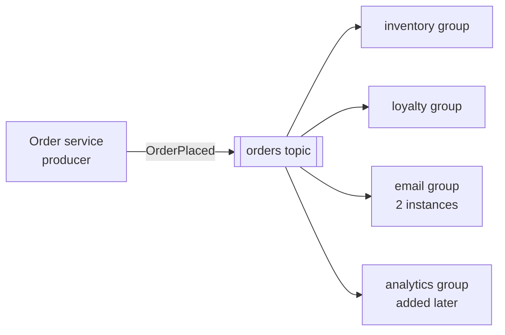

---
tags:
  - Architecture
  - Intermediate
---

# Event-Driven Architecture

<span class="badge badge--intermediate">🟡 Intermediate</span>
<span class="badge badge--category">Architecture</span>
<span class="badge badge--interview">Interview frequency ⭐⭐⭐⭐⭐</span>

!!! abstract "TL;DR"
    **Components communicate by producing and reacting to events (facts about something that happened: `OrderPlaced`, `MeterReading`, `CardSwiped`) through a broker, instead of calling each other directly.**
    Producers don't know their consumers, so new reactions can be added without touching existing code, and work happens asynchronously and in parallel. The cost: eventual consistency, harder debugging, and the need for idempotency, ordering and error-handling strategies.

---

## 1. Intent & Problem It Solves

**The problem in plain English:** after an order is placed, the order service synchronously calls inventory, loyalty, email, analytics and the recommendation engine. Every new feature adds a call; if the email service is slow, checkout is slow; if analytics is down, orders fail. The order service has become a coordinator of things that aren't its business.

**Definition (Martin Fowler, "What do you mean by Event-Driven?"):** event-driven covers several distinct patterns:

| Style | What the event carries | Example |
|---|---|---|
| **Event notification** | "Something happened" + an ID; consumers call back if they need more | `OrderPlaced{orderId}` |
| **Event-carried state transfer** | The data consumers need, so they don't call back | `CustomerAddressChanged{id, address}` |
| **Event sourcing** | Events are the system of record | Account ledger (see [Event Sourcing](../microservices/event-sourcing.md)) |
| **CQRS** | Events feed read models | See [CQRS](../microservices/cqrs.md) |

Topologies: **broker** (choreography: everyone publishes and subscribes) vs. **mediator** (an orchestrator routes events through steps).

## 2. Real-World Analogy

!!! example "A newspaper vs. phone calls"
    The order team could phone every department after each sale (synchronous calls). Instead it publishes a newsletter (event); every department subscribes and decides what to do. New departments subscribe without the order team even knowing. If a department is on holiday, the newsletters wait in its mailbox.

## 3. Structure



| Concept | Meaning |
|---|---|
| **Event** | Immutable fact, past tense, with ID and timestamp |
| **Topic / channel** | Named stream of events |
| **Consumer group** | Each group receives every event; members of a group share the work |
| **Partition / key** | Ordering scope (all events for an order in one partition) |
| **Dead-letter queue** | Where events go after repeated processing failures |

## 4. Naive Approach (Without the Pattern)

```java
public Order placeOrder(Cart cart) {
    Order order = orders.save(Order.from(cart));
    inventoryClient.reserve(order);        // slow? checkout is slow
    loyaltyClient.addPoints(order);        // down? checkout fails
    emailClient.sendReceipt(order);
    analyticsClient.track(order);          // every new feature = change here + redeploy
    return order;
}
```

---

## 5. Three Real-World Examples

### Example 1: OrderPlaced Fan-Out with Consumer Groups (Grocery)

**Scenario:** The order service publishes `OrderPlaced`. Inventory, loyalty and email each have their own consumer group; the email group has **two instances** sharing the work (competing consumers). Later the analytics team adds a group, and the order service doesn't change at all.

**Full Code:**

=== "MiniBroker.java"

    ```java
    --8<-- "code/architecture/src/main/java/com/handbook/architecture/eventdriven/broker/MiniBroker.java"
    ```

    1.  **Within** a group, events are spread across members (Kafka assigns partitions; here, round-robin). **Across** groups, everyone gets every event.

=== "OrderEventsDemo.java"

    ```java
    --8<-- "code/architecture/src/main/java/com/handbook/architecture/eventdriven/grocery/OrderEventsDemo.java"
    ```

**Output:**

```text
--8<-- "code/outputs/architecture/eventdriven/grocery/OrderEventsDemo.txt"
```

**Why event-driven here:**

- **Decoupling**: the producer doesn't know or wait for consumers.
- **Extensibility**: new consumers without changing the producer.
- **Scalability**: add instances to a group to process faster.

---

### Example 2: Windowed Stream Processing of Smart Meters (Energy)

**Scenario:** Millions of smart meters stream power readings. The platform computes 5-minute **tumbling windows** per meter by **event time** (when the reading was taken, not when it arrived), so a late reading still lands in the right window. When the **watermark** passes a window's end, the window closes, its average is emitted, and an overload alert fires above 6 kW.

**Full Code:**

=== "MeterWindowing.java"

    ```java
    --8<-- "code/architecture/src/main/java/com/handbook/architecture/eventdriven/iot/MeterWindowing.java"
    ```

    1.  The window is chosen from the **event's own timestamp**, which is what makes late arrivals land correctly.
    2.  The **watermark** says "no more events older than this are expected"; windows that end before it are final.

=== "SmartMeterDemo.java"

    ```java
    --8<-- "code/architecture/src/main/java/com/handbook/architecture/eventdriven/iot/SmartMeterDemo.java"
    ```

**Output:**

```text
--8<-- "code/outputs/architecture/eventdriven/iot/SmartMeterDemo.txt"
```

**Why stream processing here:**

- Continuous, high-volume data is processed **as it arrives**, not in nightly batches.
- Event-time windows give correct results despite network delays.
- Production engines: Kafka Streams, Apache Flink, Spark Structured Streaming.

---

### Example 3: Real-Time Fraud Detection (Banking)

**Scenario:** **Complex event processing (CEP)** looks for patterns across events. Per card, the detector remembers the last swipe; a swipe in a different city within 60 minutes triggers an "impossible travel" alert in real time, before the next transaction is approved.

**Full Code:**

=== "ImpossibleTravelDetector.java"

    ```java
    --8<-- "code/architecture/src/main/java/com/handbook/architecture/eventdriven/fraud/ImpossibleTravelDetector.java"
    ```

    1.  **Per-key state**: with Kafka Streams this is a state store, partitioned by card number so each instance holds the state for its cards.
    2.  The **pattern**: different city + short time gap.

=== "FraudDetectionDemo.java"

    ```java
    --8<-- "code/architecture/src/main/java/com/handbook/architecture/eventdriven/fraud/FraudDetectionDemo.java"
    ```

**Output:**

```text
--8<-- "code/outputs/architecture/eventdriven/fraud/FraudDetectionDemo.txt"
```

**Why event-driven here:**

- Fraud must be caught **in seconds**; batch analysis the next day is too late.
- New fraud rules are new consumers of the same card-event stream.

---

??? example "Tests"

    ```java
    --8<-- "code/architecture/src/test/java/com/handbook/architecture/ArchitectureExamplesTest.java"
    ```

## 6. Variations & Modern Java Take

```java
// Spring Kafka consumer group (reference)
@KafkaListener(topics = "orders", groupId = "loyalty", concurrency = "3")
public void on(OrderPlaced event) { loyalty.addPoints(event.customerId(), event.totalPaise()); }

// Kafka Streams: 5-minute tumbling windows per meter (reference)
builder.stream("meter-readings", Consumed.with(Serdes.String(), readingSerde))
       .groupByKey()
       .windowedBy(TimeWindows.ofSizeAndGrace(Duration.ofMinutes(5), Duration.ofMinutes(1)))
       .aggregate(Avg::new, (meter, reading, avg) -> avg.add(reading.kw()), Materialized.with(...))
       .toStream()
       .filter((window, avg) -> avg.value() > 6.0)
       .to("overload-alerts");
```

| Option | Notes |
|---|---|
| **Kafka** | Durable log, partitions, consumer groups, replay; the default for event streaming |
| **RabbitMQ** | Flexible routing (exchanges), per-message acks; great for work queues |
| **Cloud** (SNS/SQS, EventBridge, Pub/Sub, Event Hubs) | Managed brokers and routing |
| **Kafka Streams / Flink** | Stateful stream processing, windows, joins |
| **CloudEvents** | Standard event envelope (id, source, type, time) |
| **Spring Cloud Stream** | Binder abstraction over Kafka/RabbitMQ |

## 7. Where It Lives in Real Frameworks

| Where | Event-driven |
|---|---|
| Spring `ApplicationEventPublisher` / `@EventListener` | In-process events |
| Spring Kafka, Spring AMQP, Spring Cloud Stream | Broker-based messaging |
| Kafka Streams, Apache Flink | Stream processing and CEP |
| Debezium | Database changes as events |
| UI frameworks (Swing, JavaFX, browsers) | Event loops and listeners ([Observer](../behavioral/observer.md)) |

## 8. Pros, Cons & Trade-offs

| ✅ Pros | ❌ Cons |
|---|---|
| **Loose coupling** between producers and consumers | **Eventual consistency**; harder to reason about |
| Easy to add consumers; replay history (Kafka) | Debugging flows across services needs tracing |
| Absorbs load spikes (queues buffer) | Duplicates, ordering and poison messages must be handled |
| Natural fit for real-time analytics | Schema evolution of events is a long-term commitment |

## 9. Pitfalls & Anti-Patterns

!!! danger "Event-driven spaghetti"
    Dozens of services reacting to each other's events with no one owning end-to-end flows. Document event flows, give business processes owners, and use orchestration for complex workflows (see [Saga](../microservices/saga.md)).

!!! danger "Poison messages blocking a partition"
    One event that always fails, retried forever, stops everything behind it. Bounded retries + a dead-letter queue (see the coding challenge).

!!! warning "Commands disguised as events"
    `SendEmailToCustomer` isn't a fact; it's an instruction to one recipient. Use events for facts ("OrderShipped") and commands for requests, and be explicit.

!!! warning "No schema governance"
    Changing an event's fields breaks consumers you didn't know about. Use a schema registry with compatibility rules (Avro/Protobuf/JSON Schema).

## 10. Senior / Architect Deep Dive (10–15 yrs)

**Delivery guarantees.** Kafka gives at-least-once by default; design consumers to be [idempotent](../microservices/idempotent-consumer.md) and producers to publish via the [outbox](../microservices/transactional-outbox.md). Ordering holds per partition only, so choose keys (order ID, card number) to match your ordering needs.

**Notification vs. state transfer.** Thin notifications cause callback storms ("event, then 10 services call `GET /orders/{id}`"); fat events reduce coupling at runtime but increase schema coupling. Choose per event, and version deliberately.

**Observability.** Track consumer lag per group, DLQ sizes, processing latency (event time → processed time), and trace across async hops via message headers (see [Distributed Tracing](../microservices/distributed-tracing.md)).

### Explain it in 2 minutes (system design / architecture round)

> "When an order is placed, the order service writes it and an `OrderPlaced` event to its outbox; a relay publishes to Kafka keyed by order ID. Inventory, loyalty, notifications and analytics each have their own consumer group, scale by partitions, and process idempotently. Failures retry with backoff and go to a dead-letter topic after N attempts, with alerts. Events have Avro schemas in a registry with backward compatibility. Real-time features like fraud detection and live dashboards run on Kafka Streams with event-time windows. We monitor consumer lag and trace across async hops."

!!! bug "War story: the poison pill"
    A retailer's invoicing consumer hit an event with a malformed price (`"12,50"` from a new country's checkout). The consumer retried forever; Kafka offsets stopped advancing; 400,000 invoices queued behind it over a weekend. Monday's finance reports were empty.
    **Fix:** bounded retries with backoff, a dead-letter topic with an alert and a replay tool, schema validation at the producer, and a lag alert per consumer group.
    **Lesson:** in event-driven systems, one bad event can stop a whole stream. Plan for it.

## 11. Related Patterns & Comparisons

| | Event-driven | Request/response (REST/gRPC) | Batch |
|---|---|---|---|
| Coupling | Low (temporal + spatial) | Caller knows and waits for callee | Low, but delayed |
| Latency | Near real time, async | Immediate | Hours |
| Consistency | Eventual | Immediate (per call) | Periodic |
| Best for | Reactions, integration, streams | Queries, user-facing commands | Bulk processing, reports |

See [Observer](../behavioral/observer.md) (in-process ancestor), [Mediator](../behavioral/mediator.md), [Saga](../microservices/saga.md), [CQRS](../microservices/cqrs.md) and [Producer-Consumer](../concurrency/producer-consumer.md).

## 12. Interview Corner

=== "🟢 Beginner / Service Companies"

    **Q1. What is event-driven architecture?**

    Components communicate by publishing and consuming events through a broker, instead of calling each other directly.

    **Q2. What is an event?**

    An immutable record of something that happened, named in the past tense (`OrderPlaced`).

    **Q3. Name some message brokers.**

    Apache Kafka, RabbitMQ, ActiveMQ, AWS SNS/SQS, Google Pub/Sub, Azure Service Bus.

    **Q4. What is a consumer group in Kafka?**

    A set of consumers sharing a topic's partitions; each group gets all events, and each partition is read by one member of the group.

    **Q5. Main advantage?**

    Loose coupling: producers don't know consumers, and new consumers can be added without changes.

=== "🟡 Mid-Level"

    **Q1. Event notification vs. event-carried state transfer?**

    Notification carries an ID (consumers call back for details); state transfer carries the data consumers need.

    **Q2. How is ordering guaranteed in Kafka?**

    Only within a partition; events with the same key go to the same partition.

    **Q3. What is a dead-letter queue?**

    A topic/queue where messages go after failing processing repeatedly, so they don't block others and can be inspected or replayed.

    **Q4. Event time vs. processing time?**

    Event time is when it happened; processing time is when it's processed. Windows by event time handle late data correctly.

    **Q5. How do you handle duplicate events?**

    Idempotent consumers (dedupe by event ID, idempotent operations).

=== "🔴 Senior / FAANG / SAP"

    **Q1. "Design a real-time notification system for 10M users."**

    Domain events → Kafka (keyed by user) → notification service consumer groups by channel (push/SMS/email), preference service lookup (cached), rate limits per user, idempotency per notification key, DLQs, provider adapters with retries, delivery status events back for analytics.

    **Q2. "How do you evolve event schemas safely?"**

    Schema registry with compatibility (backward/forward), additive changes, new event versions or topics for breaking changes, consumers as tolerant readers, and deprecation windows.

    **Q3. "When would you NOT use event-driven?"**

    When the user needs an immediate answer that depends on the result (a synchronous query/command), for simple CRUD, or when the team lacks the operational maturity for brokers.

    **Q4. "Broker vs. mediator topology?"**

    Broker: choreography, maximum decoupling, harder to see flows. Mediator: an orchestrator controls steps, easier to manage complex workflows and errors.

    **Q5. "Consumer lag is growing. What do you check?"**

    Throughput per partition vs. produce rate, slow downstream calls in handlers, rebalancing storms, poison messages, partition skew (hot keys), and whether more partitions/instances or batching are needed.

=== "💻 Coding Challenge"

    **Problem:** A poison message must not block the stream. Retry each event up to 3 times; transient failures should succeed on retry, but an event that keeps failing goes to a **dead-letter queue** with its error, and processing continues.

    ??? success "Solution"

        === "RetryingConsumer.java"

            ```java
            --8<-- "code/architecture/src/main/java/com/handbook/architecture/eventdriven/dlq/RetryingConsumer.java"
            ```

        === "DeadLetterDemo.java"

            ```java
            --8<-- "code/architecture/src/main/java/com/handbook/architecture/eventdriven/dlq/DeadLetterDemo.java"
            ```

        **Output:**

        ```text
        --8<-- "code/outputs/architecture/eventdriven/dlq/DeadLetterDemo.txt"
        ```

        **Key points to say:** distinguish transient (retry with backoff) from permanent (DLQ immediately) errors when you can; keep the original event and error in the DLQ for replay after a fix; Spring Kafka's `DefaultErrorHandler` + `DeadLetterPublishingRecoverer` implements exactly this.

!!! info "Behavioural tie-in (STAR) for experienced candidates"
    - **S:** Checkout called 7 downstream services synchronously; p99 latency was 2.8 s and any outage broke ordering.
    - **T:** Make checkout fast and resilient while keeping all downstream reactions.
    - **A:** Kept inventory reservation synchronous, moved loyalty, email, analytics and recommendations to `OrderPlaced` consumers via an outbox and Kafka; added DLQs, lag alerts and tracing.
    - **R:** Checkout p99 went to 450 ms; three downstream outages over the next quarter had zero checkout impact.

## 13. Quick Revision Card

!!! tip "Remember in 30 seconds"
    - **Events = facts**; producers don't know consumers.
    - Consumer groups: pub/sub across groups, competing consumers within a group.
    - Ordering per **partition key**; at-least-once → **idempotent** consumers.
    - Event time + watermarks for streams; CEP for patterns.
    - Retries + **DLQ**, schema registry, lag monitoring, tracing.

## Practice

- [ ] Add per-key ordering to `MiniBroker` so all events for the same order go to the same group member.
- [ ] Add sliding (hopping) windows to `MeterWindowing`: 5-minute windows every minute.
- [ ] Add a "3 declined transactions in 10 minutes" rule to the fraud detector.

---

[:material-arrow-left: Clean Architecture](clean.md){ .md-button }
[Next: Modular Monolith :material-arrow-right:](modular-monolith.md){ .md-button .md-button--primary }
