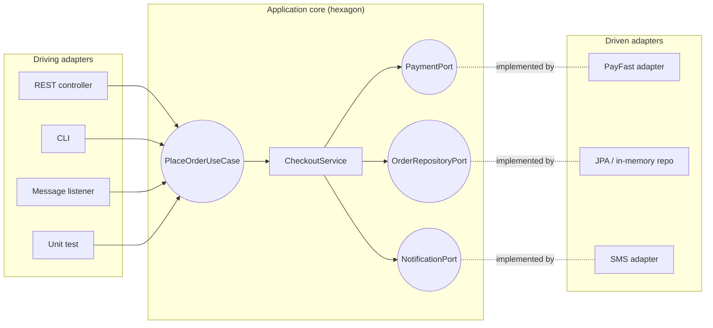

---
tags:
  - Architecture
  - Intermediate
---

# Hexagonal Architecture (Ports & Adapters)

<span class="badge badge--intermediate">🟡 Intermediate</span>
<span class="badge badge--category">Architecture</span>
<span class="badge badge--interview">Interview frequency ⭐⭐⭐⭐⭐</span>

!!! abstract "TL;DR"
    **Put the application's core (domain + use cases) in the middle and let everything else plug in through ports (interfaces the core owns) and adapters (implementations for HTTP, databases, message brokers, external APIs).**
    Driving adapters call the core; driven adapters are called by it. The core depends on nothing technical, so it can be tested without infrastructure and adapters can be swapped freely.

---

## 1. Intent & Problem It Solves

**The problem in plain English:** checkout logic is tangled with Spring MVC, JPA and the payment provider's SDK. Switching payment providers means editing business code; testing a checkout rule requires a database and a sandbox account; a nightly batch import can't reuse the logic because it's buried in a controller.

**Definition (Alistair Cockburn, 2005):**
> Allow an application to equally be driven by users, programs, automated test or batch scripts, and to be developed and tested in isolation from its eventual run-time devices and databases.

| Term | Meaning | Example |
|---|---|---|
| **Core** | Domain model + application logic | `CheckoutService` |
| **Driving (primary) port** | What the app offers | `PlaceOrderUseCase` |
| **Driven (secondary) port** | What the app needs, in its own terms | `PaymentPort`, `OrderRepositoryPort` |
| **Driving adapter** | Calls a driving port | REST controller, CLI, message listener, test |
| **Driven adapter** | Implements a driven port | JPA repository, PayFast HTTP client, SMS sender, fake |

## 2. Real-World Analogy

!!! example "A laptop's ports"
    The laptop (core) defines USB-C and HDMI ports. You can plug in any monitor, charger or keyboard that fits, from any brand, and swap them anytime. The laptop's design doesn't change when you buy a new monitor; you just need the right adapter.

## 3. Structure



**The dependency rule:** source-code dependencies always point **into** the hexagon. Adapters depend on ports; the core never imports an adapter.

## 4. Naive Approach (Without the Pattern)

```java
@RestController
class CheckoutController {
    @Autowired PayFastClient payFast;         // vendor SDK inside business flow
    @Autowired OrderJpaRepository repo;       // JPA types in the use case
    @PostMapping("/checkout") ResponseEntity<?> checkout(@RequestBody CheckoutJson json) {
        var r = payFast.charge(new PayFastRequest(json.amount().toString(), "MK-GROCERY"));
        if (!"CAPTURED".equals(r.status())) ...   // vendor status codes in business logic
    }
}
```

---

## 5. Three Real-World Examples

### Example 1: Checkout with Two Driving and Three Driven Adapters (Grocery)

**Scenario:** The same `CheckoutService` is driven by a REST adapter (JSON with rupee amounts) and a CLI used by phone-order staff (amounts in paise). It needs a payment provider, a repository and a notifier, defined as ports in its own terms. The PayFast adapter translates to PayFast's language (rupee strings, merchant key, `CAPTURED`/`DECLINED_LIMIT`).

**Full Code:**

=== "CheckoutService.java (core)"

    ```java
    --8<-- "code/architecture/src/main/java/com/handbook/architecture/hexagonal/checkout/domain/CheckoutService.java"
    ```

    1.  Constructor injection of **ports**. The core has no idea whether payments go to PayFast, a fake, or a test double.

=== "Ports"

    ```java
    --8<-- "code/architecture/src/main/java/com/handbook/architecture/hexagonal/checkout/port/in/PlaceOrderUseCase.java"
    ```

    ```java
    --8<-- "code/architecture/src/main/java/com/handbook/architecture/hexagonal/checkout/port/out/PaymentPort.java"
    ```

    ```java
    --8<-- "code/architecture/src/main/java/com/handbook/architecture/hexagonal/checkout/port/out/OrderRepositoryPort.java"
    ```

    ```java
    --8<-- "code/architecture/src/main/java/com/handbook/architecture/hexagonal/checkout/port/out/NotificationPort.java"
    ```

=== "PayFastPaymentAdapter.java"

    ```java
    --8<-- "code/architecture/src/main/java/com/handbook/architecture/hexagonal/checkout/adapter/out/PayFastPaymentAdapter.java"
    ```

    1.  Vendor-specific details (merchant key, rupee strings) live **only** in the adapter.
    2.  The vendor's status codes are translated into the port's simple contract.

=== "Driving adapters"

    ```java
    --8<-- "code/architecture/src/main/java/com/handbook/architecture/hexagonal/checkout/adapter/in/RestCheckoutAdapter.java"
    ```

    ```java
    --8<-- "code/architecture/src/main/java/com/handbook/architecture/hexagonal/checkout/adapter/in/CliCheckoutAdapter.java"
    ```

=== "Other driven adapters"

    ```java
    --8<-- "code/architecture/src/main/java/com/handbook/architecture/hexagonal/checkout/adapter/out/InMemoryOrderRepository.java"
    ```

    ```java
    --8<-- "code/architecture/src/main/java/com/handbook/architecture/hexagonal/checkout/adapter/out/SmsNotificationAdapter.java"
    ```

=== "HexagonalCheckoutDemo.java"

    ```java
    --8<-- "code/architecture/src/main/java/com/handbook/architecture/hexagonal/checkout/HexagonalCheckoutDemo.java"
    ```

**Output:**

```text
--8<-- "code/outputs/architecture/hexagonal/checkout/HexagonalCheckoutDemo.txt"
```

**Why hexagonal here:**

- Switching payment providers = writing one new adapter.
- The core is unit-tested with lambdas as adapters (see the tests); no Spring context, no database.
- New channels (CLI, batch, events) reuse the exact same use case.

---

### Example 2: Swappable Routing for Fares (Ride-hailing)

**Scenario:** The fare core needs a route (km, minutes). The GeoMaps adapter calls an online API that returns meters and seconds; an offline adapter estimates from straight-line distance. A composite **fallback adapter** tries GeoMaps and falls back offline when it's down. The fare rules never change.

**Full Code:**

=== "FareHexagon.java"

    ```java
    --8<-- "code/architecture/src/main/java/com/handbook/architecture/hexagonal/fare/FareHexagon.java"
    ```

    1.  The adapter converts the API's units (meters, seconds) into the port's units (km, minutes).
    2.  Haversine distance × 1.3 detour factor. `StrictMath` keeps results identical on every platform.
    3.  Adapters can be **composed** (a Decorator/Composite of ports) for resilience, invisible to the core.

=== "FareDemo.java"

    ```java
    --8<-- "code/architecture/src/main/java/com/handbook/architecture/hexagonal/fare/FareDemo.java"
    ```

**Output:**

```text
--8<-- "code/outputs/architecture/hexagonal/fare/FareDemo.txt"
```

**Why hexagonal here:**

- External dependencies are **replaceable** and **composable**.
- Each adapter can be tested against recorded API responses; the core against a trivial fake.

---

### Example 3: One Use Case, Event and Batch Channels (Insurance)

**Scenario:** Claims come from the mobile app (as events on a topic) and from a partner garage network (as a nightly CSV). Two driving adapters parse their formats and call the **same** `SubmitClaim` port, so validation and triage rules are identical for every channel.

**Full Code:**

=== "ClaimsHexagon.java"

    ```java
    --8<-- "code/architecture/src/main/java/com/handbook/architecture/hexagonal/claims/ClaimsHexagon.java"
    ```

    1.  Triage is a **core** decision; neither adapter knows the ₹50,000 threshold.

=== "ClaimsDemo.java"

    ```java
    --8<-- "code/architecture/src/main/java/com/handbook/architecture/hexagonal/claims/ClaimsDemo.java"
    ```

**Output:**

```text
--8<-- "code/outputs/architecture/hexagonal/claims/ClaimsDemo.txt"
```

**Why hexagonal here:**

- Driving adapters are as replaceable as driven ones: an API, a topic, a file, or a test.
- No more "the batch import has slightly different rules".

---

??? example "Tests (ArchUnit enforces that the core never depends on adapters)"

    ```java
    --8<-- "code/architecture/src/test/java/com/handbook/architecture/ArchitectureRulesTest.java"
    ```

## 6. Variations & Modern Java Take

```text
checkout/
├── domain/            Order, CheckoutService          ← no framework imports
├── port/in/           PlaceOrderUseCase
├── port/out/          PaymentPort, OrderRepositoryPort, NotificationPort
├── adapter/in/web/    CheckoutController (@RestController)
├── adapter/in/cli/    CliCheckoutAdapter
├── adapter/out/jpa/   OrderJpaAdapter (@Repository, JPA entities live here)
├── adapter/out/payfast/ PayFastPaymentAdapter
└── config/            @Configuration wiring adapters to ports
```

- **Spring wiring**: the core classes stay annotation-free; a `@Configuration` class creates them as beans with adapters injected.
- **JPA entities live in the adapter**, mapped to domain objects, so the domain isn't shaped by ORM needs. (A pragmatic variant allows JPA annotations in the domain; decide consciously.)
- **Testing pyramid**: core unit tests with fakes; adapter integration tests (Testcontainers for DB, WireMock for HTTP); a few end-to-end tests.
- **Contract tests for ports** keep fakes honest (see the coding challenge).

## 7. Where It Lives in Real Frameworks

| Where | Ports & adapters |
|---|---|
| Spring Boot apps structured as hexagons | Core + `@Configuration` wiring; ArchUnit's `onionArchitecture()` checks it |
| jMolecules | Annotations (`@Port`, `@Adapter`) and ArchUnit rules for architecture concepts |
| Micronaut / Quarkus apps | Same structure; frameworks only in adapters |
| Testcontainers / WireMock | Test driven adapters against real dependencies |

## 8. Pros, Cons & Trade-offs

| ✅ Pros | ❌ Cons |
|---|---|
| Core **testable without infrastructure** | More interfaces and mapping code |
| Adapters **swappable** (vendor, DB, channel) | Overkill for simple CRUD |
| Multiple channels share one use case | Team discipline needed to keep frameworks out of the core |
| Postpone technology decisions | Mapping between domain and persistence models takes effort |

## 9. Pitfalls & Anti-Patterns

!!! danger "Ports shaped like the vendor's API"
    A `PaymentPort` with `merchantKey` and `PayFastStatus` defeats the purpose. Define ports in **the core's language**.

!!! warning "Framework annotations creeping into the core"
    `@Transactional`, `@Entity` and `@JsonProperty` in domain classes bind the core to frameworks. Keep them in adapters or configuration.

!!! warning "One port per method, interfaces everywhere"
    Ports should be cohesive, per capability (payments, orders), not one interface per method or per class "just in case".

!!! warning "Fakes that lie"
    A fake adapter that behaves differently from the real one makes core tests pass while production fails. Run the same contract tests against both.

## 10. Senior / Architect Deep Dive (10–15 yrs)

**Hexagonal vs. Clean vs. Onion.** All three apply the dependency rule (dependencies point inward to the domain). Hexagonal emphasizes **ports and adapters**, symmetric for driving and driven sides; Onion emphasizes concentric layers (domain model, domain services, application services); Clean adds named circles (entities, use cases, interface adapters, frameworks) and presenters. In practice, teams mix their vocabulary.

**Transactions and cross-cutting concerns.** Use-case boundaries are natural transaction boundaries; apply them with decorators or Spring AOP around port implementations, keeping the core annotation-free if you want strict purity.

**When the hexagon pays off.** Several integrations, long lifespan, changing vendors, or heavy testing needs. For a two-table CRUD admin app, a layered design is cheaper.

### Explain it in 2 minutes (system design / architecture round)

> "I'd structure the checkout service as a hexagon. The core holds the domain model and use cases, with driving ports like `PlaceOrderUseCase` and driven ports like `PaymentPort` and `OrderRepositoryPort`, all in business terms. Adapters on the outside: a REST controller and a Kafka listener drive it; a JPA adapter, a payment-provider client and an SMS client implement the driven ports. Spring wiring lives in configuration. Core tests run in milliseconds with fakes, contract tests keep fakes honest, and ArchUnit fails the build if the core imports an adapter. Changing payment provider is one new adapter."

!!! bug "War story: the payment provider migration"
    A food-delivery company had to switch payment providers within 8 weeks after a pricing dispute. The old provider's SDK types appeared in 140 classes, including discount and refund logic. The migration took 5 months and caused two incidents where refunds were issued in the wrong currency unit.
    **Fix (for the next migration):** a `PaymentPort` in business terms; all provider specifics in one adapter per provider; contract tests run against both adapters; a feature flag to route by merchant.
    **Lesson:** vendor types inside the core turn a vendor change into a rewrite.

## 11. Related Patterns & Comparisons

| | Hexagonal | Layered | Clean | Adapter pattern |
|---|---|---|---|---|
| Scope | Application architecture | Application architecture | Application architecture | One class |
| Domain → DB dependency | Inverted (ports) | Direct | Inverted (gateways) | n/a |
| Key idea | Ports owned by the core; symmetric adapters | Horizontal layers | Concentric circles + presenters | Convert an interface |

See [Clean Architecture](clean.md), [Layered](layered.md), [Anti-Corruption Layer](../microservices/anti-corruption-layer.md) and the [Adapter](../structural/adapter.md) pattern.

## 12. Interview Corner

=== "🟢 Beginner / Service Companies"

    **Q1. What is hexagonal architecture?**

    An architecture where the business core is isolated and talks to the outside world only through **ports** (interfaces), with **adapters** implementing them for specific technologies.

    **Q2. What is a port? What is an adapter?**

    A port is an interface owned by the core (what it offers or needs); an adapter is a concrete implementation for a technology (REST, JPA, Kafka, a vendor API).

    **Q3. Driving vs. driven adapters?**

    Driving adapters call into the core (controllers, listeners, tests); driven adapters are called by the core (databases, external APIs).

    **Q4. Main benefit?**

    The core can be tested and changed without infrastructure, and technologies can be swapped by writing new adapters.

    **Q5. Why "hexagon"?**

    Just a drawing convention showing many sides (ports); the number six has no meaning.

=== "🟡 Mid-Level"

    **Q1. Where do JPA entities go?**

    In the persistence adapter, mapped to domain objects, or pragmatically in the domain if the team accepts the coupling.

    **Q2. How do you wire it in Spring?**

    Keep core classes free of annotations and create them as beans in a `@Configuration` class, injecting adapters for the ports.

    **Q3. How do you test each part?**

    Core: unit tests with fakes. Adapters: integration tests (Testcontainers, WireMock). Plus contract tests per port and a few end-to-end tests.

    **Q4. Hexagonal vs. layered?**

    Layered has business depending on persistence; hexagonal inverts that so both depend on ports owned by the core.

    **Q5. How do you enforce the rules?**

    ArchUnit (`onionArchitecture()` or custom `noClasses()` rules), separate Maven/Gradle modules, or jMolecules.

=== "🔴 Senior / FAANG / SAP"

    **Q1. "When is hexagonal not worth it?"**

    Small CRUD apps or short-lived prototypes, where mapping and extra interfaces cost more than they save.

    **Q2. "How do transactions work across ports?"**

    The use case is the transaction boundary; the transaction manager is applied around it (AOP/decorator), and repository adapters join it. Cross-system consistency needs sagas/outbox.

    **Q3. "How do hexagons relate to microservices?"**

    Each service can be a hexagon; inter-service clients are driven adapters and API endpoints/listeners are driving adapters. An ACL is a special driven adapter.

    **Q4. "Hexagonal vs. Clean: real differences?"**

    Clean adds explicit circles and the presenter/output-boundary idea; hexagonal is simpler and symmetric. Both enforce inward dependencies.

    **Q5. "How do you prevent port explosion?"**

    Group by capability, keep ports coarse-grained around use cases, and only introduce a port where you need substitution or isolation.

=== "💻 Coding Challenge"

    **Problem:** Fakes make core tests fast, but only if they behave like the real adapter. Write a **contract** that any `PaymentPort` adapter must pass, and run it against the real PayFast adapter (with a stubbed HTTP API), a correct fake, and a buggy fake.

    ??? success "Solution"

        === "PaymentPortContract.java"

            ```java
            --8<-- "code/architecture/src/main/java/com/handbook/architecture/hexagonal/contract/PaymentPortContract.java"
            ```

        === "ContractDemo.java"

            ```java
            --8<-- "code/architecture/src/main/java/com/handbook/architecture/hexagonal/contract/ContractDemo.java"
            ```

        **Output:**

        ```text
        --8<-- "code/outputs/architecture/hexagonal/contract/ContractDemo.txt"
        ```

        **Key points to say:** the contract encodes the port's behavioural expectations (including boundaries); in JUnit, write it as an abstract test class with one subclass per adapter. The buggy fake fails the boundary case, which would otherwise let core tests pass incorrectly.

!!! info "Behavioural tie-in (STAR) for experienced candidates"
    - **S:** Our order service's tests took 25 minutes because every test booted Spring and a database; developers stopped running them.
    - **T:** Fast, reliable feedback on business logic.
    - **A:** Refactored the core into a hexagon: ports for persistence, payments and notifications; moved JPA and vendor SDKs into adapters; added contract tests; kept a slim set of Testcontainers integration tests.
    - **R:** 900 core tests ran in 8 seconds; the full suite dropped to 4 minutes; a later payment-provider switch took 2 weeks.

## 13. Quick Revision Card

!!! tip "Remember in 30 seconds"
    - **Core in the middle; ports (owned by the core) at the edge; adapters outside.**
    - Driving adapters call in; driven adapters are called out.
    - Dependencies point **inward**; frameworks and vendors only in adapters.
    - Test the core with fakes; keep fakes honest with contract tests.
    - Swap vendors and add channels by writing adapters.

## Practice

- [ ] Add a `WhatsAppNotificationAdapter` and switch to it in the demo without touching `CheckoutService`.
- [ ] Add a third route adapter that caches GeoMaps responses for 10 minutes.
- [ ] Write the `PaymentPortContract` as an abstract JUnit 5 test with two subclasses.

---

[:material-arrow-left: Layered Architecture](layered.md){ .md-button }
[Next: Clean Architecture :material-arrow-right:](clean.md){ .md-button .md-button--primary }
