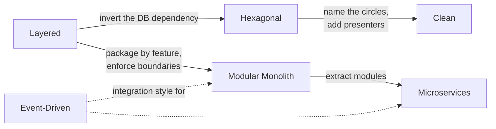

# Architecture Patterns

Design patterns organize **classes**; architecture patterns organize **whole applications**: where business rules live, which way dependencies point, how parts communicate, and how the codebase can grow without turning into a big ball of mud. These five styles cover most architecture discussions in interviews and in real Java projects.

| Pattern | Core idea | Best for | Interview frequency | Status |
|---|---|---|---|---|
| [Layered](layered.md) | Presentation → business → persistence, dependencies point down | CRUD apps, simple domains | ⭐⭐⭐⭐⭐ | ✅ |
| [Hexagonal (Ports & Adapters)](hexagonal.md) | Core owns ports; adapters plug in on both sides | Many integrations, testability, swapping vendors | ⭐⭐⭐⭐⭐ | ✅ |
| [Clean Architecture](clean.md) | Concentric circles; dependencies point inward; presenters | Complex, long-lived domains | ⭐⭐⭐⭐ | ✅ |
| [Event-Driven](event-driven.md) | Components react to events through a broker | Integration, real-time processing, decoupling | ⭐⭐⭐⭐⭐ | ✅ |
| [Modular Monolith](modular-monolith.md) | One deployable, enforced business modules | New products, growing teams, pre-microservices | ⭐⭐⭐⭐ | ✅ |

!!! info "Architecture rules are tested, not just drawn"
    The `architecture` module includes **ArchUnit** tests that fail the build if the examples break their own rules: layers calling upward, the hexagon's core importing an adapter, inner Clean Architecture circles depending on outer ones, or the billing module depending on ordering. Run them with `mvn -f code/pom.xml test -pl architecture`.

## How they relate

- **Layered, Hexagonal and Clean** answer *"how is one application organized inside?"*
- **Modular Monolith** answers *"how do we split a large application by business capability?"* (and each module can use any of the three above inside).
- **Event-Driven** answers *"how do parts communicate?"*, between modules or between services.

## Choosing quickly

| If you have... | Start with |
|---|---|
| A CRUD admin app, a small team | Layered (package by feature) |
| Several external systems or vendors you may swap | Hexagonal |
| Rich business rules that must outlive frameworks | Clean (or Hexagonal with a rich domain) |
| A new product, unclear boundaries, 1–3 teams | Modular monolith |
| Many teams needing independent deployment and scaling | [Microservices](../microservices/index.md), split along proven module boundaries |
| Many consumers reacting to the same business facts | Event-driven integration |

---

[:material-arrow-left: Anti-Corruption Layer](../microservices/anti-corruption-layer.md){ .md-button }
[Start: Layered Architecture :material-arrow-right:](layered.md){ .md-button .md-button--primary }
