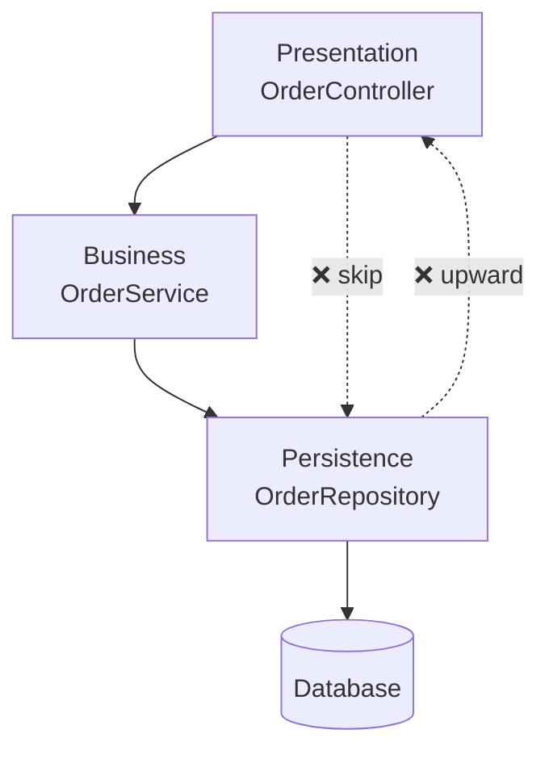
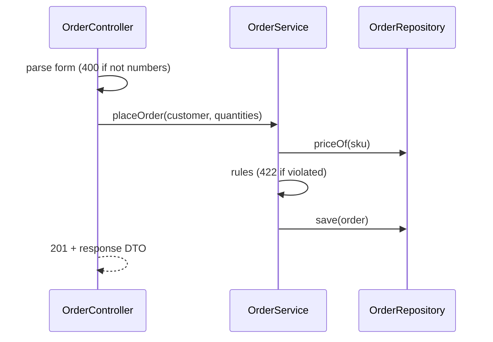

---
tags:
  - Architecture
  - Beginner
---

# Layered Architecture

<span class="badge badge--beginner">🟢 Beginner</span>
<span class="badge badge--category">Architecture</span>
<span class="badge badge--interview">Interview frequency ⭐⭐⭐⭐⭐</span>

!!! abstract "TL;DR"
    **Organize code into horizontal layers (presentation → business/service → persistence), where each layer has one kind of responsibility and depends only on the layers below it.**
    It's the default architecture of most Spring Boot applications (`@Controller` → `@Service` → `@Repository`): easy to learn and to staff, but it can turn into "pass-through" layers and database-centric designs if you're not careful.

---

## 1. Intent & Problem It Solves

**The problem in plain English:** without structure, a grocery app's HTTP handler parses JSON, checks stock, calculates discounts, writes SQL and formats the response, all in one 400-line method. Changing the database means touching UI code; testing a discount rule needs a web server and a database.

**Definition (Mark Richards, *Software Architecture Patterns*):**
> Components within the layered architecture pattern are organized into horizontal layers, each layer performing a specific role within the application.

| Layer | Responsibility | Spring stereotype |
|---|---|---|
| **Presentation** | HTTP/UI: parse input, call the service, format output | `@RestController` |
| **Business / Service** | Use cases, validation, rules, transaction boundaries | `@Service` + `@Transactional` |
| **Persistence** | Load/save data | `@Repository` (JPA/JDBC) |
| **Database** | Storage | PostgreSQL, etc. |

**Closed vs. open layers:** a *closed* layer must be passed through (presentation can't skip the service layer); an *open* layer may be skipped. **Relaxed layering** allows calling any lower layer; **strict** allows only the one directly below.

## 2. Real-World Analogy

!!! example "A restaurant: waiter, kitchen, pantry"
    The waiter (presentation) takes orders and serves plates, but never cooks. The kitchen (business) decides how dishes are made and refuses impossible orders. The pantry (persistence) stores and hands out ingredients. Customers never walk into the pantry, and the pantry never talks to customers.

## 3. Structure



## 4. Naive Approach (Without the Pattern)

```java
@PostMapping("/orders")
public String post(@RequestBody Map<String, String> form) throws SQLException {
    int qty = Integer.parseInt(form.get("qty"));                                    // parsing
    if (qty > 20) return "{\"error\":\"too many\"}";                                 // business rule
    try (var c = DriverManager.getConnection(URL)) {                                // persistence
        c.createStatement().executeUpdate("INSERT INTO orders VALUES (...)");
    }
    return "{\"ok\":true}";                                                         // formatting
}
```

---

## 5. Three Real-World Examples

### Example 1: Placing an Order Through Three Layers (Grocery)

**Scenario:** `POST /orders` flows through the controller (parses the form, maps errors to 400/422), the service (validates the 20-item limit, prices items, creates the order; this is the transaction boundary), and the repository (stores it). Each layer logs when it's involved, so you can see that invalid input never reaches the service, and invalid orders never reach the repository.

**Design:**



**Full Code:**

=== "OrderController.java"

    ```java
    --8<-- "code/architecture/src/main/java/com/handbook/architecture/layered/grocery/web/OrderController.java"
    ```

    1.  **Input translation** is the presentation layer's job: strings to numbers.
    2.  A **response DTO**: the API's shape is decoupled from the domain object.
    3.  Business errors map to HTTP status codes **here**, not in the service.

=== "OrderService.java"

    ```java
    --8<-- "code/architecture/src/main/java/com/handbook/architecture/layered/grocery/service/OrderService.java"
    ```

    1.  The **use case**: validation, pricing, creation, persistence, as one unit of work (`@Transactional` in Spring).

=== "OrderRepository.java"

    ```java
    --8<-- "code/architecture/src/main/java/com/handbook/architecture/layered/grocery/repository/OrderRepository.java"
    ```

=== "Order.java"

    ```java
    --8<-- "code/architecture/src/main/java/com/handbook/architecture/layered/grocery/domain/Order.java"
    ```

=== "LayeredOrderDemo.java"

    ```java
    --8<-- "code/architecture/src/main/java/com/handbook/architecture/layered/grocery/LayeredOrderDemo.java"
    ```

**Output:**

```text
--8<-- "code/outputs/architecture/layered/grocery/LayeredOrderDemo.txt"
```

**Why layers here:**

- Each concern has an obvious home; new developers know where to look.
- The service can be unit-tested without HTTP; the controller with a mocked service.

---

### Example 2: One Service, Two Front Ends (Clinic booking)

**Scenario:** Patients book online; receptionists use a kiosk that accepts "10:30" for today. Both front ends call the same `BookingService`, which owns the rules: clinic hours, no double-booking a doctor, at most 2 appointments per patient per day. Because the rules live in the service layer, the kiosk can't accidentally allow what the website forbids.

**Full Code:**

=== "BookingService.java"

    ```java
    --8<-- "code/architecture/src/main/java/com/handbook/architecture/layered/clinic/service/BookingService.java"
    ```

    1.  Rules in **one place**. If they lived in the web controller, the kiosk would need a copy, and the copies would drift.

=== "WebBookingPage.java"

    ```java
    --8<-- "code/architecture/src/main/java/com/handbook/architecture/layered/clinic/presentation/WebBookingPage.java"
    ```

=== "ReceptionKiosk.java"

    ```java
    --8<-- "code/architecture/src/main/java/com/handbook/architecture/layered/clinic/presentation/ReceptionKiosk.java"
    ```

=== "AppointmentDao.java"

    ```java
    --8<-- "code/architecture/src/main/java/com/handbook/architecture/layered/clinic/data/AppointmentDao.java"
    ```

=== "ClinicBookingDemo.java"

    ```java
    --8<-- "code/architecture/src/main/java/com/handbook/architecture/layered/clinic/ClinicBookingDemo.java"
    ```

**Output:**

```text
--8<-- "code/outputs/architecture/layered/clinic/ClinicBookingDemo.txt"
```

**Why layers here:**

- Multiple channels, **one** set of rules.
- Adding a phone bot later is a new presentation class, not a rewrite.

---

### Example 3: Closed vs. Open Layers for Reports (Banking)

**Scenario:** A statement report is a pure read. With strictly closed layers, the presentation calls a service method that just forwards to the query: the **architecture sinkhole** anti-pattern. Marking the read-only query layer as **open** lets presentation read it directly, while writes (transfers) still must go through the service layer and its rules.

**Full Code:**

=== "StatementLayers.java"

    ```java
    --8<-- "code/architecture/src/main/java/com/handbook/architecture/layered/reporting/StatementLayers.java"
    ```

    1.  A layer that only forwards adds code, tests and indirection with no value. If most requests look like this, the layering is too strict.

=== "OpenLayerDemo.java"

    ```java
    --8<-- "code/architecture/src/main/java/com/handbook/architecture/layered/reporting/OpenLayerDemo.java"
    ```

**Output:**

```text
--8<-- "code/outputs/architecture/layered/reporting/OpenLayerDemo.txt"
```

**Why it matters:**

- Mark Richards' rule of thumb: if more than about 20% of requests are simple pass-throughs, consider opening some layers.
- Open layers must be **explicit and documented**, or every shortcut becomes a precedent.

---

??? example "Unit and ArchUnit Tests"

    === "ArchitectureRulesTest.java"

        ```java
        --8<-- "code/architecture/src/test/java/com/handbook/architecture/ArchitectureRulesTest.java"
        ```

    === "ArchitectureExamplesTest.java"

        ```java
        --8<-- "code/architecture/src/test/java/com/handbook/architecture/ArchitectureExamplesTest.java"
        ```

## 6. Variations & Modern Java Take

- **Package by layer** (`controller/`, `service/`, `repository/`) vs. **package by feature** (`orders/`, `customers/` with layers inside each). Package by feature scales better and leads naturally to a [modular monolith](modular-monolith.md).
- **Enforce layers** with ArchUnit (`layeredArchitecture()`, see the tests above) or Java modules (JPMS).
- **DTO mapping** between layers with records and MapStruct; keep JPA entities out of API responses.
- Evolve towards [Hexagonal](hexagonal.md) or [Clean](clean.md) when the domain logic grows and you want it independent of persistence.

## 7. Where It Lives in Real Frameworks

| Where | Layering |
|---|---|
| Spring MVC / Spring Boot | `@Controller` → `@Service` → `@Repository` stereotypes |
| Jakarta EE | JAX-RS resources → EJB/CDI services → JPA |
| OSI / TCP-IP network stacks | Each layer uses only the one below |
| Classic enterprise apps (n-tier) | Web tier, application tier, data tier on separate servers |

## 8. Pros, Cons & Trade-offs

| ✅ Pros | ❌ Cons |
|---|---|
| **Simple**, universally understood | Tends to become **database-centric** (design starts from tables) |
| Clear separation of technical concerns | Changes often cut through **all** layers (a new field touches every one) |
| Easy to test layers in isolation | Sinkhole layers that only forward |
| Good default for CRUD-heavy apps | Business logic leaks into controllers or repositories |

## 9. Pitfalls & Anti-Patterns

!!! danger "Fat controllers"
    Rules in controllers can't be reused by other channels (Example 2) and are hard to test. Controllers translate; services decide.

!!! warning "Anemic domain with transaction scripts everywhere"
    Services full of `if` statements over data-only entities. Fine for simple CRUD; for rich domains, move rules into domain objects (see [Clean Architecture](clean.md)).

!!! warning "Leaking persistence types upward"
    Returning JPA entities from controllers couples your API to your schema and triggers lazy-loading surprises. Map to DTOs.

!!! warning "Upward dependencies"
    A repository importing a web DTO creates cycles and breaks layering. Catch it automatically (see the coding challenge and ArchUnit).

## 10. Senior / Architect Deep Dive (10–15 yrs)

**Layers are technical, not business, boundaries.** They tell you *how* code is organized, not *what* it does. In large systems, slice by business capability first (modules or services), then layer inside each slice.

**Where layered architecture breaks down.** When the core logic is complex, the dependency of business on persistence (service → repository implementation) makes the domain hard to test and evolve. Dependency inversion (the service owns a repository **interface**) is the first step toward Hexagonal/Clean.

**Governance.** Write the rules down (closed/open layers, allowed dependencies) and enforce them with ArchUnit in CI. Unenforced rules decay within months.

### Explain it in 2 minutes (system design / architecture round)

> "For a CRUD-heavy internal app, I'd use classic layering: REST controllers translate HTTP, services hold use cases and transaction boundaries, repositories handle persistence. I'd package by feature with layers inside, map entities to DTOs at the edge, and enforce layer rules with ArchUnit. Read-only reporting can use an open query layer to avoid pass-through services. If the domain logic grows complex, I'd invert the persistence dependency and move toward hexagonal."

!!! bug "War story: the controller that knew too much"
    An insurance portal's quote controller contained 1,100 lines of pricing logic. When the company launched a broker API, a developer copied the logic into a second controller. Six months later the two channels quoted different prices for the same customer, because a tax change had only been applied to one copy. A regulator asked why.
    **Fix:** pricing moved to a `QuoteService` used by both controllers; ArchUnit rule "controllers may not contain classes ending in Calculator"; a test comparing both channels' quotes.
    **Lesson:** business rules live in the business layer, once.

## 11. Related Patterns & Comparisons

| | Layered | Hexagonal | Clean | Modular Monolith |
|---|---|---|---|---|
| Organizes by | Technical layer | Core vs. adapters | Concentric policy levels | Business module |
| Domain depends on DB? | Usually yes | No (ports) | No (gateways) | Depends on inner style |
| Best for | CRUD, simple domains | Many integrations, testability | Complex domains, long-lived apps | Large codebases, many teams |

See [Hexagonal](hexagonal.md), [Clean](clean.md), [Modular Monolith](modular-monolith.md) and the in-process [Facade](../structural/facade.md).

## 12. Interview Corner

=== "🟢 Beginner / Service Companies"

    **Q1. What is layered architecture?**

    Organizing an application into layers (presentation, business, persistence) where each layer depends only on layers below it.

    **Q2. What does each Spring stereotype represent?**

    `@Controller`/`@RestController`: presentation; `@Service`: business logic; `@Repository`: data access (with exception translation).

    **Q3. Why shouldn't controllers contain business logic?**

    It can't be reused by other channels, is hard to test, and mixes HTTP concerns with rules.

    **Q4. What is a DTO and why use one?**

    A Data Transfer Object shapes data for the API, decoupling it from internal entities.

    **Q5. Where does `@Transactional` usually go?**

    On service-layer methods, because a use case is one unit of work.

=== "🟡 Mid-Level"

    **Q1. Closed vs. open layers?**

    Closed layers must be passed through; open layers can be skipped. Opening read-only layers avoids pass-through services.

    **Q2. What is the architecture sinkhole anti-pattern?**

    Requests passing through layers that add no logic, just forwarding.

    **Q3. Package by layer vs. package by feature?**

    By layer groups all controllers together; by feature groups everything for "orders" together. Feature packaging scales better and keeps related code close.

    **Q4. How do you enforce layering?**

    ArchUnit tests in CI (or JPMS modules / Maven modules).

    **Q5. What's wrong with returning JPA entities from controllers?**

    Couples the API to the schema, risks lazy-loading exceptions and over-exposure of fields (and mass-assignment issues on input).

=== "🔴 Senior / FAANG / SAP"

    **Q1. "When would you choose layered over hexagonal?"**

    Simple CRUD domains, small teams, short-lived apps, or where the framework's conventions give most value. Hexagonal pays off with complex logic and many integrations.

    **Q2. "A change to add a field touches 7 files across layers. Problem?"**

    It's typical of layered designs (shotgun surgery). Mitigate with package by feature, fewer mapping layers for simple reads, or generated mappers; question whether all layers add value.

    **Q3. "How do layers relate to tiers?"**

    Layers are logical code organization; tiers are physical deployment units. Several layers can run in one tier.

    **Q4. "How would you migrate a big layered monolith toward modules?"**

    Re-package by feature, identify module boundaries, introduce module APIs, forbid cross-module access to internals with ArchUnit, then split data ownership.

    **Q5. "What's the dependency inversion step from layered to hexagonal?"**

    The service defines repository/gateway interfaces it needs; persistence implements them. Now business code doesn't depend on persistence code.

=== "💻 Coding Challenge"

    **Problem:** Given layer definitions (package prefixes, top to bottom) and a list of class dependencies, report every dependency that goes **upward** (lower layer depending on a higher one). Downward skips are allowed (relaxed layering).

    ??? success "Solution"

        === "LayerRules.java"

            ```java
            --8<-- "code/architecture/src/main/java/com/handbook/architecture/layered/rules/LayerRules.java"
            ```

        === "LayerRulesDemo.java"

            ```java
            --8<-- "code/architecture/src/main/java/com/handbook/architecture/layered/rules/LayerRulesDemo.java"
            ```

        **Output:**

        ```text
        --8<-- "code/outputs/architecture/layered/rules/LayerRulesDemo.txt"
        ```

        **Key points to say:** rank layers by order; a dependency is a violation if `rank(to) < rank(from)`. Real tools (ArchUnit, jQAssistant) extract dependencies from bytecode; this exercise focuses on the rule.

!!! info "Behavioural tie-in (STAR) for experienced candidates"
    - **S:** A 6-year-old Spring app had business rules spread across controllers, services and SQL stored procedures; onboarding took months.
    - **T:** Make the codebase predictable without a rewrite.
    - **A:** Agreed layer rules with the team, moved rules into services feature by feature, introduced DTOs, and added ArchUnit tests that failed the build on violations (with a baseline of existing ones that shrank every sprint).
    - **R:** Violations went from 340 to 0 in five months; new developers shipped their first feature in their second week.

## 13. Quick Revision Card

!!! tip "Remember in 30 seconds"
    - **Presentation → Business → Persistence**; dependencies point **down**.
    - Controllers translate; services decide (and own transactions); repositories store.
    - Closed vs. open layers; avoid sinkholes.
    - Package by feature; DTOs at the edge; ArchUnit to enforce.
    - Next step for complex domains: invert dependencies (Hexagonal/Clean).

## Practice

- [ ] Add a `CancelOrder` use case to Example 1 and decide what each layer does.
- [ ] Add a phone-bot front end to Example 2 that books "tomorrow at 9".
- [ ] Add an ArchUnit rule: classes in `..service..` must not use `java.sql` directly.

---

[:material-arrow-left: Architecture overview](index.md){ .md-button }
[Next: Hexagonal Architecture :material-arrow-right:](hexagonal.md){ .md-button .md-button--primary }
