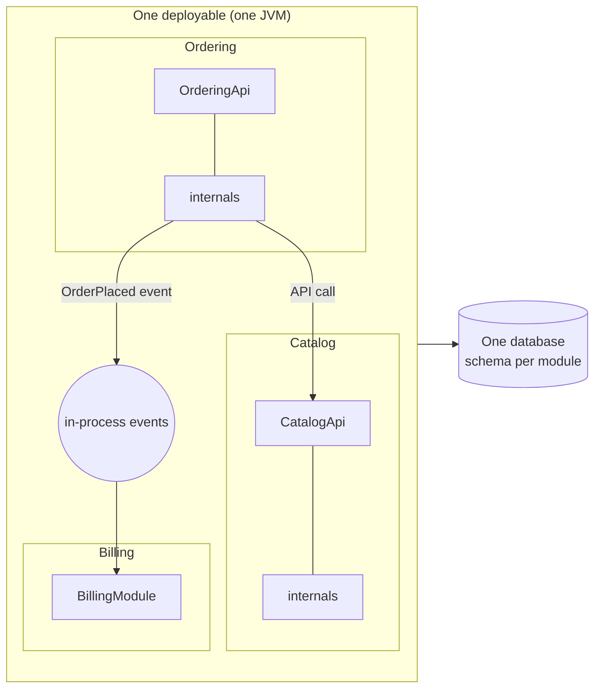

---
tags:
  - Architecture
  - Intermediate
---

# Modular Monolith

<span class="badge badge--intermediate">🟡 Intermediate</span>
<span class="badge badge--category">Architecture</span>
<span class="badge badge--interview">Interview frequency ⭐⭐⭐⭐</span>

!!! abstract "TL;DR"
    **One deployable application, split internally into modules along business capabilities. Each module has a small public API, hides its internals, owns its data, and talks to other modules through APIs or in-process events.**
    You get most of the design benefits of microservices (clear boundaries, team ownership) without the operational cost of distributed systems, and modules can be extracted into services later if needed.

---

## 1. Intent & Problem It Solves

**The problem in plain English:** a classic monolith turned into a "big ball of mud": any class calls any other, the billing code reads the catalog's tables, and a change anywhere can break anything. The usual reaction, "let's do microservices", trades that for network failures, distributed transactions and 30 deployment pipelines, often before anyone knows where the right boundaries are.

**Definition (Simon Brown; Spring Modulith documentation):**
> A modular monolith is a monolith that is built with well-defined, loosely coupled modules that align with business domains, enforced so that the modules don't depend on each other's internals.

| Rule | How it's enforced |
|---|---|
| Modules follow **business capabilities** | Package structure by domain (catalog, ordering, billing) |
| Modules expose a **small public API** | Package-private internals, Java modules (JPMS), Spring Modulith |
| No access to other modules' **internals or tables** | ArchUnit / Spring Modulith verification; schema per module |
| Communication via **API calls or events** | In-process events, ideally transactional |
| Acyclic module dependencies | Verified in CI (see the coding challenge) |

## 2. Real-World Analogy

!!! example "A department store vs. a mall"
    A department store (modular monolith) has separate departments, each with its own staff, stock room and manager, under one roof with one entrance and one checkout system. A mall (microservices) has independent shops with their own doors, tills and opening hours. The department store is cheaper to run; a department can later move out and become its own shop if it grows enough.

## 3. Structure



## 4. Naive Approach (Without the Pattern)

```java
// billing code in a big-ball-of-mud monolith
var product = productRepository.findById(sku);          // reaches into catalog internals
var order = em.createQuery("SELECT o FROM Order o JOIN Customer c ...");  // joins across domains
orderService.markInvoiced(order);                        // billing mutates ordering's state
```

---

## 5. Three Real-World Examples

### Example 1: Catalog, Ordering and Billing with Enforced Boundaries (Grocery)

**Scenario:** Each module is a Java package with **one public API** and package-private internals: code in other packages literally cannot reference `CatalogService` or `ProductTable`, because the compiler forbids it. Ordering calls `CatalogApi.priceOf()` and publishes `OrderPlaced`; billing reacts to the event and never depends on ordering.

**Full Code:**

=== "CatalogApi.java"

    ```java
    --8<-- "code/architecture/src/main/java/com/handbook/architecture/modular/shop/catalog/CatalogApi.java"
    ```

    1.  A **factory on the API**: the only way for other modules to get a catalog, without seeing its implementation.

=== "Catalog internals (package-private)"

    ```java
    --8<-- "code/architecture/src/main/java/com/handbook/architecture/modular/shop/catalog/CatalogService.java"
    ```

    ```java
    --8<-- "code/architecture/src/main/java/com/handbook/architecture/modular/shop/catalog/ProductTable.java"
    ```

=== "Ordering module"

    ```java
    --8<-- "code/architecture/src/main/java/com/handbook/architecture/modular/shop/ordering/OrderingApi.java"
    ```

    ```java
    --8<-- "code/architecture/src/main/java/com/handbook/architecture/modular/shop/ordering/OrderingService.java"
    ```

    1.  Ordering depends on catalog's **API**, never its tables.
    2.  Downstream reactions happen via an **event**, so ordering doesn't know billing exists.

=== "BillingModule.java"

    ```java
    --8<-- "code/architecture/src/main/java/com/handbook/architecture/modular/shop/billing/BillingModule.java"
    ```

    1.  Billing subscribes to the published event type; ArchUnit verifies billing never imports ordering.

=== "Shared events"

    ```java
    --8<-- "code/architecture/src/main/java/com/handbook/architecture/modular/shop/shared/ModuleEvents.java"
    ```

    ```java
    --8<-- "code/architecture/src/main/java/com/handbook/architecture/modular/shop/shared/OrderPlaced.java"
    ```

=== "ModularShopDemo.java"

    ```java
    --8<-- "code/architecture/src/main/java/com/handbook/architecture/modular/shop/ModularShopDemo.java"
    ```

**Output:**

```text
--8<-- "code/outputs/architecture/modular/shop/ModularShopDemo.txt"
```

**Why a modular monolith here:**

- Boundaries are **enforced by the compiler**, not by good intentions.
- One deployment, one database transaction where needed, simple debugging.
- Each module could become a service later, because its interactions are already explicit.

---

### Example 2: Extraction-Ready Events (HR & Payroll)

**Scenario:** HR publishes `EmployeeHired` through an `EventPublisher` port. In the monolith, the publisher delivers in-process to payroll. When payroll is extracted into its own service (different scaling, compliance and release needs), the **same HR module class** is wired with an outbox publisher instead. Only wiring changes.

**Full Code:**

=== "PayrollModules.java"

    ```java
    --8<-- "code/architecture/src/main/java/com/handbook/architecture/modular/payroll/PayrollModules.java"
    ```

    1.  HR publishes a fact; it doesn't know whether the subscriber is in the same JVM or behind Kafka.

=== "ExtractionReadyDemo.java"

    ```java
    --8<-- "code/architecture/src/main/java/com/handbook/architecture/modular/payroll/ExtractionReadyDemo.java"
    ```

**Output:**

```text
--8<-- "code/outputs/architecture/modular/payroll/ExtractionReadyDemo.txt"
```

**Why design for extraction:**

- You don't have to decide **now** which modules become services.
- Event-based integration between modules already looks like integration between services.

---

### Example 3: Verifying Module Boundaries in CI (Education platform)

**Scenario:** An LMS has modules `courses`, `enrollment`, `certificates` and `payments`, each declaring the modules it may depend on. A verifier (like Spring Modulith's `ApplicationModules.verify()`) checks dependencies found in the code against the declarations and flags undeclared dependencies and access to `internal` packages. The build fails until they're fixed.

**Full Code:**

=== "ModuleVerifier.java"

    ```java
    --8<-- "code/architecture/src/main/java/com/handbook/architecture/modular/verify/ModuleVerifier.java"
    ```

=== "ModuleVerifyDemo.java"

    ```java
    --8<-- "code/architecture/src/main/java/com/handbook/architecture/modular/verify/ModuleVerifyDemo.java"
    ```

**Output:**

```text
--8<-- "code/outputs/architecture/modular/verify/ModuleVerifyDemo.txt"
```

**Why verification matters:**

- Without automated checks, module boundaries erode within months.
- Declared dependencies double as documentation of the architecture.

---

??? example "Tests (ArchUnit: billing must not depend on ordering)"

    ```java
    --8<-- "code/architecture/src/test/java/com/handbook/architecture/ArchitectureRulesTest.java"
    ```

## 6. Variations & Modern Java Take

```java
// Spring Modulith (reference): each top-level package under the main package is a module
@SpringBootApplication
class ShopApplication { }

class ModularityTests {
    @Test
    void verifiesModuleStructure() {
        ApplicationModules.of(ShopApplication.class).verify();   // fails on cycles and internal access
    }
}

// In ordering: publish within the transaction
@Transactional
public String placeOrder(...) { ...; events.publishEvent(new OrderPlaced(id, customer, total)); }

// In billing: handled after commit, asynchronously, with a persisted event publication log
@ApplicationModuleListener
void on(OrderPlaced event) { invoices.create(event); }
```

| Option | Notes |
|---|---|
| **Package-private + ArchUnit** | Works everywhere; simplest |
| **Spring Modulith** | Module detection, verification, event publication registry, module integration tests, documentation |
| **Java Platform Module System** | `module-info.java` with `exports`; strongest encapsulation, more friction with frameworks |
| **Multi-module Maven/Gradle** | Separate build modules per business module; compile-time boundaries |
| **Schema per module** | Each module owns its tables; no cross-module joins |

## 7. Where It Lives in Real Frameworks

| Where | Modular monolith |
|---|---|
| Spring Modulith | `ApplicationModules`, `@ApplicationModuleListener`, `@ApplicationModuleTest` |
| Shopify's Rails monolith | Componentized into domain components with enforced boundaries (Packwerk) |
| JPMS | `module-info.java` exports/requires |
| ArchUnit / jMolecules | Rules for slices and cycles (`slices().should().beFreeOfCycles()`) |

## 8. Pros, Cons & Trade-offs

| ✅ Pros | ❌ Cons |
|---|---|
| **Simple operations**: one deploy, one runtime, local calls | **Shared fate**: one memory leak or bad deploy affects all modules |
| Clear boundaries, team ownership | Scaling is per application, not per module |
| Local transactions where needed | One technology stack for all modules |
| Easy refactoring of boundaries before they harden | Requires discipline and tooling to keep boundaries |
| Extraction to services is straightforward | Build and test times grow with size |

## 9. Pitfalls & Anti-Patterns

!!! danger "Modules by technical layer"
    `controllers`, `services`, `repositories` modules aren't business modules. Modules should be **capabilities** (catalog, ordering), with layers inside.

!!! danger "Shared tables"
    If billing queries ordering's tables, the modules are coupled through the database, and extraction later becomes a data migration project. One owner per table.

!!! warning "A giant 'common' module"
    Everything "shared" ends up in `common`, which everything depends on. Keep shared kernels tiny (IDs, money types, event contracts).

!!! warning "Synchronous chains between modules"
    A → B → C → D calls inside one request recreate a distributed monolith in-process. Prefer events for reactions.

## 10. Senior / Architect Deep Dive (10–15 yrs)

**"Monolith first."** Martin Fowler and others observe that many successful microservice systems started as monoliths whose boundaries were discovered over time. A modular monolith is how you do that deliberately: cheap to change boundaries while you learn the domain.

**When to extract a module.** Different scaling profile, different release cadence, different team, different compliance needs, or a different technology need. If none apply, keep it in.

**Transactional events.** Publishing events within the business transaction and handling them after commit, with a persisted publication log (Spring Modulith's event publication registry), gives outbox-like reliability inside the monolith, and makes the later switch to Kafka trivial.

### Explain it in 2 minutes (system design / architecture round)

> "For a new product with one or two teams, I'd start with a modular monolith in Spring Boot: modules per business capability (catalog, ordering, billing, customers), each with a small public API and package-private internals, owning its own schema. Modules integrate through APIs for queries and events for reactions, using Spring Modulith's transactional event publication. CI verifies module boundaries and forbids cycles. When a module needs independent scaling or a separate team, we extract it: its API becomes REST, its events go to Kafka via the outbox."

!!! bug "War story: microservices on day one"
    A startup split its MVP into 14 microservices before launch, with 4 engineers. Most features changed 3–5 services at once; local development needed 20 containers; a third of the engineering time went into infrastructure. Boundaries turned out to be wrong: "pricing" and "promotions" were constantly called together.
    **What they did:** merged into a modular monolith with 6 modules, enforced boundaries with ArchUnit, and later extracted only search (different scaling) and payments (compliance).
    **Lesson:** you can't design good service boundaries before you understand the domain. Modules let you learn cheaply.

## 11. Related Patterns & Comparisons

| | Modular monolith | Big ball of mud | Microservices |
|---|---|---|---|
| Deployables | 1 | 1 | Many |
| Boundaries | Enforced modules | None | Network |
| Transactions | Local where needed | Anywhere | Sagas |
| Operational cost | Low | Low | High |
| Changing boundaries | Cheap (refactor) | n/a | Expensive (migrate data, APIs) |

See [Decomposition](../microservices/decomposition.md), [Strangler Fig](../microservices/strangler-fig.md), [Database per Service](../microservices/database-per-service.md) and [Layered](layered.md).

## 12. Interview Corner

=== "🟢 Beginner / Service Companies"

    **Q1. What is a modular monolith?**

    A single deployable application divided into well-defined business modules with enforced boundaries.

    **Q2. How is it different from a normal monolith?**

    A normal monolith often has no enforced boundaries (any code calls any code); a modular monolith restricts modules to each other's public APIs.

    **Q3. Why not start with microservices?**

    Microservices add network, deployment and data-consistency complexity; boundaries are hard to get right early. A modular monolith keeps things simple while boundaries are learned.

    **Q4. How do modules communicate?**

    Through public APIs (method calls) and in-process events.

    **Q5. What is Spring Modulith?**

    A Spring project that detects, verifies, tests and documents modules in a Spring Boot application, and supports reliable module events.

=== "🟡 Mid-Level"

    **Q1. How do you enforce module boundaries in Java?**

    Package-private internals, ArchUnit/Spring Modulith verification, separate build modules, or JPMS.

    **Q2. How do you handle data in a modular monolith?**

    Each module owns its tables (ideally its own schema); no cross-module joins; other modules use its API or events.

    **Q3. When do you extract a module into a service?**

    When it needs independent scaling, deployment cadence, team ownership, technology or compliance isolation.

    **Q4. How do module events differ from Kafka events?**

    They're in-process (and can be transactional); with an event publication registry they're reliable. Semantically they should look like integration events so extraction is easy.

    **Q5. What's a sign of a bad module boundary?**

    Most changes touch several modules together, or modules call each other in long synchronous chains.

=== "🔴 Senior / FAANG / SAP"

    **Q1. "A CTO wants to move a 1M-line monolith to microservices. Your advice?"**

    First modularize in place: map capabilities, enforce boundaries, split data ownership, then extract only modules with a clear reason, using the strangler approach. Measure benefits along the way.

    **Q2. "How do you handle a cross-module transaction?"**

    Within the monolith, a local transaction is allowed if both modules agree, but prefer events with eventual consistency to keep extraction possible.

    **Q3. "How would you test module boundaries and behaviour?"**

    Verification tests (Spring Modulith `verify()`), module-slice integration tests (`@ApplicationModuleTest`) that bootstrap one module with mocks for others, plus scenario tests that publish events.

    **Q4. "How does Conway's law apply?"**

    Module boundaries should match team boundaries; one team per module (or a few modules) reduces coordination.

    **Q5. "What tooling would you put in CI?"**

    Module verification, cycle checks, ArchUnit rules for internal packages, schema access checks, and generated module documentation (C4/PlantUML from Spring Modulith).

=== "💻 Coding Challenge"

    **Problem:** Modules must form a **DAG**. Detect a dependency cycle and print it, or, if there's none, compute a valid build/initialization order with dependencies first.

    ??? success "Solution"

        === "ModuleGraph.java"

            ```java
            --8<-- "code/architecture/src/main/java/com/handbook/architecture/modular/cycles/ModuleGraph.java"
            ```

        === "CycleDemo.java"

            ```java
            --8<-- "code/architecture/src/main/java/com/handbook/architecture/modular/cycles/CycleDemo.java"
            ```

        **Output:**

        ```text
        --8<-- "code/outputs/architecture/modular/cycles/CycleDemo.txt"
        ```

        **Key points to say:** DFS with three colours finds back edges (cycles) in O(V + E); post-order DFS gives a topological order. To break a cycle, invert one dependency with an event or move the shared concept into its own module.

!!! info "Behavioural tie-in (STAR) for experienced candidates"
    - **S:** Our 600k-line monolith had 3 teams constantly breaking each other; leadership proposed a full microservices rewrite.
    - **T:** Restore team autonomy with less risk than a rewrite.
    - **A:** Proposed modularizing first: defined 7 modules with the teams, introduced module APIs, Spring Modulith verification with a shrinking violation baseline, and schema-per-module; extracted one module (search) that needed different scaling.
    - **R:** Cross-team breakages fell by 80% in two quarters; the rewrite was cancelled, saving an estimated 18 months.

## 13. Quick Revision Card

!!! tip "Remember in 30 seconds"
    - **One deployable, many business modules** with enforced boundaries.
    - Public API + hidden internals + own data per module.
    - APIs for queries, **events** for reactions; no cycles.
    - Verify in CI (Spring Modulith, ArchUnit).
    - Extract to services only when there's a reason.

## Practice

- [ ] Add a `shipping` module that reacts to `OrderPlaced` and exposes a `ShippingApi.eta(orderId)`.
- [ ] Add an ArchUnit rule that the modules under `modular.shop` are free of cycles (hint: `slices().matching(...).should().beFreeOfCycles()`).
- [ ] Make `ModuleEvents` record publications and re-deliver unhandled ones on restart (like Spring Modulith's registry).

---

[:material-arrow-left: Event-Driven Architecture](event-driven.md){ .md-button }
[Next: Pattern Selection Guide :material-arrow-right:](../pattern-selection-guide.md){ .md-button .md-button--primary }
