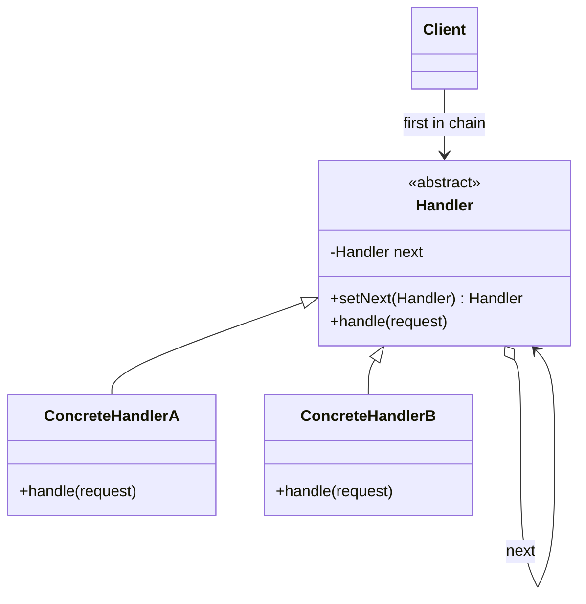
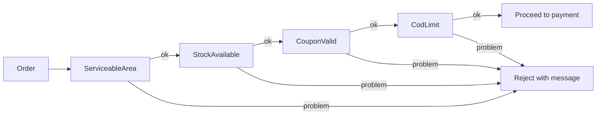
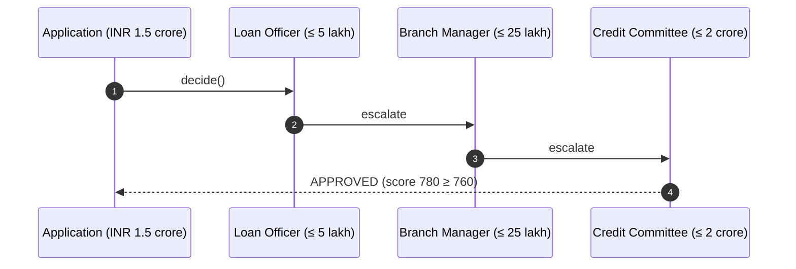
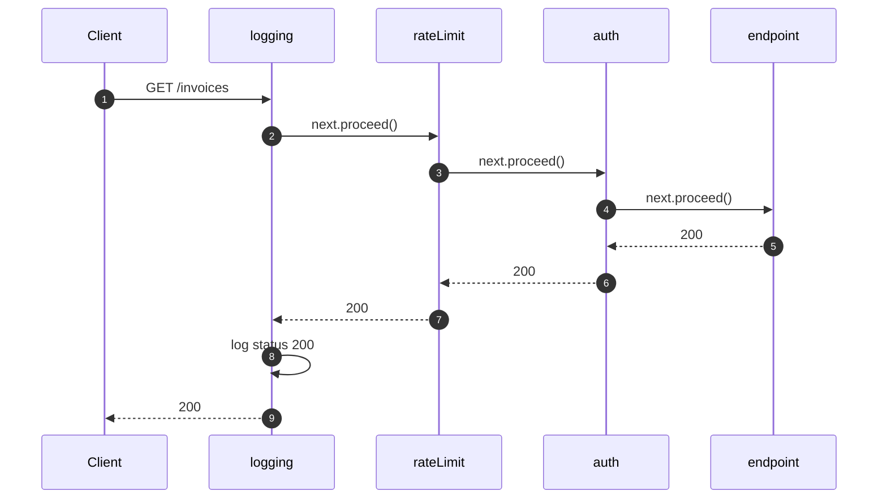

---
tags:
  - Behavioral
  - Intermediate
---

# Chain of Responsibility

<span class="badge badge--intermediate">🟡 Intermediate</span>
<span class="badge badge--category">Behavioral</span>
<span class="badge badge--interview">Interview frequency ⭐⭐⭐⭐</span>

!!! abstract "TL;DR"
    **Chain of Responsibility passes a request along a chain of handlers; each handler either handles it, rejects it, or passes it on.**
    Use it for validation pipelines, approval escalations, middleware/filters and support routing, wherever "who deals with this?" depends on the request.

---

## 1. Intent & Problem It Solves

**The problem in plain English:** a checkout must check the delivery area, stock, coupon and payment limits. Writing it as one method with 40 lines of `if`s makes it hard to reorder checks, reuse them in other flows (reorders, subscriptions), or add a new one (fraud). The sender shouldn't need to know **which** check will reject the order, or **how many** checks there are.

**Formal definition (GoF):**
> Avoid coupling the sender of a request to its receiver by giving more than one object a chance to handle the request. Chain the receiving objects and pass the request along the chain until an object handles it.

Two flavours appear in practice:

| Flavour | Behavior | Example |
|---|---|---|
| **Pure (GoF)** | Exactly **one** handler handles the request; the others pass it on | Loan approval escalation (Example 2), support routing (challenge) |
| **Pipeline / filter chain** | **Every** handler gets a turn and may **stop** the chain | Validation (Example 1), servlet filters / middleware (Example 3) |

## 2. Real-World Analogy

!!! example "Customer support escalation"
    Your question goes to the chatbot first. If it can't help, a level-1 agent. Then a specialist. Then engineering. You don't pick who answers; you just ask, and the request moves along until someone can deal with it.

## 3. Structure



| Participant | Responsibility |
|---|---|
| **Handler** | Interface for handling and a link to the next handler |
| **Concrete handler** | Handles what it's responsible for; otherwise forwards |
| **Client** | Builds the chain (or receives it) and sends requests to its **head** |

## 4. Naive Approach (Without the Pattern)

```java
String validate(Order o) {
    if (!PINCODES.contains(o.pincode())) return "not serviceable";
    if (stock.get(o.sku()) < o.qty()) return "out of stock";
    if (o.coupon() != null && !validCoupon(o)) return "bad coupon";
    if (o.amount() > 5000) return "COD limit";
    // fraud check? loyalty check? Insert somewhere in here and hope nothing breaks...
    return null;
}
```

- :material-close-circle:{ style="color:#e53935" } **One big method** that changes for every new rule (violates Open/Closed).
- :material-close-circle:{ style="color:#e53935" } Checks can't be **reused** or **reordered** per flow.
- :material-close-circle:{ style="color:#e53935" } Hard to test rules in isolation.

---

## 5. Three Real-World Examples

### Example 1: Checkout Validation Chain (Grocery)

**Scenario:** A quick-commerce app validates every order before payment: is the pincode serviceable, is there enough stock in the nearest dark store, is the coupon valid, is the cash-on-delivery limit respected? Checks are ordered **cheapest first** (a pincode lookup is cheaper than a stock call). The same validators are reused in different combinations for scheduled orders and subscriptions. The customer must see the **first** problem in plain language.

**Design:**



**Full Code:**

=== "CheckoutValidator.java"

    ```java
    --8<-- "code/behavioral/src/main/java/com/handbook/behavioral/chain/checkout/CheckoutValidator.java"
    ```

    1.  `then(...)` returns the **next** handler, so chains read left to right: `a.then(b).then(c)`.
    2.  **Short-circuit**: the first problem stops the chain. Later, more expensive checks never run.
    3.  No problem here: hand the order to the next validator. The end of the chain means "all good".

=== "Validators.java"

    ```java
    --8<-- "code/behavioral/src/main/java/com/handbook/behavioral/chain/checkout/Validators.java"
    ```

=== "Order.java"

    ```java
    --8<-- "code/behavioral/src/main/java/com/handbook/behavioral/chain/checkout/Order.java"
    ```

=== "CheckoutDemo.java"

    ```java
    --8<-- "code/behavioral/src/main/java/com/handbook/behavioral/chain/checkout/CheckoutDemo.java"
    ```

**Output:**

```text
--8<-- "code/outputs/behavioral/chain/checkout/CheckoutDemo.txt"
```

**Why Chain of Responsibility here:**

- Each rule is **one small class**; adding a fraud check is one class plus one `then(...)`.
- **Order is configuration**: cheapest first, and different flows can build different chains.
- The checkout screen only knows "the chain", not the rules.

---

### Example 2: Loan Approval Escalation (Banking)

**Scenario:** A bank's loan workflow routes each application to the **lowest authority** that can decide it: loan officers up to INR 5 lakh, branch managers up to INR 25 lakh, the credit committee up to INR 2 crore. Each level has its own credit-score threshold. Anything larger goes to the board. Authority limits change with regulation, so they must be easy to adjust.

**Design:**



**Full Code:**

=== "Approver.java"

    ```java
    --8<-- "code/behavioral/src/main/java/com/handbook/behavioral/chain/loan/Approver.java"
    ```

=== "Approvers.java"

    ```java
    --8<-- "code/behavioral/src/main/java/com/handbook/behavioral/chain/loan/Approvers.java"
    ```

=== "LoanDemo.java"

    ```java
    --8<-- "code/behavioral/src/main/java/com/handbook/behavioral/chain/loan/LoanDemo.java"
    ```

**Output:**

```text
--8<-- "code/outputs/behavioral/chain/loan/LoanDemo.txt"
```

**Why Chain of Responsibility here:**

- **Pure GoF form**: exactly one level decides; lower levels escalate.
- The applicant (client) doesn't know the hierarchy; it just submits.
- The end of the chain is handled **explicitly** ("refer to the board"): an unhandled request is a real outcome, not a silent `null`.

---

### Example 3: API Middleware (SaaS)

**Scenario:** A SaaS invoicing API runs every request through **logging**, **rate limiting** (here, 2 requests per IP for the demo) and **authentication** before the endpoint. Any step can stop the request (401, 429). Logging must see the **final** status, so it wraps everything. This is how servlet filters, Spring Security's filter chain, Express/Koa middleware and API gateways work.

**Design:**



**Full Code:**

=== "Middleware.java"

    ```java
    --8<-- "code/behavioral/src/main/java/com/handbook/behavioral/chain/middleware/Middleware.java"
    ```

    1.  The chain is built **back to front**: each middleware is wrapped around the "rest of the chain". Calling the result runs them front to back. This is how `jakarta.servlet.FilterChain` and Spring's `WebFilterChain` work.

=== "ApiGatewayDemo.java"

    ```java
    --8<-- "code/behavioral/src/main/java/com/handbook/behavioral/chain/middleware/ApiGatewayDemo.java"
    ```

    1.  Returning a response **without** calling `next` stops the chain.

**Output:**

```text
--8<-- "code/outputs/behavioral/chain/middleware/ApiGatewayDemo.txt"
```

**Why Chain of Responsibility here:**

- Cross-cutting request handling as **independent, ordered steps**.
- Each middleware can act **before and after** the rest of the chain (logging sees the final status).
- Lambdas make each step a few lines; order is a `List`, easy to change per route.

---

??? example "Unit Tests: `ChainTest.java`"

    ```java
    --8<-- "code/behavioral/src/test/java/com/handbook/behavioral/chain/ChainTest.java"
    ```

## 6. Variations & Modern Java Take

| Variation | Notes |
|---|---|
| **Linked handlers** (`next` field) | Classic GoF (Examples 1, 2) |
| **List of handlers + loop/stream** | Simpler to build and reorder: `handlers.stream().map(h -> h.apply(t)).flatMap(Optional::stream).findFirst()` (coding challenge) |
| **Wrapping chain** (`next.proceed()`) | Handlers act before **and** after (Example 3); also called "interceptor" |
| **Spring-assembled chains** | Inject `List<Validator>` with `@Order` on each bean; Spring sorts them |
| **Return type** | `Optional<Problem>`, a result type, or a sealed `Decision` (Approved / Rejected / Escalate) for clarity |

## 7. Where It Lives in Real Frameworks

| Where | Chain |
|---|---|
| Jakarta Servlet | `Filter` + `FilterChain.doFilter()` |
| Spring Security | `SecurityFilterChain` (around 15 filters: CSRF, authentication, authorization...) |
| Spring MVC | `HandlerInterceptor` (`preHandle`/`postHandle`), `HandlerExceptionResolver` chain |
| Spring WebFlux | `WebFilter` / `WebFilterChain` |
| Spring Cloud Gateway | `GatewayFilter` chains per route |
| JDK | `java.util.logging.Logger` passes records to parent loggers' handlers |
| OkHttp / Retrofit | `Interceptor` chains |
| Netty | `ChannelPipeline` of `ChannelHandler`s |

## 8. Pros, Cons & Trade-offs

| ✅ Pros | ❌ Cons |
|---|---|
| **Decouples** sender from receivers | A request may reach the end **unhandled**; you must design for that |
| Add, remove or **reorder** handlers without changing others (OCP) | Harder to **debug**: which handler did what? |
| Each handler is small and **testable** | Long chains add **latency** |
| Different chains per flow from the same handlers | Order dependencies between handlers are implicit and fragile |

## 9. Pitfalls & Anti-Patterns

!!! danger "Silent fall-through"
    A chain that ends without anyone handling the request, and returns `null`, hides bugs. Make the end of the chain explicit: a default handler, an exception, or a clear "unhandled" result.

!!! danger "Order-dependent handlers without documentation"
    Authentication must run before authorization; rate limiting usually before expensive auth calls. Write the order down and test it (see `middlewareRunsInOrderAndCanShortCircuit`).

!!! warning "Handlers that mutate the request"
    If handler 2 changes the order that handler 4 checks, reasoning becomes hard. Prefer immutable requests (records) and explicit enrichment steps.

!!! warning "Cycles in linked chains"
    `a.then(b); b.then(a);` loops forever. Build chains in one place, or use a list.

## 10. Senior / Architect Deep Dive (10–15 yrs)

**Configurable chains.** In enterprise systems (SAP-style workflows, insurance claims), chains are often **configured as data**: a list of rule IDs per product or country. The code provides handlers; operations choose the chain. Version the configuration and log which chain version decided each request; auditors will ask.

**Observability.** Emit a span or log per handler (OpenTelemetry), and record **which handler** stopped a request. "Why was this order rejected?" should be answerable from logs in seconds.

**Performance.** Order handlers by **cost and rejection probability**: cheap, frequently failing checks first. Run independent, expensive checks in **parallel** when you need all results (e.g., collecting all validation errors for a form), rather than as a sequential chain.

**Validation: first error vs. all errors.** Customer-facing forms want **all** errors at once; a payment pipeline wants to stop at the **first**. Same handlers, different traversal: return a list instead of short-circuiting.

!!! bug "War story: the filter that ran too late"
    A team added an expensive "tenant lookup" filter that called a database on every request, and registered it **before** the rate limiter. During a bot attack, rejected-but-counted requests still hit the database 50,000 times per second, and the database went down, taking legitimate traffic with it.
    **Fix:** moved rate limiting to the edge (API gateway) and to the first position in the app's filter chain; cached tenant lookups; added a test asserting the filter order.
    **Lesson:** in a chain, **position is policy**. Cheap rejections go first.

## 11. Related Patterns & Comparisons

| | Chain of Responsibility | Decorator | Command | Observer |
|---|---|---|---|---|
| Who handles? | **One** (pure) or each in turn, and **can stop** the chain | **All** layers, always forwarding | One receiver | **All** subscribers |
| Shape | Linear chain | Linear wrappers | Request object | One-to-many |
| Purpose | Decide **who** handles | **Add behavior** | Encapsulate a request | React to changes |

Chain + **Composite**: in UI frameworks, events bubble up the component tree (child → parent → window), a chain built from parent links.

## 12. Interview Corner

=== "🟢 Beginner / Service Companies"

    **Q1. What is Chain of Responsibility?**

    A behavioral pattern that passes a request along a **chain of handlers**; each handler **handles it or passes it to the next**. The sender doesn't know which handler will process it.

    **Q2. Give real examples.**

    **Servlet filters**, Spring Security's filter chain, logging levels, approval workflows, customer support escalation.

    **Q3. What happens if no handler handles the request?**

    It reaches the end of the chain. You should handle this **explicitly** with a default handler or an error, not silently ignore it.

    **Q4. Advantages?**

    **Loose coupling** between sender and receivers, easy to **add or reorder** handlers, **single responsibility** per handler.

    **Q5. Write a simple chain for logging levels (INFO, DEBUG, ERROR).**

    Abstract `Logger` with a `level` and `next`; `log(level, msg)` prints if `this.level <= level`, then forwards to `next`. Chain: `info.setNext(debug).setNext(error)`.

=== "🟡 Mid-Level"

    **Q1. Pure chain vs. pipeline?**

    **Pure**: exactly one handler processes the request (escalation). **Pipeline/filter**: every handler gets a turn and can stop it (validation, middleware).

    **Q2. How do servlet filters implement this?**

    Each `Filter.doFilter(req, res, chain)` does work, then calls `chain.doFilter()` to continue (or doesn't, to stop), and can do more work after it returns.

    **Q3. How do you build chains in Spring?**

    Inject `List<Handler>`; Spring orders beans by `@Order` / `Ordered`. Loop over the list, or link them at start-up.

    **Q4. How do you test a chain?**

    Each handler alone (accepts / rejects / forwards); then the **assembled chain** for order and short-circuit behavior.

    **Q5. Chain vs. Decorator?**

    Similar structure. Decorators **always forward** and add behavior; chain handlers may **stop** and their purpose is deciding who handles.

=== "🔴 Senior / FAANG / SAP"

    **Q1. "Design a configurable approval workflow engine (expenses, purchase orders) for many companies."**

    Handlers as **rules** (amount limits, cost centres, roles) configured per tenant as data; **versioned** chains; **escalation with timeouts** (manager doesn't respond in 48 h, so escalate); **parallel approvals** (finance AND legal); a full **audit trail**; idempotent state transitions; and a UI to simulate a chain before activating it.

    **Q2. "Design the request pipeline of an API gateway."**

    Ordered stages: TLS termination, **WAF/bot filtering**, **rate limiting** (cheap, first), authentication (JWT validation, cached keys), authorization, request transformation, routing, retries/circuit breaking, response transformation, logging/metrics. Discuss per-route chains, fail-open vs. fail-closed per stage, and latency budgets.

    **Q3. "A validation chain of 25 rules adds 400 ms. How do you speed it up?"**

    Profile per handler; reorder by **cost × rejection rate**; cache external lookups; run independent expensive checks **in parallel**; move rarely failing checks to async post-processing where the business allows it.

    **Q4. "Users want all validation errors at once, but payments want fail-fast. Same rules?"**

    Yes. Keep handlers **pure** (return problems, don't throw); provide two traversals, **collect-all** and **first-failure**, chosen by the flow.

    **Q5. "How do you make chains debuggable in production?"**

    Structured logs or trace spans per handler with a decision field; a correlation ID; record the **chain version** and the **handler that stopped** the request; expose a "dry run" endpoint that shows each handler's verdict.

=== "💻 Coding Challenge"

    **Problem (customer support):** Route tickets: the bot handles password resets; VIP customers go to the VIP desk; refunds go to L1 agents; crashes go to engineering. The **first** matching handler wins. Unmatched tickets go to L2 triage. Implement it without a class per handler.

    ??? success "Solution"

        === "SupportDemo.java"

            ```java
            --8<-- "code/behavioral/src/main/java/com/handbook/behavioral/chain/support/SupportDemo.java"
            ```

        **Output:**

        ```text
        --8<-- "code/outputs/behavioral/chain/support/SupportDemo.txt"
        ```

        **Key points to say:** handlers are `Function<Ticket, Optional<String>>`; a lazy stream with `findFirst()` stops at the first match (T2 is a crash, but VIP wins because that handler is earlier, so **order is policy**); the end of the chain has an explicit default.

!!! info "Behavioural tie-in (STAR) for experienced candidates"
    - **S:** Order validation was one 600-line method; adding a fraud check broke COD orders.
    - **T:** Make validation safe to extend and reuse across checkout, reorder and subscriptions.
    - **A:** Split it into 11 validator classes, assembled into ordered chains per flow from Spring `@Order` beans; added per-validator metrics.
    - **R:** New rules now ship in a day with isolated tests; metrics showed the slowest check, and reordering cut validation p99 by 60%.

## 13. Quick Revision Card

!!! tip "Remember in 30 seconds"
    - **Pass the request along** handlers until one handles it (or one stops it).
    - **Pure** (one handler decides) vs. **pipeline** (each may stop): know both.
    - **Order is policy**: cheap and likely rejections first; auth before authz.
    - Make **unhandled** requests explicit.
    - **Real life:** servlet `FilterChain`, Spring Security filters, interceptors, approval escalation.

    ```java
    chain = new ServiceableArea(); chain.then(new StockAvailable()).then(new CouponValid());
    ```

## Practice

- [ ] Add a fraud-score validator to Example 1 that calls a (fake) slow service, and decide where it goes.
- [ ] Change Example 1 to collect **all** problems instead of the first.
- [ ] Add a "Board" approver to Example 2 that needs two votes.
- [ ] Add a timing middleware to Example 3 that adds an `X-Response-Time` value to the response.

---

[:material-arrow-left: Behavioral overview](index.md){ .md-button }
[Next: Command :material-arrow-right:](command.md){ .md-button .md-button--primary }
