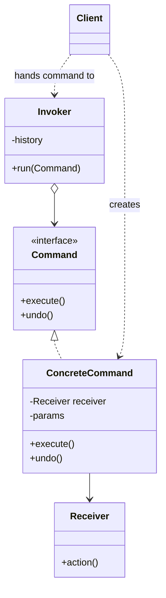
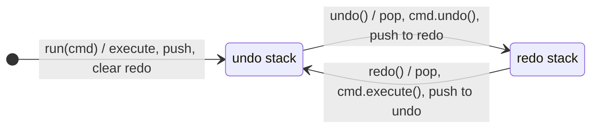
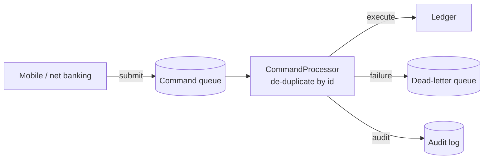
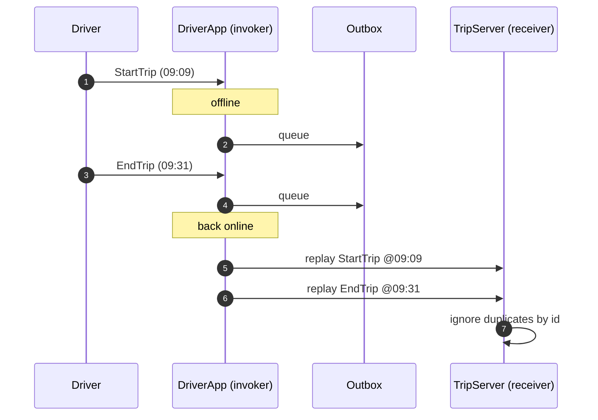

---
tags:
  - Behavioral
  - Intermediate
---

# Command

<span class="badge badge--intermediate">🟡 Intermediate</span>
<span class="badge badge--category">Behavioral</span>
<span class="badge badge--interview">Interview frequency ⭐⭐⭐⭐</span>

!!! abstract "TL;DR"
    **Command turns a request ("do this") into an object. Once it's an object, you can queue it, log it, retry it, send it over the network, replay it later, and undo it.**
    Use it for undo/redo, job queues, scheduled operations, offline-first apps, macros and audit trails.

---

## 1. Intent & Problem It Solves

**The problem in plain English:** when a button directly calls `doc.delete(0, 7)`, the action is gone the moment it runs. You can't undo it (what was deleted?), you can't queue it for later, and you can't send it to a server when the network comes back. If the action is instead an **object** (`new Delete(doc, 0, 7)`) holding everything needed to run it, and to reverse it, all of those become easy.

**Formal definition (GoF):**
> Encapsulate a request as an object, thereby letting you parameterize clients with different requests, queue or log requests, and support undoable operations.

## 2. Real-World Analogy

!!! example "A restaurant order slip"
    The waiter writes your order on a slip (**command**) and puts it on the kitchen rail (**queue**). The chef (**receiver**) cooks orders in sequence. The slip can be read again for the bill (**log**), corrected (**undo**: "cancel the dessert"), or re-made if dropped (**retry**). The waiter (**invoker**) never needs to know how to cook.

## 3. Structure



| Participant | Responsibility |
|---|---|
| **Command** | `execute()` (and optionally `undo()`) |
| **Concrete command** | Holds the **receiver and parameters**; calls the receiver |
| **Receiver** | Does the actual work (`Document`, `Ledger`) |
| **Invoker** | Runs commands and may store, queue, retry or undo them (`Editor`, `CommandProcessor`) |
| **Client** | Creates commands and gives them to the invoker |

## 4. Naive Approach (Without the Pattern)

```java
deleteButton.onClick(() -> doc.delete(selectionStart, selectionLength));   // can't undo: what was deleted?
payButton.onClick(() -> ledger.debit(acc, amount));                         // runs now or never; no queue, no retry
```

- :material-close-circle:{ style="color:#e53935" } **No undo**: nothing remembers what happened.
- :material-close-circle:{ style="color:#e53935" } **No queueing or scheduling**: the action is a method call, not data.
- :material-close-circle:{ style="color:#e53935" } **UI tied to business logic**: buttons know how operations are done.

---

## 5. Three Real-World Examples

### Example 1: Undo / Redo in a Document Editor (SaaS)

**Scenario:** A Google-Docs-style editor supports unlimited undo and redo. Each edit is a command that knows how to reverse itself: an insert is undone by deleting the inserted text; a delete is undone by re-inserting the text **it removed** (which it must remember). A new edit after an undo **clears** the redo history, as every editor does.

**Design:**



**Full Code:**

=== "EditCommand.java"

    ```java
    --8<-- "code/behavioral/src/main/java/com/handbook/behavioral/command/editor/EditCommand.java"
    ```

    1.  The command **remembers what it removed** during `execute()` so `undo()` can put it back. Commands often need a little state like this.

=== "Editor.java"

    ```java
    --8<-- "code/behavioral/src/main/java/com/handbook/behavioral/command/editor/Editor.java"
    ```

    1.  A new edit **invalidates** the redo history: redoing an old edit on top of a new one would corrupt the document.

=== "Document.java"

    ```java
    --8<-- "code/behavioral/src/main/java/com/handbook/behavioral/command/editor/Document.java"
    ```

=== "EditorDemo.java"

    ```java
    --8<-- "code/behavioral/src/main/java/com/handbook/behavioral/command/editor/EditorDemo.java"
    ```

**Output:**

```text
--8<-- "code/outputs/behavioral/command/editor/EditorDemo.txt"
```

**Why Command here:**

- Undo needs **objects that remember** what they did.
- The `Editor` (invoker) manages history without knowing what an insert or delete is.
- New edit types (format bold, insert image) plug in with their own `undo()`.

---

### Example 2: Nightly Batch of Scheduled Payments (Banking)

**Scenario:** A bank lets customers schedule transfers, bill payments and mobile recharges. At night, a batch job executes them. Commands are **data** (records), so they can be stored in a database, audited and replayed. Mobile clients sometimes resend the same instruction after a timeout, so each command has an **ID**, and duplicates are skipped. Failed commands (insufficient funds) go to a **dead-letter queue** for customer notification, without stopping the batch.

**Design:**



**Full Code:**

=== "CommandProcessor.java"

    ```java
    --8<-- "code/behavioral/src/main/java/com/handbook/behavioral/command/banking/CommandProcessor.java"
    ```

    1.  **Submit now, execute later**: the request is stored as an object. In production this queue is a database table or a Kafka topic.
    2.  **Idempotency**: the command's ID makes a resent command harmless. This matters far more than undo in real payment systems.
    3.  Commands here are pure data, and the processor dispatches with an exhaustive `switch` over a **sealed** interface. This "commands as data + handler" style is how CQRS command handlers and job queues usually look.

=== "PaymentCommand.java"

    ```java
    --8<-- "code/behavioral/src/main/java/com/handbook/behavioral/command/banking/PaymentCommand.java"
    ```

=== "Ledger.java"

    ```java
    --8<-- "code/behavioral/src/main/java/com/handbook/behavioral/command/banking/Ledger.java"
    ```

=== "BankingDemo.java"

    ```java
    --8<-- "code/behavioral/src/main/java/com/handbook/behavioral/command/banking/BankingDemo.java"
    ```

**Output:**

```text
--8<-- "code/outputs/behavioral/command/banking/BankingDemo.txt"
```

**Why Command here:**

- Requests must be **stored, scheduled, audited and replayed**, so they need to be data.
- **De-duplication** by command ID makes retries safe.
- Failures are isolated per command (dead-letter), not per batch.

---

### Example 3: Offline Driver App (Ride-hailing)

**Scenario:** Drivers lose signal in tunnels, basements and rural roads. The driver app must keep working: "start trip" and "end trip" are recorded as commands with their **original timestamps** and **IDs**, queued in an outbox while offline, and **replayed in order** when the network returns. Flaky networks sometimes deliver the same action twice, so the server applies each action ID only once. Fares must use the real trip times, not the replay time.

**Design:**



**Full Code:**

=== "DriverApp.java"

    ```java
    --8<-- "code/behavioral/src/main/java/com/handbook/behavioral/command/offline/DriverApp.java"
    ```

    1.  Replay **in the original order**, so the server sees start before end. Real apps persist the outbox to local storage (SQLite) so it survives an app restart.

=== "DriverAction.java"

    ```java
    --8<-- "code/behavioral/src/main/java/com/handbook/behavioral/command/offline/DriverAction.java"
    ```

=== "TripServer.java"

    ```java
    --8<-- "code/behavioral/src/main/java/com/handbook/behavioral/command/offline/TripServer.java"
    ```

=== "OfflineDemo.java"

    ```java
    --8<-- "code/behavioral/src/main/java/com/handbook/behavioral/command/offline/OfflineDemo.java"
    ```

**Output:**

```text
--8<-- "code/outputs/behavioral/command/offline/OfflineDemo.txt"
```

**Why Command here:**

- Actions must **outlive the moment** they happen: queued, persisted, replayed.
- Each command carries its **own context** (time, IDs), so replays are accurate.
- The same command objects travel from phone to server, which is the basis of offline-first sync.

---

??? example "Unit Tests: `CommandTest.java` (all three examples + challenge)"

    ```java
    --8<-- "code/behavioral/src/test/java/com/handbook/behavioral/command/CommandTest.java"
    ```

## 6. Variations & Modern Java Take

| Variation | Notes |
|---|---|
| **Lambdas as commands** | `Runnable`, `Callable`, `Supplier` are commands without undo: `executor.submit(() -> sendEmail(order))` |
| **Commands as data + handler** (Example 2) | Records + sealed interface + `switch`; serializable; the CQRS style |
| **Undoable commands** (Example 1) | `execute()` + `undo()`; commands store what they need to reverse |
| **Macro commands** (coding challenge) | A composite command that runs steps in order and undoes them in reverse |
| **Compensating commands** | When undo is impossible (an email was sent), issue a new command that compensates (send a correction); see **Saga** |

## 7. Where It Lives in Real Frameworks

| Where | Command |
|---|---|
| JDK | `Runnable`, `Callable` submitted to `ExecutorService`; `TimerTask` |
| Swing | `Action` / `AbstractAction` (one action used by a menu item, a toolbar button and a shortcut) and `UndoManager` / `UndoableEdit` |
| Spring Batch | `Tasklet`, `Step` |
| Spring Shell / picocli | CLI commands as objects |
| Axon Framework | `@CommandHandler` with command objects (CQRS) |
| Message queues | Kafka/RabbitMQ messages carrying commands ("ReserveStock") to handlers |
| Hystrix (legacy) | `HystrixCommand`: every remote call wrapped as a command object |

## 8. Pros, Cons & Trade-offs

| ✅ Pros | ❌ Cons |
|---|---|
| **Undo/redo**, queueing, scheduling, logging and retries | **More classes** (one per operation) unless you use lambdas or records |
| Decouples **who asks** from **who does** | Undo logic can be hard (or impossible for external side effects) |
| Commands can be **composed** (macros) | Command history uses memory; bound it |
| Serializable commands enable **distributed** and **offline** processing | Replaying old commands after schema changes needs **versioning** |

## 9. Pitfalls & Anti-Patterns

!!! danger "Non-idempotent replays"
    Queued commands get retried and duplicated. Without an ID and de-duplication (Examples 2 and 3), retries double-charge customers.

!!! danger "Undo that doesn't really undo"
    "Undo send email" is impossible. Be honest: offer **compensation** (send a correction) or a **delay** before executing (Gmail's "Undo send" just waits a few seconds).

!!! warning "Commands that capture mutable state"
    A command holding a reference to a mutable `Cart` may see different data when it runs later. Capture **values** (IDs, amounts) at creation time.

!!! warning "Unbounded history"
    Infinite undo stacks in long editing sessions eat memory. Limit them, or compact old commands into snapshots (see **Memento**).

## 10. Senior / Architect Deep Dive (10–15 yrs)

**Commands vs. events.** A **command** is a request that may be rejected ("ReserveStock", imperative). An **event** is a fact that already happened ("StockReserved", past tense). CQRS systems receive commands, validate them against the current state, and emit events. Mixing the two up leads to confusing systems; be precise in design reviews.

**Command queues at scale.** Persist commands **before** acknowledging (transactional outbox), process with **at-least-once** delivery, make handlers **idempotent**, partition by entity (account ID) to keep per-entity ordering, and route poison commands to a **dead-letter queue** with alerting.

**Collaborative editing.** Undo in a multi-user editor is hard: Alice's undo must not revert Bob's later edits. Real editors (Google Docs, Figma) use **Operational Transformation** or **CRDTs**, transforming commands against concurrent ones. Mentioning this shows depth.

**Versioning.** Stored commands outlive code. Include a **schema version** in each command and keep handlers able to read old versions, or migrate the queue during deploys.

!!! bug "War story: the batch that paid twice"
    A bank's scheduled-payments batch crashed halfway through. The operator re-ran the whole batch. Commands had no IDs, so the first half executed **again**: about 8,000 customers paid their bills twice, and refunds took a week.
    **Fix:** every command got a unique ID stored with a "processed" marker in the same database transaction as the ledger update; the processor skips processed IDs; re-running a batch became safe by design.
    **Lesson:** if a command can be stored, it can be replayed. Idempotency isn't optional.

## 11. Related Patterns & Comparisons

| | Command | Strategy | Memento | Chain of Responsibility |
|---|---|---|---|---|
| Object represents | A **request** (what to do) | An **algorithm** (how to do it) | A **state snapshot** | A **handler** |
| Typical use | Undo, queue, log, schedule | Swap behavior | Restore state | Decide who handles |
| Undo approach | Inverse operation | N/A | Restore a snapshot | N/A |

Command + **Memento**: undo by restoring a snapshot when an inverse operation is hard to write. Command + **Composite**: macro commands. Command + **Observer**: command handlers publish events.

## 12. Interview Corner

=== "🟢 Beginner / Service Companies"

    **Q1. What is the Command pattern?**

    A behavioral pattern that **encapsulates a request as an object**, so requests can be **parameterized, queued, logged and undone**.

    **Q2. Name the participants.**

    **Command** (interface), **Concrete command** (holds receiver + parameters), **Receiver** (does the work), **Invoker** (runs commands), **Client** (creates them).

    **Q3. How do you implement undo?**

    Each command implements `undo()` that reverses `execute()`; the invoker keeps a **stack** of executed commands and pops one to undo.

    **Q4. Give Java examples.**

    `Runnable`/`Callable` in `ExecutorService`, Swing `Action`, and `UndoManager`.

    **Q5. Advantage over calling methods directly?**

    **Decoupling** (the invoker doesn't know the receiver), and requests become **data** you can store, delay, retry or undo.

=== "🟡 Mid-Level"

    **Q1. How would you implement redo?**

    Two stacks: undo pops from the **undo stack**, calls `undo()`, pushes to the **redo stack**; redo does the reverse; a **new** command clears the redo stack.

    **Q2. What is a macro command?**

    A command made of other commands (**Composite**); `execute()` runs them in order and `undo()` undoes them in **reverse** order.

    **Q3. How do you make queued commands safe to retry?**

    Give each command a **unique ID** and make handlers **idempotent** (record processed IDs atomically with the effect).

    **Q4. Command vs. Strategy?**

    A command represents **what** to do (a request, often with its data); a strategy represents **how** to do something (an interchangeable algorithm).

    **Q5. How do lambdas relate to Command?**

    A lambda is a command with only `execute()`. Use lambdas for fire-and-forget tasks; use classes or records when you need undo, IDs, serialization or logging.

=== "🔴 Senior / FAANG / SAP"

    **Q1. "Design a job scheduling system (like a distributed cron) for millions of jobs."**

    Jobs as **persisted commands** (type, payload, schedule, idempotency key); time-partitioned storage or a delay queue; **leasing** workers with heartbeats; **at-least-once** execution with idempotent handlers; retries with backoff; **dead-letter** queues; per-tenant fairness; observability per job type.

    **Q2. "Commands vs. events in CQRS: walk me through a 'place order' flow."**

    `PlaceOrder` **command** goes to a handler that validates against the aggregate state and emits `OrderPlaced` (**event**), stored in an event store or table plus an outbox; projections update read models; other services react to the event. Commands can fail; events are facts.

    **Q3. "How would you implement undo in a collaborative editor?"**

    Per-user undo stacks of **operations**; undo generates an **inverse operation** that is **transformed** (OT) or merged (CRDT) against concurrent operations from others; don't revert other users' work.

    **Q4. "Stored commands from last year fail to deserialize after a refactor. Prevent it."**

    **Schema versioning** in every command; tolerant readers; **upcasters** that convert old versions; contract tests with stored samples of every version; never reuse field meanings.

    **Q5. "An offline-first mobile app syncs commands to the server. What can go wrong?"**

    Duplicates (use IDs), **ordering** (sequence numbers per device), **conflicts** (server state changed meanwhile; need conflict resolution rules), **clock skew** (server validates times), stale permissions, and very old queued commands (expire them).

=== "💻 Coding Challenge"

    **Problem (grocery):** "Reorder my usual" adds several items to the cart in one tap. Implement it as a **macro command** whose undo removes exactly what it added, leaving items that were already in the cart untouched.

    ??? success "Solution"

        === "CartCommands.java"

            ```java
            --8<-- "code/behavioral/src/main/java/com/handbook/behavioral/command/cart/CartCommands.java"
            ```

        === "MacroDemo.java"

            ```java
            --8<-- "code/behavioral/src/main/java/com/handbook/behavioral/command/cart/MacroDemo.java"
            ```

        **Output:**

        ```text
        --8<-- "code/outputs/behavioral/command/cart/MacroDemo.txt"
        ```

        **Key points to say:** the macro is a **Composite** of commands; undo runs in **reverse** order; each `AddItem` undoes only its own quantity, so the banana that was already there stays. Follow-up: if a step fails halfway, undo the steps that already ran (transactional macro).

!!! info "Behavioural tie-in (STAR) for experienced candidates"
    - **S:** Re-running a failed payments batch double-paid 8,000 bills.
    - **T:** Make batch re-runs safe and restore customer trust.
    - **A:** Introduced command IDs with processed markers written in the same transaction as ledger entries, a dead-letter queue for failures, and a runbook that says "re-run freely".
    - **R:** Zero duplicate payments in the 18 months since, including 3 more batch crashes that were simply re-run.

## 13. Quick Revision Card

!!! tip "Remember in 30 seconds"
    - **Request as an object**: queue it, log it, schedule it, retry it, undo it.
    - **Receiver** does the work; **invoker** runs and stores commands.
    - **Undo/redo** = two stacks; a new command clears redo.
    - Stored commands need **IDs + idempotency** and **versioning**.
    - **Command ≠ event**: a request vs. a fact.

    ```java
    editor.run(new Insert(doc, 0, "Hello")); editor.undo(); editor.redo();
    ```

## Practice

- [ ] Add a `Bold` formatting command to the editor and limit the undo history to 100 entries.
- [ ] Persist the banking queue to a file and resume after a simulated crash without double execution.
- [ ] Make the driver app's outbox reject actions older than 24 hours on replay.
- [ ] Make `Macro.execute()` roll back the steps already run if one step throws.

---

[:material-arrow-left: Chain of Responsibility](chain-of-responsibility.md){ .md-button }
[Next: Interpreter :material-arrow-right:](interpreter.md){ .md-button .md-button--primary }
