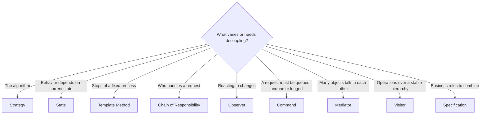

# Behavioral Patterns

Behavioral patterns are about **how objects collaborate and share responsibility**: who decides, who reacts, and how requests and changes flow through a system.

| Pattern | Problem it solves | Interview frequency | Status |
|---|---|---|---|
| [Chain of Responsibility](chain-of-responsibility.md) | Pass a request along handlers until one deals with it | ⭐⭐⭐⭐ | ✅ |
| [Command](command.md) | Turn a request into an object (queue, undo, log, retry) | ⭐⭐⭐⭐ | ✅ |
| [Interpreter](interpreter.md) | Evaluate sentences in a small language (rules, filters) | ⭐⭐ | ✅ |
| [Iterator](iterator.md) | Traverse a collection without exposing its structure | ⭐⭐⭐ | ✅ |
| [Mediator](mediator.md) | Centralize complex communication between objects | ⭐⭐⭐ | ✅ |
| [Memento](memento.md) | Capture and restore an object's state (undo, drafts) | ⭐⭐⭐ | ✅ |
| [Observer](observer.md) | Notify many objects when one changes | ⭐⭐⭐⭐⭐ | ✅ |
| [State](state.md) | Change behavior when internal state changes | ⭐⭐⭐⭐⭐ | ✅ |
| [Strategy](strategy.md) | Swap algorithms at runtime | ⭐⭐⭐⭐⭐ | ✅ |
| [Template Method](template-method.md) | Fixed algorithm skeleton, customizable steps | ⭐⭐⭐⭐ | ✅ |
| [Visitor](visitor.md) | Add operations to a class hierarchy without changing it | ⭐⭐⭐ | ✅ |
| [Null Object](null-object.md) | Replace `null` checks with a do-nothing object | ⭐⭐⭐ | ✅ |
| [Specification](specification.md) | Combine business rules with and/or/not | ⭐⭐⭐ | ✅ |

