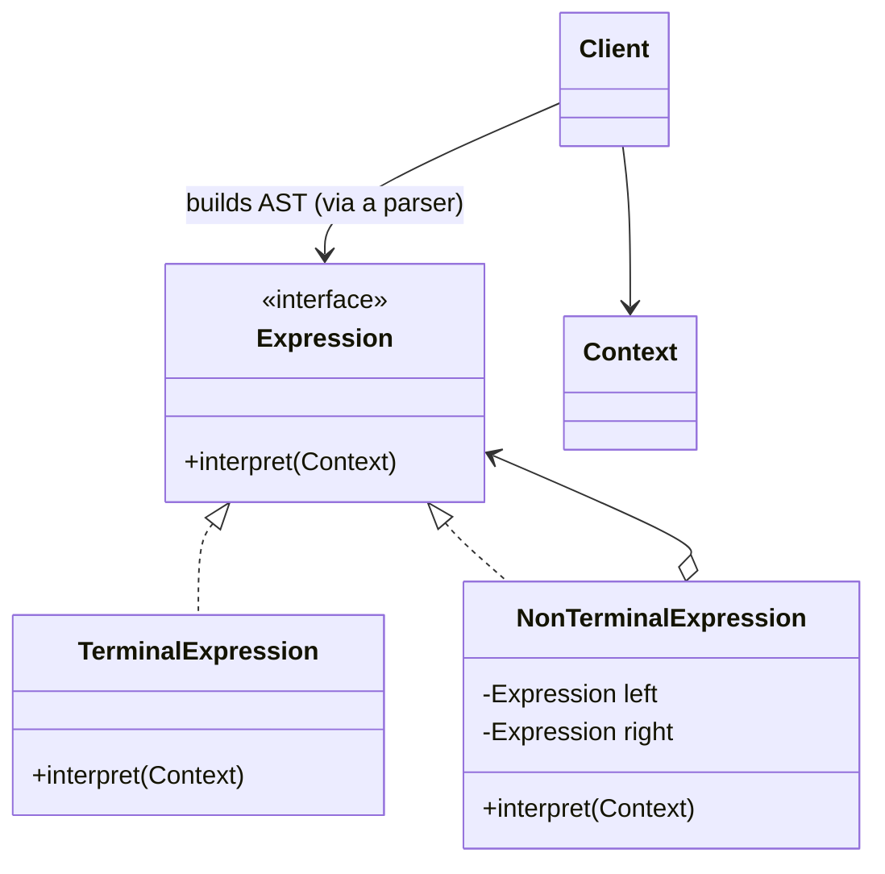
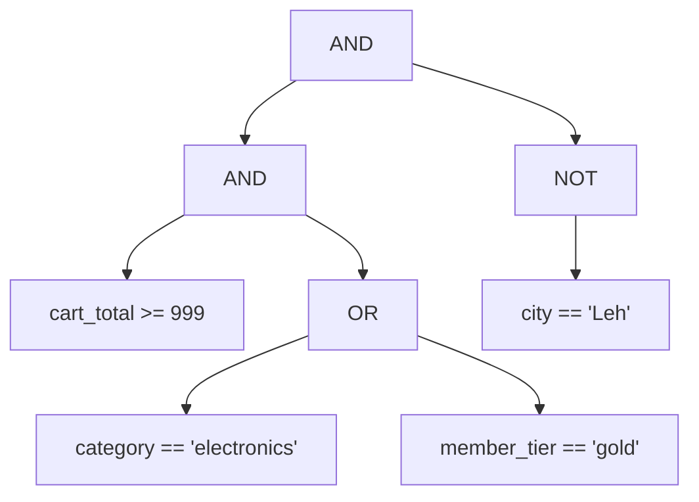
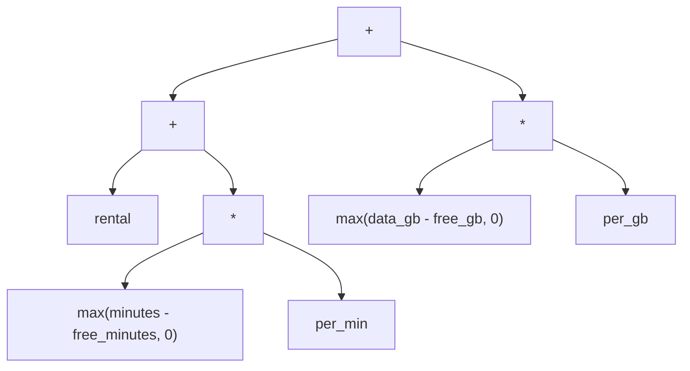
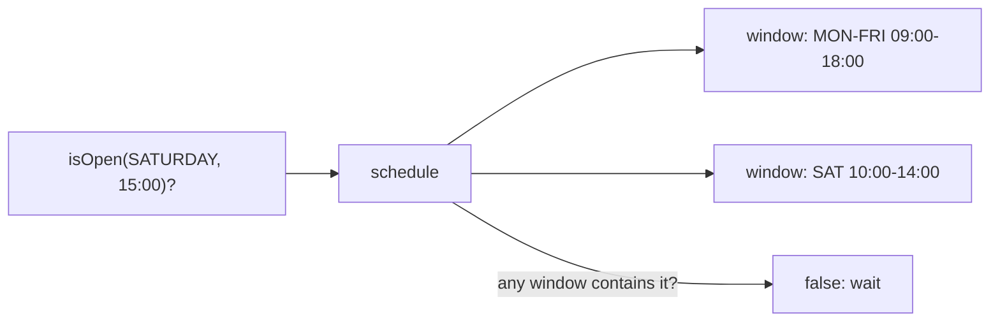

---
tags:
  - Behavioral
  - Advanced
---

# Interpreter

<span class="badge badge--advanced">🔴 Advanced</span>
<span class="badge badge--category">Behavioral</span>
<span class="badge badge--interview">Interview frequency ⭐⭐</span>

!!! abstract "TL;DR"
    **Interpreter represents the grammar of a small language as a tree of objects, where each node knows how to evaluate itself.**
    Use it for small, stable domain-specific languages (DSLs): promo rules, pricing formulas, search filters, schedules. Business people write the rules; your code runs them.

---

## 1. Intent & Problem It Solves

**The problem in plain English:** marketing changes promotion rules every week: "carts over INR 999 in electronics, or for gold members, except in Leh". If every rule is Java code, every change needs a developer, a review and a deployment. If rules are **text** in a small language that your system can **interpret**, marketing can change them through an admin screen.

**Formal definition (GoF):**
> Given a language, define a representation for its grammar along with an interpreter that uses the representation to interpret sentences in the language.

**How it works:**

1. **Parse** the text into an **abstract syntax tree (AST)**: one object per grammar construct.
2. **Interpret**: call `eval()` / `matches()` on the root; each node evaluates its children and combines the results.

| Grammar part | Node type | Example |
|---|---|---|
| **Terminal** (no children) | A value or a leaf test | `cart_total >= 999`, a number, a variable |
| **Non-terminal** (has children) | Combines other expressions | `AND`, `OR`, `+`, `max(a, b)` |

## 2. Real-World Analogy

!!! example "Musical notation"
    Sheet music is a small language. Notes are terminals; bars, repeats and chords combine them. A musician (the interpreter) reads the score and produces sound. Composers write new pieces without changing the musician.

## 3. Structure



| Participant | Responsibility |
|---|---|
| **Expression** | `interpret(context)` |
| **Terminal expression** | Leaf of the grammar (a comparison, a number) |
| **Non-terminal expression** | Composite node (AND, +, function call) |
| **Context** | Input data (cart fields, variables, date and time) |
| **Parser** | Turns text into the AST (not part of GoF's pattern, but always needed in practice) |

The AST is a **Composite**; the interpreter is a recursive walk over it.

## 4. Naive Approach (Without the Pattern)

```java
boolean offerApplies(Cart c) {
    // Changed every week by a developer, after a ticket from marketing:
    return c.total() >= 999 && (c.category().equals("electronics") || c.tier().equals("gold"))
            && !c.city().equals("Leh");
}
```

- :material-close-circle:{ style="color:#e53935" } **Every rule change is a code change** and a deployment.
- :material-close-circle:{ style="color:#e53935" } Business users can't see, test or own the rules.
- :material-close-circle:{ style="color:#e53935" } Rules can't vary per country or campaign without more `if`s.

---

## 5. Three Real-World Examples

### Example 1: Promo Rules Written by Marketing (E-commerce)

**Scenario:** An e-commerce site's promotions team defines eligibility rules in an admin UI using a tiny language: comparisons (`>=`, `==`), `AND`, `OR`, `NOT` and parentheses. Rules are stored as text, parsed once when saved (so typos are rejected immediately), and evaluated against every cart. `AND` must bind tighter than `OR`, as in every programming language, or rules will silently mean something else.

**Design:**



**Full Code:**

=== "Rule.java"

    ```java
    --8<-- "code/behavioral/src/main/java/com/handbook/behavioral/interpreter/promo/Rule.java"
    ```

    1.  **The interpreter method.** Every node evaluates itself against the cart context; non-terminals delegate to their children.
    2.  The **terminal** expression: a single comparison. A missing field means "no match" rather than an error, which is a deliberate rule-language decision.

=== "RuleParser.java"

    ```java
    --8<-- "code/behavioral/src/main/java/com/handbook/behavioral/interpreter/promo/RuleParser.java"
    ```

=== "PromoDemo.java"

    ```java
    --8<-- "code/behavioral/src/main/java/com/handbook/behavioral/interpreter/promo/PromoDemo.java"
    ```

**Output:**

```text
--8<-- "code/outputs/behavioral/interpreter/promo/PromoDemo.txt"
```

The printed AST makes precedence visible: the parser grouped `OR` inside the parentheses and `AND` everywhere else, exactly as written.

**Why Interpreter here:**

- Rules change **weekly** and belong to **business users**.
- A **small grammar** (4 constructs) is easy to parse, document and test.
- Parsing on save gives **immediate feedback**; evaluation per cart is a cheap tree walk.

---

### Example 2: Tariff Formulas (Telecom)

**Scenario:** A telecom operator's pricing team defines postpaid bills as formulas: rental, plus extra minutes beyond the free allowance, plus extra data beyond the free GB, and roaming capped at a maximum. Tariffs change with every marketing campaign and regulatory update. Formulas are stored in the product catalogue and evaluated for millions of customers at month-end, so they're **parsed once** and the AST is reused.

**Design:**



**Full Code:**

=== "Formula.java"

    ```java
    --8<-- "code/behavioral/src/main/java/com/handbook/behavioral/interpreter/billing/Formula.java"
    ```

=== "FormulaParser.java"

    ```java
    --8<-- "code/behavioral/src/main/java/com/handbook/behavioral/interpreter/billing/FormulaParser.java"
    ```

=== "BillingDemo.java"

    ```java
    --8<-- "code/behavioral/src/main/java/com/handbook/behavioral/interpreter/billing/BillingDemo.java"
    ```

**Output:**

```text
--8<-- "code/outputs/behavioral/interpreter/billing/BillingDemo.txt"
```

Heavy user: 399 + (420 − 300) × 1 + (26.5 − 20) × 50 = 399 + 120 + 325 = **INR 844**.

!!! warning "Money and `double`"
    The demo uses `double` to keep the grammar small. A real billing interpreter evaluates with `BigDecimal` and an explicit rounding rule per tariff.

**Why Interpreter here:**

- Pricing is **data owned by the pricing team**, not code.
- **Parse once, evaluate millions of times**: the AST is built at load time.
- New functions (`ceil`, `if`) are new node types; existing formulas keep working.

---

### Example 3: Warehouse Receiving Hours (Logistics)

**Scenario:** A logistics network has hundreds of warehouses and hubs, each with receiving hours like `MON-FRI 09:00-18:00, SAT 10:00-14:00`, or night hubs with `FRI-MON 22:00-23:59` (wrapping around the weekend). Trucks are routed only to sites that will accept them on arrival. Hours are edited by site managers as text, and the routing engine must interpret them.

**Design:**



**Full Code:**

=== "OpeningHours.java"

    ```java
    --8<-- "code/behavioral/src/main/java/com/handbook/behavioral/interpreter/hours/OpeningHours.java"
    ```

=== "HoursDemo.java"

    ```java
    --8<-- "code/behavioral/src/main/java/com/handbook/behavioral/interpreter/hours/HoursDemo.java"
    ```

**Output:**

```text
--8<-- "code/outputs/behavioral/interpreter/hours/HoursDemo.txt"
```

**Why Interpreter here:**

- A **familiar notation** (like OpenStreetMap's `opening_hours`) that site managers already understand.
- The grammar is tiny: windows (terminals) combined by "any of" (a non-terminal).
- Edge cases (week wrap-around, exclusive end times) are handled **once**, in the interpreter, and tested.

---

??? example "Unit Tests: `InterpreterTest.java` (all three examples + challenge)"

    ```java
    --8<-- "code/behavioral/src/test/java/com/handbook/behavioral/interpreter/InterpreterTest.java"
    ```

## 6. Variations & Modern Java Take

- **Sealed interfaces + records for ASTs** (all examples): concise, immutable nodes with exhaustive pattern matching.
- **Separate evaluation from the tree with a Visitor or `switch`**: `eval(node)` as a switch over sealed node types lets you add operations (pretty-print, optimize, translate to SQL) without touching the nodes.
- **Compile instead of interpret**: turn the AST into a lambda tree once (`Predicate<Cart>`), and evaluation becomes plain method calls.
- **Don't write a parser for big languages**: use **ANTLR** for real grammars, or embed an existing expression engine: **Spring Expression Language (SpEL)**, MVEL, JEXL, or a rules engine (Drools). For JSON-friendly rules, consider JSONLogic or CEL (Common Expression Language).

!!! danger "Never `eval` untrusted code"
    Embedding a general-purpose scripting engine (Nashorn, Groovy, full SpEL with type access) for business rules lets a rule author run arbitrary code on your servers. A **small custom grammar** or a **sandboxed** language (SpEL `SimpleEvaluationContext`, CEL) is far safer.

## 7. Where It Lives in Real Frameworks

| Where | Language interpreted |
|---|---|
| `java.util.regex.Pattern` | Regular expressions (compiled into a node tree) |
| `java.text.MessageFormat`, `java.util.Formatter` | Format strings |
| **Spring Expression Language (SpEL)** | `@Value("#{...}")`, `@PreAuthorize("hasRole('ADMIN')")`, `@Cacheable(key = "#id")` |
| Spring `@Scheduled(cron = ...)` | Cron expressions (`CronExpression.parse`) |
| JPA / Hibernate | JPQL / HQL (parsed into an AST, translated to SQL) |
| Spring Data | Query derivation from method names (`findByStatusAndTotalGreaterThan`) |
| Thymeleaf, Freemarker | Template expressions |

## 8. Pros, Cons & Trade-offs

| ✅ Pros | ❌ Cons |
|---|---|
| **Business users own the rules**; changes without deployments | Grammars grow; large languages become **hard to maintain** as hand-written classes |
| Each grammar rule is one small class (easy to extend) | **Performance**: tree walking is slower than compiled code for hot paths |
| ASTs can be **analysed**: validated, explained, translated to SQL | You now maintain a **language**: docs, error messages, versioning, tooling |
| Natural fit with Composite and Visitor | Security risk if the language can do too much |

## 9. Pitfalls & Anti-Patterns

!!! danger "Accidental general-purpose language"
    Rules start simple, then someone needs loops, then variables, then functions. Stop early: keep the grammar **declarative** and small, or adopt an established engine.

!!! danger "Silent precedence bugs"
    `A OR B AND C` must mean `A OR (B AND C)`. Test precedence explicitly (see `andBindsTighterThanOr`) and show users the parsed tree.

!!! warning "Parsing on every evaluation"
    Parse once (on save or load), cache the AST, and evaluate many times.

!!! warning "Unhelpful errors"
    "Parse error" isn't enough for business users. Report **position** and **expected token**, and validate fields against a known schema at save time.

## 10. Senior / Architect Deep Dive (10–15 yrs)

**Rules platforms.** At scale, rule DSLs grow into platforms: an editor with autocomplete, **validation against a schema** of available fields, **versioning** with effective dates, **simulation** ("how many of last week's orders would this rule have matched?"), **audit** of who changed what, and a **kill switch**. Interviews for SAP-style or fintech roles love this discussion.

**Rules → SQL.** Because the AST is data, you can translate it with a visitor: evaluate in memory for one cart, or generate a `WHERE` clause to find all matching customers in the database. Use bind parameters, never string concatenation.

**Performance.** For millions of evaluations, **compile** the AST into lambdas or bytecode once (SpEL has a compiler mode). Order `AND` operands by cost and selectivity so cheap checks short-circuit first.

**Safety.** Bound evaluation (depth limits, maximum expression size, timeouts), and whitelist functions. Treat rules as code: review, test and stage them.

!!! bug "War story: the OR that gave everything away"
    A rule meant "electronics AND (gold OR platinum)" was typed as `category == 'electronics' AND tier == 'gold' OR tier == 'platinum'`. The interpreter correctly parsed it as `(electronics AND gold) OR platinum`, so every platinum customer got 20% off **everything**, including gold coins. The promo ran for 6 hours before finance noticed.
    **Fix:** the editor now displays the parsed tree with explicit parentheses before saving, requires parentheses when `AND` and `OR` are mixed, and runs a simulation against yesterday's orders showing how many would match.
    **Lesson:** a correct interpreter isn't enough. Make the **meaning** visible to the people writing rules.

## 11. Related Patterns & Comparisons

| | Interpreter | Composite | Visitor | Specification |
|---|---|---|---|---|
| Focus | Evaluating sentences of a **language** | Part-whole **trees** | **Operations** over a structure | Combinable **business rules** in code |
| Input | Text (parsed) | Objects | Objects | Objects (built in code) |
| Relationship | AST *is* a Composite | Structure | Adds operations to an AST | A code-only cousin of Interpreter (no parser) |

## 12. Interview Corner

=== "🟢 Beginner / Service Companies"

    **Q1. What is the Interpreter pattern?**

    A behavioral pattern that defines a **grammar** as classes and **evaluates sentences** of that language by walking a tree of those objects.

    **Q2. Terminal vs. non-terminal expressions?**

    **Terminal** expressions are leaves (a number, a variable, a comparison). **Non-terminal** expressions combine others (AND, OR, +).

    **Q3. Give real examples.**

    **Regex** (`Pattern`), **SpEL**, SQL/JPQL parsing, cron expressions, calculators.

    **Q4. When should you use it?**

    For a **simple, stable** grammar that needs to be evaluated often, especially when non-developers write the sentences.

    **Q5. Main disadvantage?**

    **Complex grammars** produce many classes and are hard to maintain; performance can suffer compared with compiled code.

=== "🟡 Mid-Level"

    **Q1. How do you parse text into an AST?**

    Tokenize, then a **recursive-descent parser** with one method per grammar rule (`expr`, `term`, `factor`); precedence comes from the call hierarchy.

    **Q2. How do you add a new operation (pretty-print, to-SQL) without changing nodes?**

    Use a **Visitor**, or with sealed node types, a `switch` with pattern matching in a separate class.

    **Q3. How do you make evaluation fast?**

    Parse **once** and cache the AST; compile to lambdas; short-circuit `AND`/`OR`; order cheap checks first.

    **Q4. Interpreter vs. Specification pattern?**

    Specification composes rule **objects in code** (`isGold().and(totalAbove(999))`); Interpreter **parses text** into such objects.

    **Q5. What are the risks of user-written rules?**

    Wrong meaning (precedence), invalid fields, expensive or infinite evaluation, and **code execution** if the engine is too powerful. Validate, sandbox and limit.

=== "🔴 Senior / FAANG / SAP"

    **Q1. "Design a promotions engine where marketing writes rules."**

    A small DSL or JSON rules with a **schema of fields**; parse-on-save with errors; **versioned** rules with effective dates; **simulation** on historical data; **conflict resolution** between promos (priority, stacking rules); compiled evaluation for checkout latency; **audit** and a kill switch; a/b tests.

    **Q2. "Build your own DSL or use an existing engine (SpEL, CEL, Drools)?"**

    Custom: tight control, small surface, better error messages, but you maintain it. **CEL/SpEL (sandboxed)**: proven, fast, but you must restrict features. **Drools**: complex rule sets with inference, at the cost of a steep learning curve. Choose based on rule complexity, who writes rules, and security.

    **Q3. "How would you evaluate a rule against 50 million customers?"**

    Translate the AST to **SQL or a Spark predicate** (visitor) and push it down to the data, instead of loading each customer into memory.

    **Q4. "Protect the system from a malicious or careless rule."**

    Limits on **expression size and depth**, **evaluation timeouts**, whitelisted functions only, no reflection or I/O, and staged rollout with monitoring.

    **Q5. "How do you evolve a rule language without breaking stored rules?"**

    **Version** the grammar; keep old parsers or **migrate** stored rules with automated rewriters; deprecate constructs with warnings; test with a corpus of real stored rules.

=== "💻 Coding Challenge"

    **Problem:** Interpret Roman numerals (`MCMXCIV` = 1994). Each symbol is a terminal with a value; a smaller symbol **before** a larger one is subtracted.

    ??? success "Solution"

        === "Roman.java"

            ```java
            --8<-- "code/behavioral/src/main/java/com/handbook/behavioral/interpreter/roman/Roman.java"
            ```

        === "RomanDemo.java"

            ```java
            --8<-- "code/behavioral/src/main/java/com/handbook/behavioral/interpreter/roman/RomanDemo.java"
            ```

        **Output:**

        ```text
        --8<-- "code/outputs/behavioral/interpreter/roman/RomanDemo.txt"
        ```

        **Key points to say:** symbols are **terminals**; the subtraction rule is the **grammar**; single left-to-right pass, O(n). Follow-up: validate canonical form (`IIII` and `IC` are invalid) with a stricter grammar.

!!! info "Behavioural tie-in (STAR) for experienced candidates"
    - **S:** Every promotion change needed a developer and a release; marketing waited about 5 days per change.
    - **T:** Let marketing own promotion rules safely.
    - **A:** Built a small rule DSL with a recursive-descent parser, a schema of allowed fields, parse-on-save validation, a "show parsed tree" preview, and simulation against yesterday's orders.
    - **R:** Rule changes went from 5 days to 15 minutes; after adding the preview, zero mis-scoped promos in a year.

## 13. Quick Revision Card

!!! tip "Remember in 30 seconds"
    - **Grammar as classes; sentences as trees; evaluation as a tree walk.**
    - **Terminals** (leaves) and **non-terminals** (combine children); the AST is a **Composite**.
    - **Parse once, evaluate many**; test **precedence**.
    - Keep grammars **small**; use ANTLR, SpEL or CEL for anything bigger; **never** eval untrusted code.
    - **Real life:** regex, SpEL, JPQL, cron expressions.

    ```java
    Rule r = RuleParser.parse("cart_total >= 999 AND NOT city == 'Leh'"); r.matches(cart);
    ```

## Practice

- [ ] Add an `IN` operator to the promo language: `city IN ('Pune', 'Delhi')`.
- [ ] Write a visitor (or `switch`) that converts a promo `Rule` into a SQL `WHERE` clause with bind parameters.
- [ ] Switch `Formula` evaluation to `BigDecimal` with half-up rounding to 2 decimals.
- [ ] Support overnight windows like `MON-FRI 22:00-06:00` in `OpeningHours`.

---

[:material-arrow-left: Command](command.md){ .md-button }
[Next: Iterator :material-arrow-right:](iterator.md){ .md-button .md-button--primary }
