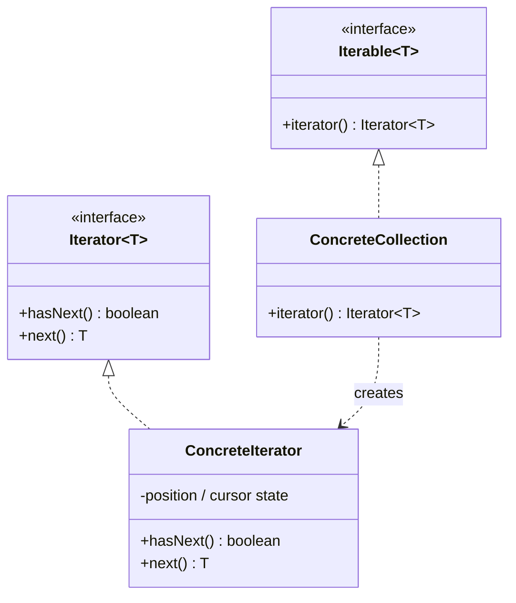
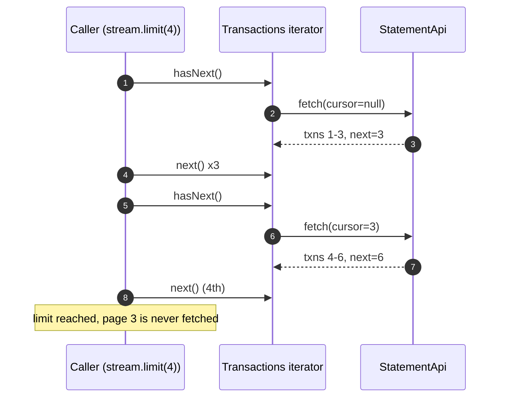
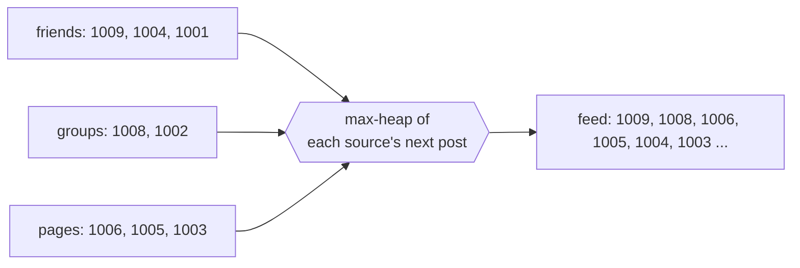
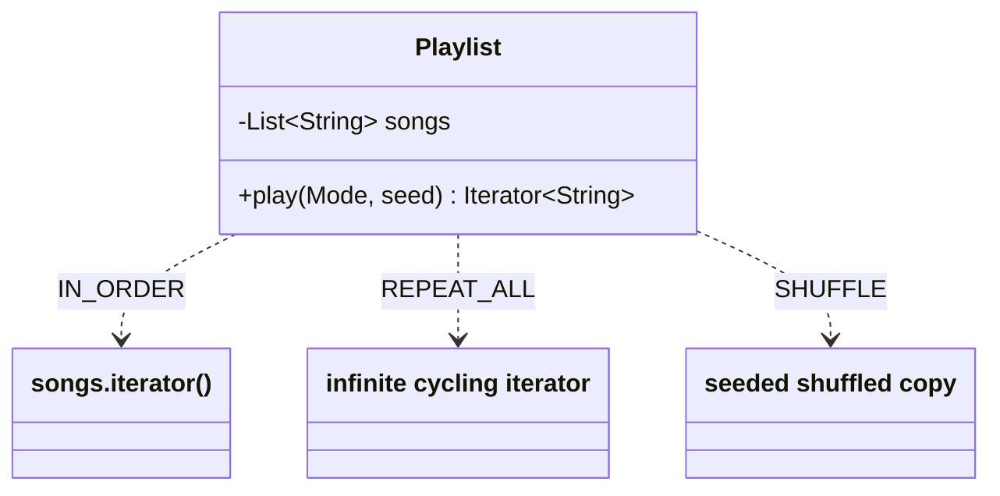

---
tags:
  - Behavioral
  - Beginner
---

# Iterator

<span class="badge badge--beginner">🟢 Beginner → 🟡 Intermediate</span>
<span class="badge badge--category">Behavioral</span>
<span class="badge badge--interview">Interview frequency ⭐⭐⭐</span>

!!! abstract "TL;DR"
    **Iterator gives a standard way to walk through the elements of a collection one at a time, without exposing how the collection is stored.**
    Java has it built in (`Iterator`, `Iterable`, for-each, streams). Write your own when the data is **paginated, merged, generated, or traversed in different orders**.

---

## 1. Intent & Problem It Solves

**The problem in plain English:** a bank statement lives behind an API that returns 50 transactions per page. Callers want "all transactions" in a simple loop. They shouldn't handle cursors, page boundaries, or when to fetch the next page, and they shouldn't download all 10,000 transactions if they only show the first 4.

**Formal definition (GoF):**
> Provide a way to access the elements of an aggregate object sequentially without exposing its underlying representation.

**Java's built-in version:**

```java
public interface Iterator<E> { boolean hasNext(); E next(); default void remove() {...} }
public interface Iterable<T> { Iterator<T> iterator(); }   // anything Iterable works in for-each
```

## 2. Real-World Analogy

!!! example "A TV remote's channel button"
    You press "next channel" without knowing whether channels come from cable, satellite or the internet, or how they're stored in the TV's memory. Different buttons (next, favourites only, last watched) give **different traversals** of the same channel list.

## 3. Structure



| Participant | Responsibility |
|---|---|
| **Iterator** | `hasNext()` / `next()`; keeps the **traversal state** (position, cursor) |
| **Iterable (aggregate)** | Creates a **fresh** iterator on each `iterator()` call |
| **Client** | Loops without knowing the storage or traversal details |

Because each iterator has its own state, several traversals can run **at the same time** over the same collection.

## 4. Naive Approach (Without the Pattern)

```java
String cursor = null;
do {
    Page page = api.fetch(account, cursor);         // pagination logic in every caller
    for (Txn t : page.items()) {
        if (shown++ == 4) break;                     // break only exits the inner loop...
        print(t);
    }
    cursor = page.nextCursor();
} while (cursor != null && shown < 4);              // ...so every caller re-implements stopping
```

- :material-close-circle:{ style="color:#e53935" } **Traversal logic duplicated** in every caller.
- :material-close-circle:{ style="color:#e53935" } Callers depend on the **storage format** (pages and cursors).
- :material-close-circle:{ style="color:#e53935" } Easy to fetch too much or too little.

---

## 5. Three Real-World Examples

### Example 1: Statement with Lazy Pagination (Banking)

**Scenario:** A banking app shows a 4-line "mini statement" on the home screen and a full statement on another screen. The core banking API is **cursor-paginated** (3 per page here; usually 50–100). The mini statement must fetch **only** what it needs (one or two pages), while the full statement must get everything, using the **same** simple loop and the same stream API.

**Design:**



**Full Code:**

=== "Transactions.java"

    ```java
    --8<-- "code/behavioral/src/main/java/com/handbook/behavioral/iterator/statement/Transactions.java"
    ```

    1.  Every call to `iterator()` returns a **new** iterator with its own cursor, so two screens can iterate independently.
    2.  The page-fetching loop lives here, **once**: fetch a page only when the current one is used up. A `while` (not `if`) handles empty pages correctly.
    3.  `Iterable` gives you `spliterator()` for free, so the collection works with **streams** too, and `limit()` really does stop fetching.

=== "StatementApi.java"

    ```java
    --8<-- "code/behavioral/src/main/java/com/handbook/behavioral/iterator/statement/StatementApi.java"
    ```

=== "StatementDemo.java"

    ```java
    --8<-- "code/behavioral/src/main/java/com/handbook/behavioral/iterator/statement/StatementDemo.java"
    ```

**Output:**

```text
--8<-- "code/outputs/behavioral/iterator/statement/StatementDemo.txt"
```

The mini statement needed 2 API calls; the full statement made 3 more, all hidden behind a for-each loop.

**Why Iterator here:**

- **Hides pagination**: callers see one sequence.
- **Lazy**: pages are fetched on demand, so short reads are cheap.
- Plugs into **for-each and streams** by implementing `Iterable`.

---

### Example 2: Merged Home Feed (Social Media)

**Scenario:** A social app's home feed combines posts from friends, groups and followed pages. Each source already returns posts **newest first**. The feed must show one combined, newest-first list, but only one screen (6 posts) at a time, without loading every source fully. This is a **k-way merge**, the same algorithm databases use to merge sorted runs.

**Design:**



**Full Code:**

=== "FeedMerger.java"

    ```java
    --8<-- "code/behavioral/src/main/java/com/handbook/behavioral/iterator/feed/FeedMerger.java"
    ```

    1.  A **heap** holds the next post of each source, newest on top: O(log k) per post for k sources.
    2.  After taking a post, refill the heap from **the same source**. Each source is read only as far as needed.

=== "FeedDemo.java"

    ```java
    --8<-- "code/behavioral/src/main/java/com/handbook/behavioral/iterator/feed/FeedDemo.java"
    ```

**Output:**

```text
--8<-- "code/outputs/behavioral/iterator/feed/FeedDemo.txt"
```

**Why Iterator here:**

- An iterator built **from other iterators**: composition without materializing lists.
- The UI just calls `next()` until the screen is full.
- Works the same whether sources are lists, database cursors, or remote paginated APIs.

---

### Example 3: Playlist Play Modes (Streaming)

**Scenario:** A music app plays the same playlist **in order**, **on repeat** (infinitely), or **shuffled**. The player only knows "give me the next song". Shuffle must be **reproducible** given a seed, so a "shuffle session" can be resumed on another device and tested deterministically.

**Design:**



**Full Code:**

=== "Playlist.java"

    ```java
    --8<-- "code/behavioral/src/main/java/com/handbook/behavioral/iterator/playlist/Playlist.java"
    ```

    1.  An **infinite iterator**: `hasNext()` is always true for a non-empty playlist. Callers must bound it (the demo takes 6). Streams do this well: `Stream.generate(...).limit(n)`.
    2.  A **seeded** shuffle is reproducible: the same seed gives the same order. Store the seed to resume a session elsewhere.

=== "PlaylistDemo.java"

    ```java
    --8<-- "code/behavioral/src/main/java/com/handbook/behavioral/iterator/playlist/PlaylistDemo.java"
    ```

**Output:**

```text
--8<-- "code/outputs/behavioral/iterator/playlist/PlaylistDemo.txt"
```

**Why Iterator here:**

- **Several traversals** of one collection: the essence of the pattern.
- The player depends on `Iterator<String>`, not on the mode.
- New modes (smart shuffle that avoids repeating an artist) are new iterators.

---

??? example "Unit Tests: `IteratorTest.java` (all three examples + challenge)"

    ```java
    --8<-- "code/behavioral/src/test/java/com/handbook/behavioral/iterator/IteratorTest.java"
    ```

## 6. Variations & Modern Java Take

| Variation | Notes |
|---|---|
| **External iterator** (`hasNext`/`next`) | Caller controls the loop; can stop, interleave, merge (Example 2) |
| **Internal iterator** (`forEach(consumer)`, streams) | Collection controls the loop; concise; harder to stop early or interleave |
| **Lazy / generated** | Pages fetched on demand (Example 1), infinite sequences (Example 3) |
| **Fail-fast** | Throws `ConcurrentModificationException` if the collection changes during iteration (`ArrayList`, coding challenge) |
| **Weakly consistent** | Never throws; may or may not reflect changes (`ConcurrentHashMap`, `CopyOnWriteArrayList` snapshots) |
| **Spliterator** | Iterator that can **split** for parallel streams |

**Modern Java helpers:** `Stream.iterate(seed, hasNext, next)`, `Stream.generate`, `Iterator.forEachRemaining`, `Enumeration.asIterator()`, and `takeWhile`/`dropWhile` for lazy stopping.

## 7. Where It Lives in Real Frameworks

| Where | Iterator |
|---|---|
| JDK collections | Every `Collection.iterator()`; `ListIterator` (bidirectional, with `set`/`add`) |
| JDK | `Scanner` (an `Iterator<String>` over input), `BufferedReader.lines()`, `Files.walk()`, `DirectoryStream` |
| JDBC | `ResultSet.next()`: a database cursor is an iterator |
| Spring Data | `Slice` / `Page` with `hasNext()`; `Stream<T>` repository methods backed by DB cursors |
| Spring Batch | `ItemReader.read()`: an iterator over input records (files, DB, Kafka) |
| Kafka | `ConsumerRecords` iteration; `poll()` loops |
| AWS SDK v2 | Paginators (`listObjectsV2Paginator`) that hide continuation tokens, exactly like Example 1 |

## 8. Pros, Cons & Trade-offs

| ✅ Pros | ❌ Cons |
|---|---|
| Hides storage and traversal details | Custom iterators are easy to get subtly wrong (`hasNext` side effects, empty pages) |
| **Multiple simultaneous** and **different** traversals | External iterators are more verbose than streams |
| **Lazy**: works with huge, remote or infinite data | Fail-fast behavior is best-effort, not a concurrency guarantee |
| Uniform loop syntax (for-each, streams) | Iterators over remote data hide latency and errors |

## 9. Pitfalls & Anti-Patterns

!!! danger "Modifying a collection while iterating"
    `for (x : list) list.remove(x)` throws `ConcurrentModificationException`. Use `iterator.remove()`, `removeIf`, or collect changes and apply them afterwards.

!!! danger "`next()` without `hasNext()` semantics"
    `next()` must throw `NoSuchElementException` at the end, and `hasNext()` must be **idempotent** (calling it twice must not skip elements or fetch twice).

!!! warning "Leaking resources"
    Iterators over files or DB cursors must be **closed**. Prefer `Stream` with try-with-resources (`try (Stream<String> lines = Files.lines(p))`).

!!! warning "Infinite iterators in eager code"
    `toList()` on an infinite iterator never returns. Always bound them (`limit`).

## 10. Senior / Architect Deep Dive (10–15 yrs)

**Pagination design.** Prefer **cursor-based** (keyset) pagination over offset pagination for large or changing datasets: offsets skip or duplicate items when data changes, and `OFFSET 100000` is slow. Cursors encode the last seen key (`created_at, id`). Example 1's iterator works unchanged with either.

**Streaming large results.** Don't load 10 million rows into a `List`. Stream them: JDBC fetch size, Spring Data `Stream<T>` inside a transaction, Spring Batch chunking, or reactive streams with **back-pressure** (`Flux`), where the consumer controls how fast the producer goes.

**Merging sorted streams** (Example 2) is everywhere: LSM-tree compaction, external merge sort, timeline services, log aggregation. Know the complexity: O(n log k).

**Concurrency.** Choose collection iterators deliberately: fail-fast for single-threaded code (bugs show up quickly), **weakly consistent** (`ConcurrentHashMap`) or **snapshot** (`CopyOnWriteArrayList`) for concurrent readers.

!!! bug "War story: the export that ate the heap"
    A "download all transactions" feature for business customers called `repository.findAll(accountId)` and built a CSV from the resulting `List`. It worked for two years, until a large merchant with 9 million transactions clicked the button. The JVM ran out of memory and the pod restarted mid-business-day, taking other customers' requests with it.
    **Fix:** replaced with a streaming iterator: a keyset-paginated query (1,000 rows per page) feeding a streaming CSV writer that wrote straight to the HTTP response; constant memory regardless of size.
    **Lesson:** if the size of a collection depends on a customer, iterate lazily.

## 11. Related Patterns & Comparisons

| | Iterator | Composite | Visitor | Generator / Stream |
|---|---|---|---|---|
| Purpose | **Traverse** elements sequentially | **Structure** of parts and wholes | **Operations** over elements | Lazily **produce** elements |
| Who controls the loop | Caller (external) | N/A | The structure / visitor | Caller pulls (`limit`) |
| Typical combo | Iterating a Composite tree (DFS/BFS iterator) | Traversed by Iterator or Visitor | Often uses an Iterator internally | Implemented with an Iterator |

## 12. Interview Corner

=== "🟢 Beginner / Service Companies"

    **Q1. What is the Iterator pattern?**

    A behavioral pattern that provides a way to **access elements sequentially** without exposing the collection's **internal structure**.

    **Q2. `Iterator` vs. `Iterable`?**

    `Iterable` is something you can iterate (has `iterator()`); `Iterator` is the cursor that does the iterating (`hasNext()`, `next()`). For-each works on any `Iterable`.

    **Q3. What is a fail-fast iterator?**

    One that throws **`ConcurrentModificationException`** if the collection is structurally modified during iteration (except through the iterator's own `remove()`). `ArrayList` and `HashMap` iterators are fail-fast.

    **Q4. Fail-fast vs. fail-safe?**

    **Fail-fast** detects modification and throws. **Fail-safe / weakly consistent** iterators (`ConcurrentHashMap`, `CopyOnWriteArrayList`) work on a snapshot or tolerate changes and never throw.

    **Q5. How do you remove elements safely while iterating?**

    `iterator.remove()` or `collection.removeIf(predicate)`.

=== "🟡 Mid-Level"

    **Q1. Write a custom `Iterable` for a range of numbers.**

    Class with `start`/`end`; `iterator()` returns an anonymous `Iterator` with a `current` field; `hasNext()` returns `current < end`; `next()` throws `NoSuchElementException` at the end, otherwise returns `current++`.

    **Q2. Internal vs. external iteration?**

    **External**: the caller drives (`while (it.hasNext())`), can stop and interleave. **Internal**: the collection drives (`forEach`, streams), which is concise and can parallelize.

    **Q3. How does `ListIterator` differ from `Iterator`?**

    It's **bidirectional** (`hasPrevious`, `previous`), knows indices, and supports `set` and `add` during iteration.

    **Q4. How would you iterate a paginated REST API?**

    An iterator that fetches the **next page lazily** when the current page is exhausted (Example 1), exposed as `Iterable` or `Stream`.

    **Q5. How do iterators enable laziness in streams?**

    Stream pipelines **pull** elements one at a time through the spliterator; with `limit` or `findFirst`, the source stops producing as soon as enough elements have been consumed.

=== "🔴 Senior / FAANG / SAP"

    **Q1. "Merge k sorted lists/streams efficiently." (classic coding round)**

    A **min-heap** (or max-heap) holding each stream's head: pop the top, push the next from the same stream; **O(n log k)** time, **O(k)** memory, lazy (Example 2).

    **Q2. "Design an API to export 50 million records."**

    **Keyset pagination** or a server-side **streaming** endpoint (chunked transfer, NDJSON/CSV), back-pressure, resumable cursors (opaque, signed tokens), or an **async export job** that writes to object storage and returns a link.

    **Q3. "Offset vs. cursor pagination: trade-offs?"**

    Offset: simple, supports jumping to page N, but slow at high offsets and inconsistent under inserts and deletes. Cursor: stable and fast, but no random access. Use cursors for feeds and exports; offsets for small admin tables.

    **Q4. "Implement a BST iterator with O(h) memory." (common at Google/Microsoft)**

    Use an explicit **stack**: push the left path from the root; `next()` pops a node, then pushes the left path of its right child. Amortized O(1) per `next()`, O(h) memory.

    **Q5. "What can go wrong with iterators over remote data?"**

    Hidden **latency** (N round trips), **errors mid-iteration** (retry the page, resume from the cursor), **consistency** (data changes between pages), **resource leaks** (unclosed cursors). Make these explicit in the API.

=== "💻 Coding Challenge"

    **Problem (logistics):** Keep only the **last 3 GPS pings** of a delivery bike in a fixed-size ring buffer. Iterate oldest to newest, and make the iterator **fail-fast** if the buffer is modified during iteration.

    ??? success "Solution"

        === "RingBuffer.java"

            ```java
            --8<-- "code/behavioral/src/main/java/com/handbook/behavioral/iterator/ring/RingBuffer.java"
            ```

        === "RingDemo.java"

            ```java
            --8<-- "code/behavioral/src/main/java/com/handbook/behavioral/iterator/ring/RingDemo.java"
            ```

        **Output:**

        ```text
        --8<-- "code/outputs/behavioral/iterator/ring/RingDemo.txt"
        ```

        **Key points to say:** circular indexing `(start + i) % capacity`; overwriting moves `start`; the iterator snapshots `modCount` (exactly how `ArrayList` does fail-fast); `NoSuchElementException` at the end. For concurrent producers, use a lock or a lock-free ring buffer (LMAX Disruptor).

!!! info "Behavioural tie-in (STAR) for experienced candidates"
    - **S:** A full-history CSV export crashed a shared service when a large merchant used it.
    - **T:** Make exports safe for any account size without a new system.
    - **A:** Replaced list-based loading with a keyset-paginated iterator streaming rows directly to the response; added a row cap with an async export fallback.
    - **R:** Memory flat at about 200 MB for any export size; the 9-million-row export finished in 4 minutes with no impact on other tenants.

## 13. Quick Revision Card

!!! tip "Remember in 30 seconds"
    - **Sequential access without exposing structure**: `Iterator` (cursor) + `Iterable` (collection).
    - Custom iterators shine for **pagination, merging, generation, multiple traversal orders**.
    - **Fail-fast** (`ConcurrentModificationException`) vs. **weakly consistent** iterators.
    - Lazy iteration keeps memory flat; close resource-backed iterators.
    - **Real life:** `ResultSet`, Spring Batch `ItemReader`, AWS SDK paginators.

    ```java
    for (Txn t : new Transactions(api, "SB-1001")) { ... }   // pages fetched lazily
    ```

## Practice

- [ ] Add a "smart shuffle" mode that never plays the same artist twice in a row.
- [ ] Make `Transactions` retry a failed page fetch once before giving up.
- [ ] Implement an in-order iterator for a binary search tree using a stack.
- [ ] Return a `Stream<Post>` from `FeedMerger` using `Spliterators.spliteratorUnknownSize`.

---

[:material-arrow-left: Interpreter](interpreter.md){ .md-button }
[Next: Mediator :material-arrow-right:](mediator.md){ .md-button .md-button--primary }
