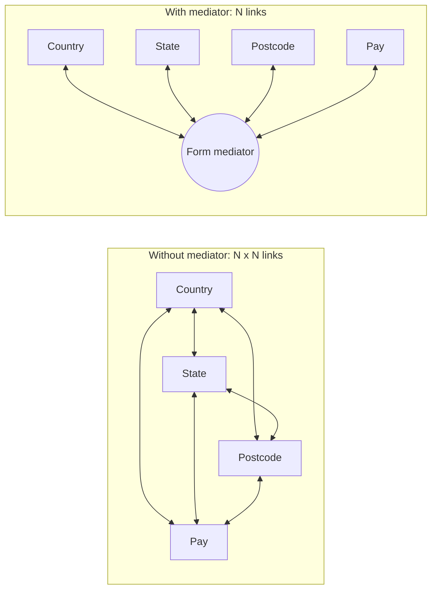
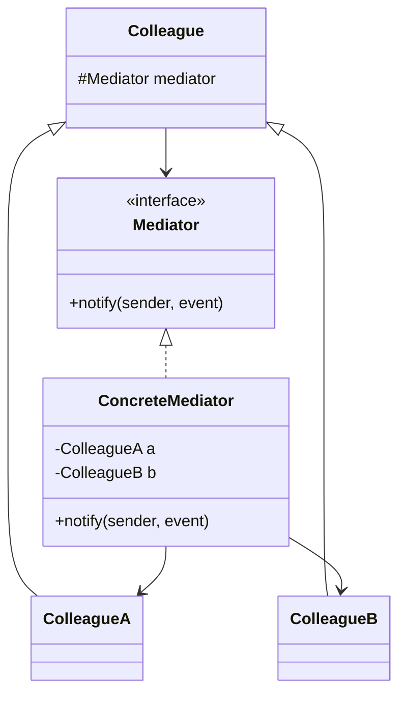
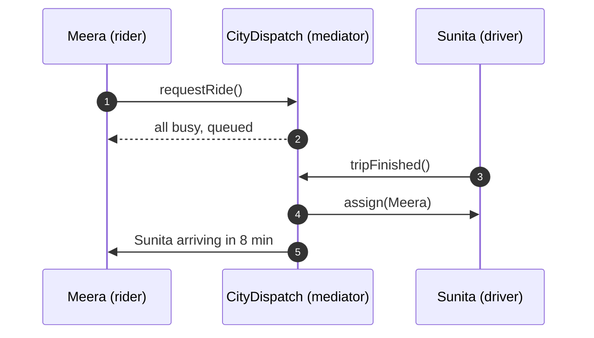
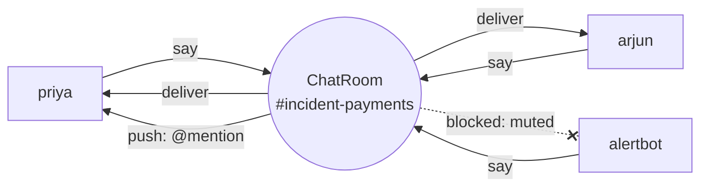
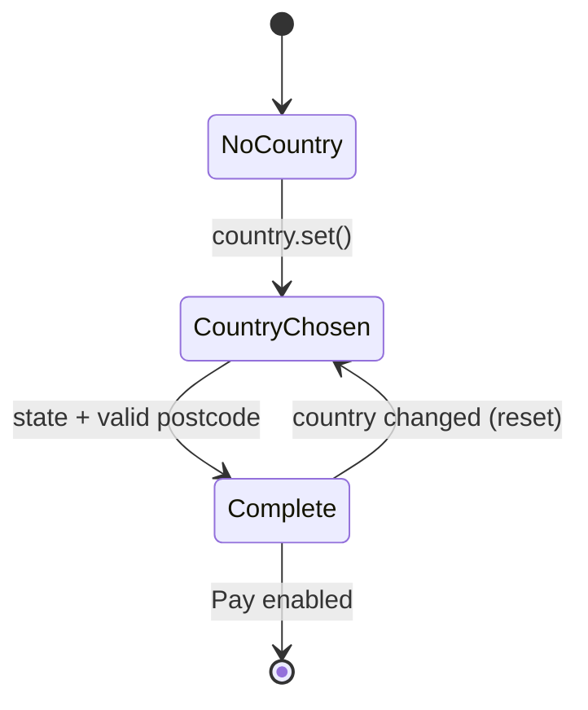

---
tags:
  - Behavioral
  - Intermediate
---

# Mediator

<span class="badge badge--intermediate">🟡 Intermediate</span>
<span class="badge badge--category">Behavioral</span>
<span class="badge badge--interview">Interview frequency ⭐⭐⭐</span>

!!! abstract "TL;DR"
    **Mediator centralizes how a group of objects interact. Instead of talking to each other directly, they talk to a mediator that coordinates them.**
    Use it when many objects have tangled, many-to-many communication: dispatch systems, chat rooms, UI forms, auctions, air-traffic-style coordination.

---

## 1. Intent & Problem It Solves

**The problem in plain English:** on a checkout form, choosing a country must reset the state list, change the postcode hint and disable the Pay button; choosing a state and a valid postcode must enable Pay. If each widget calls the others directly, every widget knows every other widget: N widgets means up to N×(N−1) dependencies, and adding one field means editing all of them.

**Formal definition (GoF):**
> Define an object that encapsulates how a set of objects interact. Mediator promotes loose coupling by keeping objects from referring to each other explicitly, and it lets you vary their interaction independently.



## 2. Real-World Analogy

!!! example "Air traffic control"
    Pilots don't negotiate runways with each other. Each pilot talks only to the control tower, and the tower sequences take-offs and landings. Adding a new plane doesn't require it to know every other plane.

## 3. Structure



| Participant | Responsibility |
|---|---|
| **Mediator** | Interface colleagues use to report events or requests |
| **Concrete mediator** | Knows the colleagues and the **coordination rules** |
| **Colleagues** | Know only the mediator; do their own job and report to it |

## 4. Naive Approach (Without the Pattern)

```java
class CountrySelect {
    StateSelect state; PostcodeField postcode; PayButton pay;   // knows everyone
    void onChange(String c) {
        state.setOptions(STATES.get(c)); state.clear();
        postcode.setHint(c.equals("India") ? "PIN" : "PLZ"); postcode.clear();
        pay.setEnabled(false);
    }
}
class StateSelect { PayButton pay; PostcodeField postcode; ... }   // ...and so on
```

- :material-close-circle:{ style="color:#e53935" } **Tight many-to-many coupling**: components can't be reused on another form.
- :material-close-circle:{ style="color:#e53935" } **Rules are scattered** across components; "when is Pay enabled?" has no single answer.
- :material-close-circle:{ style="color:#e53935" } Adding a field touches several classes.

---

## 5. Three Real-World Examples

### Example 1: Dispatch Center (Ride-hailing)

**Scenario:** Riders request trips; drivers become available or busy. Matching rules (nearest available driver, queue riders when everyone is busy, assign the queue when a driver finishes) change often: surge zones, driver ratings, women-only rides. Riders and drivers must **never** know about each other until matched. All of this belongs in the dispatch center, the mediator.

**Design:**



**Full Code:**

=== "Dispatch.java"

    ```java
    --8<-- "code/behavioral/src/main/java/com/handbook/behavioral/mediator/dispatch/Dispatch.java"
    ```

    1.  The **mediator interface**: what colleagues can tell the center.
    2.  Colleagues report events to the mediator. A driver finishing a trip doesn't look for riders itself.
    3.  The **matching rule lives in one place**. Switching to "highest-rated nearby driver" changes only the mediator.

=== "DispatchDemo.java"

    ```java
    --8<-- "code/behavioral/src/main/java/com/handbook/behavioral/mediator/dispatch/DispatchDemo.java"
    ```

**Output:**

```text
--8<-- "code/outputs/behavioral/mediator/dispatch/DispatchDemo.txt"
```

**Why Mediator here:**

- Many riders and many drivers, coordinated by **one set of rules**.
- Riders and drivers are simple; all coordination (matching, queueing) is in the center.
- The rules can change (or be A/B tested) without touching rider or driver code.

---

### Example 2: Incident Channel (SaaS Team Chat)

**Scenario:** A Slack-style chat app runs an `#incident-payments` channel during an outage. Members (engineers and an alert bot) post messages; the room delivers them to everyone else, sends **push notifications for @mentions**, and enforces **mutes** (the noisy alert bot gets muted). Members never hold references to each other: they join a room and talk through it.

**Design:**



**Full Code:**

=== "ChatRoom.java"

    ```java
    --8<-- "code/behavioral/src/main/java/com/handbook/behavioral/mediator/chat/ChatRoom.java"
    ```

=== "ChatDemo.java"

    ```java
    --8<-- "code/behavioral/src/main/java/com/handbook/behavioral/mediator/chat/ChatDemo.java"
    ```

**Output:**

```text
--8<-- "code/outputs/behavioral/mediator/chat/ChatDemo.txt"
```

(Only Priya's screen is printed, plus pushes and room actions, to keep the output short.)

**Why Mediator here:**

- Classic **many-to-many** communication reduced to **many-to-one**.
- Policies (mentions, mutes, later retention and moderation) live in the room.
- Members can be people, bots or integrations; the room treats them the same way.

---

### Example 3: Checkout Address Form (E-commerce)

**Scenario:** An international checkout form has country, state, postcode and a Pay button. Choosing a country loads that country's states, resets the state and postcode, and changes the postcode hint (6-digit PIN for India, 5-digit PLZ for Germany). Pay is enabled only when a state is chosen and the postcode has the right length **for the selected country**. The same field components are reused across many forms.

**Design:**



**Full Code:**

=== "CheckoutForm.java"

    ```java
    --8<-- "code/behavioral/src/main/java/com/handbook/behavioral/mediator/form/CheckoutForm.java"
    ```

    1.  **All coordination rules in one method.** "When is Pay enabled?" has exactly one answer, here.

=== "FormDemo.java"

    ```java
    --8<-- "code/behavioral/src/main/java/com/handbook/behavioral/mediator/form/FormDemo.java"
    ```

**Output:**

```text
--8<-- "code/outputs/behavioral/mediator/form/FormDemo.txt"
```

**Why Mediator here:**

- This is the GoF's original motivating example (dialog boxes).
- Fields are reusable and dumb; the **form** knows how they depend on each other.
- Business rules for the form are testable without a UI (see the unit tests).

---

??? example "Unit Tests: `MediatorTest.java`"

    ```java
    --8<-- "code/behavioral/src/test/java/com/handbook/behavioral/mediator/MediatorTest.java"
    ```

## 6. Variations & Modern Java Take

- **Event-based mediator**: colleagues publish events (`CountryChanged`) to a mediator or an in-process event bus that routes them to handlers. Looser, but the flow is harder to follow.
- **Command/query mediator**: in-process request routing (`mediator.send(new PlaceOrderCommand(...))` finds the one handler). Popular in .NET (MediatR) and used in Java with Spring's `ApplicationEventPublisher` or small custom dispatchers. It decouples controllers from handlers.
- **UI frameworks**: a form's controller or view-model (MVC/MVVM) is usually the mediator between widgets.
- **Keep it focused**: one mediator per collaboration (a form, a room, a dispatch zone), not one per application.

## 7. Where It Lives in Real Frameworks

| Where | Mediator |
|---|---|
| Spring MVC | `DispatcherServlet` coordinates handler mappings, adapters, view resolvers and exception resolvers |
| Spring | `ApplicationEventPublisher` / `ApplicationEventMulticaster` (event-based mediator between beans) |
| JDK | `java.util.Timer` (schedules tasks that never know each other); `ExecutorService` mediates between submitters and worker threads |
| Swing / JavaFX | Dialog and controller classes coordinating widgets |
| Messaging | Message brokers (Kafka, RabbitMQ) are mediators at system scale |
| Workflow engines | Camunda, Temporal: orchestrators that mediate between services |

## 8. Pros, Cons & Trade-offs

| ✅ Pros | ❌ Cons |
|---|---|
| **Loose coupling**: colleagues know only the mediator | The mediator can grow into a **god object** |
| **Interaction rules in one place**: easy to change and test | Single point of failure or bottleneck (at system scale) |
| Colleagues become **reusable** | Logic moves from many small places into one complex place |
| Many-to-many becomes **one-to-many** | Indirection makes the flow harder to trace than direct calls |

## 9. Pitfalls & Anti-Patterns

!!! danger "The god mediator"
    A `MainController` mediating 40 widgets and every business rule is unmaintainable. Split by collaboration (address section, payment section) or move domain rules into domain objects.

!!! warning "Colleagues bypassing the mediator"
    One shortcut (`state.payButton.enable()`) brings the tangled dependencies back. Colleagues shouldn't hold references to each other at all.

!!! warning "Event loops"
    A mediator reacting to "state changed" by setting the state again (which fires "state changed"...) loops forever. Guard re-entrant updates.

!!! warning "Hidden ordering assumptions"
    With event-based mediators, handlers run in some order. If correctness depends on it, make the order explicit.

## 10. Senior / Architect Deep Dive (10–15 yrs)

**Orchestration is Mediator at system scale.** A saga orchestrator (or Temporal/Camunda workflow) is a mediator between services: services know only the orchestrator's commands and events, never each other. The trade-off against **choreography** (services react to each other's events directly, Observer-style) is the same as in-process: centralized, visible flow and a potential bottleneck vs. decentralized, flexible flow that's harder to trace.

| | Orchestration (Mediator) | Choreography (Observer) |
|---|---|---|
| Flow visibility | One place shows the whole flow | Spread across services |
| Coupling | Services coupled to the orchestrator | Services coupled to event schemas |
| Change | Change the orchestrator | Change several services |
| Failure handling | Centralized compensation | Each service handles its part |

**Scaling a mediator.** Dispatch systems **partition** the mediator (one dispatcher per city or geo-cell) to avoid a global bottleneck; chat systems shard rooms across servers. The mediator's state (available drivers, room membership) must be partitioned too.

**Testing.** The mediator holds the interesting rules, so test it heavily with fake colleagues (as `MediatorTest` does for the form).

!!! bug "War story: the form that charged the wrong currency"
    A travel site's checkout widgets talked to each other directly. When a new "billing country" field was added, it updated the currency label but nobody updated the payment widget's currency code, because that link existed only in the old shipping-country widget. Customers who changed billing country saw prices in euros but were charged the same number in dollars.
    **Fix:** introduced a form mediator owning all cross-field rules (country to currency to payment), with the payment amount and currency computed in exactly one place, and unit tests for every field combination.
    **Lesson:** when "X must stay in sync with Y" rules are spread across components, one will be missed. Centralize them.

## 11. Related Patterns & Comparisons

| | Mediator | Observer | Facade | Chain of Responsibility |
|---|---|---|---|---|
| Direction | **Two-way**: colleagues ↔ mediator | One-way: subject → observers | One-way: client → facade → subsystems | Along a chain |
| Who knows whom | Colleagues know only the mediator; it knows them | Subject knows observers through an interface | Subsystems don't know the facade | Each handler knows the next |
| Purpose | **Coordinate** peers | **Notify** about changes | **Simplify** a subsystem | Find a handler |

A mediator is often **implemented with Observer** (colleagues publish events, the mediator subscribes).

## 12. Interview Corner

=== "🟢 Beginner / Service Companies"

    **Q1. What is the Mediator pattern?**

    A behavioral pattern where objects communicate **through a central mediator** instead of directly, which **reduces coupling** between them.

    **Q2. Real-world examples?**

    **Air traffic control**, chat rooms, a ride-hailing dispatch center, UI dialogs coordinating widgets, and Spring's `DispatcherServlet`.

    **Q3. What problem does it solve?**

    **Many-to-many dependencies** between objects, which become hard to change and reuse.

    **Q4. Mediator vs. Facade?**

    A facade gives clients a **simpler interface** to a subsystem (one-way); a mediator **coordinates peers** that talk to it in both directions.

    **Q5. Main drawback?**

    The mediator can become a **complex god object**.

=== "🟡 Mid-Level"

    **Q1. Mediator vs. Observer?**

    Observer is **one-to-many notification**; Mediator **coordinates** interactions with rules. A mediator is often built on top of Observer-style events.

    **Q2. How do you test a mediator?**

    With **fake colleagues** (or real simple ones) and assertions on the resulting interactions; most rules live there, so it deserves the most tests.

    **Q3. How do you stop the mediator becoming too big?**

    One mediator **per collaboration**; push domain logic into domain objects; split into sub-mediators by area.

    **Q4. Is `DispatcherServlet` a mediator?**

    Yes: it coordinates handler mappings, handler adapters, view resolvers and exception resolvers, which don't know each other.

    **Q5. How does a command bus relate to Mediator?**

    A command bus routes a request to its handler, so senders and handlers don't know each other. It's a mediator for requests.

=== "🔴 Senior / FAANG / SAP"

    **Q1. "Design the dispatch system for a ride-hailing company."**

    Geo-partitioned **dispatchers** (mediators per cell/city) holding available drivers in spatial indexes (geohash, H3); rider requests matched by ETA, rating and fairness; **batching** of matches every few seconds for global optimization; timeouts and re-matching when drivers decline; event streams for location; surge and supply-demand balancing.

    **Q2. "Orchestration vs. choreography for an order flow across 6 services?"**

    Orchestration (**mediator**) for complex flows needing visibility, compensation and timeouts; choreography (**observer/events**) for simple, loosely coupled reactions. Often a mix: orchestrate the core flow, publish events for side effects (emails, analytics).

    **Q3. "How would you scale a chat room with 500,000 members?"**

    Fan-out on read for huge rooms; shard members across gateway servers; the room mediator publishes once to a pub/sub topic; each gateway delivers to its connected members; mentions and pushes processed asynchronously.

    **Q4. "The mediator is a single point of failure. Mitigate."**

    **Partition** it, run replicas with leader election per partition, keep its state recoverable (event log), and make colleagues tolerate temporary unavailability (retries, local queues).

    **Q5. "When would you avoid Mediator?"**

    When there are only **two or three** collaborators (direct calls are clearer), or when interactions are simple notifications better served by Observer.

=== "💻 Coding Challenge"

    **Problem:** An online auction: bidders must not see or call each other. The house enforces a reserve price and a minimum increment, tells the previous leader when they're outbid, announces the result to everyone, and rejects bids after closing.

    ??? success "Solution"

        === "AuctionHouse.java"

            ```java
            --8<-- "code/behavioral/src/main/java/com/handbook/behavioral/mediator/auction/AuctionHouse.java"
            ```

        === "AuctionDemo.java"

            ```java
            --8<-- "code/behavioral/src/main/java/com/handbook/behavioral/mediator/auction/AuctionDemo.java"
            ```

        **Output:**

        ```text
        --8<-- "code/outputs/behavioral/mediator/auction/AuctionDemo.txt"
        ```

        **Key points to say:** bidders hold only the house; all rules (reserve, increment, outbid notice, closing) are in the mediator; for concurrent bidders, make `bid()` `synchronized` or serialize bids through a queue so two bidders can't both "lead".

!!! info "Behavioural tie-in (STAR) for experienced candidates"
    - **S:** Our checkout widgets were wired to each other directly; a new field caused a currency mismatch in payments.
    - **T:** Make cross-field rules reliable and testable.
    - **A:** Introduced a form mediator owning all cross-field rules, removed direct widget references, and wrote table-driven tests for country, currency and payment combinations.
    - **R:** No cross-field defects in the following 3 releases; adding a "GST number" field took one rule and one test.

## 13. Quick Revision Card

!!! tip "Remember in 30 seconds"
    - **Peers talk to a mediator, not to each other**: many-to-many becomes many-to-one.
    - Coordination **rules in one place**; colleagues become simple and reusable.
    - Watch for the **god mediator**; one per collaboration.
    - **vs Observer:** coordinate vs. notify. **vs Facade:** two-way peers vs. one-way simplification.
    - **System scale:** orchestrators, message brokers, `DispatcherServlet`.

    ```java
    void changed(Field source) { /* the only place that knows how fields depend on each other */ }
    ```

## Practice

- [ ] Change dispatch to prefer drivers with a rating above 4.5 when two are equally close.
- [ ] Add thread-safety to `AuctionHouse` and test with 100 concurrent bidders on virtual threads.
- [ ] Add a "billing address same as shipping" checkbox to `CheckoutForm` and handle it in the mediator.

---

[:material-arrow-left: Iterator](iterator.md){ .md-button }
[Next: Memento :material-arrow-right:](memento.md){ .md-button .md-button--primary }
