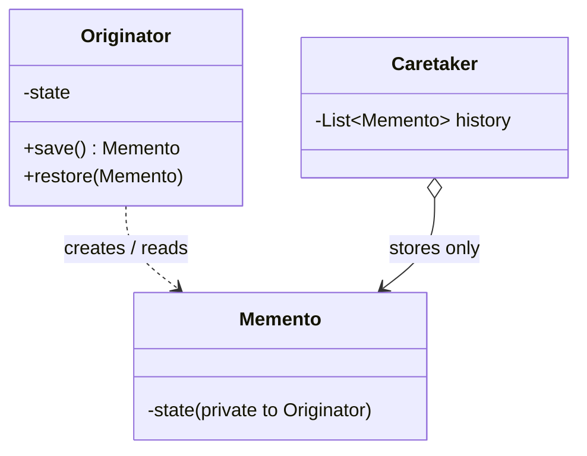
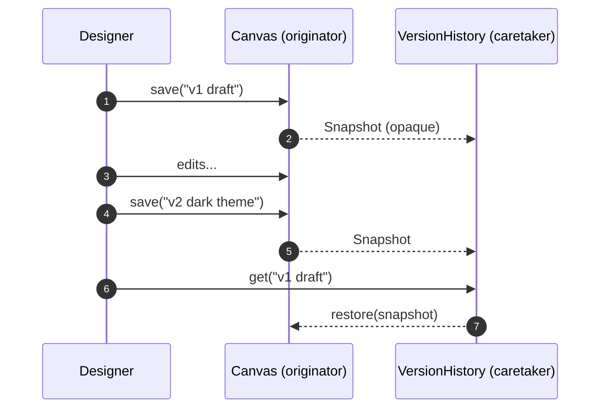
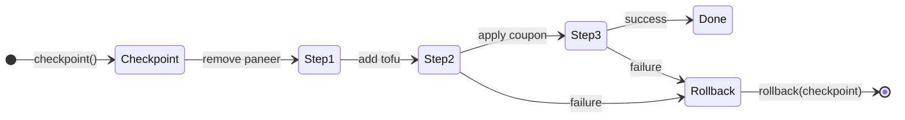
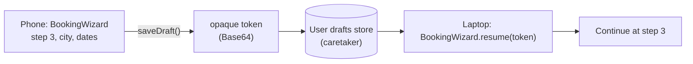

---
tags:
  - Behavioral
  - Intermediate
---

# Memento

<span class="badge badge--intermediate">🟡 Intermediate</span>
<span class="badge badge--category">Behavioral</span>
<span class="badge badge--interview">Interview frequency ⭐⭐⭐</span>

!!! abstract "TL;DR"
    **Memento captures an object's internal state in a snapshot so it can be restored later, without exposing that state to anyone else.**
    Use it for undo, version history, checkpoints and rollbacks, and saving drafts to resume later.

---

## 1. Intent & Problem It Solves

**The problem in plain English:** a designer wants to go back to "v1 draft" of a canvas. To restore it, *someone* must have saved every shape, colour and the background. If the version-history code copies the canvas's private fields itself, the canvas loses encapsulation: every change to its internals breaks the history code. Memento lets the **canvas** make its own snapshot, hand it out as an **opaque** object, and later restore from it.

**Formal definition (GoF):**
> Without violating encapsulation, capture and externalize an object's internal state so that the object can be restored to this state later.

## 2. Real-World Analogy

!!! example "A game's save point"
    At a checkpoint the game saves your level, health and inventory into a save slot. You can't read or edit the save file (it's opaque to you), but you can load it to go back. The save slots (**caretaker**) just store saves; only the game (**originator**) knows what's inside.

## 3. Structure



| Participant | Responsibility |
|---|---|
| **Originator** | Creates a memento of its current state; restores from one |
| **Memento** | **Immutable** snapshot; contents visible **only** to the originator |
| **Caretaker** | Keeps mementos (undo stack, version list, database) but **never inspects** them |

## 4. Naive Approach (Without the Pattern)

```java
class VersionHistory {
    void saveVersion(Canvas c) {
        versions.add(new ArrayList<>(c.shapes));   // needs access to Canvas internals
        backgrounds.add(c.background);             // forgets the new 'grid' field added last week
    }
}
```

- :material-close-circle:{ style="color:#e53935" } **Breaks encapsulation**: the history must know (and keep up with) the canvas's internals.
- :material-close-circle:{ style="color:#e53935" } **Incomplete snapshots** when fields are added.
- :material-close-circle:{ style="color:#e53935" } **Shared mutable state** if the copy isn't deep enough.

---

## 5. Three Real-World Examples

### Example 1: Named Version History (Design SaaS)

**Scenario:** A Figma/Canva-style design tool lets designers save named versions ("v1 draft", "v2 dark theme") and restore any of them. The client changes their mind a lot. The canvas's internal model evolves constantly (layers, effects, grids), so the version-history service must **not** depend on it: it just stores labelled, opaque snapshots.

**Design:**



**Full Code:**

=== "Canvas.java"

    ```java
    --8<-- "code/behavioral/src/main/java/com/handbook/behavioral/memento/canvas/Canvas.java"
    ```

    1.  The memento is a **nested class with private fields**. Outer classes in Java can read a nested class's private members, but nobody else can. That's how Java enforces "only the originator sees the state".
    2.  **Defensive copy** at snapshot time. The shapes are immutable records, so a shallow copy of the list is enough.

=== "VersionHistory.java"

    ```java
    --8<-- "code/behavioral/src/main/java/com/handbook/behavioral/memento/canvas/VersionHistory.java"
    ```

=== "CanvasDemo.java"

    ```java
    --8<-- "code/behavioral/src/main/java/com/handbook/behavioral/memento/canvas/CanvasDemo.java"
    ```

**Output:**

```text
--8<-- "code/outputs/behavioral/memento/canvas/CanvasDemo.txt"
```

**Why Memento here:**

- **Full-state snapshots** are simpler and safer than writing an inverse for every possible edit.
- The caretaker stays **independent of the canvas internals**.
- Snapshots are **immutable**, so they're safe to keep and share.

---

### Example 2: Safe Substitutions and "Undo Clear Cart" (Grocery)

**Scenario:** When an item is out of stock, a grocery app tries a multi-step **substitution**: remove the item, add a replacement, apply a bundle coupon. If any step fails (the replacement is *also* out of stock), the cart must return to **exactly** how it was. Separately, "Clear cart" shows a toast with **UNDO** for a few seconds. Both use a checkpoint taken just before the change.

**Design:**



**Full Code:**

=== "Cart.java"

    ```java
    --8<-- "code/behavioral/src/main/java/com/handbook/behavioral/memento/cart/Cart.java"
    ```

    1.  A **record as memento**: immutable and simple. It's public here because callers need to hold it; its contents are copies, so holding it can't change the cart. (If you also want to *hide* the contents, use the nested-class approach from Example 1.)

=== "CartDemo.java"

    ```java
    --8<-- "code/behavioral/src/main/java/com/handbook/behavioral/memento/cart/CartDemo.java"
    ```

**Output:**

```text
--8<-- "code/outputs/behavioral/memento/cart/CartDemo.txt"
```

!!! note "A bug this example caught"
    The first version of `Checkpoint` used `Map.copyOf`, which **doesn't keep insertion order** (and its iteration order changes between JVM runs). After a rollback, the cart showed items in a different order. A memento must restore the state **exactly**, including order where users can see it.

**Why Memento here:**

- **All-or-nothing** multi-step changes with an in-memory checkpoint, like a database savepoint.
- **Undo** for destructive actions without writing an inverse of "clear".
- The cart decides what's in its checkpoint; callers just hold it.

---

### Example 3: Resume a Booking on Another Device (Travel)

**Scenario:** A hotel booking takes 4 steps. Users often start on a phone and finish on a laptop. The wizard's state is saved as a **draft token** (a serialized memento) stored against the user's account. The token is **opaque** to the server (it doesn't parse it) and **versioned**: drafts saved by an older app version must be rejected cleanly instead of being misread.

**Design:**



**Full Code:**

=== "BookingWizard.java"

    ```java
    --8<-- "code/behavioral/src/main/java/com/handbook/behavioral/memento/booking/BookingWizard.java"
    ```

    1.  The memento leaves the process as an **opaque string**. Only `BookingWizard` knows the format. Production code would use JSON with a schema and **sign or encrypt** the token so it can't be tampered with.
    2.  **Versioned mementos**: a draft from an old format is rejected with a friendly message (or migrated) instead of producing a corrupt wizard.

=== "BookingDemo.java"

    ```java
    --8<-- "code/behavioral/src/main/java/com/handbook/behavioral/memento/booking/BookingDemo.java"
    ```

**Output:**

```text
--8<-- "code/outputs/behavioral/memento/booking/BookingDemo.txt"
```

**Why Memento here:**

- The wizard's state must **outlive the session and the device**.
- The caretaker (drafts store) treats drafts as **blobs**, so the wizard can evolve freely.
- **Versioning** is how mementos survive app updates.

---

??? example "Unit Tests: `MementoTest.java` (all three examples + challenge)"

    ```java
    --8<-- "code/behavioral/src/test/java/com/handbook/behavioral/memento/MementoTest.java"
    ```

## 6. Variations & Modern Java Take

| Variation | Notes |
|---|---|
| **Nested class with private fields** (Example 1) | Strong encapsulation: only the originator can read it |
| **Record memento** (Example 2) | Simple and immutable; contents visible but can't change the originator |
| **Serialized memento** (Example 3) | JSON/Protobuf/bytes for persistence or transfer; needs versioning and integrity protection |
| **Incremental mementos** | Store diffs instead of full copies for large states (with periodic full snapshots) |
| **Bounded history** (coding challenge) | Keep the last N; drop the oldest |

**Memento vs. Command for undo:**

| | Memento (snapshot) | Command (inverse operation) |
|---|---|---|
| Undo by | Restoring the **whole state** | Running an **inverse** of each operation |
| Easy when | State is small, or operations are hard to reverse | State is big, and operations are easy to reverse |
| Memory | Higher (full copies) | Lower (just the operations) |
| Combined | Commands store a memento of what they change, or snapshots every N commands to speed up undo |

## 7. Where It Lives in Real Frameworks

| Where | Memento |
|---|---|
| JDK | `java.io.Serializable` (serialized state); `Swing UndoManager` with `StateEdit` (state snapshots) |
| Databases | Savepoints (`Connection.setSavepoint()` / `rollback(savepoint)`) |
| Spring Web Flow / Spring Session | Saving conversation or session state to resume |
| Spring Batch | `ExecutionContext` saved per step so a failed job **restarts from the checkpoint** |
| Kafka Streams / Flink | State snapshots and checkpoints for fault-tolerant stream processing |
| Event sourcing | **Snapshots** of an aggregate to avoid replaying every event |
| Browsers / editors | History API state objects; autosave drafts |

## 8. Pros, Cons & Trade-offs

| ✅ Pros | ❌ Cons |
|---|---|
| **Preserves encapsulation** while enabling undo/restore | **Memory/storage cost** of snapshots, especially for large state |
| Simplifies the originator (no inverse logic needed) | Snapshots of objects with references to **external resources** (connections, files) are tricky |
| Caretaker independent of the originator's internals | Serialized mementos need **versioning and security** |
| Natural fit for checkpoints, drafts and versions | Frequent snapshots can be slow; consider incremental ones |

## 9. Pitfalls & Anti-Patterns

!!! danger "Shallow snapshots of mutable state"
    If the memento shares a mutable list with the originator, later edits change the "snapshot". Copy mutable parts (or use immutable data). See [Prototype](../creational/prototype.md) on deep vs. shallow copies.

!!! danger "Trusting serialized mementos from clients"
    A draft token sent to the browser can be edited ("price=1"). Sign it (HMAC), encrypt it, or store mementos server-side and give the client only an ID.

!!! warning "Unbounded history"
    Snapshotting a big canvas on every keystroke eats memory. Bound the history, snapshot periodically, or store diffs.

!!! warning "Restoring identity and side effects"
    A memento restores **state**, not the world: emails sent and payments made aren't undone. Restoring a cart doesn't release stock reserved in another service.

## 10. Senior / Architect Deep Dive (10–15 yrs)

**Checkpointing in distributed processing.** Spark, Flink and Kafka Streams periodically snapshot operator state (mementos) to durable storage; on failure they restore the last checkpoint and replay input from a matching offset. The key insight: a snapshot is only useful **together with a position in the input**, so the system can resume exactly once.

**Event sourcing snapshots.** Aggregates rebuilt from events can be slow to load after millions of events. Store a **snapshot** every N events (a memento) and replay only newer events. Snapshots must be **versioned**, because the aggregate's shape changes over time.

**Storage design for version history.** Full copies are simple but expensive; **content-addressed storage** (like Git: snapshots are trees of hashed, shared blobs) gives cheap versions with structural sharing. Google Docs stores operations and periodic snapshots.

**Security and privacy.** Mementos may contain personal data; apply the same retention and deletion rules (GDPR "right to be forgotten" must also delete old versions and drafts).

!!! bug "War story: the draft that set its own price"
    A travel site stored booking-wizard drafts in a client-side cookie as Base64 JSON, including the quoted price, so the user could resume later. A curious user decoded the cookie, edited the price from INR 18,000 to INR 1,800, re-encoded it and resumed. The checkout trusted the draft's price.
    **Fix:** drafts moved server-side (the client keeps only an opaque ID); prices are always re-quoted at checkout; any remaining client-side state is HMAC-signed and rejected if modified.
    **Lesson:** a memento that leaves your process is untrusted input. Sign it, encrypt it, or keep it on the server.

## 11. Related Patterns & Comparisons

| | Memento | Command | Prototype | Event Sourcing |
|---|---|---|---|---|
| Stores | A **state snapshot** | An **operation** | A **copy** to create new objects | **All changes** as events |
| Undo by | Restore snapshot | Inverse operation | N/A | Replay to an earlier point |
| Encapsulation | Strong (opaque) | N/A | N/A | Events are public facts |

## 12. Interview Corner

=== "🟢 Beginner / Service Companies"

    **Q1. What is the Memento pattern?**

    A behavioral pattern that **saves an object's state** into a snapshot so it can be **restored later**, **without exposing** its internal details.

    **Q2. Name the participants.**

    **Originator** (creates and restores), **Memento** (the snapshot), **Caretaker** (stores mementos without looking inside).

    **Q3. Give real examples.**

    **Undo** in editors, **save games**, **version history**, browser back/forward state, database **savepoints**.

    **Q4. Why shouldn't the caretaker read the memento?**

    To keep **encapsulation**: only the originator knows its internal structure, so it can change without breaking the caretaker.

    **Q5. Main disadvantage?**

    **Memory** usage when snapshots are large or frequent.

=== "🟡 Mid-Level"

    **Q1. How do you enforce that only the originator reads the memento in Java?**

    Make the memento a **nested class with private fields** (Example 1), or a narrow public interface with a private implementation.

    **Q2. Memento vs. Command for undo?**

    Memento **restores snapshots** (simple, more memory); Command **reverses operations** (less memory, needs an inverse for each operation). They're often combined.

    **Q3. How do you limit memory use?**

    **Bound** the history, snapshot **periodically** with commands in between, store **diffs**, or compress old snapshots.

    **Q4. What must you watch for when copying state?**

    **Deep vs. shallow** copies of mutable fields, and **ordering** (see the `Map.copyOf` note in Example 2).

    **Q5. How do you persist mementos safely?**

    Serialize with a **versioned schema**, protect integrity (signing) and confidentiality (encryption) if they leave the server, and handle old versions gracefully.

=== "🔴 Senior / FAANG / SAP"

    **Q1. "Design version history for a collaborative document editor."**

    Store **operations** (for collaboration and fine-grained undo) plus **periodic snapshots** (for fast loading and named versions); content-addressed storage for structural sharing; retention policies; a "restore version" that creates a **new** version rather than rewriting history; access control per version.

    **Q2. "How do stream processors achieve fault tolerance with checkpoints?"**

    Periodic **consistent snapshots** of operator state (Chandy–Lamport-style barriers in Flink) stored durably, together with **source offsets**; on failure, restore the snapshot and replay from those offsets, giving exactly-once state.

    **Q3. "Event-sourced aggregates take 8 seconds to load. Fix it."**

    **Snapshots** every N events (versioned), load snapshot + newer events; archive old events; check that snapshotting doesn't block writes (async creation).

    **Q4. "Users want to resume a multi-step application on any device. Design it."**

    Server-side **draft store** keyed by user and flow, versioned draft schema with migrations, TTL for abandoned drafts, re-validation and **re-pricing** on resume, and conflict handling if two devices edit the same draft.

    **Q5. "What can't a memento restore?"**

    **External side effects** (payments, emails, other services' state). For those you need **compensating actions** (Saga), not snapshots.

=== "💻 Coding Challenge"

    **Problem:** An editor keeps text snapshots for undo, but memory is limited: keep only the **last 3** snapshots and count how many were dropped. Undo until history runs out.

    ??? success "Solution"

        === "BoundedHistory.java"

            ```java
            --8<-- "code/behavioral/src/main/java/com/handbook/behavioral/memento/history/BoundedHistory.java"
            ```

        === "HistoryDemo.java"

            ```java
            --8<-- "code/behavioral/src/main/java/com/handbook/behavioral/memento/history/HistoryDemo.java"
            ```

        **Output:**

        ```text
        --8<-- "code/outputs/behavioral/memento/history/HistoryDemo.txt"
        ```

        **Key points to say:** an `ArrayDeque` used as a stack, removing from the **bottom** when full; `Optional` for "no more undo"; strings are immutable, so snapshots are safe without copying. Follow-ups: a redo stack, and snapshotting every N edits instead of every edit.

!!! info "Behavioural tie-in (STAR) for experienced candidates"
    - **S:** Users lost multi-step insurance applications when switching devices; 30% abandoned.
    - **T:** Let users resume anywhere, securely.
    - **A:** Built a server-side draft store with versioned mementos, re-validation on resume, a 30-day TTL, and deletion hooks for privacy requests.
    - **R:** Abandonment fell from 30% to 18%; zero tampering incidents because no state was trusted from the client.

## 13. Quick Revision Card

!!! tip "Remember in 30 seconds"
    - **Snapshot state, restore later, keep encapsulation.**
    - **Originator** creates and restores; **memento** is immutable and opaque; **caretaker** stores without reading.
    - Copy mutable state **deeply** and keep **order**; bound the history.
    - Persisted mementos need **versioning** and **integrity**.
    - **Memento = snapshot undo; Command = inverse-operation undo.**

    ```java
    Snapshot v1 = canvas.save("v1"); ...; canvas.restore(v1);
    ```

## Practice

- [ ] Add redo to `BoundedHistory`.
- [ ] Sign `BookingWizard` tokens with HMAC-SHA256 and reject modified ones.
- [ ] Make `VersionHistory` store diffs between consecutive canvas snapshots.

---

[:material-arrow-left: Mediator](mediator.md){ .md-button }
[Next: Observer :material-arrow-right:](observer.md){ .md-button .md-button--primary }
