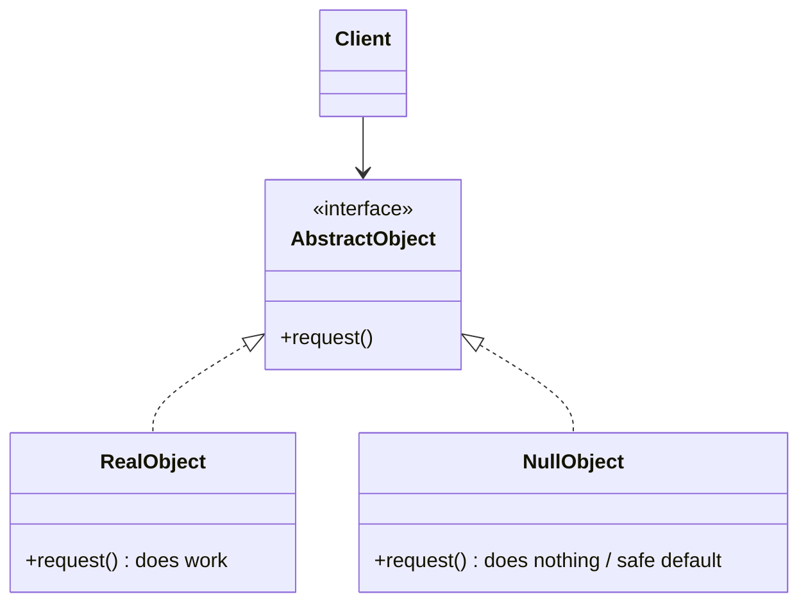
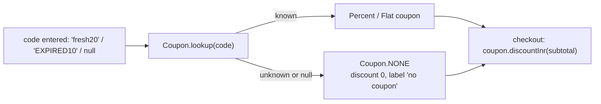
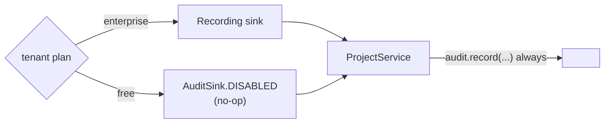
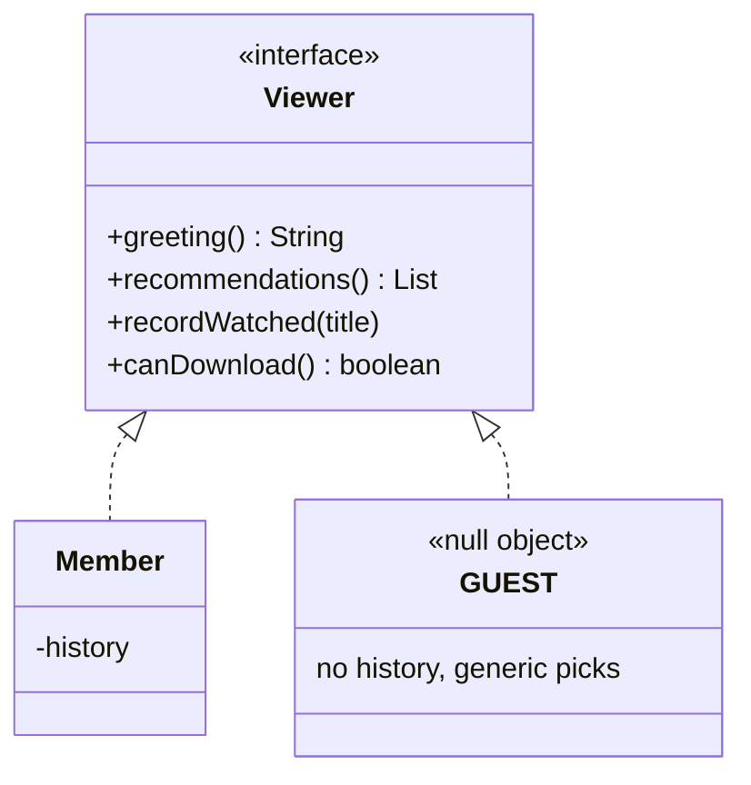

---
tags:
  - Behavioral
  - Beginner
---

# Null Object

<span class="badge badge--beginner">🟢 Beginner</span>
<span class="badge badge--category">Behavioral</span>
<span class="badge badge--interview">Interview frequency ⭐⭐⭐</span>

!!! abstract "TL;DR"
    **A Null Object is a real object that does "nothing" (or a safe default) in place of `null`. Callers use it like any other object, without null checks.**
    Use it for optional collaborators: no coupon, audit disabled, guest user, no-op logger. Combine it with `Optional` at boundaries where absence must be visible.

---

## 1. Intent & Problem It Solves

**The problem in plain English:** a cart may or may not have a coupon. If the coupon is `null`, every piece of code that touches it needs `if (coupon != null)`: price calculation, receipts, analytics, emails. Forget one check and you get a `NullPointerException` in production. Tony Hoare, who invented null references, called them his "billion-dollar mistake".

**Definition (Bobby Woolf, *Pattern Languages of Program Design 3*):**
> Provide an object as a surrogate for the lack of an object of a given type. The Null Object provides intelligent do-nothing behavior, hiding the details from its collaborators.

## 2. Real-World Analogy

!!! example "A placeholder seat card"
    At a wedding, an empty seat still has a card saying "Reserved". Waiters serve every seat the same way; the empty one politely receives nothing. Nobody needs a special procedure for "is someone sitting here?"

## 3. Structure



| Participant | Responsibility |
|---|---|
| **Abstract object** | The interface clients use |
| **Real object** | Normal behavior |
| **Null object** | Same interface, **neutral** behavior (zero discount, no-op, defaults); usually a shared singleton |

## 4. Naive Approach (Without the Pattern)

```java
Coupon coupon = coupons.get(code);              // may be null
int discount = coupon != null ? coupon.discount(subtotal) : 0;
String label = coupon != null ? coupon.label() : "no coupon";
if (coupon != null) analytics.track(coupon.code());
// receipt, email, invoice: each repeats the checks; one forgets -> NullPointerException
```

- :material-close-circle:{ style="color:#e53935" } **Null checks everywhere**, and the special case is duplicated.
- :material-close-circle:{ style="color:#e53935" } **NPEs** when one check is forgotten.
- :material-close-circle:{ style="color:#e53935" } The "no coupon" behavior is defined in many places, inconsistently.

---

## 5. Three Real-World Examples

### Example 1: Coupons without Null Checks (Grocery)

**Scenario:** A grocery checkout supports percentage coupons (capped) and flat coupons (with a minimum order). Most orders have **no coupon**, and some customers type codes that don't exist or have expired. The checkout, receipt and invoice code must work identically in all these cases.

**Design:**



**Full Code:**

=== "Coupon.java"

    ```java
    --8<-- "code/behavioral/src/main/java/com/handbook/behavioral/nullobject/coupon/Coupon.java"
    ```

    1.  The **Null Object**: a shared constant implementing the same interface with neutral behavior (zero discount).
    2.  The lookup **never returns null**: absence is converted into `NONE` at the boundary, once.

=== "CouponDemo.java"

    ```java
    --8<-- "code/behavioral/src/main/java/com/handbook/behavioral/nullobject/coupon/CouponDemo.java"
    ```

**Output:**

```text
--8<-- "code/outputs/behavioral/nullobject/coupon/CouponDemo.txt"
```

!!! warning "Don't hide errors the user should see"
    `EXPIRED10` silently became "no coupon". For **pricing**, that's correct (no discount). For the **UI**, the customer should be told "this code has expired". Use the Null Object for behavior, but keep the lookup result (valid/invalid/expired) available to the UI. A Null Object must never swallow information someone needs.

**Why Null Object here:**

- "No coupon" is a **legitimate, common case** with obvious neutral behavior (0 discount).
- **One definition** of "no coupon", shared everywhere.
- No `NullPointerException` path in checkout code.

---

### Example 2: Audit Log by Plan (SaaS)

**Scenario:** A project-management SaaS records audit trails (who created or deleted what) only for **enterprise** tenants; free-plan tenants don't get audit logs. Business code shouldn't be littered with `if (tenant.plan() == ENTERPRISE) audit.record(...)`. The plan decides which `AuditSink` is injected; free tenants get a **disabled** sink that does nothing.

**Design:**



**Full Code:**

=== "AuditSink.java"

    ```java
    --8<-- "code/behavioral/src/main/java/com/handbook/behavioral/nullobject/audit/AuditSink.java"
    ```

    1.  A **no-op lambda** is a complete Null Object when the interface has one method.

=== "ProjectService.java"

    ```java
    --8<-- "code/behavioral/src/main/java/com/handbook/behavioral/nullobject/audit/ProjectService.java"
    ```

=== "AuditDemo.java"

    ```java
    --8<-- "code/behavioral/src/main/java/com/handbook/behavioral/nullobject/audit/AuditDemo.java"
    ```

**Output:**

```text
--8<-- "code/outputs/behavioral/nullobject/audit/AuditDemo.txt"
```

**Why Null Object here:**

- **Feature toggling by injection**: the plan picks the implementation; business code is identical.
- Tests can inject `DISABLED` (or a recording fake) without mocking frameworks.
- The same idea powers no-op loggers, metrics and tracers in libraries.

---

### Example 3: Members and Guests (Streaming)

**Scenario:** A streaming app lets people browse and watch trailers without signing in. The player, home screen and download button all ask the "current viewer" for a greeting, recommendations and permissions, and record what was watched. Without a Null Object, every screen checks `if (user != null)`. With a **guest viewer**, there's always a viewer: guests get generic recommendations, nothing is recorded, and downloads require sign-in.

**Design:**



**Full Code:**

=== "Viewer.java"

    ```java
    --8<-- "code/behavioral/src/main/java/com/handbook/behavioral/nullobject/viewer/Viewer.java"
    ```

    1.  The guest isn't just "do nothing": it has **sensible defaults** (trending titles, a sign-in prompt). Null Objects can carry real, if neutral, behavior.

=== "ViewerDemo.java"

    ```java
    --8<-- "code/behavioral/src/main/java/com/handbook/behavioral/nullobject/viewer/ViewerDemo.java"
    ```

**Output:**

```text
--8<-- "code/outputs/behavioral/nullobject/viewer/ViewerDemo.txt"
```

**Why Null Object here:**

- "Not signed in" is a **normal state** with well-defined behavior.
- All screens share one code path; guest rules are in **one class**.
- Spring Security does the same with its `AnonymousAuthenticationToken`.

---

??? example "Unit Tests: `NullObjectTest.java`"

    ```java
    --8<-- "code/behavioral/src/test/java/com/handbook/behavioral/nullobject/NullObjectTest.java"
    ```

## 6. Variations & Modern Java Take

**Null Object vs. `Optional`:**

| | Null Object | `Optional<T>` |
|---|---|---|
| Purpose | **Behave** neutrally when something is absent | **Signal** that a value may be absent |
| Caller must handle absence? | No: it just works | Yes: `orElse`, `map`, `ifPresent` |
| Good for | Collaborators with obvious neutral behavior (no-op sink, zero discount, guest) | Return values where absence matters (lookup by ID) |
| Risk | **Hides** absence when it actually matters | Verbose; misuse as fields or parameters |

**The best practice is to combine them** (coding challenge): repositories return `Optional`; at the boundary, the domain converts absence into a Null Object if a neutral behavior exists, or into an error if it doesn't.

**Other forms:** empty collections (`List.of()` instead of `null`), `Comparator.naturalOrder()`, `Collections.emptyIterator()`, `OutputStream.nullOutputStream()` (Java 11), `Reader.nullReader()`.

## 7. Where It Lives in Real Frameworks

| Where | Null Object |
|---|---|
| JDK | `OutputStream.nullOutputStream()`, `InputStream.nullInputStream()`, `Writer.nullWriter()`; `Collections.emptyList/Map/Set`; `Optional.empty()` |
| SLF4J | `NOPLogger` (when no binding is present) |
| Micrometer / OpenTelemetry | No-op registries and tracers when observability is disabled |
| Spring Security | `AnonymousAuthenticationToken` for unauthenticated users |
| Spring | `NoOpCacheManager` (caching disabled); `NoOpPasswordEncoder` (tests only!) |
| Mockito | `RETURNS_DEFAULTS` returns empty collections and zero values |

## 8. Pros, Cons & Trade-offs

| ✅ Pros | ❌ Cons |
|---|---|
| **Removes null checks** and NPEs | Can **hide real errors** (absence that should be reported) |
| Neutral behavior **defined once** | Another class/constant per interface |
| Simplifies client code and tests | Behavior of the null object must be truly neutral, which isn't always obvious |
| Works well with DI (inject a no-op) | Debugging "why did nothing happen?" can be harder |

## 9. Pitfalls & Anti-Patterns

!!! danger "Hiding failures that matter"
    A `NullPaymentGateway` that returns "success" when no gateway is configured would ship orders without charging. Only use Null Objects when **doing nothing is genuinely correct**. Otherwise fail fast.

!!! danger "Null objects in security"
    `NoOpPasswordEncoder` or an "allow everything" authorizer as a default is dangerous. Security defaults must **deny**.

!!! warning "Mutable or stateful null objects"
    Null Objects are usually shared singletons; they must be immutable and stateless.

!!! warning "Returning `null` anyway"
    A Null Object only helps if the API **guarantees** non-null returns. Document it, and enforce it (`Objects.requireNonNull`, nullness annotations like JSpecify).

## 10. Senior / Architect Deep Dive (10–15 yrs)

**Null-safety as a codebase policy.** Large codebases adopt rules: never return `null` from public methods; return empty collections, `Optional` for maybe-values, and Null Objects for optional collaborators. Enforce with nullness annotations (**JSpecify** `@Nullable`/`@NullMarked`) plus static analysis (NullAway, Error Prone, IntelliJ inspections).

**Configuration and feature flags.** Disabled features are often implemented by injecting no-op implementations (metrics off, audit off, cache off). Make it **observable** (log at startup "Audit: DISABLED for plan FREE") so "why is nothing recorded?" has an answer.

**Graceful degradation.** When a dependency is down, a fallback (empty recommendations, default prices) is a cousin of Null Object: neutral behavior instead of failure. Keep fallbacks explicit, metered and alarmed.

!!! bug "War story: the metrics that weren't"
    A team's services used a `MetricsClient` injected by Spring. In one environment the metrics configuration was missing, so a convenient `NoOpMetricsClient` default kicked in silently. For three months, dashboards showed **zero errors** for the checkout service, which everyone read as "healthy", while it was actually failing 2% of payments.
    **Fix:** the no-op default stayed for local development, but production startup now **fails** if metrics aren't configured, and every service exports a heartbeat metric with alerts on its absence.
    **Lesson:** a Null Object is great when "nothing" is the right answer. When "nothing" might mean "broken", make it loud.

## 11. Related Patterns & Comparisons

| | Null Object | Optional | Strategy | Proxy |
|---|---|---|---|---|
| Purpose | Neutral **behavior** for absence | **Explicit** absence for values | Interchangeable algorithms | Control access |
| Relation | A "do-nothing" strategy or implementation | Complementary (use at boundaries) | A Null Object is often a no-op strategy | Can return a Null Object when access is denied |

Null Objects are often **Singletons** (one shared `NONE`) and **Flyweights** (stateless, shared).

## 12. Interview Corner

=== "🟢 Beginner / Service Companies"

    **Q1. What is the Null Object pattern?**

    Using an object with **neutral, do-nothing behavior** instead of `null`, so callers **don't need null checks**.

    **Q2. Give examples.**

    A `NoDiscount` coupon, a no-op logger, an anonymous/guest user, `Collections.emptyList()`.

    **Q3. Benefits?**

    Fewer **NullPointerExceptions**, simpler client code, and the default behavior is defined in **one place**.

    **Q4. Null Object vs. `Optional`?**

    Null Object **behaves** neutrally; `Optional` **forces callers** to handle absence explicitly.

    **Q5. Should methods return `null` for empty collections?**

    No. Return an **empty collection** (`List.of()`), which is itself a Null Object.

=== "🟡 Mid-Level"

    **Q1. When should you NOT use a Null Object?**

    When absence is an **error** or must be reported (payment gateway missing, security checks). Fail fast instead.

    **Q2. How do you combine `Optional` and Null Objects?**

    Repositories return `Optional`; the service converts with `orElse(NULL_OBJECT)` where a neutral behavior exists (challenge).

    **Q3. How would you implement a no-op logger?**

    A class implementing the logger interface with empty methods, exposed as a singleton (`NoOpLogger.INSTANCE`), like SLF4J's `NOPLogger`.

    **Q4. How do Null Objects help testing?**

    Inject no-op collaborators (audit, metrics, notifications) to test business logic without mocks.

    **Q5. How does Spring Security represent anonymous users?**

    With `AnonymousAuthenticationToken`: a real `Authentication` object with role `ROLE_ANONYMOUS`, so filters and access checks don't deal with `null`.

=== "🔴 Senior / FAANG / SAP"

    **Q1. "Define a null-safety strategy for a 2-million-line codebase."**

    Nullness annotations (JSpecify) with **package-level `@NullMarked`**, static analysis in CI (NullAway), no `null` returns for collections, `Optional` for maybe-values in return types, Null Objects for optional collaborators, and incremental adoption module by module.

    **Q2. "Disabled features via no-op implementations: risks?"**

    Silent misconfiguration (the war story). Mitigate with **startup logs**, **health indicators** reporting which implementations are active, and **production guards** that fail if critical features are no-ops.

    **Q3. "How does graceful degradation relate to Null Object?"**

    Fallbacks return neutral results (empty recommendations) when a dependency fails, keeping the page working. They must be **metered and alarmed** so degraded mode doesn't go unnoticed.

    **Q4. "Design a guest checkout flow."**

    A **guest customer** object (no saved addresses, no loyalty) implementing the same `Customer` interface; same checkout path; prompts to sign in at the right moments; merge guest carts on sign-in.

    **Q5. "Kotlin and Scala have null-safe types; how do you get similar safety in Java?"**

    Annotations + static analysis, `Optional`, Null Objects, records with `Objects.requireNonNull` in compact constructors, and APIs that never accept or return `null`.

=== "💻 Coding Challenge"

    **Problem:** `findById` may not find a customer. Pricing applies a loyalty discount (Gold 5%, Platinum 10%). Design it so the **repository** makes absence explicit, while **pricing code** has no null checks or `Optional` handling.

    ??? success "Solution"

        === "CustomerDemo.java"

            ```java
            --8<-- "code/behavioral/src/main/java/com/handbook/behavioral/nullobject/customer/CustomerDemo.java"
            ```

        **Output:**

        ```text
        --8<-- "code/outputs/behavioral/nullobject/customer/CustomerDemo.txt"
        ```

        **Key points to say:** `Optional` at the **repository boundary** (absence is explicit there); `orElse(UNKNOWN)` converts it to a **Null Object** where a neutral behavior (0% discount) is correct; pricing logic stays simple. For operations where absence is an error (send invoice), use `orElseThrow()` instead.

!!! info "Behavioural tie-in (STAR) for experienced candidates"
    - **S:** Checkout code had 40+ null checks for coupons, and a missed one caused an NPE outage during a sale.
    - **T:** Remove the class of bug.
    - **A:** Introduced `Coupon.NONE`, made lookups non-null, added JSpecify annotations and NullAway in CI for the checkout module.
    - **R:** No NPE incidents in checkout in the next year; the code shrank by about 300 lines.

## 13. Quick Revision Card

!!! tip "Remember in 30 seconds"
    - **A real object with neutral behavior instead of `null`**: no checks, no NPEs.
    - Typical: no-op loggers/metrics, `NoCoupon`, guest users, empty collections.
    - Use only when **doing nothing is correct**; never in security or payments.
    - **`Optional` at boundaries + Null Object inside the domain.**
    - Make disabled features **visible** (logs, health checks).

    ```java
    Coupon coupon = Coupon.lookup(code);  // never null: NONE when absent
    int discount = coupon.discountInr(subtotal);
    ```

## Practice

- [ ] Return a lookup result (`VALID`, `UNKNOWN`, `EXPIRED`) alongside the coupon so the UI can show a message.
- [ ] Add a `NoOpNotificationService` for tests and use it in a unit test.
- [ ] Add JSpecify `@NullMarked` to one package and run NullAway (or IntelliJ inspections).

---

[:material-arrow-left: Visitor](visitor.md){ .md-button }
[Next: Specification :material-arrow-right:](specification.md){ .md-button .md-button--primary }
