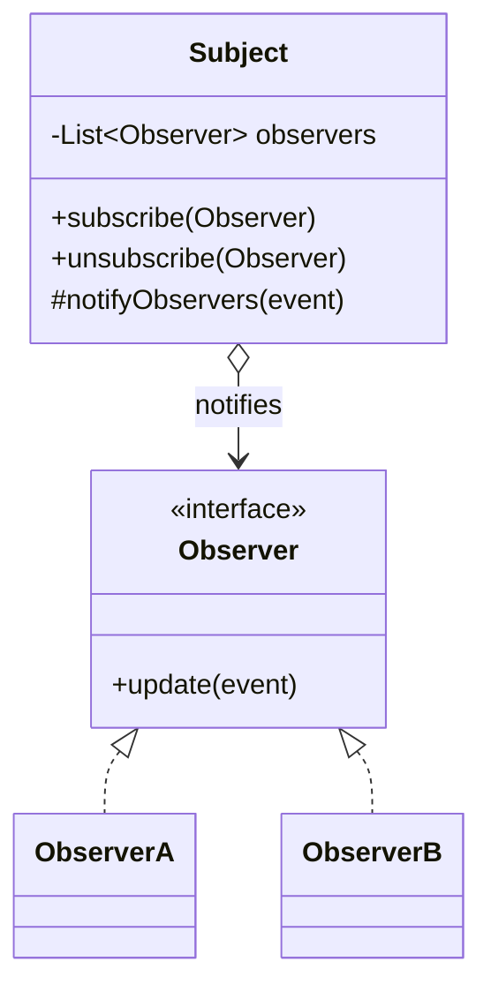
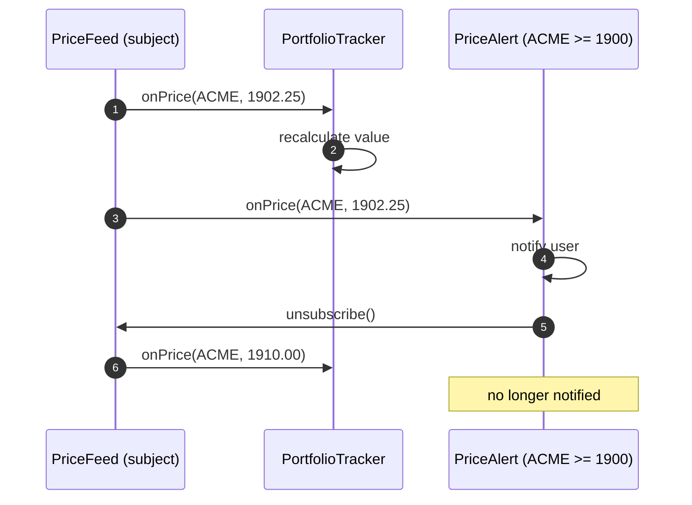
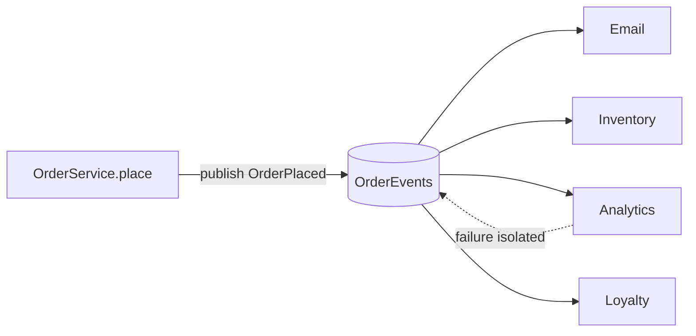
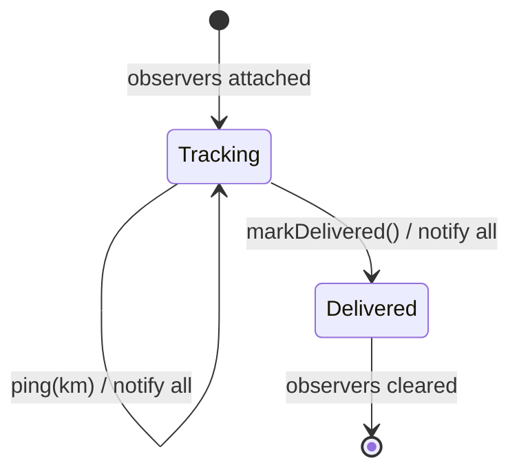

---
tags:
  - Behavioral
  - Beginner
---

# Observer

<span class="badge badge--beginner">🟢 Beginner → 🔴 Advanced</span>
<span class="badge badge--category">Behavioral</span>
<span class="badge badge--interview">Interview frequency ⭐⭐⭐⭐⭐</span>

!!! abstract "TL;DR"
    **Observer lets many objects subscribe to an object and get notified automatically when something happens to it.**
    It's the basis of event listeners, pub/sub, reactive streams and event-driven microservices. The subject doesn't know who's listening, so you can add reactions without touching it.

---

## 1. Intent & Problem It Solves

**The problem in plain English:** when an order is placed, the system must send an email, reserve inventory, record analytics and add loyalty points, and next month, notify the warehouse too. If `OrderService.place()` calls all of these directly, it depends on every one of them, a slow analytics call delays checkout, and every new reaction means editing the order code.

**Formal definition (GoF):**
> Define a one-to-many dependency between objects so that when one object changes state, all its dependents are notified and updated automatically.

## 2. Real-World Analogy

!!! example "A YouTube channel subscription"
    You subscribe to a channel. When a new video is published, every subscriber is notified. The creator doesn't call each subscriber; they don't even know who most subscribers are. You can unsubscribe at any time.

## 3. Structure



| Participant | Responsibility |
|---|---|
| **Subject (publisher)** | Keeps a list of observers; notifies them on change |
| **Observer (subscriber)** | Interface with an update/callback method |
| **Concrete observers** | React to notifications (send email, update UI, recalculate) |

**Push vs. pull:** the subject either **pushes** the data with the notification (`onPrice(symbol, price)`, used here) or just says "I changed" and observers **pull** what they need. Push is simpler; pull avoids sending data observers don't need.

## 4. Naive Approach (Without the Pattern)

```java
public String place(Order order) {
    repository.save(order);
    emailService.sendConfirmation(order);       // OrderService knows about email...
    inventoryService.reserve(order);            // ...inventory...
    analyticsClient.track(order);               // ...analytics (slow, sometimes fails)...
    loyaltyService.addPoints(order);            // ...loyalty, and next month the warehouse
    return order.id();
}
```

- :material-close-circle:{ style="color:#e53935" } **Tight coupling**: the core service depends on every reaction.
- :material-close-circle:{ style="color:#e53935" } **One failure breaks everything**: analytics times out, so checkout fails.
- :material-close-circle:{ style="color:#e53935" } **Open/Closed violation**: every new reaction edits `place()`.

---

## 5. Three Real-World Examples

### Example 1: Price Alerts and Live Portfolio (Trading / Banking)

**Scenario:** A stock-trading app streams price ticks. A portfolio widget recalculates the user's holdings on every relevant tick, and users set **one-shot price alerts** ("tell me when ACME crosses INR 1,900"). Alerts must **unsubscribe themselves** after firing, during the notification, without crashing the feed.

**Design:**



**Full Code:**

=== "PriceFeed.java"

    ```java
    --8<-- "code/behavioral/src/main/java/com/handbook/behavioral/observer/trading/PriceFeed.java"
    ```

    1.  A **functional interface** as the observer type, so observers can be lambdas.
    2.  `subscribe` returns an **unsubscribe handle**. Callers don't need to keep the listener object around to remove it.
    3.  Iterate over a **copy** of the list, so an observer can unsubscribe (or subscribe others) while being notified, without a `ConcurrentModificationException`.

=== "PriceAlert.java"

    ```java
    --8<-- "code/behavioral/src/main/java/com/handbook/behavioral/observer/trading/PriceAlert.java"
    ```

=== "PortfolioTracker.java"

    ```java
    --8<-- "code/behavioral/src/main/java/com/handbook/behavioral/observer/trading/PortfolioTracker.java"
    ```

=== "TradingDemo.java"

    ```java
    --8<-- "code/behavioral/src/main/java/com/handbook/behavioral/observer/trading/TradingDemo.java"
    ```

**Output:**

```text
--8<-- "code/outputs/behavioral/observer/trading/TradingDemo.txt"
```

**Why Observer here:**

- A **stream of changes** with many independent consumers.
- Consumers come and go at runtime (alerts are created and removed by users).
- The feed doesn't know about portfolios or alerts.

---

### Example 2: Reacting to OrderPlaced (E-commerce)

**Scenario:** After an order is saved, four teams want to react: email, inventory, analytics and loyalty. The analytics endpoint occasionally times out, and that must **never** stop the customer from getting their confirmation email or loyalty points. The order service should publish **one event** and know nothing about who listens.

**Design:**



**Full Code:**

=== "OrderEvents.java"

    ```java
    --8<-- "code/behavioral/src/main/java/com/handbook/behavioral/observer/orders/OrderEvents.java"
    ```

    1.  **Failure isolation**: one observer's exception is caught and logged; the rest still run. Without this, a buggy analytics listener would stop loyalty points from being added.

=== "OrderService.java"

    ```java
    --8<-- "code/behavioral/src/main/java/com/handbook/behavioral/observer/orders/OrderService.java"
    ```

    1.  The service's only dependency is the **event publisher**. Adding a warehouse listener needs no change here.

=== "OrdersDemo.java"

    ```java
    --8<-- "code/behavioral/src/main/java/com/handbook/behavioral/observer/orders/OrdersDemo.java"
    ```

**Output:**

```text
--8<-- "code/outputs/behavioral/observer/orders/OrdersDemo.txt"
```

**Why Observer here:**

- **Open/Closed**: new reactions are new listeners.
- **Failure isolation** protects the core flow.
- This is exactly Spring's `ApplicationEventPublisher` + `@EventListener`, and at system scale, publishing `OrderPlaced` to Kafka.

---

### Example 3: Live Delivery Tracking (Grocery Delivery)

**Scenario:** While a grocery order is on the way, the rider's phone sends location pings. The customer app shows the distance; the ETA service recomputes the arrival time but only **notifies on meaningful changes** (no flood of "ETA 5 min" messages). When the order is delivered, all observers get a final notification and are **detached**, so a finished delivery doesn't keep references to them (a classic memory leak).

**Design:**



**Full Code:**

=== "DeliveryTracker.java"

    ```java
    --8<-- "code/behavioral/src/main/java/com/handbook/behavioral/observer/tracking/DeliveryTracker.java"
    ```

    1.  **Detach on completion.** Forgotten subscriptions (the "lapsed listener" problem) are the most common Observer memory leak.

=== "TrackingDemo.java"

    ```java
    --8<-- "code/behavioral/src/main/java/com/handbook/behavioral/observer/tracking/TrackingDemo.java"
    ```

**Output:**

```text
--8<-- "code/outputs/behavioral/observer/tracking/TrackingDemo.txt"
```

At 1.8 km the ETA is still 5 minutes, so the ETA observer stays quiet. Observers decide **what matters to them**.

**Why Observer here:**

- One stream of pings, several consumers with **different needs**.
- An observer interface with **two events** (`locationChanged`, `delivered`) models a lifecycle.
- Explicit **cleanup** at the end of the lifecycle.

---

??? example "Unit Tests: `ObserverTest.java` (all three examples + challenge)"

    ```java
    --8<-- "code/behavioral/src/test/java/com/handbook/behavioral/observer/ObserverTest.java"
    ```

## 6. Variations & Modern Java Take

| Variation | Notes |
|---|---|
| **Lambdas as observers** (Examples 1, 2) | `Consumer<Event>` or a custom functional interface |
| **Unsubscribe handles** (`Runnable`, `AutoCloseable`) | Easier and safer than `removeListener(this)` |
| **Typed event bus** (coding challenge) | Subscribe by event class; Guava `EventBus`, Spring events |
| **Async observers** | Notify on an executor so slow observers don't block the subject (Spring `@Async @EventListener`) |
| **Reactive streams** | `java.util.concurrent.Flow` (`Publisher`/`Subscriber`, `SubmissionPublisher`), Project Reactor, RxJava: Observer + **back-pressure** + operators |
| **Transactional events** | Spring `@TransactionalEventListener(phase = AFTER_COMMIT)`: notify only if the DB transaction committed |

!!! warning "`java.util.Observable` is deprecated"
    `Observable`/`Observer` in `java.util` were deprecated in Java 9 (not thread-safe, class instead of interface, no event types). Use your own interfaces, `PropertyChangeListener`, Spring events, or `Flow`.

## 7. Where It Lives in Real Frameworks

| Where | Observer |
|---|---|
| JDK | `java.beans.PropertyChangeListener`; Swing/AWT `ActionListener`, `MouseListener`; `java.util.concurrent.Flow` |
| Spring | `ApplicationEventPublisher` + `@EventListener`; `ApplicationListener`; `@TransactionalEventListener` |
| Spring Boot | Lifecycle events (`ApplicationReadyEvent`) |
| JPA / Hibernate | Entity listeners (`@PostPersist`, `@PreUpdate`) |
| Reactive | Project Reactor `Flux`/`Mono` (Spring WebFlux), RxJava |
| Messaging | Kafka consumer groups, RabbitMQ fan-out exchanges, AWS SNS: Observer across services |
| Frontend | DOM `addEventListener`, React state subscriptions, WebSockets |

## 8. Pros, Cons & Trade-offs

| ✅ Pros | ❌ Cons |
|---|---|
| **Loose coupling**: subject doesn't know concrete observers | **Hidden control flow**: hard to see what happens when an event fires |
| Add reactions without changing the subject (**OCP**) | **Ordering** of notifications is usually unspecified |
| Runtime subscribe/unsubscribe | **Memory leaks** from forgotten subscriptions |
| Natural fit for UIs, events, streams | **Cascades**: observers triggering events that trigger more observers |
| | Synchronous observers can slow the subject; async ones complicate error handling |

## 9. Pitfalls & Anti-Patterns

!!! danger "Lapsed listener (memory leak)"
    A screen subscribes to a long-lived service and is never unsubscribed, so the screen (and everything it references) can never be garbage collected. Always unsubscribe (handles, try-with-resources, lifecycle hooks), or use weak references deliberately.

!!! danger "One observer breaks the others"
    Without try/catch per observer (Example 2), the first exception stops notification of the rest.

!!! danger "Side effects before commit"
    Sending "order confirmed" emails from an event published inside a DB transaction that later rolls back confirms an order that doesn't exist. Use after-commit events or a transactional outbox.

!!! warning "Concurrent modification"
    Observers subscribing or unsubscribing during notification. Iterate over a copy, or use `CopyOnWriteArrayList`.

!!! warning "Event storms and cycles"
    Observer A updates B, which notifies A... Detect re-entrance, debounce, or redesign the flow.

## 10. Senior / Architect Deep Dive (10–15 yrs)

**In-process vs. distributed observers.** In-process events (Spring) are fast but are lost if the process crashes after commit and before listeners run. For reliable reactions across services, use the **transactional outbox**: write the event to an outbox table in the same transaction as the business change, and a relay publishes it to Kafka. Consumers must be **idempotent** because delivery is at-least-once.

**Choreography.** Services reacting to each other's events (Observer at system scale) scale teams well but make end-to-end flows hard to see. Invest in **event catalogs**, schema registries (Avro/Protobuf with compatibility rules), and distributed tracing across async hops. Know when to switch to orchestration ([Mediator](mediator.md)).

**Back-pressure.** If the subject produces faster than observers consume, synchronous observers slow the subject and asynchronous ones build unbounded queues. Reactive streams (`Flow`, Reactor) make the subscriber **request** how many items it can handle.

**Ordering and consistency.** Kafka gives ordering per partition (key by entity ID); consumers see events **eventually**. Design UIs and APIs for eventual consistency ("Your order is being processed").

!!! bug "War story: the welcome email for users who never existed"
    A sign-up service published `UserRegistered` with Spring's `ApplicationEventPublisher` inside the `@Transactional` registration method. A synchronous listener sent the welcome email immediately. When a later step (duplicate phone number check) failed, the transaction rolled back, but the email was already sent. Thousands of "Welcome!" emails went to people whose accounts didn't exist, and support tickets piled up.
    **Fix:** `@TransactionalEventListener(phase = AFTER_COMMIT)` for in-process reactions, and a transactional outbox for cross-service events.
    **Lesson:** "when this changes, notify them" must mean "when this change is **committed**".

## 11. Related Patterns & Comparisons

| | Observer | Mediator | Pub/Sub (message broker) | Chain of Responsibility |
|---|---|---|---|---|
| Relationship | Subject → **many** observers | Colleagues ↔ **one** mediator | Publishers → broker → subscribers | Request along a chain |
| Coupling | Observers know the subject (to subscribe) | Colleagues know the mediator | Publishers and subscribers know only the **topic** | Handlers know the next |
| Who reacts | **All** observers | Mediator decides | All subscribers (per group) | One (or until stopped) |
| Scope | Usually in-process | In-process or orchestrator | Across processes | In-process |

## 12. Interview Corner

=== "🟢 Beginner / Service Companies"

    **Q1. What is the Observer pattern?**

    A behavioral pattern defining a **one-to-many** dependency: when the **subject** changes, all registered **observers** are **notified automatically**.

    **Q2. Give real examples.**

    **Event listeners** in UIs (button clicks), **YouTube/newsletter subscriptions**, stock price tickers, Spring **`@EventListener`**, Kafka consumers.

    **Q3. What are push and pull models?**

    **Push**: the subject sends the data with the notification. **Pull**: the subject only signals a change, and observers fetch what they need.

    **Q4. Advantages?**

    **Loose coupling**, easy to **add new observers**, supports **broadcast** communication.

    **Q5. Is `java.util.Observable` still used?**

    No. It's **deprecated since Java 9**. Use custom listener interfaces, `PropertyChangeListener`, Spring events or `Flow`.

=== "🟡 Mid-Level"

    **Q1. How do you avoid memory leaks with observers?**

    **Unsubscribe** (return handles from `subscribe`), tie subscriptions to **lifecycles**, clear observers when the subject finishes (Example 3), or use weak references carefully.

    **Q2. How do you stop one failing observer from affecting others?**

    **Catch exceptions per observer** and log them (Example 2), or deliver **asynchronously** with isolated error handling.

    **Q3. How do Spring application events work?**

    Publish with `ApplicationEventPublisher.publishEvent(e)`; methods annotated with `@EventListener` for that event type are called (synchronously by default, `@Async` for async, `@TransactionalEventListener` to tie to transaction phases).

    **Q4. How do you make an observer list thread-safe?**

    `CopyOnWriteArrayList` (cheap reads, expensive writes, ideal when subscriptions change rarely), or iterate over a snapshot copy under a lock.

    **Q5. Observer vs. Pub/Sub?**

    Observer: observers subscribe **directly** to the subject (in-process). Pub/Sub: a **broker** sits between publishers and subscribers, which only share a topic, usually across processes.

=== "🔴 Senior / FAANG / SAP"

    **Q1. "Design a notification system that reacts to order, payment and delivery events for 50 million users."**

    Services publish events to **Kafka** via outbox; a notification service consumes, applies **user preferences**, de-duplicates (idempotency), batches and rate-limits per channel, and fans out to push/SMS/email providers through per-channel queues. Discuss retries, dead letters, ordering per user, and quiet hours.

    **Q2. "Events are published inside DB transactions. What can go wrong and how do you fix it?"**

    Events for **rolled-back** changes, and **lost** events if the process crashes after commit. Fix: **after-commit** listeners in-process; **transactional outbox** + relay (or CDC with Debezium) for cross-service events; **idempotent** consumers.

    **Q3. "A slow observer is slowing down a hot path. Options?"**

    Make it **async** (executor or queue), **batch**, apply **back-pressure** (reactive streams), or move it out of process (publish to a broker). Measure the hot path's latency budget first.

    **Q4. "Choreography or orchestration?"**

    Choreography (Observer) for loosely coupled, independent reactions; orchestration (Mediator) for multi-step business flows needing visibility, timeouts and compensation. Many systems combine them.

    **Q5. "How do you evolve event schemas without breaking consumers?"**

    A **schema registry** with backward/forward compatibility checks, additive changes only, versioned topics or event types for breaking changes, and consumer-driven contract tests.

=== "💻 Coding Challenge"

    **Problem:** Build a **typed, thread-safe event bus**: subscribers register for an event class; `subscribe` returns a handle that unsubscribes when closed; publishing an event calls only handlers for that type.

    ??? success "Solution"

        === "EventBus.java"

            ```java
            --8<-- "code/behavioral/src/main/java/com/handbook/behavioral/observer/bus/EventBus.java"
            ```

        === "EventBusDemo.java"

            ```java
            --8<-- "code/behavioral/src/main/java/com/handbook/behavioral/observer/bus/EventBusDemo.java"
            ```

        **Output:**

        ```text
        --8<-- "code/outputs/behavioral/observer/bus/EventBusDemo.txt"
        ```

        **Key points to say:** `ConcurrentHashMap` + `CopyOnWriteArrayList` make subscribe, unsubscribe and publish safe from any thread; `AutoCloseable` handles work with try-with-resources; `type.cast` keeps handlers type-safe. Follow-ups: deliver to handlers of **supertypes**, isolate handler failures, async delivery.

!!! info "Behavioural tie-in (STAR) for experienced candidates"
    - **S:** Welcome emails were sent for sign-ups that later rolled back.
    - **T:** Guarantee notifications only for committed changes, in-process and across services.
    - **A:** Switched listeners to after-commit, introduced a transactional outbox with a Debezium relay to Kafka, and made consumers idempotent by event ID.
    - **R:** Zero phantom notifications since; the outbox also gave us a replayable audit trail of all domain events.

## 13. Quick Revision Card

!!! tip "Remember in 30 seconds"
    - **One-to-many**: subject notifies all subscribed observers automatically.
    - **Push vs. pull**; **unsubscribe handles**; iterate over a **copy** when notifying.
    - **Isolate failures**, beware **memory leaks**, notify **after commit**.
    - **Spring:** `@EventListener`, `@TransactionalEventListener`. **JDK:** `Flow`. (`java.util.Observable` is deprecated.)
    - System scale: **pub/sub** (Kafka) + **outbox** + **idempotent consumers**.

    ```java
    Runnable unsubscribe = feed.subscribe((symbol, price) -> ...); unsubscribe.run();
    ```

## Practice

- [ ] Make `OrderEvents` deliver to listeners asynchronously on virtual threads, keeping failure isolation.
- [ ] Add supertype delivery to `EventBus` (a handler for `Object` receives everything).
- [ ] Rewrite the price feed with `java.util.concurrent.SubmissionPublisher` and a `Flow.Subscriber` that requests 1 item at a time.

---

[:material-arrow-left: Memento](memento.md){ .md-button }
[Next: State :material-arrow-right:](state.md){ .md-button .md-button--primary }
