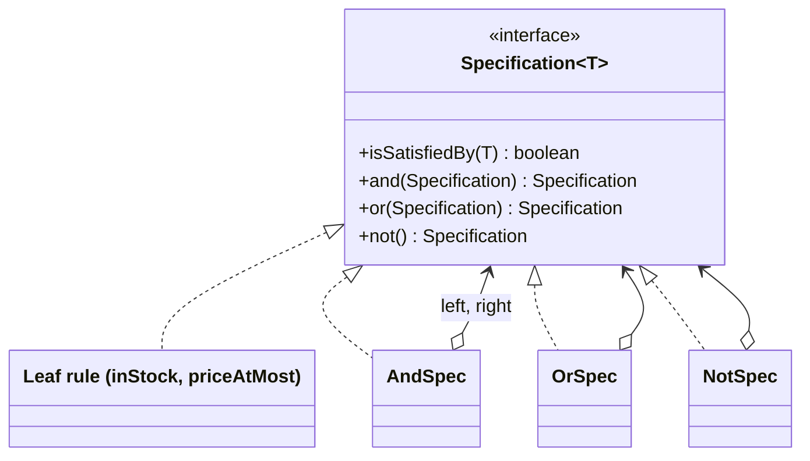
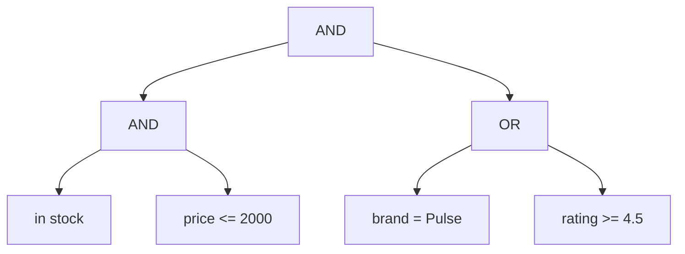
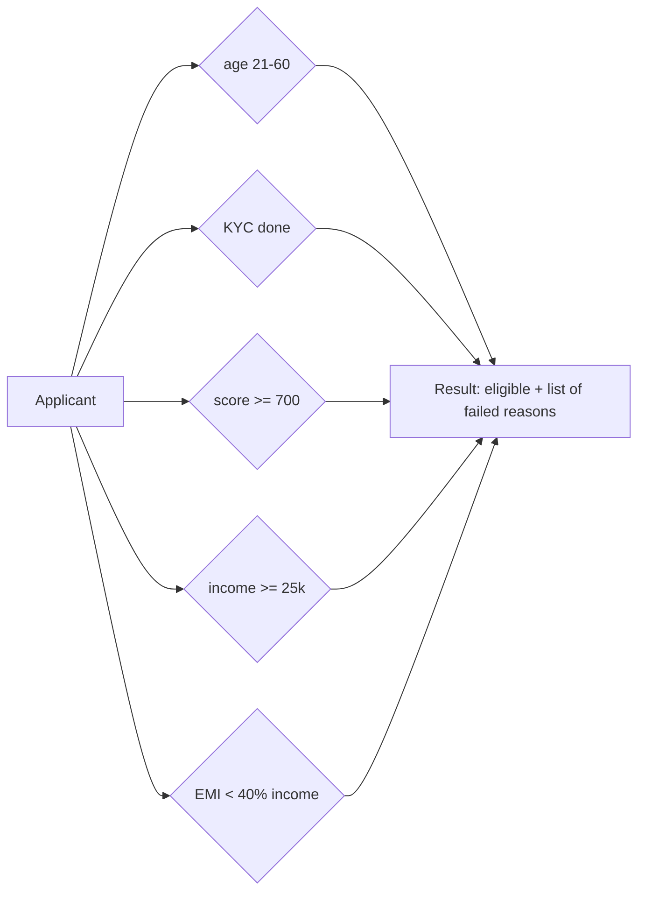
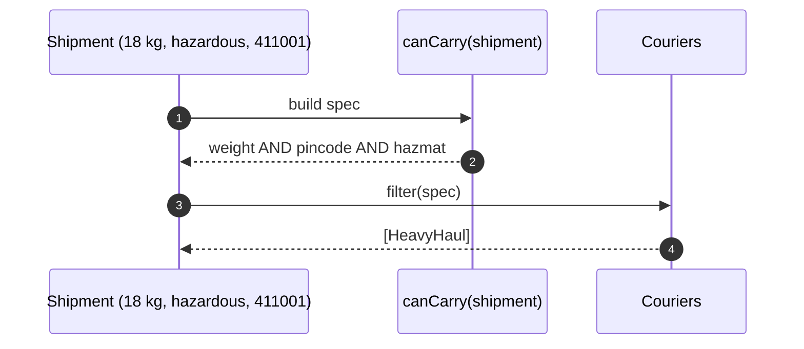

---
tags:
  - Behavioral
  - Intermediate
---

# Specification

<span class="badge badge--intermediate">🟡 Intermediate</span>
<span class="badge badge--category">Behavioral</span>
<span class="badge badge--interview">Interview frequency ⭐⭐⭐</span>

!!! abstract "TL;DR"
    **Specification wraps a business rule ("is in stock", "credit score ≥ 700") in an object that can be combined with AND, OR and NOT, and reused for filtering, validation and querying.**
    It comes from Domain-Driven Design (Eric Evans and Martin Fowler) and is what Spring Data JPA's `Specification` is built on.

---

## 1. Intent & Problem It Solves

**The problem in plain English:** a product search has many filters (in stock, under a price, brand, rating, COD), and customers combine them freely. Loan eligibility has a list of rules, and regulators require **reasons** for every rejection. Writing every combination as its own `if` or SQL query leads to duplicated, inconsistent rules ("in stock" means `stock > 0` in search but `stock >= 1 AND !blocked` in checkout).

**Definition (Evans & Fowler, *Specifications*):**
> A specification states a constraint on the state of another object. It can be combined with other specifications using logical operators, and used for validation, selection (querying) and creation (building to order).

## 2. Real-World Analogy

!!! example "A job description's requirements"
    "3+ years of Java AND (Spring OR Micronaut) AND NOT requires visa sponsorship." Recruiters combine reusable criteria, apply the same criteria to every candidate, and can explain exactly which criterion a candidate didn't meet.

## 3. Structure



| Participant | Responsibility |
|---|---|
| **Specification** | `isSatisfiedBy(candidate)` plus combinators |
| **Leaf specifications** | Single named business rules |
| **Composite specifications** | AND / OR / NOT of other specifications (a **Composite**) |

It's a code-built cousin of [Interpreter](interpreter.md): the same tree of rules, but built with Java method calls instead of parsed from text.

## 4. Naive Approach (Without the Pattern)

```java
List<Product> search(Filters f) {
    return products.stream().filter(p ->
            p.stock() > 0
            && (f.maxPrice() == null || p.price() <= f.maxPrice())
            && (f.brand() == null || p.brand().equals(f.brand()) || (f.minRating() != null && p.rating() >= f.minRating()))
            // ...the same rules re-typed in the SQL repository, the recommendations job and checkout
    ).toList();
}
```

- :material-close-circle:{ style="color:#e53935" } **Business rules duplicated** in lambdas, SQL and services, and they drift.
- :material-close-circle:{ style="color:#e53935" } Rules are **anonymous**: no names, no descriptions, no reasons.
- :material-close-circle:{ style="color:#e53935" } Boolean soup that's hard to read and test.

---

## 5. Three Real-World Examples

### Example 1: Search Filters (E-commerce)

**Scenario:** An electronics store's search lets customers tick filters: in stock, maximum price, brand, minimum rating, cash on delivery. Filters combine with AND, and some with OR (brand **or** high rating). The same named rules (`inStock`, `codAvailable`) are reused by checkout and recommendations, so "in stock" means the same thing everywhere. The UI shows a readable description of the active filter.

**Design:**



**Full Code:**

=== "Spec.java"

    ```java
    --8<-- "code/behavioral/src/main/java/com/handbook/behavioral/specification/core/Spec.java"
    ```

    1.  A factory turns a **named predicate** into a specification. The description travels with the rule.
    2.  **Combinators** return new specifications, building a tree with readable descriptions. Specifications are immutable, so they're safe to share and reuse.

=== "ProductSpecs.java"

    ```java
    --8<-- "code/behavioral/src/main/java/com/handbook/behavioral/specification/catalog/ProductSpecs.java"
    ```

=== "CatalogDemo.java"

    ```java
    --8<-- "code/behavioral/src/main/java/com/handbook/behavioral/specification/catalog/CatalogDemo.java"
    ```

**Output:**

```text
--8<-- "code/outputs/behavioral/specification/catalog/CatalogDemo.txt"
```

**Why Specification here:**

- **Named, reusable rules** shared across search, checkout and recommendations.
- **Free combination** with AND/OR/NOT, built at runtime from the user's choices.
- **Self-describing**: the filter explains itself (useful for UI chips, logs and debugging).

---

### Example 2: Loan Eligibility with Reasons (Banking)

**Scenario:** A bank's personal-loan journey checks age, KYC, credit score, income and existing EMIs (debt-to-income). Regulations and good customer service require telling applicants **every** reason they're not eligible, not just the first. The credit policy team updates thresholds quarterly. Each rule is a specification with a human-readable reason.

**Design:**



**Full Code:**

=== "Eligibility.java"

    ```java
    --8<-- "code/behavioral/src/main/java/com/handbook/behavioral/specification/loan/Eligibility.java"
    ```

    1.  **Explainable** evaluation: all rules run and **every** failure is collected with its reason, instead of a single true/false.

=== "LoanDemo.java"

    ```java
    --8<-- "code/behavioral/src/main/java/com/handbook/behavioral/specification/loan/LoanDemo.java"
    ```

**Output:**

```text
--8<-- "code/outputs/behavioral/specification/loan/LoanDemo.txt"
```

**Why Specification here:**

- **Rules are data-like objects** with reasons: easy to review with the credit policy team.
- **Explainability** is built in (reasons per rule), which is critical in lending.
- Product variants (gold loan, two-wheeler loan) reuse rules in different lists.

---

### Example 3: Courier Selection (Logistics)

**Scenario:** A shipping aggregator decides which couriers can take each parcel. Requirements come from the **shipment**: weight within the courier's limit, destination pincode served, **hazardous goods** need certified couriers, **cash on delivery** needs couriers who collect cash. The specification is **built per shipment** and then applied to every courier. If none qualify, the parcel goes to manual booking.

**Design:**



**Full Code:**

=== "CourierSelection.java"

    ```java
    --8<-- "code/behavioral/src/main/java/com/handbook/behavioral/specification/courier/CourierSelection.java"
    ```

    1.  **Parameterized specifications**: the shipment's needs decide which rules are included. Optional constraints (hazmat, COD) are only added when relevant.

=== "CourierDemo.java"

    ```java
    --8<-- "code/behavioral/src/main/java/com/handbook/behavioral/specification/courier/CourierDemo.java"
    ```

**Output:**

```text
--8<-- "code/outputs/behavioral/specification/courier/CourierDemo.txt"
```

**Why Specification here:**

- Requirements are **assembled dynamically** from the request.
- The resulting rule is **printable**, so ops can see why a courier was excluded.
- Courier filtering, pricing and SLA checks can share the same rule objects.

---

??? example "Unit Tests: `SpecificationTest.java` (all three examples + challenge)"

    ```java
    --8<-- "code/behavioral/src/test/java/com/handbook/behavioral/specification/SpecificationTest.java"
    ```

## 6. Variations & Modern Java Take

| Variation | Notes |
|---|---|
| **`java.util.function.Predicate`** | Already has `and`, `or`, `negate`: the simplest specification. Add names/descriptions when you need explainability |
| **Explainable specs** (Example 2) | Return reasons, not just booleans |
| **Parameterized specs** (Example 3) | Built from request data |
| **Specs that compile to queries** (coding challenge) | Push filtering into the database |
| **Spring Data JPA `Specification<T>`** | `toPredicate(root, query, cb)` produces JPA Criteria predicates; `repo.findAll(spec.and(other))` |
| **QueryDSL / jOOQ conditions** | Type-safe query predicates, composable the same way |

**Spring Data JPA example:**

```java
static Specification<Product> inStock() { return (root, q, cb) -> cb.gt(root.get("stock"), 0); }
static Specification<Product> priceAtMost(int max) { return (root, q, cb) -> cb.le(root.get("priceInr"), max); }

List<Product> results = productRepository.findAll(inStock().and(priceAtMost(2000)));  // SQL WHERE, not in-memory
```

## 7. Where It Lives in Real Frameworks

| Where | Specification |
|---|---|
| JDK | `Predicate` with `and`/`or`/`negate`/`not` |
| Spring Data JPA | `org.springframework.data.jpa.domain.Specification` + `JpaSpecificationExecutor` |
| Spring Data (Querydsl) | `QuerydslPredicateExecutor` with `BooleanExpression` |
| jOOQ | `Condition` objects combined with `and()`/`or()` |
| Hibernate Validator | Constraint annotations (a declarative, per-field form of specification) |
| Elasticsearch / OpenSearch | Bool queries (`must`, `should`, `must_not`) |

## 8. Pros, Cons & Trade-offs

| ✅ Pros | ❌ Cons |
|---|---|
| **Named, reusable** business rules (DDD ubiquitous language) | **In-memory** filtering doesn't scale to large tables; you need query translation |
| **Composable** (AND/OR/NOT) at runtime | Two implementations (in-memory + SQL) can **drift** |
| Testable rule by rule | Overkill for one or two fixed conditions |
| Self-describing and **explainable** | Deep trees can be slow if leaves are expensive (order cheap rules first) |

## 9. Pitfalls & Anti-Patterns

!!! danger "Filtering huge tables in memory"
    `repository.findAll().stream().filter(spec::isSatisfiedBy)` loads every row. For large data, specifications must translate to **queries** (Spring Data `Specification`, the coding challenge).

!!! danger "String-concatenated SQL"
    Building `WHERE brand = '` + input + `'` invites SQL injection. Always use **bind parameters** (see the challenge's injection attempt).

!!! warning "Rules that drift between layers"
    If "in stock" is a Java predicate in one place and SQL in another, they'll diverge. Keep one definition (e.g., JPA specs reused for both), or test both against the same cases.

!!! warning "Unexplainable rejections"
    A plain `boolean` result can't tell a customer why. Where people are affected (credit, insurance, hiring), collect reasons.

## 10. Senior / Architect Deep Dive (10–15 yrs)

**Specifications in DDD.** Specifications express domain concepts ("overdue invoice", "eligible for free delivery") in the ubiquitous language. They live in the **domain layer**; repositories accept them (`invoiceRepository.findAll(overdue())`), keeping persistence details out of the domain.

**Query translation strategies.** (1) Implement each spec twice (in-memory and query) with **shared tests**; (2) express specs only as queries (JPA Criteria, QueryDSL) and evaluate in memory via an in-memory database in tests; (3) build a small AST (as in [Interpreter](interpreter.md)) and write **two visitors**, one to evaluate and one to emit SQL.

**Performance.** Order AND operands by **cost and selectivity** (cheap, highly selective rules first). In SQL, make sure combined specs hit **indexes**; OR-heavy specs often defeat indexes, so check query plans.

**Explainability and compliance.** In lending and insurance, store the **rules version** and **failed reasons** with each decision. Regulators may ask "why was this customer rejected on 3 March?" months later.

!!! bug "War story: two definitions of 'eligible'"
    A bank's loan-offer emails used one eligibility query (in SQL, written by the marketing analytics team), while the application form used Java rules (written by the lending team). The SQL omitted the debt-to-income check. Thousands of customers received "You're pre-approved!" emails and were then rejected when applying, which led to complaints and a regulator inquiry.
    **Fix:** one set of eligibility specifications in the domain module, translated to SQL for campaigns and evaluated in memory for applications, with a shared test suite of 200 applicant profiles run against both.
    **Lesson:** a business rule should exist **once**. Specifications give it a home.

## 11. Related Patterns & Comparisons

| | Specification | Interpreter | Strategy | Chain of Responsibility |
|---|---|---|---|---|
| Represents | A **business rule** (boolean) | A **language** (parsed) | An **algorithm** | A **handler** |
| Combination | AND / OR / NOT trees | Grammar trees | Usually not combined | Sequential chain |
| Built from | Code | Text | Code | Code/config |
| Typical use | Filtering, validation, querying | User-written rules | Swappable behavior | Pipelines |

## 12. Interview Corner

=== "🟢 Beginner / Service Companies"

    **Q1. What is the Specification pattern?**

    A pattern that puts a **business rule** in an object with `isSatisfiedBy(candidate)`, and lets rules be **combined** with AND, OR and NOT.

    **Q2. Where is it used?**

    **Filtering** (search), **validation** (eligibility), and **querying** (Spring Data JPA `Specification`).

    **Q3. How is it related to `Predicate`?**

    `Predicate<T>` with `and`, `or` and `negate` is a minimal specification. The pattern adds **names, descriptions, reasons and query translation**.

    **Q4. Advantages?**

    **Reusable**, **composable**, **testable** rules with a single definition.

    **Q5. Write a spec for "adult AND resident".**

    `Spec<Person> adult = Spec.of("adult", p -> p.age() >= 18); Spec<Person> resident = Spec.of("resident", Person::isResident); adult.and(resident).isSatisfiedBy(person);`

=== "🟡 Mid-Level"

    **Q1. How does Spring Data JPA's `Specification` work?**

    Each spec returns a JPA Criteria `Predicate` via `toPredicate(root, query, criteriaBuilder)`; they combine with `and`/`or`; `JpaSpecificationExecutor.findAll(spec)` runs **one SQL query**.

    **Q2. How do you report why a candidate failed?**

    Give each rule a **reason**, evaluate **all** rules and collect failures (Example 2), or have `and` return a result object listing failed children.

    **Q3. In-memory vs. database evaluation?**

    In-memory for small sets or objects already loaded; **database** for large data. Keep one definition (or shared tests) so both agree.

    **Q4. Specification vs. Strategy?**

    Specification is a **boolean business rule** meant to be combined; Strategy is an **interchangeable algorithm** producing a result.

    **Q5. How do you test specifications?**

    Table-driven tests per leaf rule (boundary values), plus a few combinations to check AND/OR/NOT and descriptions.

=== "🔴 Senior / FAANG / SAP"

    **Q1. "Design dynamic search filters over 50 million products."**

    Filters map to **specifications** that translate to the **search engine's query DSL** (Elasticsearch bool queries) or SQL with indexed columns; facets computed by the engine; validation of allowed filters; cache common combinations; never filter in application memory.

    **Q2. "Eligibility rules change quarterly and must be explainable for 7 years. Design it."**

    Versioned rule sets (specifications with reasons), **effective dates**, decision records storing rule version + inputs + failed reasons, replay capability to reproduce old decisions, and a review workflow for rule changes.

    **Q3. "How do you avoid the in-memory and SQL versions of a rule diverging?"**

    Single source (AST plus two visitors, or JPA specs evaluated against an in-memory DB in tests), and a **shared conformance test suite** run against both.

    **Q4. "OR-heavy specifications are slow in Postgres. What do you do?"**

    Check `EXPLAIN ANALYZE`; rewrite ORs as `UNION ALL` or `IN`, add composite or partial indexes, push selective filters first, or move faceted search to a search engine.

    **Q5. "Specification vs. a rules engine (Drools)?"**

    Specifications: simple, explicit, compile-time-checked combinations in code. Rules engines: many interacting rules, inference and business-authored rules, at the cost of complexity and opacity. Start with specifications.

=== "💻 Coding Challenge"

    **Problem:** Make specifications that produce a **parameterized SQL `WHERE` clause** (never concatenating values into SQL), support AND/OR/NOT, keep parameters in the right order, and show that an injection attempt stays a harmless parameter.

    ??? success "Solution"

        === "SqlSpec.java"

            ```java
            --8<-- "code/behavioral/src/main/java/com/handbook/behavioral/specification/sql/SqlSpec.java"
            ```

        === "SqlDemo.java"

            ```java
            --8<-- "code/behavioral/src/main/java/com/handbook/behavioral/specification/sql/SqlDemo.java"
            ```

        **Output:**

        ```text
        --8<-- "code/outputs/behavioral/specification/sql/SqlDemo.txt"
        ```

        **Key points to say:** values go only into the **params list** (bind with `PreparedStatement.setObject` in order); combinators add parentheses so precedence is explicit; records keep specs immutable. Column names must come from a **whitelist**, never from user input.

!!! info "Behavioural tie-in (STAR) for experienced candidates"
    - **S:** Marketing's "pre-approved" emails used different eligibility logic than the application, causing complaints.
    - **T:** One eligibility definition for every channel.
    - **A:** Built eligibility specifications with reasons in the domain module, translated to SQL for campaigns, and shared a 200-profile conformance suite across both paths.
    - **R:** Pre-approval-to-approval mismatch fell from 31% to under 2%; audit questions answered from stored reasons in minutes.

## 13. Quick Revision Card

!!! tip "Remember in 30 seconds"
    - **Business rule as an object**: `isSatisfiedBy`, combined with **AND / OR / NOT**.
    - **Named, reusable, testable, explainable** (collect reasons where people are affected).
    - For big data, **translate to queries** (Spring Data JPA `Specification`), always with bind parameters.
    - One definition of each rule; shared tests if it has two implementations.
    - `Predicate` is the minimal Java version.

    ```java
    productRepository.findAll(inStock().and(priceAtMost(2000)).and(brand("Pulse").or(ratingAtLeast(4.5))));
    ```

## Practice

- [ ] Make `Spec.and` report **which** side failed, producing a list of failed descriptions.
- [ ] Rewrite `ProductSpecs` as Spring Data JPA `Specification`s and run them against H2.
- [ ] Add an "express delivery available" rule to courier selection based on pincode tiers.

---

[:material-arrow-left: Null Object](null-object.md){ .md-button }
[Next: Concurrency Patterns :material-arrow-right:](../concurrency/index.md){ .md-button .md-button--primary }
