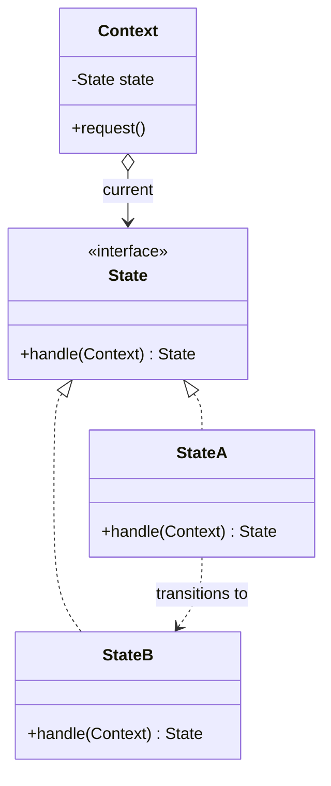
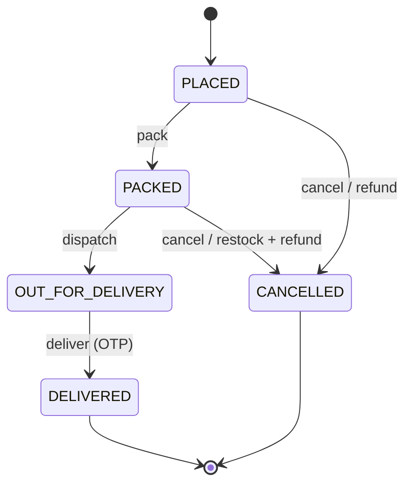
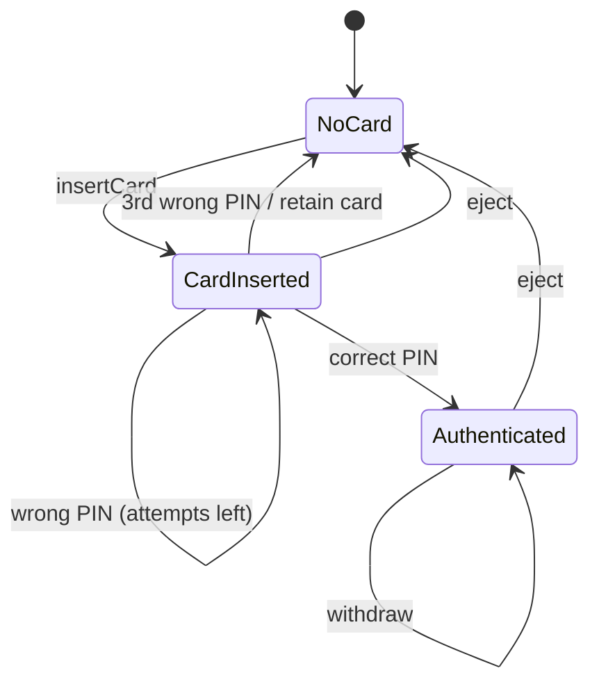
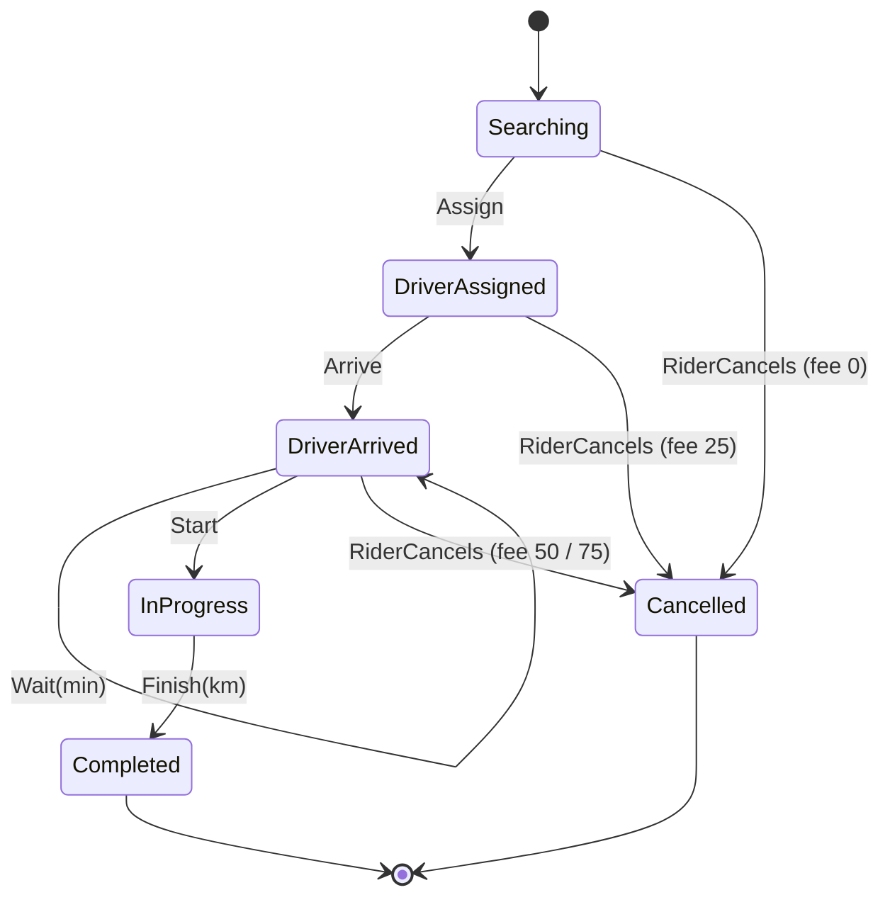

---
tags:
  - Behavioral
  - Intermediate
---

# State

<span class="badge badge--intermediate">🟡 Intermediate</span>
<span class="badge badge--category">Behavioral</span>
<span class="badge badge--interview">Interview frequency ⭐⭐⭐⭐⭐</span>

!!! abstract "TL;DR"
    **State lets an object change its behavior when its internal state changes, by delegating to a state object. It's a clean way to build state machines.**
    Use it for lifecycles (orders, trips, payments, documents), devices (ATMs, vending machines), and anything with "what's allowed depends on where we are".

---

## 1. Intent & Problem It Solves

**The problem in plain English:** an order can be cancelled when placed or packed, but not once the rider has left. Delivery is only possible when it's out for delivery. Without the pattern, every method becomes `if (status == PLACED) ... else if (status == PACKED) ...`, repeated in `cancel()`, `dispatch()`, `deliver()`, refunds and notifications. Adding a status ("READY_FOR_PICKUP") means editing every one of those switches.

**Formal definition (GoF):**
> Allow an object to alter its behavior when its internal state changes. The object will appear to change its class.

## 2. Real-World Analogy

!!! example "A traffic light"
    Pressing the pedestrian button means something different on red (do nothing), green (shorten the cycle) and amber (ignore). The light is one device, but its behavior depends entirely on its current state, and each state knows which state comes next.

## 3. Structure



| Participant | Responsibility |
|---|---|
| **Context** | Holds the current state; delegates actions to it |
| **State** | Interface with every action the context supports |
| **Concrete states** | Implement what each action means in that state, and **which state comes next** |

## 4. Naive Approach (Without the Pattern)

```java
void cancel() {
    switch (status) {
        case PLACED, PACKED -> { refund(); status = CANCELLED; }
        case OUT_FOR_DELIVERY -> throw new IllegalStateException("rider on the way");
        case DELIVERED -> throw new IllegalStateException("already delivered");
        case CANCELLED -> throw new IllegalStateException("already cancelled");
    }
}
void dispatch() { switch (status) { /* the same five cases again */ } }
void deliver()  { switch (status) { /* ...and again */ } }
```

- :material-close-circle:{ style="color:#e53935" } **Rules for one state are spread** across every method.
- :material-close-circle:{ style="color:#e53935" } Adding a state touches **every** switch.
- :material-close-circle:{ style="color:#e53935" } Easy to miss a case, which leaves an **illegal transition** open.

---

## 5. Three Real-World Examples

### Example 1: Order Lifecycle (Grocery) — *classic state objects*

**Scenario:** A quick-commerce order moves through PLACED → PACKED → OUT_FOR_DELIVERY → DELIVERED, or to CANCELLED. Cancelling is free before dispatch (with different side effects: refund only, or restock + refund) and **not allowed** once the rider has left. Delivered and cancelled orders accept no further actions. Support agents need clear messages when an action isn't allowed.

**Design:**



**Full Code:**

=== "OrderState.java"

    ```java
    --8<-- "code/behavioral/src/main/java/com/handbook/behavioral/state/order/OrderState.java"
    ```

    1.  **Default methods reject** every action. Each state overrides **only** what's legal in it, so illegal transitions are closed by default, which is the safe choice.

=== "States.java"

    ```java
    --8<-- "code/behavioral/src/main/java/com/handbook/behavioral/state/order/States.java"
    ```

=== "Order.java"

    ```java
    --8<-- "code/behavioral/src/main/java/com/handbook/behavioral/state/order/Order.java"
    ```

    1.  The context **delegates** and stores whatever state the current state returns. It contains no `switch` at all.

=== "OrderDemo.java"

    ```java
    --8<-- "code/behavioral/src/main/java/com/handbook/behavioral/state/order/OrderDemo.java"
    ```

**Output:**

```text
--8<-- "code/outputs/behavioral/state/order/OrderDemo.txt"
```

**Why State here:**

- Each state's rules live **together** in one class (Packed: can dispatch or cancel).
- New state (READY_FOR_PICKUP) = new class + transitions into it; other states are untouched.
- **Closed by default**: forgetting to allow an action is safe, unlike forgetting to forbid one.

---

### Example 2: ATM Session (Banking)

**Scenario:** An ATM session has clear phases: no card, card inserted (PIN entry, max 3 attempts, then the card is retained), and authenticated (withdrawals in multiples of 100, within balance). The same buttons mean different things in each phase. Security auditors want to see exactly what's possible in each state.

**Design:**



**Full Code:**

=== "Atm.java"

    ```java
    --8<-- "code/behavioral/src/main/java/com/handbook/behavioral/state/atm/Atm.java"
    ```

    1.  **State-specific data** lives in the state object: the PIN attempt counter exists only while a card is inserted, and a new card starts with a fresh `CardInserted` and 3 attempts.

=== "AtmDemo.java"

    ```java
    --8<-- "code/behavioral/src/main/java/com/handbook/behavioral/state/atm/AtmDemo.java"
    ```

**Output:**

```text
--8<-- "code/outputs/behavioral/state/atm/AtmDemo.txt"
```

**Why State here:**

- Behavior is **driven entirely by state**; the same input means different things.
- **State-local data** (PIN attempts) is scoped naturally to its state.
- Inner classes let states use the context's fields (balance, PIN) without exposing them publicly.

---

### Example 3: Trip State Machine (Ride-hailing) — *functional style*

**Scenario:** A ride-hailing trip goes from searching to driver assigned, driver arrived, in progress, and completed, or cancelled. **Cancellation fees depend on the state** (free while searching, INR 25 once a driver is assigned, INR 50 after arrival, INR 75 if the driver waited more than 5 minutes). Mobile apps send events that are sometimes out of order or duplicated, so invalid events must be **rejected**, not silently applied. The state is persisted and the transition function is used by several services.

**Design:**



**Full Code:**

=== "Trip.java"

    ```java
    --8<-- "code/behavioral/src/main/java/com/handbook/behavioral/state/trip/Trip.java"
    ```

    1.  A **pure transition function** `(state, event) -> new state`, using sealed types and nested pattern-matching switches. The compiler checks that every **state** is handled. States are immutable records, so they're trivial to persist, log and test.

=== "TripDemo.java"

    ```java
    --8<-- "code/behavioral/src/main/java/com/handbook/behavioral/state/trip/TripDemo.java"
    ```

**Output:**

```text
--8<-- "code/outputs/behavioral/state/trip/TripDemo.txt"
```

**Why a functional state machine here:**

- **Immutable states + a pure function** means no hidden mutation: easy to test, replay and use in several services.
- **State carries data** (driver, minutes waited, fare), so fees are computed from the state itself.
- Invalid events from buggy clients are **rejected loudly**.

---

??? example "Unit Tests: `StateTest.java` (all three examples + challenge)"

    ```java
    --8<-- "code/behavioral/src/test/java/com/handbook/behavioral/state/StateTest.java"
    ```

## 6. Variations & Modern Java Take

| Style | When |
|---|---|
| **State objects** (Example 1) | Each state has rich behavior; classic GoF |
| **Inner-class states** (Example 2) | States need the context's private data |
| **Sealed types + pure transition function** (Example 3) | Immutable, persisted, event-driven state (event sourcing, workflows) |
| **Enum with per-constant methods** (coding challenge) | Simple workflows with few actions and no state-specific data |
| **Transition table** (`Map<State, Map<Event, State>>`) | Large, data-driven state machines, possibly configured outside code |
| **Libraries** | Spring Statemachine, Squirrel; workflow engines (Temporal, Camunda) for long-running, persisted processes |

## 7. Where It Lives in Real Frameworks

| Where | State machine |
|---|---|
| JDK | `Thread.State` (NEW, RUNNABLE, BLOCKED, WAITING, ...); `java.util.concurrent.FutureTask` states |
| JDK | `Iterator` implementations (states like "before first", "after last") |
| Spring Statemachine | Declarative states, events, guards and actions |
| Spring Batch | Job and step statuses (`BatchStatus`) |
| TCP | Connection states (LISTEN, SYN_SENT, ESTABLISHED, TIME_WAIT) |
| Payments | Payment intent lifecycles (requires_payment_method → processing → succeeded), as in Stripe-like APIs |
| Kubernetes | Pod phases (Pending, Running, Succeeded, Failed) |

## 8. Pros, Cons & Trade-offs

| ✅ Pros | ❌ Cons |
|---|---|
| Each state's behavior **in one place** (SRP) | **More classes** than a switch for small machines |
| New states without editing others (OCP) | Transitions are **spread across states**; the full picture needs a diagram |
| Illegal transitions are **explicit** (closed by default) | Shared data between states needs care (context fields vs. state fields) |
| Removes large conditional blocks | Overkill for 2–3 states with trivial behavior |

## 9. Pitfalls & Anti-Patterns

!!! danger "Transitions without persistence discipline"
    In a database, two requests can read PACKED and both apply different transitions. Use **optimistic locking** (`@Version`) or a conditional update (`UPDATE ... SET status='CANCELLED' WHERE id=? AND status='PACKED'`).

!!! danger "Silently ignoring invalid events"
    Returning "OK" for "deliver" on a cancelled order hides client bugs and corrupts reports. Reject loudly and log.

!!! warning "Boolean flags instead of states"
    `isPaid`, `isShipped`, `isCancelled`, `isRefunded` give 16 combinations, most of them nonsense ("cancelled and delivered"). One explicit state field makes impossible states impossible.

!!! warning "Side effects inside transition functions"
    Sending SMS from inside `next(state, event)` makes replays send it again. Compute the new state **purely**, then run side effects based on the transition (or emit events).

## 10. Senior / Architect Deep Dive (10–15 yrs)

**Persisted state machines.** In real systems the state lives in a database row or an event log. Apply transitions **atomically** with concurrency control, record **transition history** (who, when, from, to, why) for audit and support, and publish **events** on transition (via outbox) so other services react.

**Idempotency.** Mobile and webhook clients retry. Treat "event already applied" as success (same target state), and reject truly invalid transitions. Include event IDs.

**Long-running workflows.** When states span days (loan approval, KYC, returns), add **timeouts** (escalate after 48 h) and **compensation** (refund after cancellation). This is where workflow engines (Temporal, Camunda) or sagas come in; they're state machines with durable timers.

**Diagrams as documentation.** Generate the state diagram from code or configuration (Spring Statemachine can export it) so docs never drift from behavior.

!!! bug "War story: the refund that happened twice"
    An e-commerce order service used flags and an `if` chain. "Cancel" checked `!isShipped` and issued a refund. The mobile app double-sent "Cancel" when the network hiccuped, and both requests passed the check before either saved. Two refunds per order, about 1,100 times on a sale day.
    **Fix:** an explicit `status` column with a State-pattern transition function, a conditional `UPDATE ... WHERE status IN ('PLACED','PACKED')` (only one request wins), and idempotency keys on the cancel API.
    **Lesson:** a state machine is only as correct as the way its transitions are **persisted**.

## 11. Related Patterns & Comparisons

| | State | Strategy | Command | Memento |
|---|---|---|---|---|
| Object represents | **Current condition** that changes itself | An **interchangeable algorithm** | A **request** | A **snapshot** |
| Who switches it | **States themselves** (transitions) | The **client** chooses | N/A | N/A |
| Knows other variants? | Yes: states know their successors | No: strategies are independent | No | No |

"State vs. Strategy" is a top interview question: same structure (context delegates to an interface), different **intent**. In State, the object changes **itself** based on events; in Strategy, the client **picks** a behavior.

## 12. Interview Corner

=== "🟢 Beginner / Service Companies"

    **Q1. What is the State pattern?**

    A behavioral pattern where an object **changes its behavior when its internal state changes**, by delegating to a **state object** that represents the current state.

    **Q2. Give examples.**

    **Order lifecycle**, **ATM**, **vending machine**, traffic light, document approval, TCP connection.

    **Q3. State vs. Strategy?**

    Same structure, different intent. **State**: states switch **themselves** based on events. **Strategy**: the **client** chooses an algorithm, and strategies don't know each other.

    **Q4. Why not use if-else or switch?**

    With many states and actions, conditionals spread each state's rules across methods, and adding a state means editing every switch. State keeps each state's rules **in one class**.

    **Q5. Implement a vending machine with states.**

    States `NoCoin`, `HasCoin`, `Dispensing`, `SoldOut`; each implements `insertCoin`, `selectItem`, `dispense` (rejecting what's not allowed) and returns the next state. The `VendingMachine` context delegates.

=== "🟡 Mid-Level"

    **Q1. How do you implement State with enums?**

    Each enum constant overrides the methods valid for it and returns the next constant; the base methods throw (see the coding challenge). Good for simple workflows.

    **Q2. Where should state-specific data live?**

    In the **state object** when it only matters in that state (PIN attempts); in the **context** when it's shared across states (balance).

    **Q3. How do you persist a state machine in a database?**

    Store the state as a column; apply transitions with **optimistic locking** or conditional updates; record a **transition history** table.

    **Q4. How do you handle duplicate events?**

    **Idempotency**: an event that leads to the state you're already in is a success; track event IDs; reject genuinely invalid transitions.

    **Q5. How do you test a state machine?**

    A table of **(state, event) → expected state / error** for every combination, which is easy with a pure transition function (Example 3).

=== "🔴 Senior / FAANG / SAP"

    **Q1. "Design the payment lifecycle for a payments platform."**

    States: created → requires_action (3-D Secure) → processing → succeeded / failed / canceled, plus refunds (partial and full) and disputes. Durable state with a transition log; **idempotency keys** on API calls; **webhooks** for state changes via outbox; timeouts for stuck processing (reconciliation with the bank); strict invalid-transition handling.

    **Q2. "Two microservices both update an order's state. How do you avoid conflicts?"**

    **Single owner** of the order state (the order service); others send **commands/events**; transitions validated by the owner; optimistic concurrency; or a workflow/saga orchestrator owning the flow.

    **Q3. "State objects vs. a transition table vs. a workflow engine?"**

    State objects: rich behavior, in-memory. Transition tables: data-driven, easier to visualize and configure. Workflow engines: long-running, durable timers, retries, human tasks; heavier, but they solve persistence and time.

    **Q4. "How do you migrate a state machine when adding new states to live data?"**

    Add states **backward-compatibly** (old states still valid), deploy code that understands both, migrate rows if needed, then enable new transitions. Never reinterpret existing states.

    **Q5. "Booleans vs. a status field: argue it."**

    N booleans create 2ⁿ combinations, most impossible; a status enum + state machine makes illegal combinations **unrepresentable**, gives one place for rules, and gives auditable transitions.

=== "💻 Coding Challenge"

    **Problem (content platform):** A document goes DRAFT → IN_REVIEW → APPROVED → PUBLISHED; a reviewer can **reject** it back to DRAFT. Any other action must fail with a clear message. Implement it with an `enum`.

    ??? success "Solution"

        === "DocumentStatus.java"

            ```java
            --8<-- "code/behavioral/src/main/java/com/handbook/behavioral/state/approval/DocumentStatus.java"
            ```

        === "ApprovalDemo.java"

            ```java
            --8<-- "code/behavioral/src/main/java/com/handbook/behavioral/state/approval/ApprovalDemo.java"
            ```

        **Output:**

        ```text
        --8<-- "code/outputs/behavioral/state/approval/ApprovalDemo.txt"
        ```

        **Key points to say:** **constant-specific method bodies** override only legal actions; base methods throw, so the machine is **closed by default**; enums are serializable and easy to store in a column. Limits: no per-instance data (use classes or records for that).

!!! info "Behavioural tie-in (STAR) for experienced candidates"
    - **S:** Duplicate cancel requests caused double refunds on sale days.
    - **T:** Make order transitions correct under retries and concurrency.
    - **A:** Replaced boolean flags with a status enum and a State-pattern transition function, conditional SQL updates, idempotency keys, and a transition history table.
    - **R:** Double refunds dropped to zero; support could finally answer "what happened to my order?" from the history.

## 13. Quick Revision Card

!!! tip "Remember in 30 seconds"
    - **Behavior depends on state**; the context **delegates** to the current state object.
    - States implement **only legal actions** and return the **next state** (closed by default).
    - Styles: state objects, inner classes, **sealed records + pure function**, enums.
    - Persist with **atomic transitions**, history and idempotency.
    - **State vs. Strategy**: self-switching vs. client-chosen.

    ```java
    public void cancel() { state = state.cancel(this); }   // no switch in the context
    ```

## Practice

- [ ] Add a `READY_FOR_PICKUP` state (for store pickup orders) to Example 1.
- [ ] Add a daily withdrawal limit to the ATM's `Authenticated` state.
- [ ] Write a test that checks every `(state, event)` pair of the trip machine against a table.
- [ ] Persist `Order` state with a conditional SQL update (H2 in a test).

---

[:material-arrow-left: Observer](observer.md){ .md-button }
[Next: Strategy :material-arrow-right:](strategy.md){ .md-button .md-button--primary }
