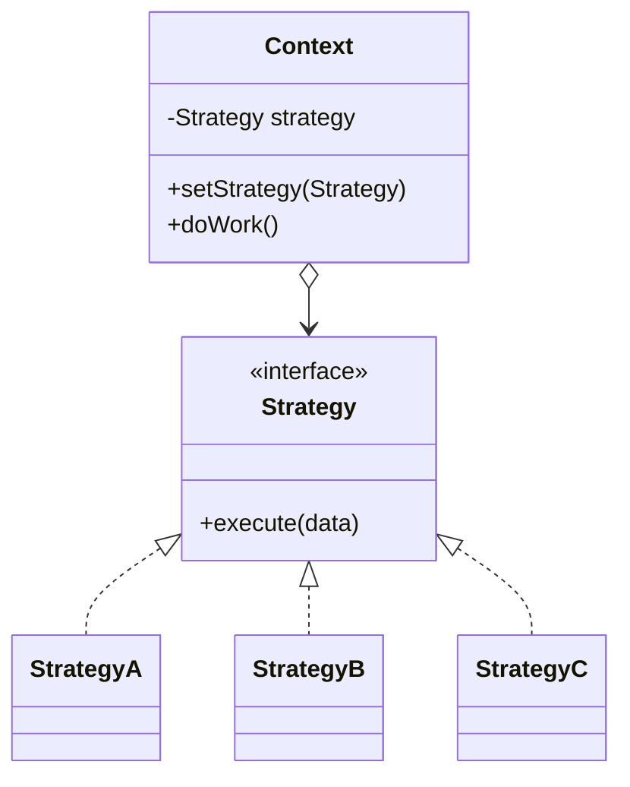
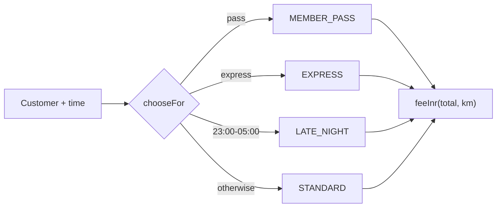
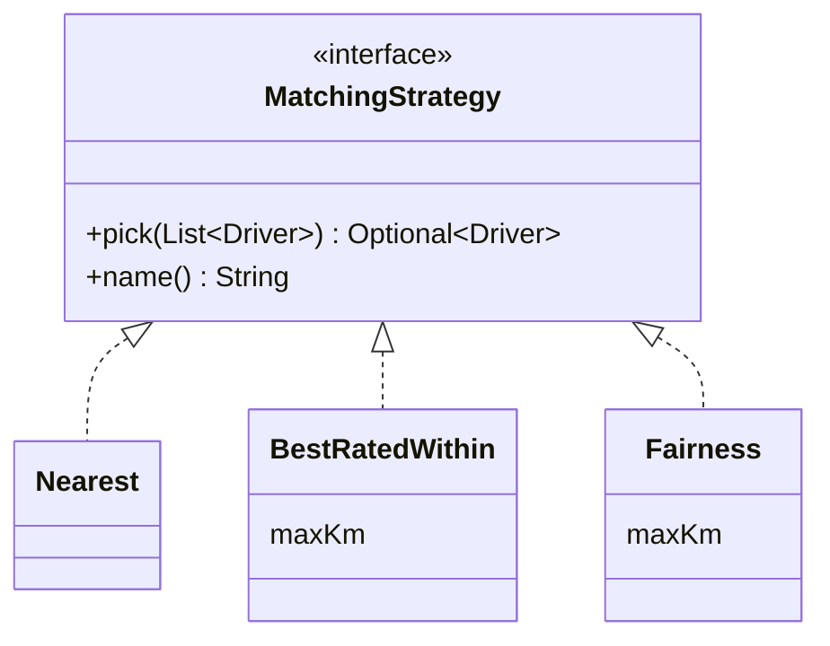
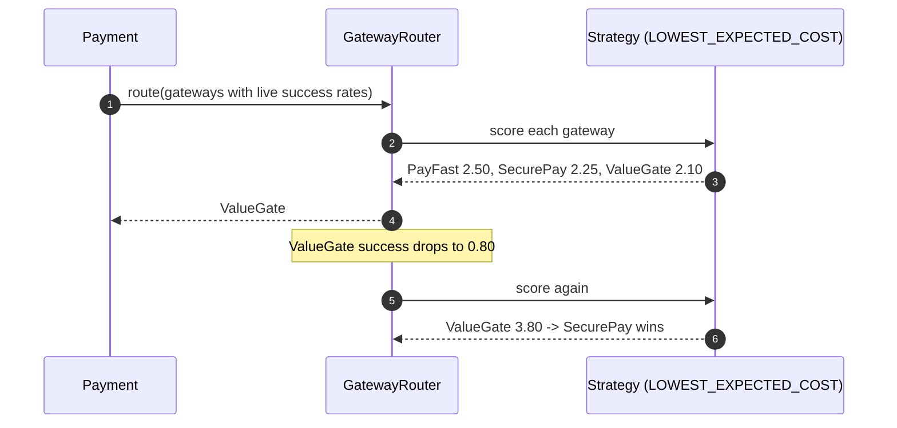

---
tags:
  - Behavioral
  - Beginner
---

# Strategy

<span class="badge badge--beginner">🟢 Beginner</span>
<span class="badge badge--category">Behavioral</span>
<span class="badge badge--interview">Interview frequency ⭐⭐⭐⭐⭐</span>

!!! abstract "TL;DR"
    **Strategy puts each variant of an algorithm behind a common interface, so the algorithm can be chosen and swapped at runtime.**
    Use it whenever "how we calculate or decide this" varies: fees, pricing, matching, routing, sorting, validation, compression. In modern Java a strategy is often just a lambda.

---

## 1. Intent & Problem It Solves

**The problem in plain English:** delivery fees depend on the customer: standard customers pay INR 30 below INR 199, express costs INR 49 (plus INR 10 beyond 3 km), pass members pay nothing, and late-night orders carry a surcharge. Writing all of this as one growing `if/else` inside checkout makes checkout change every time pricing changes, and the rules can't be tested or reused on their own.

**Formal definition (GoF):**
> Define a family of algorithms, encapsulate each one, and make them interchangeable. Strategy lets the algorithm vary independently from clients that use it.

## 2. Real-World Analogy

!!! example "Getting to the airport"
    You can take a cab, the metro, or drive. Each is a different strategy for the same goal. You pick one based on time, budget and luggage, and you can switch at the last minute. The goal ("be at the airport by 6") doesn't change.

## 3. Structure



| Participant | Responsibility |
|---|---|
| **Strategy** | Common interface for the algorithm |
| **Concrete strategies** | Different implementations (independent of each other) |
| **Context** | Uses a strategy; doesn't know which one |
| **Client / selector** | Chooses the strategy (from config, user, context) |

## 4. Naive Approach (Without the Pattern)

```java
int deliveryFee(Customer c, int total, double km, int hour) {
    if (c.hasPass()) return 0;
    else if (c.wantsExpress()) return 49 + (km > 3 ? 10 : 0);
    else if (hour >= 23 || hour < 5) return (total >= 199 ? 0 : 30) + 25;
    else return total >= 199 ? 0 : 30;
    // Next sprint: rain surcharge, festival waiver, B2B pricing...
}
```

- :material-close-circle:{ style="color:#e53935" } **One method that changes for every pricing idea** (violates Open/Closed).
- :material-close-circle:{ style="color:#e53935" } **Rules tangled** with selection logic; hard to test each rule alone.
- :material-close-circle:{ style="color:#e53935" } Can't switch behavior per city or A/B test without more `if`s.

---

## 5. Three Real-World Examples

### Example 1: Delivery Fee Strategies (Grocery)

**Scenario:** A grocery app has four delivery-fee rules: standard (free above INR 199), express (INR 49, +INR 10 beyond 3 km), member pass (always free) and late night (standard + INR 25). Pricing experiments add new rules monthly. Selection ("which rule applies to this customer right now?") is separate from the rules themselves.

**Design:**



**Full Code:**

=== "DeliveryFeeStrategy.java"

    ```java
    --8<-- "code/behavioral/src/main/java/com/handbook/behavioral/strategy/delivery/DeliveryFeeStrategy.java"
    ```

    1.  Strategies as **lambdas** on a functional interface. `LATE_NIGHT` even **reuses** `STANDARD`, so strategies compose.

=== "Checkout.java"

    ```java
    --8<-- "code/behavioral/src/main/java/com/handbook/behavioral/strategy/delivery/Checkout.java"
    ```

    1.  **Selection is separate from the algorithms.** The `if`s that remain only *choose*; they don't *calculate*. In production this is often config- or experiment-driven.

=== "DeliveryDemo.java"

    ```java
    --8<-- "code/behavioral/src/main/java/com/handbook/behavioral/strategy/delivery/DeliveryDemo.java"
    ```

**Output:**

```text
--8<-- "code/outputs/behavioral/strategy/delivery/DeliveryDemo.txt"
```

**Why Strategy here:**

- A **family of interchangeable calculations** with the same inputs and output.
- New pricing ideas are **new strategies**; checkout doesn't change.
- Each rule is a one-line, independently **testable** function.

---

### Example 2: Driver Matching Policies (Ride-hailing)

**Scenario:** A ride-hailing company matches riders with drivers. The default is **nearest driver**; premium rides use **best-rated within 2 km**; in some cities regulators require **fairness** (the driver idle longest within 3 km gets the trip). Operations switch the policy per city and run experiments without deploying code. Same drivers, different decisions.

**Design:**



**Full Code:**

=== "MatchingStrategy.java"

    ```java
    --8<-- "code/behavioral/src/main/java/com/handbook/behavioral/strategy/matching/MatchingStrategy.java"
    ```

=== "MatchingDemo.java"

    ```java
    --8<-- "code/behavioral/src/main/java/com/handbook/behavioral/strategy/matching/MatchingDemo.java"
    ```

**Output:**

```text
--8<-- "code/outputs/behavioral/strategy/matching/MatchingDemo.txt"
```

**Why Strategy here:**

- **Policy is a business decision** that changes per city and over time.
- Strategies can be **parameterized** (max distance) through static factory methods.
- Easy **A/B testing**: route 10% of requests to a new strategy and compare metrics.

---

### Example 3: Smart Gateway Routing (Payments)

**Scenario:** A payments platform can send each card payment through several gateways. The cheapest isn't always best: a failed payment costs a lost sale and a retry. The router supports **lowest fee**, **highest success rate**, and **lowest expected cost** (fee + failure rate × a penalty). During a bank outage, one gateway's success rate drops, and the expected-cost strategy moves traffic away **automatically**, using live metrics.

**Design:**



**Full Code:**

=== "GatewayRouter.java"

    ```java
    --8<-- "code/behavioral/src/main/java/com/handbook/behavioral/strategy/routing/GatewayRouter.java"
    ```

    1.  An **enum of strategies**, each holding a scoring function: a compact way to offer a fixed menu of algorithms that can be stored in config by name.
    2.  The strategy can be **swapped at runtime** (by ops tooling or a feature flag).

=== "RoutingDemo.java"

    ```java
    --8<-- "code/behavioral/src/main/java/com/handbook/behavioral/strategy/routing/RoutingDemo.java"
    ```

**Output:**

```text
--8<-- "code/outputs/behavioral/strategy/routing/RoutingDemo.txt"
```

**Why Strategy here:**

- Routing goals (cost, reliability, a mix) are **business trade-offs** that change.
- The router stays the same; **only the scoring changes**.
- The expected-cost strategy reacts to **live data** without code changes.

---

??? example "Unit Tests: `StrategyTest.java`"

    ```java
    --8<-- "code/behavioral/src/test/java/com/handbook/behavioral/strategy/StrategyTest.java"
    ```

## 6. Variations & Modern Java Take

| Form | Example |
|---|---|
| **Lambda / functional interface** | `DeliveryFeeStrategy` (Example 1), `Comparator`, `Predicate`, `Function` |
| **Classes / anonymous classes** | When strategies have state, several methods, or names (Example 2) |
| **Enum of strategies** | Fixed menu, storable by name in config (Example 3) |
| **Map of strategies** | `Map<String, Strategy>` picked by a request parameter (coding challenge) |
| **Spring beans** | Each strategy is a `@Component`; inject `Map<String, Strategy>` or `List<Strategy>` and select at runtime |
| **Composed strategies** | `comparing(...).thenComparing(...)`, `predicate.and(...)`, `LATE_NIGHT` reusing `STANDARD` |

`java.util.Comparator` is the most-used strategy in Java: `list.sort(Comparator.comparing(Product::price))`.

## 7. Where It Lives in Real Frameworks

| Where | Strategy |
|---|---|
| JDK | `Comparator` (for `sort`, `TreeMap`); `RejectedExecutionHandler` (thread-pool rejection policies); `ThreadFactory` |
| JDK | `java.util.zip.Deflater` levels; `javax.crypto.Cipher` algorithms (chosen by name) |
| Spring | `PasswordEncoder` (BCrypt, Argon2, PBKDF2); `ResourceLoader`; `TaskExecutor`; `CacheManager` |
| Spring Security | `AuthenticationProvider`s; `AccessDecisionVoter`s |
| Spring Retry / Resilience4j | `BackOffPolicy` (fixed, exponential); `RetryPolicy` |
| Hibernate | `Dialect` (SQL generation per database); ID generation strategies |
| Jackson | `PropertyNamingStrategy` (snake_case, camelCase) |

## 8. Pros, Cons & Trade-offs

| ✅ Pros | ❌ Cons |
|---|---|
| **Swap algorithms at runtime** | Clients (or a selector) must know **which** strategy to choose |
| **Open/Closed**: new strategies without touching the context | More objects/classes (lambdas reduce this) |
| Each algorithm **isolated and testable** | Strategies must share an interface even if some need less data |
| Removes conditional logic from the context | Overkill when there are only two stable variants |

## 9. Pitfalls & Anti-Patterns

!!! danger "Selection logic leaking back into the context"
    If the context still has `if (strategy instanceof Express)`, you've gained nothing. All variant-specific behavior belongs in the strategy.

!!! warning "Strategies with hidden dependencies"
    A strategy that secretly calls a database or remote service makes the context's performance unpredictable. Pass data in, or make dependencies explicit.

!!! warning "Fat strategy interfaces"
    If each strategy implements 8 methods and most are no-ops, the abstraction is wrong. Split the interface or rethink it.

!!! warning "Stateful strategies shared between threads"
    Strategies are often shared singletons; keep them **stateless** or thread-safe.

## 10. Senior / Architect Deep Dive (10–15 yrs)

**Strategies + configuration + experiments.** In production, the "client" choosing a strategy is often a **feature-flag or experiment platform**: `strategy = flags.variant("matching", city)`. Log which strategy made each decision so you can compare outcomes (conversion, ETA, cost) across variants.

**Policy engines.** When strategies become data (pricing tables, routing weights), consider making parameters configurable (a parameterized strategy) rather than adding a class per variant. When rules become complex combinations, look at [Specification](specification.md) or [Interpreter](interpreter.md).

**Safety.** Strategies that change money or matching need **guardrails**: limits (max fee), shadow mode (compute the new strategy's decision without using it), gradual rollout and fast rollback.

**Performance.** Strategy calls are interface calls the JIT handles well. With many strategies at one call site (megamorphic), hot loops can slow down slightly; rarely a concern outside of ultra-low-latency code.

!!! bug "War story: the cheapest gateway that cost the most"
    A merchant platform routed all card payments to the gateway with the lowest fee (a hard-coded `min(fee)`). One evening that gateway's issuing-bank connection degraded, and success rates fell from 95% to 60%. The router kept sending everything there because it was cheapest. Lost sales that evening were roughly 40× the fee savings of the whole month.
    **Fix:** routing became a Strategy; the default switched to **expected cost** using success rates from the last 5 minutes; a circuit breaker removed gateways below 80% success; every routing decision was logged with the strategy name.
    **Lesson:** make policies swappable, and make the default strategy **reflect the real objective**, not a proxy for it.

## 11. Related Patterns & Comparisons

| | Strategy | State | Template Method | Command |
|---|---|---|---|---|
| Varies | **Whole algorithm** | Behavior per **current state** | **Steps** of a fixed algorithm | The **request** itself |
| Chosen by | **Client** | **States** (self-transition) | **Subclass** at compile time | Client creates it |
| Mechanism | Composition | Composition | Inheritance | Object as data |
| Strategies know each other? | No | Yes (successor states) | N/A | No |

**Strategy vs. Template Method**: composition (swap at runtime) vs. inheritance (fixed per subclass). Modern Java prefers Strategy with lambdas.

## 12. Interview Corner

=== "🟢 Beginner / Service Companies"

    **Q1. What is the Strategy pattern?**

    A behavioral pattern that defines a **family of algorithms**, puts each in its own class behind a **common interface**, and makes them **interchangeable at runtime**.

    **Q2. Give a Java example.**

    **`Comparator`**: `Collections.sort(list, comparator)` uses whatever comparison strategy you pass.

    **Q3. Which SOLID principles does it follow?**

    **Open/Closed** (add strategies without changing the context), **Single Responsibility** (one algorithm per class), and **Dependency Inversion** (the context depends on the interface).

    **Q4. Strategy vs. State?**

    Same structure. Strategy is **chosen by the client** and strategies are independent; State objects **switch themselves** as the object's state changes.

    **Q5. Write a payment strategy example.**

    Interface `PaymentStrategy { void pay(int amount); }`, classes `UpiPayment`, `CardPayment`, `WalletPayment`; `Checkout` holds a `PaymentStrategy` set by the user's choice and calls `pay()`.

=== "🟡 Mid-Level"

    **Q1. How do lambdas change the Strategy pattern?**

    Single-method strategies become **lambdas or method references**; no class per strategy. Use classes when strategies have state, multiple methods or need names.

    **Q2. Who should choose the strategy?**

    Not the context. A **selector**/factory, **configuration**, **dependency injection**, or an experiment platform.

    **Q3. How do you use Strategy with Spring?**

    Each strategy is a bean implementing the interface; inject `Map<String, Strategy>` (bean name → bean) and pick by key at runtime.

    **Q4. Strategy vs. Template Method?**

    Strategy uses **composition** (swap the whole algorithm at runtime); Template Method uses **inheritance** (subclasses fill in steps of a fixed algorithm).

    **Q5. How do you test strategies?**

    Each strategy **alone** with inputs and expected outputs; the selector separately (which strategy for which context); the context with a fake strategy.

=== "🔴 Senior / FAANG / SAP"

    **Q1. "Design a pricing engine that supports many pricing strategies per region and A/B tests."**

    Strategy interface + registry; selection by region/segment/experiment from config; **shadow evaluation** of new strategies; guardrails (min/max price); decision **logging** with strategy and version; fast rollback via flags; offline evaluation on historical data.

    **Q2. "Design ride matching for a city with 50,000 drivers."**

    Spatial indexing (geohash/H3) to get candidates; a **matching strategy** (nearest, ETA-based, batched global optimization with the Hungarian algorithm) chosen per market; constraints (vehicle type, accessibility); fairness; continuous evaluation of metrics (pickup ETA, cancellation rate).

    **Q3. "How would you switch the strategy in production safely?"**

    Feature flag with **percentage rollout**, shadow mode first, metric comparison, automatic rollback triggers, and decision logs for audit.

    **Q4. "Many strategies need different inputs. How do you design the interface?"**

    Pass a **context object** (record) with everything strategies might need; or use a two-step design where the selector also prepares inputs. Avoid one giant parameter list.

    **Q5. "When is Strategy over-engineering?"**

    Two stable variants that never change (a simple `if` is clearer), or "strategies" that are really just different **parameters** of one algorithm (make it configurable instead).

=== "💻 Coding Challenge"

    **Problem (e-commerce search):** Product results can be sorted by `relevance` (ties broken by lower price), `price_asc`, or `rating` (ties broken by more reviews). The sort key comes from the URL. Implement it without `if/else` on the sort key.

    ??? success "Solution"

        === "SortingDemo.java"

            ```java
            --8<-- "code/behavioral/src/main/java/com/handbook/behavioral/strategy/sorting/SortingDemo.java"
            ```

        **Output:**

        ```text
        --8<-- "code/outputs/behavioral/strategy/sorting/SortingDemo.txt"
        ```

        **Key points to say:** each sort is a `Comparator` **strategy**, composed with `thenComparing` for **tie-breakers** (Glass and Steel tie on relevance, so price decides; Steel and Glass tie on rating, so review count decides); a `Map` replaces `if/else`; an unknown key should return 400 or fall back to relevance.

!!! info "Behavioural tie-in (STAR) for experienced candidates"
    - **S:** Our router sent all payments to the cheapest gateway, which failed badly during a bank outage.
    - **T:** Make routing reflect real business cost and be changeable without deploys.
    - **A:** Refactored routing into strategies (fee, success, expected cost), selected per merchant via flags, fed live success rates, added a circuit breaker and decision logging.
    - **R:** Payment success rose 2.3 points overall; during the next outage traffic shifted within 5 minutes automatically.

## 13. Quick Revision Card

!!! tip "Remember in 30 seconds"
    - **Family of interchangeable algorithms** behind one interface; **swap at runtime**.
    - Context **uses** a strategy; a selector/config/DI **chooses** it.
    - Modern Java: **lambdas**, `Comparator`, enums of strategies, `Map<String, Strategy>`.
    - **vs State:** client-chosen vs. self-switching. **vs Template Method:** composition vs. inheritance.
    - Production: flags, shadow mode, decision logs.

    ```java
    list.sort(Comparator.comparing(Product::rating).reversed().thenComparing(Product::reviews));
    ```

## Practice

- [ ] Add a `RAIN_SURGE` delivery strategy that adds INR 20 to whatever the base strategy returns (hint: wrap another strategy).
- [ ] Make `MatchingStrategy.nearest()` break distance ties by rating.
- [ ] Wire the gateway strategies as Spring beans and choose by a property.

---

[:material-arrow-left: State](state.md){ .md-button }
[Next: Template Method :material-arrow-right:](template-method.md){ .md-button .md-button--primary }
