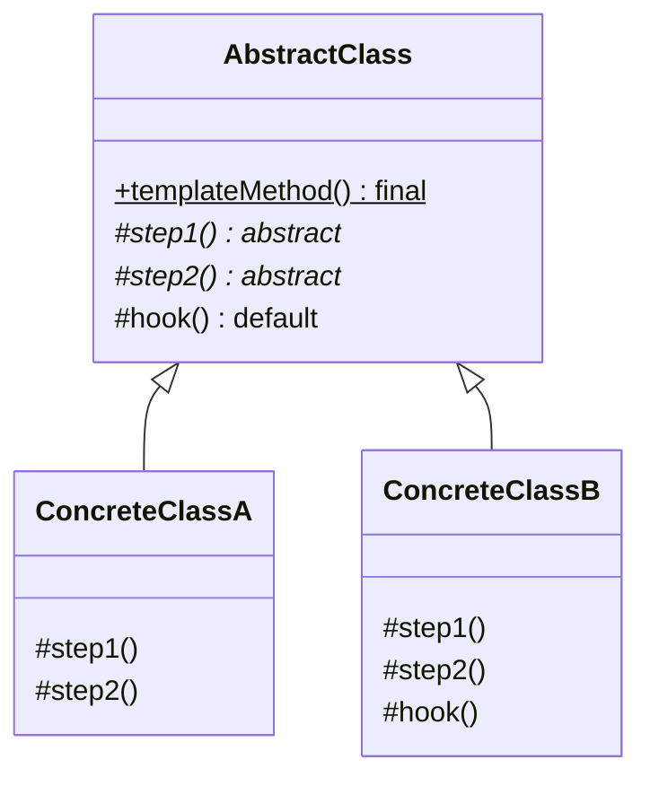
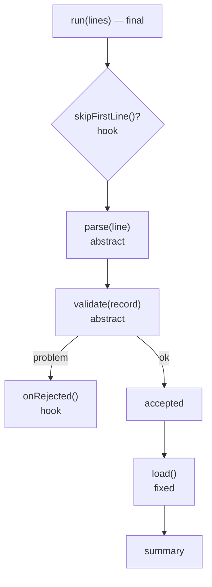
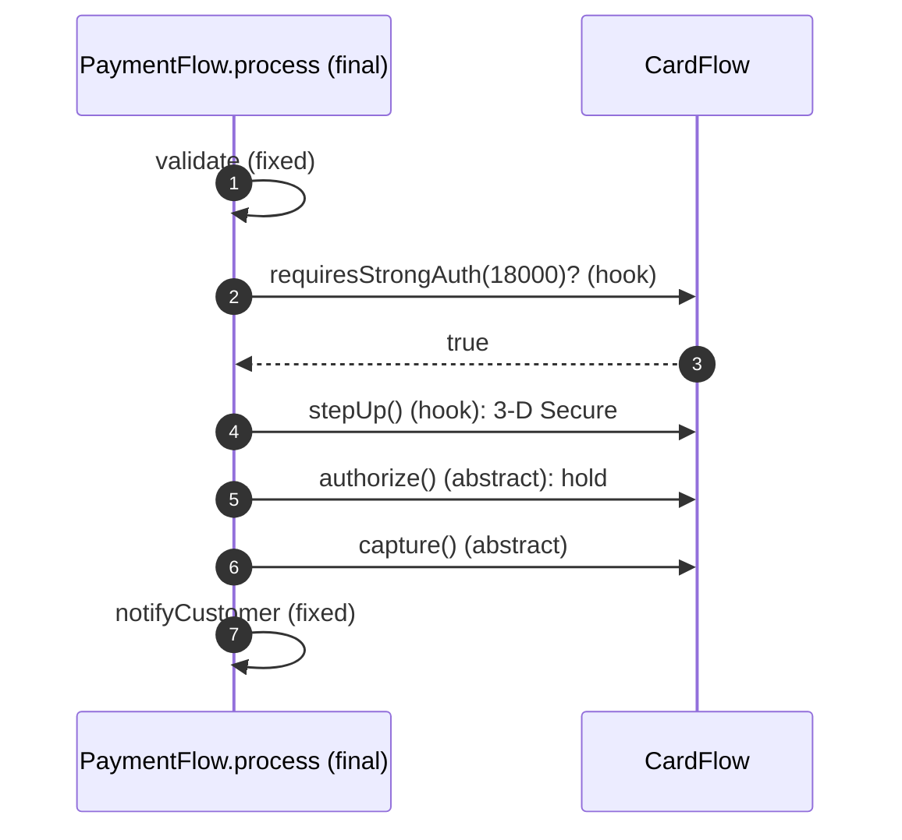
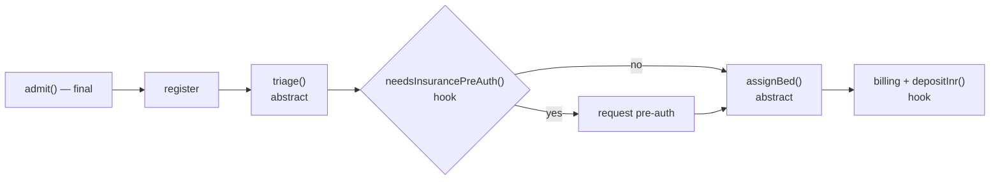

---
tags:
  - Behavioral
  - Beginner
---

# Template Method

<span class="badge badge--beginner">🟢 Beginner → 🟡 Intermediate</span>
<span class="badge badge--category">Behavioral</span>
<span class="badge badge--interview">Interview frequency ⭐⭐⭐⭐</span>

!!! abstract "TL;DR"
    **Template Method defines the skeleton of an algorithm in a base class (a `final` method) and lets subclasses fill in specific steps.**
    Use it when several variants share the same overall process and only some steps differ, and the order of steps must **not** be changed by subclasses.

---

## 1. Intent & Problem It Solves

**The problem in plain English:** every data import does the same thing: read lines, parse, validate, reject bad rows, load good rows, report. CSV customers and fixed-width bank files differ only in *parsing* and *validation*. Copy-pasting the whole loop into each importer means the next fix (say, counting rejections) must be applied to every copy, and someone will forget one.

**Formal definition (GoF):**
> Define the skeleton of an algorithm in an operation, deferring some steps to subclasses. Template Method lets subclasses redefine certain steps of an algorithm without changing the algorithm's structure.

**Kinds of steps:**

| Step type | Meaning | Example |
|---|---|---|
| **Abstract** | Subclasses **must** implement | `parse()`, `validate()` |
| **Hook** | Has a default; subclasses **may** override | `skipFirstLine()` (default false), `onRejected()` |
| **Fixed** (`private`/`final`) | Subclasses can't change it | `load()`, the order of steps |

## 2. Real-World Analogy

!!! example "Following a recipe card"
    "Making tea" is always: boil water, add the tea, steep, pour, add extras. Masala chai and green tea follow the **same steps** but differ in *what* you add and *how long* you steep. You don't reinvent the process each time; you fill in the blanks.

## 3. Structure



| Participant | Responsibility |
|---|---|
| **Abstract class** | Defines the `final` template method (the order of steps) and shared steps |
| **Concrete classes** | Implement the abstract steps and optionally override hooks |

**The Hollywood Principle:** "Don't call us, we'll call you." The base class calls subclass methods, not the other way around.

## 4. Naive Approach (Without the Pattern)

```java
class CsvImporter {
    String run(List<String> lines) {
        for (String line : lines.subList(1, lines.size())) { /* parse CSV, validate, load */ }
        return "...";
    }
}
class BankFileImporter {
    String run(List<String> lines) {
        for (String line : lines) { /* parse fixed width, validate, load */ }   // copied loop
        return "...";                                                         // forgot to count rejections
    }
}
```

- :material-close-circle:{ style="color:#e53935" } **Duplicated workflow** that drifts between copies.
- :material-close-circle:{ style="color:#e53935" } Nothing enforces the **order** of steps (validate before load).
- :material-close-circle:{ style="color:#e53935" } Cross-cutting fixes must be repeated everywhere.

---

## 5. Three Real-World Examples

### Example 1: Nightly Data Imports (ERP)

**Scenario:** An ERP imports customers from a CRM (CSV with a header row) and transactions from banks (fixed-width files, the format banks have used for decades). Every import must parse, validate, reject bad rows, load good rows and report counts, in that order. Bank-file rejections go to a **reconciliation queue** instead of just being logged.

**Design:**



**Full Code:**

=== "DataImporter.java"

    ```java
    --8<-- "code/behavioral/src/main/java/com/handbook/behavioral/template/importer/DataImporter.java"
    ```

    1.  **`final`**: subclasses can't change the order or skip validation. This is what makes it a *template*.
    2.  A **hook** decides whether to skip the header; the template stays generic.
    3.  Hooks have **sensible defaults**, so most subclasses don't override them.

=== "CsvCustomerImporter.java"

    ```java
    --8<-- "code/behavioral/src/main/java/com/handbook/behavioral/template/importer/CsvCustomerImporter.java"
    ```

=== "FixedWidthBankImporter.java"

    ```java
    --8<-- "code/behavioral/src/main/java/com/handbook/behavioral/template/importer/FixedWidthBankImporter.java"
    ```

=== "ImportDemo.java"

    ```java
    --8<-- "code/behavioral/src/main/java/com/handbook/behavioral/template/importer/ImportDemo.java"
    ```

**Output:**

```text
--8<-- "code/outputs/behavioral/template/importer/ImportDemo.txt"
```

**Why Template Method here:**

- **Same process, different formats**: subclasses supply only what differs.
- The **order is enforced** (`final`), so no importer can load unvalidated data.
- Shared improvements (rejection counts) happen **once**.

---

### Example 2: Payment Flows (Payments)

**Scenario:** A payment platform supports cards and UPI. Compliance requires every payment to go through **validate → (strong authentication if needed) → authorize → capture → notify**, in that order. Cards need 3-D Secure above INR 5,000 and have separate authorize/capture steps (the bank places a hold, then captures). UPI authorizes and settles in one step. New methods (wallets, BNPL) must follow the same compliant sequence.

**Design:**



**Full Code:**

=== "PaymentFlow.java"

    ```java
    --8<-- "code/behavioral/src/main/java/com/handbook/behavioral/template/payment/PaymentFlow.java"
    ```

=== "Flows.java"

    ```java
    --8<-- "code/behavioral/src/main/java/com/handbook/behavioral/template/payment/Flows.java"
    ```

=== "PaymentDemo.java"

    ```java
    --8<-- "code/behavioral/src/main/java/com/handbook/behavioral/template/payment/PaymentDemo.java"
    ```

**Output:**

```text
--8<-- "code/outputs/behavioral/template/payment/PaymentDemo.txt"
```

**Why Template Method here:**

- The **sequence is a compliance rule**: encode it once and make it `final`.
- **Hooks** express optional steps (strong authentication) without `if (method == CARD)` in the base class.
- New payment methods inherit validation and notifications automatically.

---

### Example 3: Patient Admission (Healthcare)

**Scenario:** A hospital admits patients through a standard process: register, triage, insurance pre-authorization, bed assignment, billing. **Emergency** admissions skip pre-authorization and defer the deposit ("treat first, paperwork later"), with ICU beds. **Planned** admissions (surgery) require pre-authorization and a deposit. The process must be identical in structure for audit purposes.

**Design:**



**Full Code:**

=== "Admission.java"

    ```java
    --8<-- "code/behavioral/src/main/java/com/handbook/behavioral/template/admission/Admission.java"
    ```

=== "Admissions.java"

    ```java
    --8<-- "code/behavioral/src/main/java/com/handbook/behavioral/template/admission/Admissions.java"
    ```

=== "AdmissionDemo.java"

    ```java
    --8<-- "code/behavioral/src/main/java/com/handbook/behavioral/template/admission/AdmissionDemo.java"
    ```

**Output:**

```text
--8<-- "code/outputs/behavioral/template/admission/AdmissionDemo.txt"
```

**Why Template Method here:**

- One **auditable** process with controlled variation points.
- Hooks (`needsInsurancePreAuth`, `depositInr`) express policy differences clearly.
- Variants are small classes that read like policy documents.

---

??? example "Unit Tests: `TemplateMethodTest.java`"

    ```java
    --8<-- "code/behavioral/src/test/java/com/handbook/behavioral/template/TemplateMethodTest.java"
    ```

## 6. Variations & Modern Java Take

**Template Method with lambdas (composition instead of inheritance).** You can pass the varying steps as functions instead of subclassing:

```java
static String importLines(List<String> lines,
                          Function<String, Map<String, String>> parse,
                          Function<Map<String, String>, Optional<String>> validate) {
    // same skeleton; steps passed in
}
```

This is how Spring's `JdbcTemplate` works: the template handles connections, statements, exceptions and cleanup; you pass a `RowMapper` (a step) as a lambda.

| Style | Pros | Cons |
|---|---|---|
| **Inheritance** (classic) | Hooks with defaults; clear named variants | Tied to a class hierarchy; Java has single inheritance |
| **Callbacks/lambdas** ("template + strategy") | Flexible, no subclassing, easy to test | Many parameters if there are many steps |

**Always make the template method `final`**, and make steps `protected` (or package-private), not `public`, so clients call only the template.

## 7. Where It Lives in Real Frameworks

| Where | Template |
|---|---|
| JDK | `AbstractList` (implement `get` and `size`, inherit the rest); `AbstractMap`; `InputStream.read(byte[])` calls abstract `read()` |
| JDK | `HttpServlet.service()` calls `doGet`/`doPost` |
| Spring | **`JdbcTemplate`**, `RestTemplate`, `TransactionTemplate`, `JmsTemplate` (callback style) |
| Spring | `AbstractController`, `OncePerRequestFilter.doFilterInternal`, `AbstractRoutingDataSource.determineCurrentLookupKey` |
| Spring Batch | `AbstractItemCountingItemStreamItemReader` |
| JUnit | Test lifecycle: `@BeforeEach` → test → `@AfterEach` (the framework is the template) |

## 8. Pros, Cons & Trade-offs

| ✅ Pros | ❌ Cons |
|---|---|
| **Removes duplication** of the overall process | **Inheritance coupling**: subclasses depend on base-class details |
| **Enforces order** and invariants (`final`) | Hard to understand when steps are spread across a deep hierarchy |
| **Hooks** give controlled extension points | Liskov risks: a subclass's step can break assumptions of the template |
| Hollywood Principle keeps control in one place | Single inheritance limits combining templates |

## 9. Pitfalls & Anti-Patterns

!!! danger "Non-final template methods"
    If subclasses can override `run()`, they can skip validation. Make it `final`.

!!! danger "Calling overridable methods from a constructor"
    The subclass isn't initialized yet when the base constructor runs. Call template steps from methods, never from constructors.

!!! warning "Deep hierarchies"
    `AbstractImporter → AbstractCsvImporter → AbstractCustomerCsvImporter → ...` becomes impossible to follow. Prefer one level of template plus composition (strategies) for further variation.

!!! warning "Too many hooks"
    15 optional hooks turn the template into a configuration maze. If variants differ a lot, use Strategy or separate classes.

## 10. Senior / Architect Deep Dive (10–15 yrs)

**Frameworks are templates.** Spring, servlets and JUnit run the overall flow and call your code at defined points (inversion of control). When you design internal platforms (job frameworks, importers, payment SDKs), Template Method with **few, well-documented hooks** is a strong way to enforce company-wide rules (audit logging, metrics, security checks) while letting teams plug in business logic.

**Favor "template + callbacks" in libraries.** `JdbcTemplate` is the gold standard: it guarantees resource cleanup and exception translation, and you pass small lambdas. It avoids inheritance and works naturally with dependency injection and testing.

**Observability and resilience in the template.** Put metrics, tracing spans, retries and error handling **in the template**, not in each subclass, so every variant gets them (see the coding challenge: locking and cleanup for every job).

!!! bug "War story: the importer that loaded unvalidated rows"
    A team copied the CSV importer to create a supplier importer, and "temporarily" commented out validation to get a demo working. It shipped. Weeks later, 30,000 supplier records with malformed GST numbers were loaded, and tax filings failed at quarter-end.
    **Fix:** a base `DataImporter` with a `final run()` that always validates (with a validation step subclasses must implement), plus metrics on rejected rows per importer.
    **Lesson:** when a step is mandatory, don't rely on discipline. Put it in a `final` template.

## 11. Related Patterns & Comparisons

| | Template Method | Strategy | Factory Method | Hook-based frameworks |
|---|---|---|---|---|
| Varies | **Steps** of an algorithm | The **whole** algorithm | **Which object** to create | Callbacks at lifecycle points |
| Mechanism | **Inheritance** | **Composition** | Inheritance (GoF) | Inversion of control |
| Bound when | Compile time (subclass) | Runtime | Compile time | Registration time |

A **Factory Method** is often one step of a Template Method (see the logistics example on the [Factory Method](../creational/factory-method.md) page).

## 12. Interview Corner

=== "🟢 Beginner / Service Companies"

    **Q1. What is the Template Method pattern?**

    A behavioral pattern where a base class defines the **skeleton of an algorithm** in a method, and **subclasses implement specific steps** without changing the overall structure.

    **Q2. Why is the template method usually `final`?**

    So subclasses **can't change the order** of steps or skip mandatory ones.

    **Q3. What is a hook method?**

    An **optional** step with a **default** implementation that subclasses may override (e.g., `skipFirstLine()` returning false).

    **Q4. Give examples in Java.**

    `HttpServlet.service()` calling `doGet()`/`doPost()`, `AbstractList`, Spring's `JdbcTemplate`.

    **Q5. What is the Hollywood Principle?**

    "**Don't call us, we'll call you**": the framework/base class calls your code at the right time.

=== "🟡 Mid-Level"

    **Q1. Template Method vs. Strategy?**

    Template Method varies **steps** via **inheritance** (fixed at compile time); Strategy swaps the **whole algorithm** via **composition** (at runtime).

    **Q2. How does `JdbcTemplate` apply this pattern?**

    It handles connection, statement, execution, exception translation and cleanup (the skeleton); you provide the **SQL and a `RowMapper` callback** (the variable step).

    **Q3. What can go wrong with inheritance-based templates?**

    Tight coupling to the base class, deep hierarchies, and subclasses that violate the template's assumptions (LSP).

    **Q4. Can you implement Template Method without inheritance?**

    Yes: pass the steps as **lambdas** to a method that runs the skeleton ("template + callbacks").

    **Q5. Where do you put logging, metrics and error handling?**

    **In the template**, so every variant gets them consistently.

=== "🔴 Senior / FAANG / SAP"

    **Q1. "Design an internal job framework used by 40 teams."**

    A template (`final execute()`) handling **distributed locking**, scheduling, retries, timeouts, metrics, tracing and alerting; teams implement `doWork()` and optional hooks (`shouldRun`, `onFailure`). Or a callback API. Version the framework; document hooks; test the template with fake jobs.

    **Q2. "How would you enforce compliance steps (audit, consent checks) across many services?"**

    Shared libraries with **template methods/callbacks** that wrap business logic; **AOP** for cross-cutting concerns; or platform-level enforcement (gateways, sidecars). Each has trade-offs in flexibility and bypass risk.

    **Q3. "A template has grown 12 hooks and 3 levels of subclasses. Refactor?"**

    Split the varying parts into **strategies** injected into one template, flatten the hierarchy, remove rarely used hooks, and add tests that pin the template's order.

    **Q4. "Inheritance vs. composition for a payments SDK's flows?"**

    For external SDK users, **composition/callbacks** are safer (no fragile base-class problem, easier evolution). Internally, a `final` template with hooks works well when all variants are in your control.

    **Q5. "How do you test a template method?"**

    Test the **skeleton** with a fake subclass that records the call order; test each concrete step separately; and test the hooks' default behavior.

=== "💻 Coding Challenge"

    **Problem:** Several scheduled jobs (invoice generation, cache warm-up, GST report) all need: a "should run" switch, a lock so two instances don't run at once, start/finish logging, failure handling, and **guaranteed lock release** even when the job throws. Teams should only write the job's work.

    ??? success "Solution"

        === "ScheduledJob.java"

            ```java
            --8<-- "code/behavioral/src/main/java/com/handbook/behavioral/template/jobs/ScheduledJob.java"
            ```

        === "JobsDemo.java"

            ```java
            --8<-- "code/behavioral/src/main/java/com/handbook/behavioral/template/jobs/JobsDemo.java"
            ```

        **Output:**

        ```text
        --8<-- "code/outputs/behavioral/template/jobs/JobsDemo.txt"
        ```

        **Key points to say:** `final execute()` owns the lifecycle; `doWork()` is the only required step; `shouldRun()` is a hook; `finally` guarantees lock release. In production the lock would be distributed (ShedLock, Redis), and failures would emit metrics and alerts.

!!! info "Behavioural tie-in (STAR) for experienced candidates"
    - **S:** Each team wrote its own scheduled jobs; some forgot locking, so duplicate invoices went out when two pods ran the same job.
    - **T:** Make every job safe by default.
    - **A:** Built a job base class with a `final execute()` handling distributed locks, metrics and alerts; migrated 23 jobs; added a lint rule against raw `@Scheduled` methods.
    - **R:** Zero duplicate-run incidents after migration; new jobs needed about 20 lines instead of 150.

## 13. Quick Revision Card

!!! tip "Remember in 30 seconds"
    - **Skeleton in a `final` base method**; subclasses fill in **steps**.
    - **Abstract steps** (must), **hooks** (may), **fixed steps** (can't).
    - **Hollywood Principle**: the base class calls you.
    - **Real life:** `HttpServlet`, `AbstractList`, Spring `JdbcTemplate` (callback style).
    - **vs Strategy:** inheritance and steps vs. composition and whole algorithm.

    ```java
    public final String run(List<String> lines) { /* parse -> validate -> load, always in this order */ }
    ```

## Practice

- [ ] Add a `JsonProductImporter` that rejects products with negative prices.
- [ ] Add a wallet payment flow that requires no capture step, with a test.
- [ ] Rewrite `DataImporter` in callback style (`importLines(lines, parse, validate)`) and compare.

---

[:material-arrow-left: Strategy](strategy.md){ .md-button }
[Next: Visitor :material-arrow-right:](visitor.md){ .md-button .md-button--primary }
