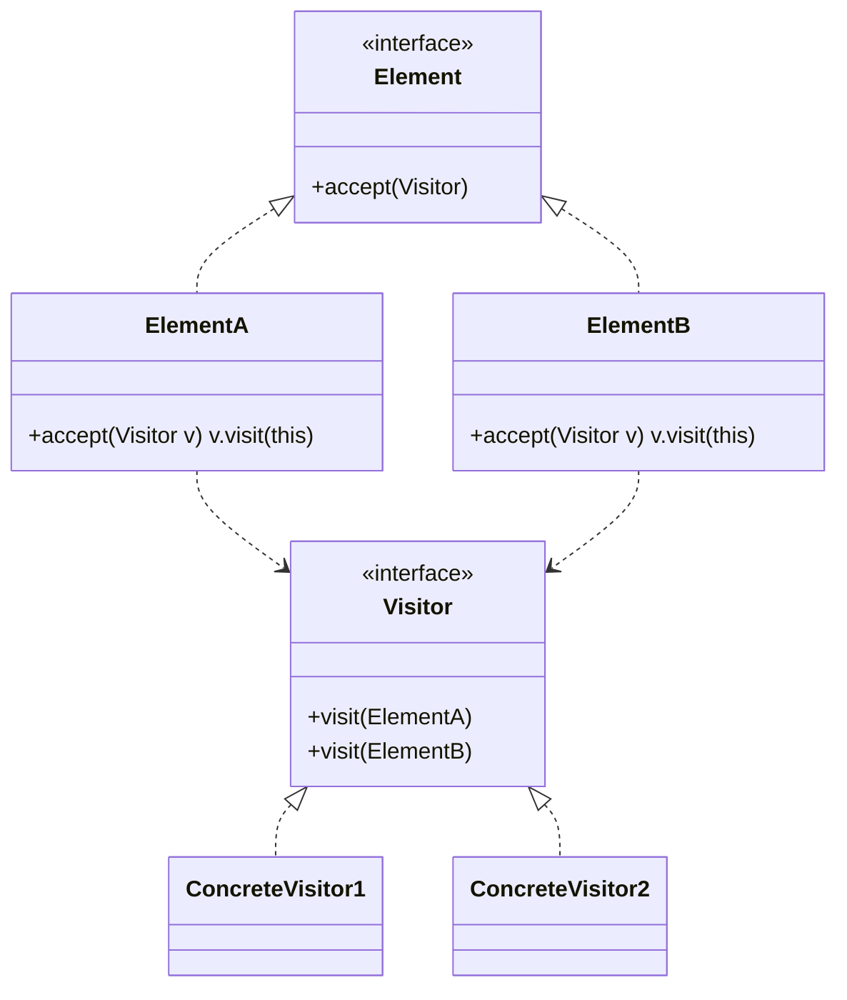
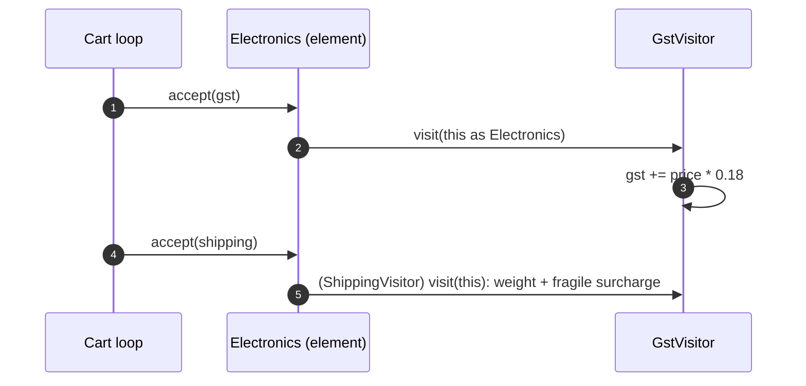
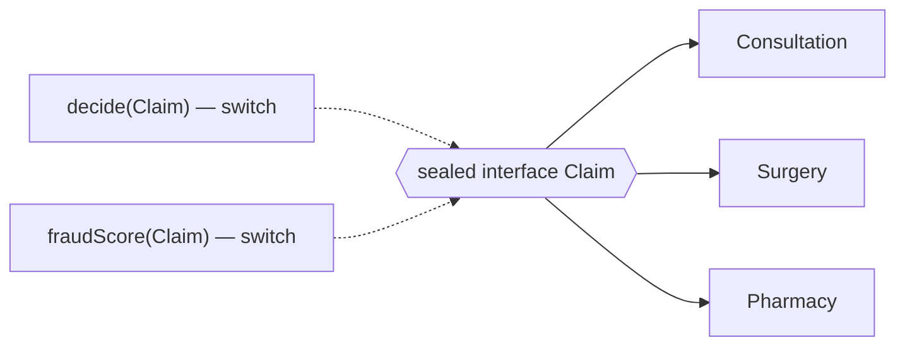
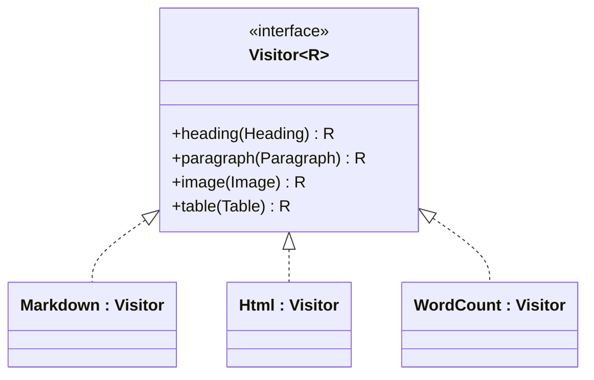

---
tags:
  - Behavioral
  - Advanced
---

# Visitor

<span class="badge badge--advanced">🔴 Advanced</span>
<span class="badge badge--category">Behavioral</span>
<span class="badge badge--interview">Interview frequency ⭐⭐⭐</span>

!!! abstract "TL;DR"
    **Visitor lets you add new operations to a stable class hierarchy without changing those classes. Each operation is a "visitor" with one method per element type.**
    In Java 21, **sealed interfaces + pattern-matching `switch`** often give the same benefit with far less code. Know both.

---

## 1. Intent & Problem It Solves

**The problem in plain English:** a cart has books, electronics and fresh produce. Finance wants GST per category, logistics wants shipping cost, marketing wants loyalty points, and next quarter someone wants carbon footprint. If each operation becomes a method on every item class (`gst()`, `shipping()`, `points()`, `carbon()`), item classes grow forever and mix tax rules with logistics rules. The item **types** rarely change; the **operations** keep coming.

**Formal definition (GoF):**
> Represent an operation to be performed on the elements of an object structure. Visitor lets you define a new operation without changing the classes of the elements on which it operates.

**Double dispatch:** `item.accept(visitor)` calls `visitor.visit(this)`. The right `visit` method is chosen by **both** the element's runtime type (first dispatch, via `accept`) and the visitor's type (second dispatch). That's how Java, with only single dispatch, picks "GST rule for Electronics".

## 2. Real-World Analogy

!!! example "Inspectors visiting a building"
    A building has flats, shops and a parking lot (stable element types). Different inspectors visit: fire safety, electrical, tax assessment. Each inspector knows what to check for each kind of unit. Adding a new kind of inspection doesn't require rebuilding the units; you just send a new inspector.

## 3. Structure



| Participant | Responsibility |
|---|---|
| **Visitor** | One `visit` method per element type |
| **Concrete visitor** | One **operation** (GST, shipping, export) across all element types; may accumulate results |
| **Element** | `accept(visitor)` calls back the matching `visit` |
| **Object structure** | The collection or tree being visited (a cart, a document, an AST) |

## 4. Naive Approach (Without the Pattern)

```java
double gst(Item item) {
    if (item instanceof Book) return 0;
    else if (item instanceof Electronics e) return e.price() * 0.18;
    else if (item instanceof FreshProduce) return 0;
    throw new IllegalArgumentException();   // a new item type compiles fine and fails at runtime
}
int shipping(Item item) { /* the same instanceof chain again */ }
```

- :material-close-circle:{ style="color:#e53935" } **`instanceof` chains** repeated per operation.
- :material-close-circle:{ style="color:#e53935" } A new element type **compiles fine** and fails at runtime when a branch is missing.
- :material-close-circle:{ style="color:#e53935" } Or, the alternative: every operation added as a method to every class, mixing unrelated concerns.

---

## 5. Three Real-World Examples

### Example 1: Tax and Shipping over a Mixed Cart (E-commerce) — *classic double dispatch*

**Scenario:** An Indian marketplace sells books (GST-exempt), electronics (18% GST, fragile items need careful packing) and fresh produce (exempt, chilled items need a cold-chain bag). Tax rules are owned by finance; shipping rules by logistics. Neither team should edit the item classes, which are shared by catalog, search and orders.

**Design:**



**Full Code:**

=== "CartItems.java"

    ```java
    --8<-- "code/behavioral/src/main/java/com/handbook/behavioral/visitor/cart/CartItems.java"
    ```

    1.  One `visit` overload **per element type**. Adding an element type means adding a method here, and the compiler then forces **every visitor** to handle it.
    2.  `accept` is identical in every element (`v.visit(this)`), but it must be written in each class: inside `Book`, `this` has static type `Book`, so the compiler picks `visit(Book)`.

=== "GstVisitor.java"

    ```java
    --8<-- "code/behavioral/src/main/java/com/handbook/behavioral/visitor/cart/GstVisitor.java"
    ```

=== "ShippingVisitor.java"

    ```java
    --8<-- "code/behavioral/src/main/java/com/handbook/behavioral/visitor/cart/ShippingVisitor.java"
    ```

=== "CartDemo.java"

    ```java
    --8<-- "code/behavioral/src/main/java/com/handbook/behavioral/visitor/cart/CartDemo.java"
    ```

**Output:**

```text
--8<-- "code/outputs/behavioral/visitor/cart/CartDemo.txt"
```

**Why Visitor here:**

- **Stable element types**, a **growing list of operations** owned by different teams.
- Each operation's rules are **together** in one class (all GST rules in `GstVisitor`).
- Visitors can **accumulate** results across the whole cart.

---

### Example 2: Claim Adjudication (Health Insurance) — *sealed types + pattern matching*

**Scenario:** A health insurer processes consultation, surgery and pharmacy claims. Two operations run on every claim: **adjudication** (approve, reject or review, with rules like "surgery needs pre-authorization" and "cap at sum insured") and **fraud scoring**. More operations (reserve estimation, reinsurance split) are planned. The claim types are fixed by regulation and rarely change.

**Design:**



**Full Code:**

=== "Claim.java"

    ```java
    --8<-- "code/behavioral/src/main/java/com/handbook/behavioral/visitor/claims/Claim.java"
    ```

=== "ClaimOperations.java"

    ```java
    --8<-- "code/behavioral/src/main/java/com/handbook/behavioral/visitor/claims/ClaimOperations.java"
    ```

    1.  The **modern Visitor**: a `switch` over a **sealed** type is checked for **exhaustiveness** (add `Dental` to `Claim` and both operations stop compiling, exactly like a visitor interface), with **guards** (`when`) for rule conditions. No `accept()` methods, no visitor interfaces.

=== "ClaimsDemo.java"

    ```java
    --8<-- "code/behavioral/src/main/java/com/handbook/behavioral/visitor/claims/ClaimsDemo.java"
    ```

**Output:**

```text
--8<-- "code/outputs/behavioral/visitor/claims/ClaimsDemo.txt"
```

**Why this form here:**

- The hierarchy is **closed** (sealed) and owned by the same codebase, which is ideal for pattern matching.
- Rules read like a **decision table**, which reviewers in insurance appreciate.
- Same benefit as Visitor (new operations without touching claim classes), and the compiler still catches missing cases.

---

### Example 3: One Document, Many Exports (Docs SaaS) — *visitor with return values*

**Scenario:** A docs product stores documents as a list of elements: headings, paragraphs, images, tables. Users export to **Markdown** and **HTML**; the editor shows a **word count**; PDF and Google-Docs export are planned. Element classes are part of a stable, versioned document model; exporters are added by different teams.

**Design:**



**Full Code:**

=== "Doc.java"

    ```java
    --8<-- "code/behavioral/src/main/java/com/handbook/behavioral/visitor/docs/Doc.java"
    ```

=== "Exporters.java"

    ```java
    --8<-- "code/behavioral/src/main/java/com/handbook/behavioral/visitor/docs/Exporters.java"
    ```

=== "DocsDemo.java"

    ```java
    --8<-- "code/behavioral/src/main/java/com/handbook/behavioral/visitor/docs/DocsDemo.java"
    ```

**Output:**

```text
--8<-- "code/outputs/behavioral/visitor/docs/DocsDemo.txt"
```

**Why Visitor here:**

- **Generic `Visitor<R>`** lets each operation return its own type (`String` for exports, `Integer` for counts) without casts or accumulator fields.
- Exporters are **independent plug-ins**; the document model stays clean.
- This is how compilers and document processors (ASTs, Markdown parsers) are typically structured.

---

??? example "Unit Tests: `VisitorTest.java`"

    ```java
    --8<-- "code/behavioral/src/test/java/com/handbook/behavioral/visitor/VisitorTest.java"
    ```

## 6. Variations & Modern Java Take

| Form | When to use |
|---|---|
| **Classic visitor** (Example 1) | Element types in another module/library you can't make sealed; visitors that keep state |
| **Generic `Visitor<R>`** (Example 3, challenge) | Operations that return values; no mutable accumulators |
| **Sealed + pattern-matching switch** (Example 2) | Closed hierarchies in your own code (Java 21+); usually the simplest choice today |
| **Reflective/dynamic visitors** | Avoid; you lose compile-time safety |
| **Visitor over a Composite** | Elements call `accept` on their children (tree traversal inside or outside the visitor) |

!!! tip "The expression problem"
    OOP makes it easy to add **types** (new class) and hard to add **operations** (edit every class). Visitor flips that: easy to add **operations**, hard to add **types** (edit every visitor). Choose based on which side changes more often. This is a favourite senior-level discussion.

## 7. Where It Lives in Real Frameworks

| Where | Visitor |
|---|---|
| JDK | `java.nio.file.FileVisitor` with `Files.walkFileTree` |
| JDK | `javax.lang.model.element.ElementVisitor` (annotation processors), `javax.lang.model.type.TypeVisitor` |
| Compilers | javac's tree visitors, ASM `ClassVisitor`/`MethodVisitor` (bytecode), ANTLR parse-tree visitors |
| Spring | `BeanDefinitionVisitor` (resolving placeholders in bean definitions) |
| Hibernate / JPA | Criteria/HQL AST walkers that render SQL |
| Jackson | `JsonFormatVisitor` (schema generation) |

## 8. Pros, Cons & Trade-offs

| ✅ Pros | ❌ Cons |
|---|---|
| **Add operations** without changing element classes (OCP for operations) | **Adding an element type** breaks every visitor |
| Related logic **grouped** per operation | **Boilerplate** (`accept` everywhere, visitor interfaces) |
| Visitors can **accumulate state** across a structure | Visitors may need access to element internals (weaker encapsulation) |
| Compile-time completeness (every type handled) | Harder for beginners to follow (double dispatch) |

## 9. Pitfalls & Anti-Patterns

!!! danger "Using Visitor on an unstable hierarchy"
    If new element types arrive every sprint, every visitor must change every sprint. Use plain polymorphic methods instead.

!!! warning "`default` branches that hide new types"
    A visitor base class with no-op defaults, or a `switch` with `default`, silently ignores new element types: the tax visitor returns 0 GST for a new "Jewellery" type. Prefer exhaustive handling.

!!! warning "Visitors with too much state"
    A visitor that both accumulates totals and mutates elements is hard to reason about. Keep visitors focused, or return values (`Visitor<R>`).

!!! warning "Reusing a stateful visitor"
    `GstVisitor` accumulates a total; reusing the same instance for two carts adds them together. Create one per traversal.

## 10. Senior / Architect Deep Dive (10–15 yrs)

**Where Visitor shines: ASTs.** Compilers, query engines, rule engines and document processors have stable node types and many passes (type check, optimize, generate code, pretty-print). That's the textbook Visitor use case. The [Interpreter](interpreter.md) page's ASTs could get a `ToSqlVisitor` this way.

**Choosing in modern Java.** Inside one codebase with a closed hierarchy, **sealed + switch** wins: less code, exhaustive, readable. Use **classic visitors** across module boundaries (public APIs where you can't seal types and want third parties to add operations), or when you need double dispatch over **two** hierarchies.

**Traversal ownership.** Decide whether the **structure** controls traversal (elements call children's `accept`) or the **visitor** does. For trees, letting the visitor control traversal enables pruning (skip a subtree) and different orders.

!!! bug "War story: the missing jewellery tax"
    A marketplace added a `Jewellery` item type. Their tax code used a visitor base class with **no-op default** methods "for convenience". `GstVisitor` didn't override `visit(Jewellery)`, so jewellery was charged **0% GST** instead of 3% for two months, and the company paid the shortfall plus interest.
    **Fix:** removed default implementations (every visitor must handle every type); migrated tax rules to a sealed hierarchy with an exhaustive `switch`; added a test that runs every visitor over one instance of every element type.
    **Lesson:** Visitor's main safety feature is the compiler forcing every case. Don't turn it off with defaults.

## 11. Related Patterns & Comparisons

| | Visitor | Strategy | Iterator | Composite |
|---|---|---|---|---|
| Varies | **Operation** over many element types | Algorithm for **one** context | Traversal order | Structure |
| Dispatch | **Double** (element type × operation) | Single | N/A | Single |
| Typical pairing | Visits a **Composite** / AST | Used by a context | Walks a collection | Visited by Visitor, walked by Iterator |

## 12. Interview Corner

=== "🟢 Beginner / Service Companies"

    **Q1. What is the Visitor pattern?**

    A behavioral pattern that lets you **add new operations** to a set of classes **without modifying them**, by moving each operation into a separate visitor class.

    **Q2. What is double dispatch?**

    The method called depends on **two** runtime types: `element.accept(visitor)` dispatches on the element, and `visitor.visit(this)` dispatches on the visitor, so the right combination runs.

    **Q3. When should you use Visitor?**

    When the **element types are stable** but you keep adding **operations** (tax, shipping, export).

    **Q4. Main disadvantage?**

    Adding a **new element type** requires changing **every visitor**.

    **Q5. Give a Java example.**

    `Files.walkFileTree(path, FileVisitor)` and compiler/AST visitors.

=== "🟡 Mid-Level"

    **Q1. Why must every element implement `accept` itself?**

    Because overload resolution is **compile-time**: inside each class, `this` has that class's static type, so `v.visit(this)` selects the right overload.

    **Q2. How do Java 21 features change Visitor?**

    **Sealed interfaces + pattern-matching `switch`** give exhaustive type-based dispatch without `accept`/visitor boilerplate (Example 2).

    **Q3. How do you return values from visitors?**

    Make the visitor **generic**: `interface Visitor<R> { R visitX(X x); }` and `<R> R accept(Visitor<R> v)` (Example 3).

    **Q4. Visitor vs. Strategy?**

    Strategy swaps one algorithm for **one** context type; Visitor defines an operation across **many element types**.

    **Q5. How do you visit a tree?**

    Composite nodes call `accept` on their children (structure-driven), or the visitor recurses into children (visitor-driven, which allows pruning).

=== "🔴 Senior / FAANG / SAP"

    **Q1. "Explain the expression problem and how you'd choose a design."**

    Adding **types** is easy with OOP polymorphism, adding **operations** is easy with Visitor/pattern matching; neither makes both easy. Choose based on which axis changes more; in Java 21, sealed + switch for operations, open interfaces for types.

    **Q2. "Design a SQL query builder that supports Postgres, MySQL and BigQuery."**

    Build an **AST** of the query (Composite), then **dialect visitors** render it (quoting, limits, functions); add optimizer passes as visitors; tests per dialect with golden outputs.

    **Q3. "A visitor-based tax engine must support 30 countries. Structure?"**

    Stable item categories as elements; **one visitor per jurisdiction** (or a visitor parameterized by rate tables); effective-dated rules; exhaustive handling; golden-file tests per country.

    **Q4. "How would you add a new element type to a public visitor API without breaking third parties?"**

    Add `visit(NewType)` as a **default method** that falls back to a generic `visitOther(Element)` (or throws `UnsupportedOperationException`), document it, and version the API. Accept the safety trade-off consciously.

    **Q5. "When would you choose a classic visitor over pattern matching in 2026?"**

    When element types live in a **library you don't control** (can't seal), when you need **two-hierarchy** double dispatch, or when third parties add operations via a published interface.

=== "💻 Coding Challenge"

    **Problem:** Shapes (circle, rectangle, triangle) need **area** and **perimeter**, and more operations later (bounding box, SVG). Implement a generic `ShapeVisitor<R>` so operations return values and shape classes never change.

    ??? success "Solution"

        === "ShapesDemo.java"

            ```java
            --8<-- "code/behavioral/src/main/java/com/handbook/behavioral/visitor/shapes/ShapesDemo.java"
            ```

        **Output:**

        ```text
        --8<-- "code/outputs/behavioral/visitor/shapes/ShapesDemo.txt"
        ```

        **Key points to say:** `<R> R accept(ShapeVisitor<R> v)` gives typed results; visitors are **stateless** constants (safe to reuse); the triangle uses Heron's formula. Then mention the sealed + switch alternative: `double area(Shape s) { return switch (s) { case Circle c -> ...; ... }; }`.

!!! info "Behavioural tie-in (STAR) for experienced candidates"
    - **S:** A new item type silently got 0% GST because the tax visitor had no-op defaults.
    - **T:** Fix the shortfall and make tax rules impossible to forget.
    - **A:** Removed visitor defaults, moved tax rules to a sealed hierarchy with exhaustive switches, and added a test running every operation over every item type.
    - **R:** The next two item types (gift cards, refurbished electronics) failed to compile until tax rules were added. That is exactly what we wanted.

## 13. Quick Revision Card

!!! tip "Remember in 30 seconds"
    - **Add operations without changing element classes**; one visitor per operation.
    - **Double dispatch**: `element.accept(v)` → `v.visit(this)`.
    - Easy: new **operations**. Hard: new **element types** (the expression problem).
    - **Java 21:** sealed + pattern-matching `switch` is often the simpler visitor.
    - Avoid **no-op defaults**; they hide missing cases.

    ```java
    return switch (claim) { case Surgery s when !s.preAuthorized() -> "REJECT"; case Surgery s -> "APPROVE"; ... };
    ```

## Practice

- [ ] Add a `LoyaltyPointsVisitor` to the cart (books 2%, electronics 1%, produce 5%).
- [ ] Add a `Dental` claim type and fix every compile error the compiler reports.
- [ ] Write a `PlainTextExporter` for documents that turns tables into tab-separated lines.

---

[:material-arrow-left: Template Method](template-method.md){ .md-button }
[Next: Null Object :material-arrow-right:](null-object.md){ .md-button .md-button--primary }
