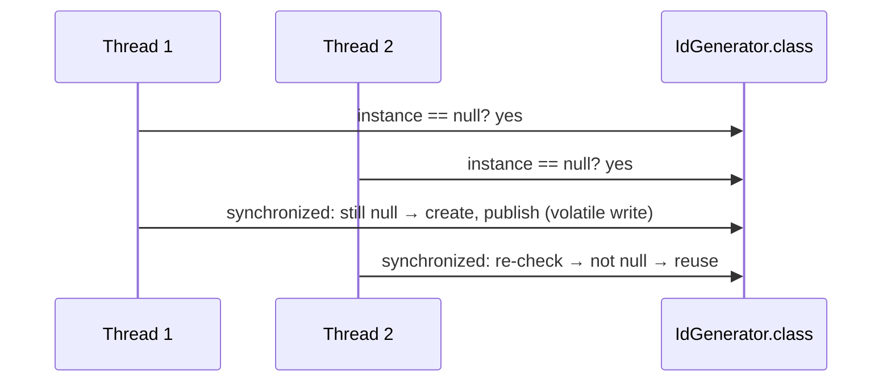

# 1. Unbreakable Thread-Safe Singleton

<span class="level l2">L2</span> ★★★ · Holder idiom, double-checked locking + `volatile`, reflection & serialization defence

## Problem

> Write a lazily initialised, thread-safe Singleton. Then show how **reflection** and **serialization** can create a
> second instance, and defend against both.

## See the pattern in motion

Before you write any code, watch the pattern this problem is built on. Switch to **Without it** to see the bug the pattern prevents. [Read the full Singleton page](../creational/singleton.md).

<iframe class="motion-embed" src="../../motion/index.html?p=singleton&amp;embed=1" title="Animated walkthrough of the Singleton pattern" loading="lazy"></iframe>

## Key idea

The **holder idiom** gives lazy, lock-free initialisation, because the JVM runs a class initialiser exactly once and
synchronizes it for you. **Double-checked locking** is the version interviewers ask you to write by hand, and its field
*must* be `volatile`. Defences: a constructor guard (reflection) and `readResolve()` (serialization). An **enum**
singleton gets both defences from the JVM. See [Singleton](../creational/singleton.md).



## Solution

```java title="SingletonDefended.java"
--8<-- "coding-interview/src/SingletonDefended.java"
```

## Walkthrough

| Code | Why |
|---|---|
| `private static final class Holder { static final Config INSTANCE = new Config(); }` | `Holder` is only initialised on the first `getInstance()` call. JVM class initialisation is thread-safe, so this needs no locks and no `volatile`. |
| `private static volatile IdGenerator instance` | Without `volatile`, another thread could see a non-null reference to a partially constructed object, because the constructor writes and the reference write can be reordered. |
| `IdGenerator local = instance` | Reading into a local variable means only one volatile read on the fast path. It's a small optimisation that `java.util` itself uses. |
| `if (created) throw new IllegalStateException(...)` | Reflection can call a private constructor with `setAccessible(true)`. The guard makes the second call fail. |
| `private Object readResolve() { return getInstance(); }` | Deserialization creates a new object. `readResolve` replaces it with the real instance. |
| `enum Registry { INSTANCE }` | `Constructor.newInstance` refuses enums, and enum serialization is by name, so the enum form is safe by construction. |

## Complexity

| Approach | Time | Space |
|---|---|---|
| getInstance (after init) | O(1), no locking | O(1) |

## Run it

```bash
java coding-interview/src/SingletonDefended.java      # JDK 21+ single-file launcher, no build needed
```

```text
--8<-- "coding-interview/outputs/SingletonDefended.txt"
```

## Common mistakes

* Double-checked locking without `volatile`. It's broken under the Java Memory Model.
* Making the whole `getInstance()` method `synchronized`. It's correct, but every call pays for a lock.
* Putting mutable global state in a singleton. It makes tests order-dependent. Prefer a DI-managed singleton bean.
* Forgetting that a singleton is "one per class loader", not one per cluster.

## Follow-up questions

??? question "Singleton vs Spring singleton bean?"
    A Spring singleton is one instance **per application context**, created and injected by the container. It's testable (you can inject a fake) and doesn't need a static accessor. The GoF Singleton enforces one instance per class loader with a static method, which hides the dependency.

??? question "How do you unit-test code that uses a singleton?"
    Don't call `getInstance()` inside business logic. Inject the instance through the constructor. If that isn't possible, add a package-private reset hook for tests, or wrap the singleton behind an interface.
