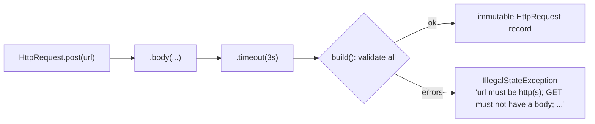

# 2. Builder with Validation

<span class="level l1">L1</span> ★★☆ · Required vs optional params, defaults, cross-field validation, immutability

## Problem

> Build an immutable `HttpRequest` with **two required fields** (method, url) and several optional ones (headers, body, timeout,
> retries). Invalid combinations ("GET with a body", "POST without a body", retries > 5) must be rejected, with all
> the errors reported at once.

## See the pattern in motion

Before you write any code, watch the pattern this problem is built on. Switch to **Without it** to see the bug the pattern prevents. [Read the full Builder page](../creational/builder.md).

<iframe class="motion-embed" src="../../motion/index.html?p=builder&amp;embed=1" title="Animated walkthrough of the Builder pattern" loading="lazy"></iframe>

## Key idea

Put the **required parameters into the builder's entry point** (`HttpRequest.post(url)`) so they can't be forgotten, and the
optional ones into fluent methods with **defaults**. `build()` is the **single place for cross-field validation**, so an invalid
object can never exist. See [Builder](../creational/builder.md).



## Solution

```java title="BuilderPattern.java"
--8<-- "coding-interview/src/BuilderPattern.java"
```

## Walkthrough

| Code | Why |
|---|---|
| `static Builder post(String url) { return new Builder("POST", url); }` | Static entry points per method name the required parameters, and read well: `HttpRequest.get(url)`. |
| `private Duration timeout = Duration.ofSeconds(10)` | Defaults live in the builder, so callers set only what differs. |
| `Builder header(...) { ...; return this; }` | Returning `this` enables chaining. |
| `List<String> errors = ...; if (!errors.isEmpty()) throw ...` | Collect **all** the problems and report them together. A caller fixing a config file wants to see every error at once. |
| `HttpRequest { headers = Map.copyOf(headers); }` | The record's compact constructor copies the map, so the builder can be reused without changing objects it already built. |

## Complexity

| Approach | Time | Space |
|---|---|---|
| build() | O(h) for h headers | O(h) |

## Run it

```bash
java coding-interview/src/BuilderPattern.java      # JDK 21+ single-file launcher, no build needed
```

```text
--8<-- "coding-interview/outputs/BuilderPattern.txt"
```

## Common mistakes

* Making every field optional, including the ones that must be set. Then `new Builder().build()` compiles and fails at run time.
* Validating in each setter only. Cross-field rules (GET + body) can only be checked in `build()`.
* Returning a mutable object from `build()`, or sharing the builder's map with it.

## Follow-up questions

??? question "Builder vs telescoping constructors vs JavaBeans setters?"
    Telescoping constructors become unreadable (`new Req("GET", url, null, null, 10, 0)`). JavaBeans setters allow half-built, mutable objects. A Builder gives readable, validated, immutable objects at the cost of one extra class.

??? question "How does Lombok's @Builder compare?"
    It generates the boilerplate, but it doesn't enforce required parameters or cross-field validation. You still add a custom `build()`, or validate in the constructor that the builder calls.
