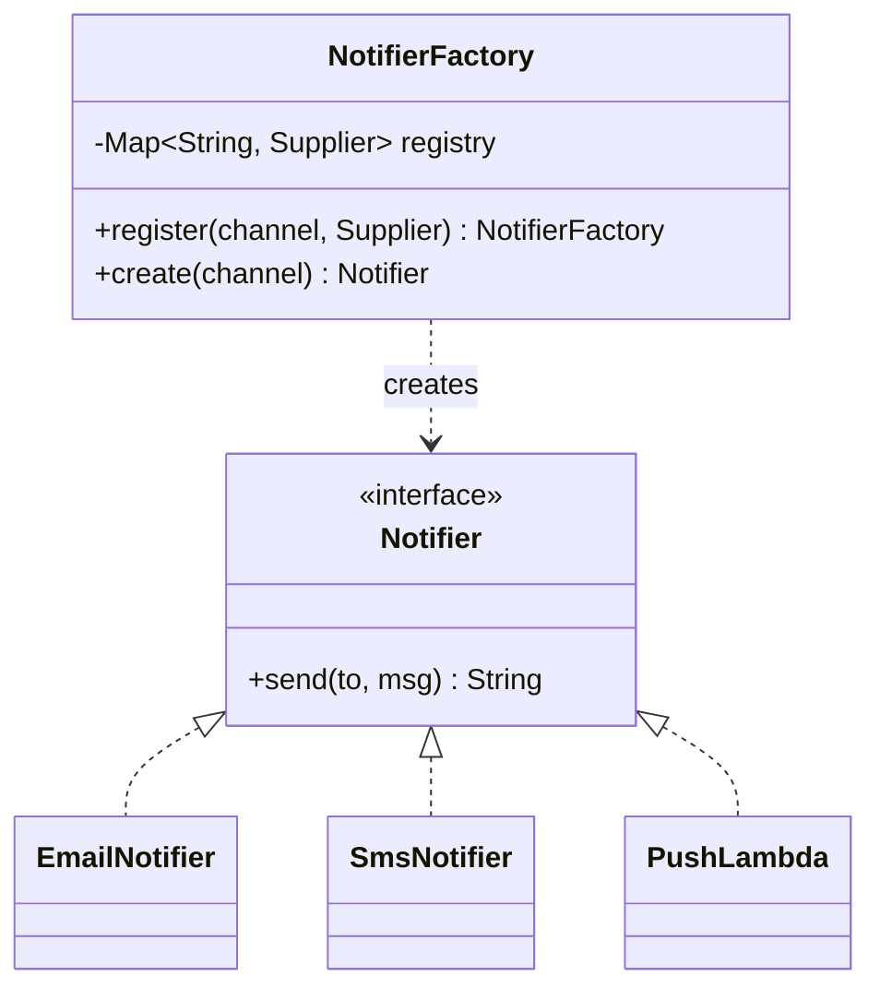

# 3. Factory Without a Switch

<span class="level l2">L2</span> ★★☆ · Registry of `Supplier`s, OCP, runtime extension

## Problem

> `createNotifier(channel)` is a `switch` that grows with every new channel (email, SMS, push and so on). Refactor it so that adding a
> channel **doesn't edit the factory**, and new channels can even be registered at run time.

## Key idea

Replace the `switch` with a **map from key to constructor** (`Map<String, Supplier<Notifier>>`). Creation becomes a lookup,
and extension becomes a `register` call. This is the same idea as Spring injecting `Map<String, Notifier>` beans by name, or
`ServiceLoader` plugins. See [Factory Method](../creational/factory-method.md).



## Solution

```java title="FactoryRegistry.java"
--8<-- "coding-interview/src/FactoryRegistry.java"
```

## Walkthrough

| Code | Why |
|---|---|
| `Map<String, Supplier<? extends Notifier>> registry` | Constructor references (`EmailNotifier::new`) are `Supplier`s, so the map stores "how to create", not instances. |
| `registry.putIfAbsent(...) != null → throw` | Registering the same key twice is almost always a bug, so fail fast. |
| `throw new IllegalArgumentException("unknown channel ... known: " + ...)` | Listing the valid keys in the error message saves the on-call engineer a lot of time. |
| `register("push", () -> (to, msg) -> ...)` | A new channel added at run time, without editing or recompiling the factory. |

## Complexity

| Approach | Time | Space |
|---|---|---|
| create | O(1) | O(k) registered types |

## Run it

```bash
java coding-interview/src/FactoryRegistry.java      # JDK 21+ single-file launcher, no build needed
```

```text
--8<-- "coding-interview/outputs/FactoryRegistry.txt"
```

## Common mistakes

* Storing instances instead of suppliers in the map, which accidentally shares stateful objects.
* Calling `toLowerCase()` without `Locale.ROOT`. In the Turkish locale, "EMAIL" lowercases to a dotless ı.
* Building a registry for two types that will never change. That's YAGNI; a `switch` is fine.

## Follow-up questions

??? question "How would you do this in Spring?"
    Annotate each implementation `@Component("email")` and inject `Map<String, Notifier>`. Spring fills it with bean name → bean. New channel = new class, and no edits anywhere else.

??? question "Factory Method vs Abstract Factory vs this?"
    Factory Method: a subclass decides which product to create. Abstract Factory: creates *families* of related products. A registry is the pragmatic, data-driven form of a simple factory.
