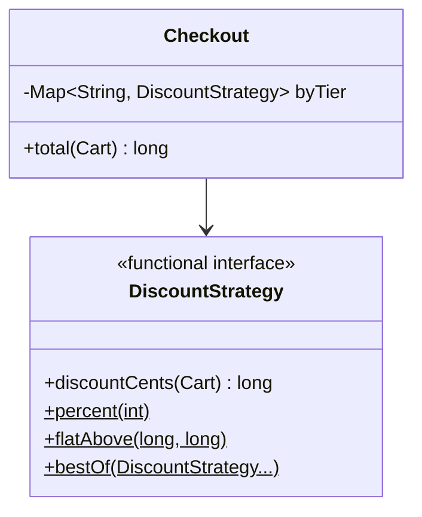

# 4. Strategy: Pluggable Discount Rules

<span class="level l1">L1</span> ★★☆ · Functional interface, lambdas as strategies, composite strategy

## Problem

> Checkout applies a discount rule chosen by customer tier: percentage, flat amount above a threshold, buy-3-get-the-cheapest-free,
> or **the best of several rules**. Adding a rule must not change `Checkout`.

## See the pattern in motion

Before you write any code, watch the pattern this problem is built on. Switch to **Without it** to see the bug the pattern prevents. [Read the full Strategy page](../behavioral/strategy.md).

<iframe class="motion-embed" src="../../motion/index.html?p=strategy&amp;embed=1" title="Animated walkthrough of the Strategy pattern" loading="lazy"></iframe>

## Key idea

Extract the varying part into a **one-method interface**. Each rule is an implementation, and in modern Java often just a
lambda from a static factory method. The context (`Checkout`) receives its strategies and never asks "which one is this?".
Combining strategies (`bestOf`) is itself a strategy. See [Strategy](../behavioral/strategy.md).



## Solution

```java title="StrategyPricing.java"
--8<-- "coding-interview/src/StrategyPricing.java"
```

## Walkthrough

| Code | Why |
|---|---|
| `@FunctionalInterface interface DiscountStrategy` | One abstract method means any lambda can be a strategy, and tests can pass `cart -> 100`. |
| `static DiscountStrategy percent(int pct) { return cart -> ...; }` | Static factories on the interface give the rules readable names without a class per rule. |
| `bestOf(DiscountStrategy... strategies)` | Strategies compose. Composite plus Strategy is a very common interview follow-up. |
| `Math.min(strategy.discountCents(cart), cart.subtotal())` | The **context** enforces global invariants, such as never charging a negative total, so no individual rule can break them. |
| `byTier.getOrDefault(tier, DiscountStrategy.none())` | A Null Object strategy instead of `if (strategy != null)`. |

## Complexity

| Approach | Time | Space |
|---|---|---|
| total(cart) | O(items × strategies) | O(1) |

## Run it

```bash
java coding-interview/src/StrategyPricing.java      # JDK 21+ single-file launcher, no build needed
```

```text
--8<-- "coding-interview/outputs/StrategyPricing.txt"
```

## Common mistakes

* Using `double` for money. Use minor units (`long` cents) or `BigDecimal`.
* Letting strategies reach into the context's internals. Pass them only what they need (the cart).
* A strategy interface with many methods, most of them unused. Keep it to one method (ISP).

## Follow-up questions

??? question "Strategy vs State?"
    They have the same structure, but different intent. A **Strategy** is chosen by the client and doesn't change on its own. A **State** is changed by the object itself as it moves through a lifecycle. Each state knows the next one.

??? question "Which SOLID principles does Strategy support?"
    OCP (new rules without editing Checkout), DIP (Checkout depends on the interface) and SRP (each rule lives in its own place).
