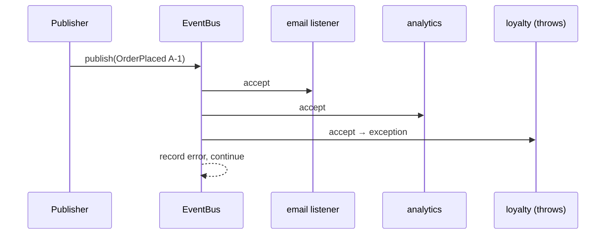

# 5. Observer: Type-Safe Event Bus

<span class="level l2">L2</span> ★★☆ · Subscribe by type, unsubscribe handle, failure isolation, `CopyOnWriteArrayList`

## Problem

> Implement an in-process event bus. Listeners subscribe to a specific event **type**, can **unsubscribe**, and a listener that
> throws must **not** stop the others from receiving the event.

## Key idea

Keep a map from **event class to listener list**. `publish` looks up the event's class and calls each listener inside its own
`try/catch`. Returning an `AutoCloseable` from `subscribe` gives a clean way to unsubscribe and avoids the
**lapsed-listener memory leak**. See [Observer](../behavioral/observer.md).



## Solution

```java title="ObserverEventBus.java"
--8<-- "coding-interview/src/ObserverEventBus.java"
```

## Walkthrough

| Code | Why |
|---|---|
| `<E extends Event> AutoCloseable subscribe(Class<E> type, Consumer<? super E> listener)` | The generic type ties the listener's parameter to the event type, so the compiler stops a cancel-handler subscribing to placed events. |
| `event -> listener.accept(type.cast(event))` | The wrapper does one checked cast, so the map can store a uniform `Consumer<? super Event>`. |
| `targets = List.copyOf(...) under the lock, then call outside it` | Never call foreign code while holding a lock: a listener that subscribes or publishes could deadlock. |
| `catch (RuntimeException e) { errors.add(...) }` | Failure isolation: one broken subscriber can't break the publisher or the other subscribers. |
| `return () -> listeners.get(type).remove(wrapper)` | The unsubscribe handle removes exactly the wrapper that was added. |

## Complexity

| Approach | Time | Space |
|---|---|---|
| publish | O(listeners of that type) | O(listeners) |
| subscribe / unsubscribe | O(1) / O(listeners) | - |

## Run it

```bash
java coding-interview/src/ObserverEventBus.java      # JDK 21+ single-file launcher, no build needed
```

```text
--8<-- "coding-interview/outputs/ObserverEventBus.txt"
```

## Common mistakes

* Iterating a plain `ArrayList` while a listener unsubscribes, which throws `ConcurrentModificationException`.
* Never unsubscribing. Long-lived buses keep short-lived listeners (and everything they reference) alive.
* Letting one listener's exception propagate to the publisher.
* Assuming delivery is asynchronous or ordered without saying so. This bus is synchronous and in registration order.

## Follow-up questions

??? question "How would you make delivery asynchronous?"
    Submit each listener call to an `Executor` (virtual threads work well). Then you must decide on ordering per listener, back-pressure (bounded queues) and error handling (dead-letter logging). Spring's `@EventListener` with `@Async` does this.

??? question "In-process observer vs Kafka?"
    In-process: fast and simple, but events are lost on a crash and stay inside one JVM. Kafka: durable, replayable, and works across services, at the cost of infrastructure and eventual consistency. To publish reliably after a DB commit, use the transactional outbox.
