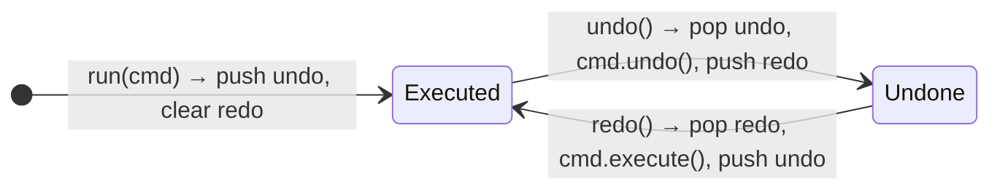

# 7. Command: Undo / Redo Editor

<span class="level l2">L2</span> ★★☆ · Command objects, two stacks, captured state for undo

## Problem

> Implement a text editor that supports `insert` and `delete` with **unlimited undo and redo**. A new edit after an undo must
> discard the redo history.

## See the pattern in motion

Before you write any code, watch the pattern this problem is built on. Switch to **Without it** to see the bug the pattern prevents. [Read the full Command page](../behavioral/command.md).

<iframe class="motion-embed" src="../../motion/index.html?p=command&amp;embed=1" title="Animated walkthrough of the Command pattern" loading="lazy"></iframe>

## Key idea

Turn each action into an **object that can `execute()` and `undo()` itself**. The editor keeps two stacks: run pushes
onto *undo*, undo moves a command onto *redo*, and redo moves it back. A **new** command clears *redo*, because the
history has branched. See [Command](../behavioral/command.md).



## Solution

```java title="CommandUndoRedo.java"
--8<-- "coding-interview/src/CommandUndoRedo.java"
```

## Walkthrough

| Code | Why |
|---|---|
| `interface Command { void execute(); void undo(); String name(); }` | Commands are first-class objects you can store, log, queue, replay or send over a network. |
| `private String removed; // captured at execute time` | `Delete` can only undo if it remembers *what* it deleted. Commands capture the state they need. |
| `void run(Command c) { c.execute(); undo.push(c); redo.clear(); }` | Clearing redo on a new command is the rule most people forget. |
| `Deque<Command> undo = new ArrayDeque<>()` | `ArrayDeque` as a stack: `push`/`pop` at the head. |

## Complexity

| Approach | Time | Space |
|---|---|---|
| run / undo / redo | O(1) + cost of the edit | O(history length) |

## Run it

```bash
java coding-interview/src/CommandUndoRedo.java      # JDK 21+ single-file launcher, no build needed
```

```text
--8<-- "coding-interview/outputs/CommandUndoRedo.txt"
```

## Common mistakes

* Not clearing the redo stack after a new command.
* Storing a full snapshot of the document for every command. That's the Memento approach: simple, but O(document) memory per step.
* Commands that aren't self-contained, for example an undo that depends on the cursor's *current* position rather than the recorded one.

## Follow-up questions

??? question "Command vs Memento for undo?"
    Command stores **how to reverse** each change, which is small and needs reversible operations. Memento stores **snapshots of state**, which is simple and works for any change, but uses more memory. Real editors often combine them: commands, plus periodic snapshots to rebuild from quickly.

??? question "How would you limit the history to 100 steps?"
    Use a bounded deque: after pushing, if `undo.size() > 100`, remove the oldest with `undo.removeLast()`.
