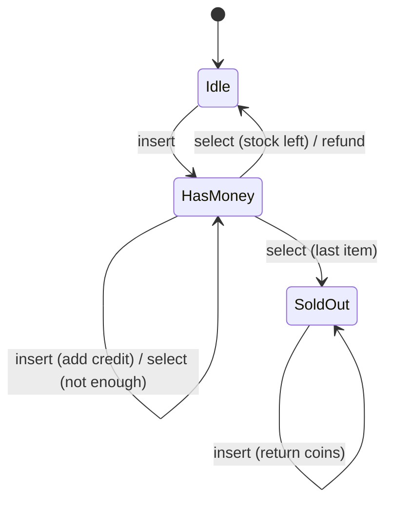

# 8. State: Vending Machine

<span class="level l2">L2</span> ★★☆ · Sealed states, transitions return the next state, illegal actions

## Problem

> A vending machine behaves differently depending on its state: **Idle**, **HasMoney(credit)** or **SoldOut**. Support
> insert, select and refund. It should give change, ask for more money, and refuse coins when it's sold out.

## See the pattern in motion

Before you write any code, watch the pattern this problem is built on. Switch to **Without it** to see the bug the pattern prevents. [Read the full State page](../behavioral/state.md).

<iframe class="motion-embed" src="../../motion/index.html?p=state&amp;embed=1" title="Animated walkthrough of the State pattern" loading="lazy"></iframe>

## Key idea

Replace `if (state == X && action == Y)` ladders with **one type per state**. Each state implements the actions that are
legal for it and **returns the next state**. Defaults on the interface handle the illegal ones. With `sealed` records the
states are immutable and the full set of states is known to the compiler. See [State](../behavioral/state.md).



## Solution

```java title="StateVendingMachine.java"
--8<-- "coding-interview/src/StateVendingMachine.java"
```

## Walkthrough

| Code | Why |
|---|---|
| `sealed interface State permits Idle, HasMoney, SoldOut` | The state set is closed and visible. A pattern-matching `switch` over `State` would be exhaustive. |
| `default State select(Machine m) { m.say("cannot select in " + this); return this; }` | Illegal actions are handled once, in the interface. Each state overrides only the actions it supports. |
| `record HasMoney(int credit)` | State-specific data (the credit) lives **in the state**, not as a nullable field on the machine. |
| `return m.stock == 0 ? new SoldOut() : new Idle();` | The transition logic sits next to the behaviour that causes it. |
| `state = state.select(this)` | The context just delegates and stores whatever comes back. |

## Complexity

| Approach | Time | Space |
|---|---|---|
| each action | O(1) | O(1) |

## Run it

```bash
java coding-interview/src/StateVendingMachine.java      # JDK 21+ single-file launcher, no build needed
```

```text
--8<-- "coding-interview/outputs/StateVendingMachine.txt"
```

## Common mistakes

* Keeping several booleans (`hasMoney`, `soldOut`) that can contradict each other. One state value avoids that.
* Letting the context decide transitions in a big `switch`, which spreads one state's rules across methods.
* Using mutable singleton state objects that carry per-machine data, so machines share credit by accident.

## Follow-up questions

??? question "How would you persist this state machine (for example, an order lifecycle in a DB)?"
    Store the state name plus its data in columns. Rebuild the state object when loading. Enforce allowed transitions in the domain, and optionally with a DB check or an optimistic version column so that two concurrent transitions can't both win.

??? question "When would you use Spring State Machine instead?"
    For large, configurable workflows with guards, actions, hierarchical states and persistence. For a handful of states, hand-written sealed types are clearer and easier to test.
