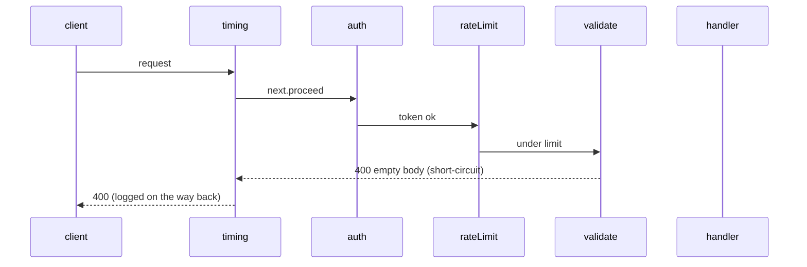

# 9. Chain of Responsibility: Request Pipeline

<span class="level l2">L2</span> ★★☆ · Handlers with `next`, short-circuiting, pre/post processing

## Problem

> Every API request passes **authentication → rate limiting → validation → handler**. Any step may reject the request with
> its own status code. Steps must be addable and reorderable, and one step must also run **after** the handler (audit).

## Key idea

Each handler receives the request and a **`next`** link. It either returns a response itself (short-circuit) or calls
`next.proceed(request)`. Code placed *after* `next.proceed` runs on the way back, which is how servlet filters,
Spring `HandlerInterceptor`s and Netty pipelines work. See [Chain of Responsibility](../behavioral/chain-of-responsibility.md).



## Solution

```java title="ChainOfResponsibility.java"
--8<-- "coding-interview/src/ChainOfResponsibility.java"
```

## Walkthrough

| Code | Why |
|---|---|
| `interface Handler { Response handle(Request r, Chain next); }` | A handler doesn't know which step comes next, only that there is one. |
| `return handlers.get(index).handle(r, new Chain(handlers, index + 1, terminal))` | Each `Chain` is an immutable cursor into the list, so the same chain object can serve concurrent requests. |
| `validTokens.contains(r.token()) ? next.proceed(r) : new Response(401, ...)` | Short-circuiting: a failed check never reaches later steps. |
| `Response resp = next.proceed(r); log.add(...); return resp;` | Post-processing: the timing handler sees the final status of every request, including rejected ones. |

## Complexity

| Approach | Time | Space |
|---|---|---|
| per request | O(handlers) | O(handlers) call depth |

## Run it

```bash
java coding-interview/src/ChainOfResponsibility.java      # JDK 21+ single-file launcher, no build needed
```

```text
--8<-- "coding-interview/outputs/ChainOfResponsibility.txt"
```

## Common mistakes

* Forgetting to call `next.proceed`, so the request silently stops.
* Putting the order-dependent logic inside the handlers. Keep ordering in the chain configuration, with auth before rate limiting before validation.
* Keeping per-request state in handler fields. That's a race once requests are concurrent. (The rate limiter's map here would need `ConcurrentHashMap` in production.)

## Follow-up questions

??? question "Where is this pattern in Spring?"
    The Servlet `FilterChain` (Spring Security is a chain of about 15 filters), `HandlerInterceptor` pre/post handlers, WebFlux `WebFilter`, and `ExchangeFilterFunction` on `WebClient`.

??? question "Chain of Responsibility vs Decorator?"
    Both wrap calls. A decorator always delegates and adds behaviour. A chain handler may **decide not to delegate** (handle or reject), and the chain is usually built from a configurable list.
