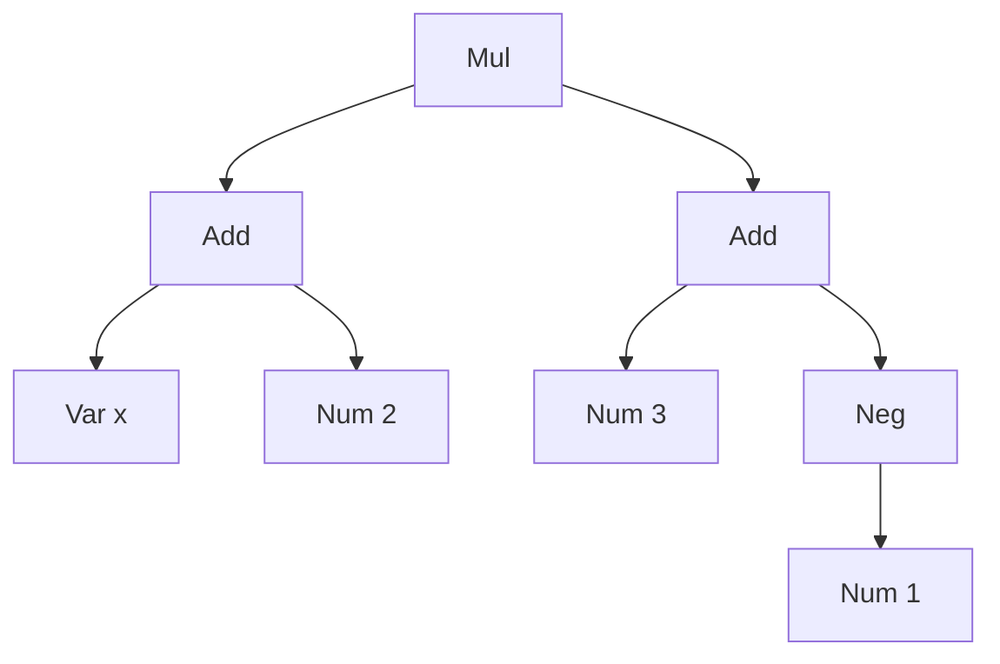

# 10. Composite + Visitor: Expression Tree

<span class="level l3">L3</span> ★★★ · Recursive sealed types, pattern-matching switch, record deconstruction

## Problem

> Model arithmetic expressions such as `(x + 2) * (3 + -1)` as a tree. Implement **evaluate**, **pretty-print** and
> **simplify** (`y * 1 + 0` → `y`, and constant folding). New operations must not require editing the node classes.

## Key idea

**Composite**: leaves (`Num`, `Var`) and branches (`Add`, `Mul`, `Neg`) share one type, so operations recurse uniformly.
**Visitor**: put operations *outside* the nodes. In Java 21 a `switch` over a `sealed` interface, with record
patterns, replaces the classic double-dispatch visitor. The compiler checks that every node type is handled. See
[Composite](../structural/composite.md) and [Visitor](../behavioral/visitor.md).



## Solution

```java title="CompositeExpression.java"
--8<-- "coding-interview/src/CompositeExpression.java"
```

## Walkthrough

| Code | Why |
|---|---|
| `sealed interface Expr permits Num, Var, Add, Mul, Neg` | A closed hierarchy: the compiler knows every node type. |
| `return switch (e) { case Num n -> ...; case Add a -> eval(a.left()) + eval(a.right()); ... }` | An exhaustive switch with no `default`. Adding a `Div` node makes every operation fail to compile until it's handled, which is exactly what you want. |
| `case Add(Expr l, Expr r) -> { ... }` | **Record patterns** (Java 21) deconstruct a node in the case label. |
| `if (a instanceof Num(double x) && x == 0) yield b;` | Nested patterns read like the algebra rule: "0 + b = b". |
| `case Neg(Neg(Expr inner)) -> simplify(inner);` | Patterns can match nested shapes, such as double negation, in one case. |
| `check(eval(simplify(e2), env) == eval(e2, env))` | Property-style check: simplification must preserve the value. |

## Complexity

| Approach | Time | Space |
|---|---|---|
| eval / show / simplify | O(nodes) | O(depth) recursion |

## Run it

```bash
java coding-interview/src/CompositeExpression.java      # JDK 21+ single-file launcher, no build needed
```

```text
--8<-- "coding-interview/outputs/CompositeExpression.txt"
```

## Common mistakes

* Adding `eval()`, `show()` and `simplify()` as methods on every node class. Each new operation then edits every class.
* Using `default ->` in a switch over a sealed type. It turns off the exhaustiveness check that is the whole point.
* Recursing on very deep trees without thinking about stack depth. Mention an explicit stack for untrusted input.

## Follow-up questions

??? question "Classic Visitor (accept/visit) vs pattern matching?"
    The classic visitor uses double dispatch: `node.accept(visitor)` calls `visitor.visitAdd(this)`. It needs an `accept` method on every node and a visitor interface. With sealed types and pattern-matching `switch`, you get the same 'operations outside the nodes' benefit with much less code.

??? question "What's the expression problem?"
    With OO subclassing, adding **types** is easy and adding **operations** is hard. With visitors or pattern matching, the opposite is true. Choose based on which changes more often in your domain.
