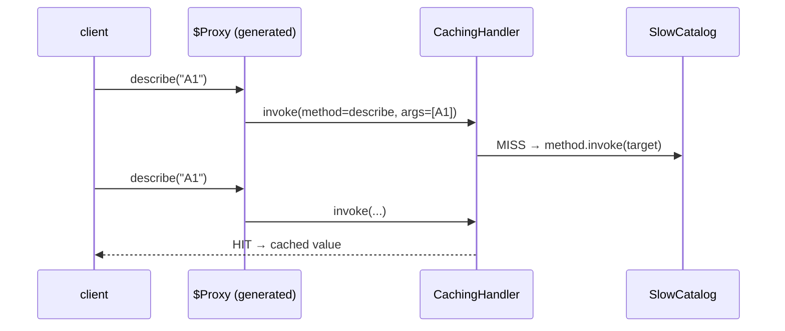

# 11. Proxy: Caching & Lazy Loading

<span class="level l3">L3</span> ★★★ · `java.lang.reflect.Proxy`, `InvocationHandler`, virtual proxy

## Problem

> Add result caching to **any interface** without writing a class per interface, and create an expensive service
> **lazily**, only when it's first used.

## See the pattern in motion

Before you write any code, watch the pattern this problem is built on. Switch to **Without it** to see the bug the pattern prevents. [Read the full Proxy page](../structural/proxy.md).

<iframe class="motion-embed" src="../../motion/index.html?p=proxy&amp;embed=1" title="Animated walkthrough of the Proxy pattern" loading="lazy"></iframe>

## Key idea

A **JDK dynamic proxy** generates a class at run time that implements the interfaces you pass and routes every call to one
`InvocationHandler.invoke(proxy, method, args)`. That single handler can add caching, timing, security or transactions
to any interface. Spring AOP and Mockito work this way. A **virtual proxy** holds a factory and builds the real object on
first use. See [Proxy](../structural/proxy.md).



## Solution

```java title="DynamicProxy.java"
--8<-- "coding-interview/src/DynamicProxy.java"
```

## Walkthrough

| Code | Why |
|---|---|
| `Proxy.newProxyInstance(loader, new Class<?>[]{type}, handler)` | This generates a class implementing `type`. It works for **interfaces only**; class proxies need ByteBuddy or CGLIB, which is what Spring uses for `@Configuration`. |
| `if (method.getDeclaringClass() == Object.class) return method.invoke(target, args)` | `equals`, `hashCode` and `toString` are also routed through the handler, so don't cache them. |
| `List<Object> key = [methodName, args...]` | A cache key built from method plus arguments. `List.equals` and `hashCode` make it a valid map key. |
| `method.invoke(target, args)` | Reflective call to the real object. In production, unwrap `InvocationTargetException` so callers see the original exception. |
| `private ProductCatalog real() { if (real == null) real = factory.get(); ... }` | Virtual proxy: lazy creation. This version isn't thread-safe; use a holder or a lock if the proxy is shared. |

## Complexity

| Approach | Time | Space |
|---|---|---|
| cached call | O(args) to build the key | O(distinct calls) |

## Run it

```bash
java coding-interview/src/DynamicProxy.java      # JDK 21+ single-file launcher, no build needed
```

```text
--8<-- "coding-interview/outputs/DynamicProxy.txt"
```

## Common mistakes

* Expecting a JDK proxy to work on a concrete class. It only implements interfaces.
* Self-invocation: inside the target, `this.otherMethod()` bypasses the proxy. That's the classic "`@Transactional` doesn't work" bug in Spring.
* Caching methods with side effects, or with mutable arguments used as keys.

## Follow-up questions

??? question "Why doesn't @Transactional work when a method calls another method in the same class?"
    Spring applies `@Transactional` with a proxy around the bean. A call from inside the bean (`this.save()`) goes straight to the target and skips the proxy, so no transaction starts. Fix it by moving the method to another bean, injecting the bean's own proxy, or using AspectJ weaving.

??? question "JDK proxy vs CGLIB/ByteBuddy?"
    JDK proxies implement interfaces, using built-in reflection. CGLIB and ByteBuddy subclass the target class at run time, so they work without interfaces, but they can't proxy `final` classes or methods. Spring Boot defaults to class-based proxies.
