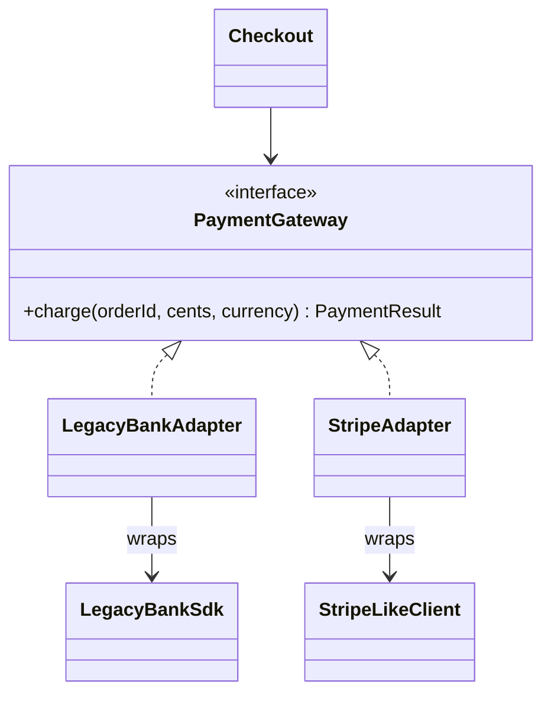

# 12. Adapter: Integrating Payment SDKs

<span class="level l1">L1</span> ★★☆ · Object adapter, unit/error translation, anti-corruption layer

## Problem

> Checkout depends on `PaymentGateway.charge(orderId, amountCents, currency)`. Integrate a **legacy bank SDK** (rupees as
> `double`, numeric status codes, checked exceptions) and a **third-party client** (map-based requests, string statuses)
> without changing checkout.

## See the pattern in motion

Before you write any code, watch the pattern this problem is built on. Switch to **Without it** to see the bug the pattern prevents. [Read the full Adapter page](../structural/adapter.md).

<iframe class="motion-embed" src="../../motion/index.html?p=adapter&amp;embed=1" title="Animated walkthrough of the Adapter pattern" loading="lazy"></iframe>

## Key idea

Write one **adapter per vendor** that implements *our* interface and wraps *their* client. It translates **units**
(cents ↔ rupees), **requests** (map building), **results** (codes → our `PaymentResult`) and **errors**
(checked exceptions → domain failures). Vendor quirks never leak into the domain. At the architecture level this is
an anti-corruption layer. See [Adapter](../structural/adapter.md).



## Solution

```java title="AdapterPayments.java"
--8<-- "coding-interview/src/AdapterPayments.java"
```

## Walkthrough

| Code | Why |
|---|---|
| `sdk.pay(orderId, amountCents / 100.0)` | Unit translation is confined to the adapter. The domain stays on exact minor units. The legacy `double` is the vendor's problem, kept at the edge. |
| `catch (Exception e) { return new PaymentResult(false, null, e.getMessage()); }` | The vendor's checked exception becomes a domain result instead of leaking `throws Exception` into checkout. |
| `code == 0 ? ... : "CODE_" + code` | Map vendor codes to our error vocabulary in one place. A real adapter would use a proper code table. |
| `if (!currency.equals("INR")) return ... UNSUPPORTED_CURRENCY` | Adapters also enforce the vendor's capabilities, so callers get a clear error instead of a mysterious failure from the SDK. |

## Complexity

| Approach | Time | Space |
|---|---|---|
| charge | O(1) + vendor call | O(1) |

## Run it

```bash
java coding-interview/src/AdapterPayments.java      # JDK 21+ single-file launcher, no build needed
```

```text
--8<-- "coding-interview/outputs/AdapterPayments.txt"
```

## Common mistakes

* Letting vendor types (status codes, SDK exceptions, `double` amounts) appear in domain signatures.
* Adapting by inheritance (a class adapter that `extends` the SDK class), which couples you to SDK internals and its constructor.
* Putting business rules in the adapter. It should translate, not decide.

## Follow-up questions

??? question "How do you test an adapter?"
    Use contract tests against the vendor's sandbox, or a recorded stub (WireMock) for the HTTP shape. Unit-test the translation rules (units, code mapping, error mapping) with a fake SDK object, as this demo does.

??? question "Adapter vs Facade?"
    An adapter makes **one** existing interface fit the one you expect. A facade **simplifies many** interfaces behind one new, smaller interface.
