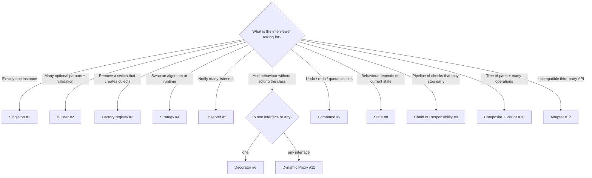

# Coding Interview: 12 "Implement This Pattern" Problems

In pattern-focused coding rounds you aren't asked to *define* a pattern. You're asked to **write one in 20–30 minutes**:
"make this thread-safe singleton unbreakable", "add undo/redo", "remove this switch", "add retries without touching
the class". Each problem here has a **runnable, self-checking solution** in
[`coding-interview/src`](https://github.com/khiruashish/java-design-pattern/tree/main/coding-interview/src).
Each file checks its own results, prints `PASS`, and is run by CI on every change. The code on each page is
included from those files.

Each page links to the full pattern chapter (intent, structure, three real-world examples, trade-offs). For whole-system
design questions (parking lot, elevator, Splitwise and more), see [LLD Problems](../interview/lld-problems.md).

Each page follows the same structure:

1. **Problem**: the statement as an interviewer would give it.
2. **Key idea**: the shape of the solution before any code, with a diagram.
3. **Solution**: the complete, runnable code (included from the repository, so it is exactly what CI ran).
4. **Walkthrough**: the important lines and *why* they are written that way.
5. **Complexity**: time and space for each approach.
6. **Run it**: the command and its real output.
7. **Common mistakes** and **follow-up questions** with answers.

## Problem map

| # | Problem | What it tests | Level | Difficulty |
|---|---|---|---|---|
| 1 | [Unbreakable Thread-Safe Singleton](01-singleton.md) | Holder idiom, double-checked locking + `volatile`, reflection & serialization defence | <span class="level l2">L2</span> | ★★★ |
| 2 | [Builder with Validation](02-builder.md) | Required vs optional params, defaults, cross-field validation, immutability | <span class="level l1">L1</span> | ★★☆ |
| 3 | [Factory Without a Switch](03-factory-registry.md) | Registry of `Supplier`s, OCP, runtime extension | <span class="level l2">L2</span> | ★★☆ |
| 4 | [Strategy: Pluggable Discount Rules](04-strategy.md) | Functional interface, lambdas as strategies, composite strategy | <span class="level l1">L1</span> | ★★☆ |
| 5 | [Observer: Type-Safe Event Bus](05-observer.md) | Subscribe by type, unsubscribe handle, failure isolation, `CopyOnWriteArrayList` | <span class="level l2">L2</span> | ★★☆ |
| 6 | [Decorator: Retry + Cache + Log](06-decorator.md) | Wrapping, ordering of decorators, composition over inheritance | <span class="level l2">L2</span> | ★★☆ |
| 7 | [Command: Undo / Redo Editor](07-command-undo.md) | Command objects, two stacks, captured state for undo | <span class="level l2">L2</span> | ★★☆ |
| 8 | [State: Vending Machine](08-state-machine.md) | Sealed states, transitions return the next state, illegal actions | <span class="level l2">L2</span> | ★★☆ |
| 9 | [Chain of Responsibility: Request Pipeline](09-chain-of-responsibility.md) | Handlers with `next`, short-circuiting, pre/post processing | <span class="level l2">L2</span> | ★★☆ |
| 10 | [Composite + Visitor: Expression Tree](10-composite-visitor.md) | Recursive sealed types, pattern-matching switch, record deconstruction | <span class="level l3">L3</span> | ★★★ |
| 11 | [Proxy: Caching & Lazy Loading](11-dynamic-proxy.md) | `java.lang.reflect.Proxy`, `InvocationHandler`, virtual proxy | <span class="level l3">L3</span> | ★★★ |
| 12 | [Adapter: Integrating Payment SDKs](12-adapter.md) | Object adapter, unit/error translation, anti-corruption layer | <span class="level l1">L1</span> | ★★☆ |

Levels: <span class="level l1">L1</span> 0–2 yrs · <span class="level l2">L2</span> 2–5 yrs · <span class="level l3">L3</span> 5–10 yrs · <span class="level l4">L4</span> 10+ yrs / architect.

### Watch the patterns behind the problems

<iframe class="motion-embed motion-family" src="../motion/index.html?set=singleton,builder,factory-method,strategy,observer,decorator,command,state,chain-of-responsibility,composite,visitor,proxy,adapter&amp;embed=1" title="Animated player for the patterns used in the coding problems" loading="lazy"></iframe>

The chips follow the problem map: one animation for each pattern the twelve problems use (problem 10 uses both Composite and Visitor). Watch the one you're about to solve to fix the shape in your head before you write code.

## Which technique fits? (the interviewer's hidden question)



## How to answer a coding round

1. **Name the pattern and the force behind it** ("the switch grows with every channel, so this is OCP: a factory registry").
2. **Sketch the participants** (interface, implementations, context or client) before coding. A 30-second class diagram saves 10 minutes.
3. **Write the client code first**, the way you want it to read (`checkout.total(cart)`), then implement behind it.
4. **Prove it works** with a normal case, an edge case and the extension the pattern is meant to make cheap (a new channel, a new rule, a new node type).
5. **Discuss the trade-offs**: more classes and indirection, and when *not* to use the pattern (YAGNI).

## Run every solution

```bash
coding-interview/run-all.sh          # runs all 12, writes outputs/
coding-interview/run-all.sh --check  # what CI runs: fails on any failure or changed output
```
