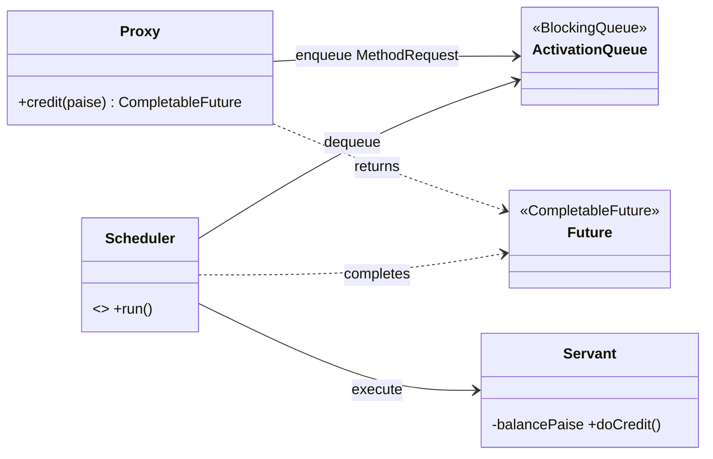
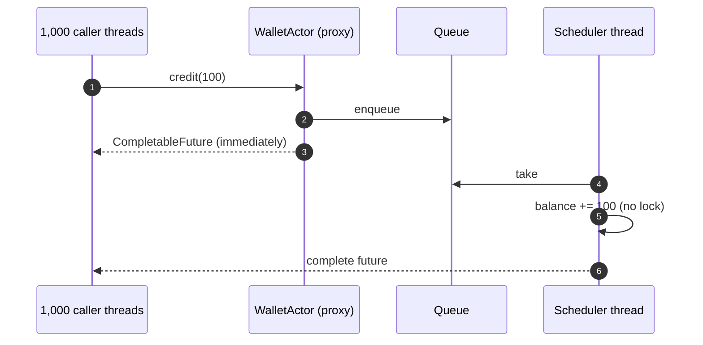
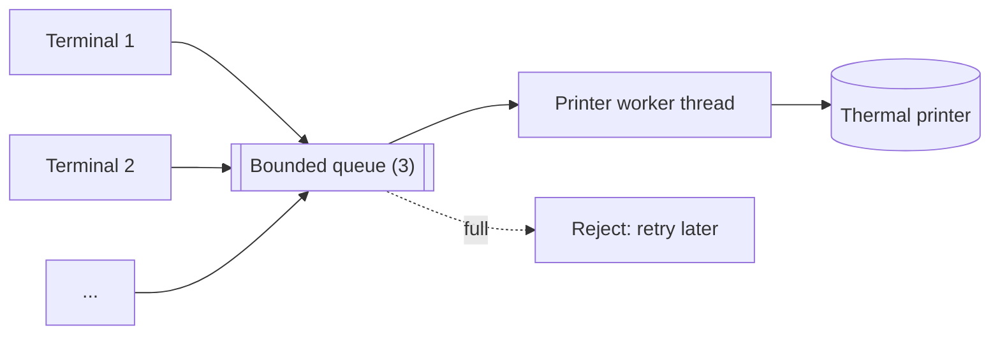
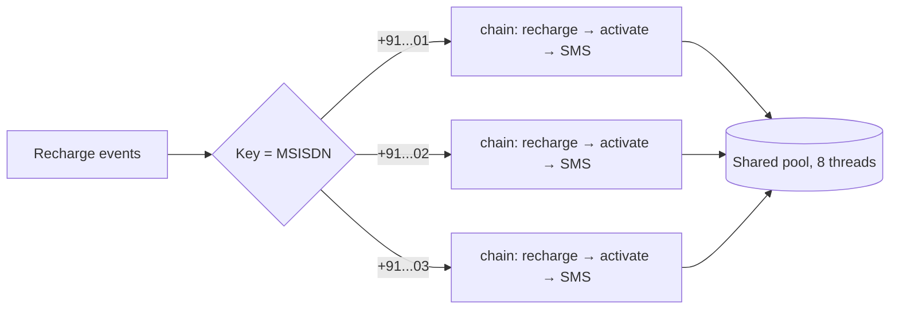

---
tags:
  - Concurrency
  - Advanced
---

# Active Object

<span class="badge badge--intermediate">🟡 Intermediate → 🔴 Advanced</span>
<span class="badge badge--category">Concurrency</span>
<span class="badge badge--interview">Interview frequency ⭐⭐⭐</span>

!!! abstract "TL;DR"
    **An Active Object owns its own thread. Callers don't run its methods; they drop requests into its queue and get a `Future` back. One scheduler thread executes the requests in order, so the object's state needs no locks.**
    Use it for a shared resource that must be accessed one request at a time (a wallet, a printer, a device, a subscriber's state), especially when callers shouldn't block.

---

## 1. Intent & Problem It Solves

**The problem in plain English:** a wallet receives thousands of cashback credits and payment debits from different threads. With locks, every method must be carefully synchronized; a slow operation holds the lock and blocks callers; and a missed lock somewhere corrupts the balance. What if only **one** thread ever touched the wallet, and everyone else just sent it messages?

**Definition (Lavender & Schmidt, *Active Object*, 1996; POSA2):**
> Decouples method **execution** from method **invocation** to enhance concurrency and simplify synchronized access to an object that resides in its own thread of control.

The **actor model** (Erlang, Akka/Pekko, Orleans) is the same idea taken further: everything is an active object with a mailbox, and actors only communicate by messages.

## 2. Real-World Analogy

!!! example "A bank teller window with a token system"
    Customers don't walk into the vault. They take a token (a future), drop their request slip in the tray (the activation queue), and sit down. One teller (the scheduler thread) processes slips in order. Customers are free to read the paper while they wait, and the vault never has two people in it.

## 3. Structure



| Participant | Responsibility | In the examples |
|---|---|---|
| **Proxy** | Public API; turns calls into requests; returns futures | `WalletActor.credit()` |
| **Method request** | A captured call | The lambda passed to `supplyAsync` |
| **Activation queue** | Buffers requests (bounded = back-pressure) | The executor's queue |
| **Scheduler** | Single thread that dequeues and runs requests | `newSingleThreadExecutor()` |
| **Servant** | The real state and logic, confined to the scheduler thread | `balancePaise` |
| **Future** | Lets callers wait for or chain the result | `CompletableFuture` |

## 4. Naive Approach (Without the Pattern)

```java
public class Wallet {
    private long balance;
    public void credit(long p) { balance += p; }                       // not atomic: lost updates
    public synchronized boolean debit(long p) { ... }                  // locked, but credit isn't
    public synchronized String statement() { Thread.sleep(200); ... }  // slow call blocks every debit
}
```

- :material-close-circle:{ style="color:#e53935" } Every method must get locking right, forever.
- :material-close-circle:{ style="color:#e53935" } Slow operations block all callers.
- :material-close-circle:{ style="color:#e53935" } Callers can't do anything else while waiting.

---

## 5. Three Real-World Examples

### Example 1: Wallet as an Active Object (Payments)

**Scenario:** A payments app credits INR 1 cashback on 1,000 transactions in a burst, while the user tries 15 debits of INR 100. The balance must end exactly right, no debit may overdraw, and callers (request threads) must not block on a lock.

**Design:**



**Full Code:**

=== "WalletActor.java"

    ```java
    --8<-- "code/concurrency/src/main/java/com/handbook/concurrency/activeobject/wallet/WalletActor.java"
    ```

    1.  The **scheduler**: one thread, one queue. All state is confined to it ("thread confinement"), so plain fields are safe.
    2.  The **proxy** method returns at once with a future. The lambda is the method request.
    3.  `close()` lets queued requests finish and stops the thread (`ExecutorService` is `AutoCloseable` since Java 19).

=== "WalletDemo.java"

    ```java
    --8<-- "code/concurrency/src/main/java/com/handbook/concurrency/activeobject/wallet/WalletDemo.java"
    ```

**Output:**

```text
--8<-- "code/outputs/concurrency/activeobject/wallet/WalletDemo.txt"
```

**Why an active object here:**

- Check-then-act (`if balance >= amount then subtract`) is atomic **by construction**.
- No locks to forget; the scheduler thread is the only writer.
- Callers get futures they can combine (`thenCompose`) instead of blocking.

---

### Example 2: Shared Label Printer with Back-Pressure (Logistics)

**Scenario:** A warehouse packing station has one thermal printer shared by six packers' terminals. Labels must print one at a time, in submission order. While the printer warms up, jobs queue; if more than 3 are waiting, new jobs are **rejected** with a clear message so packers retry instead of the queue growing without limit.

**Design:**



**Full Code:**

=== "LabelPrinter.java"

    ```java
    --8<-- "code/concurrency/src/main/java/com/handbook/concurrency/activeobject/printer/LabelPrinter.java"
    ```

    1.  A **bounded** activation queue plus `AbortPolicy`. An unbounded queue would hide overload until memory runs out.
    2.  Rejection becomes a **failed future**, so callers handle it like any other result.

=== "PrinterDemo.java"

    ```java
    --8<-- "code/concurrency/src/main/java/com/handbook/concurrency/activeobject/printer/PrinterDemo.java"
    ```

**Output:**

```text
--8<-- "code/outputs/concurrency/activeobject/printer/PrinterDemo.txt"
```

**Why an active object here:**

- The device is inherently single-threaded; the pattern mirrors reality.
- FIFO ordering of jobs comes for free.
- The bounded queue gives explicit **back-pressure** (one job printing + 3 waiting, the 5th is rejected).

---

### Example 3: Per-Subscriber Ordering at Scale (Telecom)

**Scenario:** A telecom processes 20,000 recharge events per second. For each subscriber, "recharge → activate data pack → send SMS" must happen **in order**, but different subscribers should be processed in parallel. One single-threaded actor per subscriber (millions of them) would be wasteful; instead, each key gets a lightweight "virtual actor": a chain of futures executed on a shared pool.

**Design:**



**Full Code:**

=== "KeyedSerialExecutor.java"

    ```java
    --8<-- "code/concurrency/src/main/java/com/handbook/concurrency/activeobject/keyed/KeyedSerialExecutor.java"
    ```

    1.  `compute` atomically appends the new task to **this key's** tail future.
    2.  The new task starts only when the previous one for the same key finishes (even if it failed); other keys don't wait.

=== "TelecomDemo.java"

    ```java
    --8<-- "code/concurrency/src/main/java/com/handbook/concurrency/activeobject/keyed/TelecomDemo.java"
    ```

**Output:**

```text
--8<-- "code/outputs/concurrency/activeobject/keyed/TelecomDemo.txt"
```

**Why keyed active objects here:**

- Ordering is needed **per key**, not globally, which is the same reason Kafka partitions by key.
- A shared pool keeps thread count fixed regardless of subscriber count.
- This is how Orleans "virtual actors" and Akka's sharded entities scale to millions of instances.

---

??? example "Unit Tests: `ActiveObjectTest.java`"

    ```java
    --8<-- "code/concurrency/src/test/java/com/handbook/concurrency/activeobject/ActiveObjectTest.java"
    ```

## 6. Variations & Modern Java Take

| Variation | Notes |
|---|---|
| **Single-thread executor + `CompletableFuture`** | The simplest Java active object (Examples 1–2) |
| **Virtual-thread scheduler** | `Executors.newSingleThreadExecutor(Thread.ofVirtual().factory())`: thousands of active objects without thousands of OS threads |
| **Keyed serial executor** | Per-key ordering on a shared pool (Example 3) |
| **Actors** | Akka/Pekko (`AbstractBehavior`), Orleans-style virtual actors, Vert.x verticles (event-loop-confined state) |
| **Event loop** | Netty, Node.js, Vert.x: one thread per loop runs all handlers for its channels: active objects at the I/O layer |
| Alternative | For short critical sections, a `ReentrantLock` or atomics are simpler and faster |

## 7. Where It Lives in Real Frameworks

| Where | Active Object |
|---|---|
| JDK | `Executors.newSingleThreadExecutor`, `CompletableFuture.supplyAsync(..., executor)`, Swing's Event Dispatch Thread (`SwingUtilities.invokeLater`) |
| Akka / Apache Pekko | Actors with mailboxes; `ask` returns a `CompletionStage` |
| Vert.x | Verticles: state confined to an event loop; `vertx.eventBus().request(...)` |
| Netty | `EventLoop`: each channel's handlers run on one thread |
| Android | `Looper` + `Handler` (main thread message queue) |
| Kafka Streams | One stream thread per partition set: per-key ordering, no locks in processors |

## 8. Pros, Cons & Trade-offs

| ✅ Pros | ❌ Cons |
|---|---|
| No locks: state is confined to one thread | Every call pays queueing and a thread hop |
| Callers don't block; futures compose | Throughput capped by one thread per object |
| Natural ordering and bounded-queue back-pressure | Debugging async flows and stack traces is harder |
| Scales to many objects with virtual threads/keyed executors | Deadlock risk if an actor waits (`join()`) on its own future or another actor waiting on it |

## 9. Pitfalls & Anti-Patterns

!!! danger "Blocking inside the scheduler"
    A request that calls `future.join()` on another request to the **same** active object deadlocks: the only thread is waiting for itself. Compose with `thenCompose` instead of blocking.

!!! danger "Leaking the servant"
    Returning the mutable internal object (`return balancesMap`) lets callers touch it from other threads. Return copies or immutable values.

!!! warning "Unbounded mailboxes"
    `newSingleThreadExecutor()` has an unbounded queue. Under sustained overload, latency and memory grow silently. Use a bounded queue and a rejection policy (Example 2).

!!! warning "Keyed executors that never forget keys"
    `KeyedSerialExecutor` keeps one tail future per key forever. In production, remove the entry when its tail completes (or use a bounded, sharded set of single-thread lanes).

## 10. Senior / Architect Deep Dive (10–15 yrs)

**Throughput math.** One active object processes `1 / service_time` requests per second. If a wallet operation takes 50 µs, that's ~20,000 ops/s per wallet, which is plenty per user but a hard ceiling for a global object. Shard: one active object per account (keyed), not one for the whole bank.

**Failure handling.** Decide what a failed request does to the object. Erlang/Akka "let it crash": a supervisor restarts the actor with clean state. In a plain Java active object, catch exceptions per request (the future fails), and never let one request corrupt the shared state halfway: validate first, then mutate.

**Same idea, distributed.** A Kafka partition with one consumer is an active object for all keys in that partition: messages are its mailbox, the consumer thread its scheduler. That's why "partition by entity id" gives per-entity ordering and lock-free processing in stream processors.

!!! bug "War story: the wallet that deadlocked at midnight"
    A wallet actor's `applyCashback` request called `statement().join()` to log the new balance. `statement()` was enqueued on the **same** single thread, behind the request waiting for it. The first cashback after deployment froze the wallet; the midnight cashback batch then queued 2 million requests behind it and the service ran out of memory.
    **Fix:** compose (`thenCompose`) instead of `join()` inside the actor; a bounded mailbox; and an ArchUnit rule forbidding `join()`/`get()` in actor classes.
    **Lesson:** never block an active object on itself.

## 11. Related Patterns & Comparisons

| | Active Object | Monitor (`synchronized`) | Producer-Consumer | Thread Pool |
|---|---|---|---|---|
| Who runs the method | The object's own thread | The caller's thread | Consumer threads | Any pool thread |
| Synchronization | Thread confinement | Locks | Queue | None (tasks must be independent) |
| Caller blocks? | No (future) | Yes, while waiting for the lock | Only when the queue is full | No |
| Ordering | FIFO per object | None guaranteed | FIFO per queue | None |

Active Object = [Producer-Consumer](producer-consumer.md) (the queue) + [Future/Promise](future-promise.md) (the result) + [Command](../behavioral/command.md) (the request) + thread confinement.

## 12. Interview Corner

=== "🟢 Beginner / Service Companies"

    **Q1. What is an Active Object?**

    An object with its own thread; calls become queued requests that the thread runs one by one, returning futures.

    **Q2. Why doesn't it need locks?**

    Only its own thread ever reads or writes its state (thread confinement).

    **Q3. What does the caller get back?**

    A `Future`/`CompletableFuture` it can wait on or chain.

    **Q4. How do you build one in Java quickly?**

    `Executors.newSingleThreadExecutor()` plus `CompletableFuture.supplyAsync(task, executor)`.

    **Q5. Actor vs Active Object?**

    Same core idea; actors communicate only via messages and usually come with supervision and location transparency.

=== "🟡 Mid-Level"

    **Q1. What's the biggest risk?**

    Deadlock by blocking the object's thread on its own future, and unbounded queues under overload.

    **Q2. How do you add back-pressure?**

    Bounded queue (`ThreadPoolExecutor` with `ArrayBlockingQueue`) and a rejection policy, surfaced as failed futures.

    **Q3. How do you get ordering per key with parallelism across keys?**

    Keyed serial execution: chain tasks per key, or hash keys onto N single-thread lanes.

    **Q4. When is a lock better?**

    Very short critical sections with synchronous callers; a lock is cheaper than a thread hop.

    **Q5. How do virtual threads help?**

    You can give many objects their own (virtual) scheduler thread cheaply.

=== "🔴 Senior / FAANG / SAP"

    **Q1. "Design a per-user rate counter for 50M users with no locks."**

    Hash users onto N lanes (single-thread executors or Kafka partitions); state per user in a lane-local map; periodic snapshots for durability.

    **Q2. "How does Kafka Streams relate to Active Object?"**

    Each partition is processed by one stream thread with its local state store: per-key ordering and lock-free state, like a sharded active object.

    **Q3. "Supervision: what happens when a request throws?"**

    Fail that request's future; keep state consistent by validating before mutating; for corrupted state, restart the actor from a snapshot/log.

    **Q4. "How do you test active objects deterministically?"**

    Inject the executor; in tests use a direct/synchronous executor, or await futures and assert on results, not timing.

    **Q5. "Event loop vs thread-per-request?"**

    Event loops (Netty, Vert.x) confine state per loop and need non-blocking code; virtual threads make thread-per-request cheap again with plain blocking code. Active objects fit both.

=== "💻 Coding Challenge"

    **Problem:** Write a generic `Actor<S>` with `<R> CompletableFuture<R> ask(Function<S, R>)` that makes any non-thread-safe object (like a `HashMap`) safe to use from many threads.

    ??? success "Solution"

        === "Actor.java"

            ```java
            --8<-- "code/concurrency/src/main/java/com/handbook/concurrency/activeobject/generic/Actor.java"
            ```

        === "ActorDemo.java"

            ```java
            --8<-- "code/concurrency/src/main/java/com/handbook/concurrency/activeobject/generic/ActorDemo.java"
            ```

        **Output:**

        ```text
        --8<-- "code/outputs/concurrency/activeobject/generic/ActorDemo.txt"
        ```

        **Key points to say:** the state is captured once and only touched inside `ask` lambdas, which all run on one (virtual) thread; callers must not keep references to the state or return it; results should be immutable values.

!!! info "Behavioural tie-in (STAR) for experienced candidates"
    - **S:** A wallet service had recurring balance drift from inconsistent locking across 14 methods.
    - **T:** Make balance updates provably consistent without a database lock per call.
    - **A:** Turned each wallet into a keyed active object (per-account lanes on a shared pool), bounded the mailboxes, and banned blocking calls inside actors with ArchUnit.
    - **R:** Zero balance-drift incidents in a year; p99 latency fell 40% because callers stopped contending on locks.

## 13. Quick Revision Card

!!! tip "Remember in 30 seconds"
    - **Own thread + queue + futures**; callers enqueue, never execute.
    - State confined to one thread: **no locks**.
    - Bound the mailbox; reject or shed when full.
    - Never block the actor on its own future: compose.
    - Per-key ordering at scale: keyed lanes / partitions.

    ```java
    CompletableFuture<Long> credit(long p) { return supplyAsync(() -> balance += p, singleThread); }
    ```

## Practice

- [ ] Add a `transfer(WalletActor to, long paise)` that composes two actors without blocking either.
- [ ] Make `KeyedSerialExecutor` remove a key when its last task completes.
- [ ] Give `LabelPrinter` a priority lane for express shipments.

---

[:material-arrow-left: Guarded Suspension & Balking](guarded-suspension-balking.md){ .md-button }
[Next: Fork/Join :material-arrow-right:](fork-join.md){ .md-button .md-button--primary }
