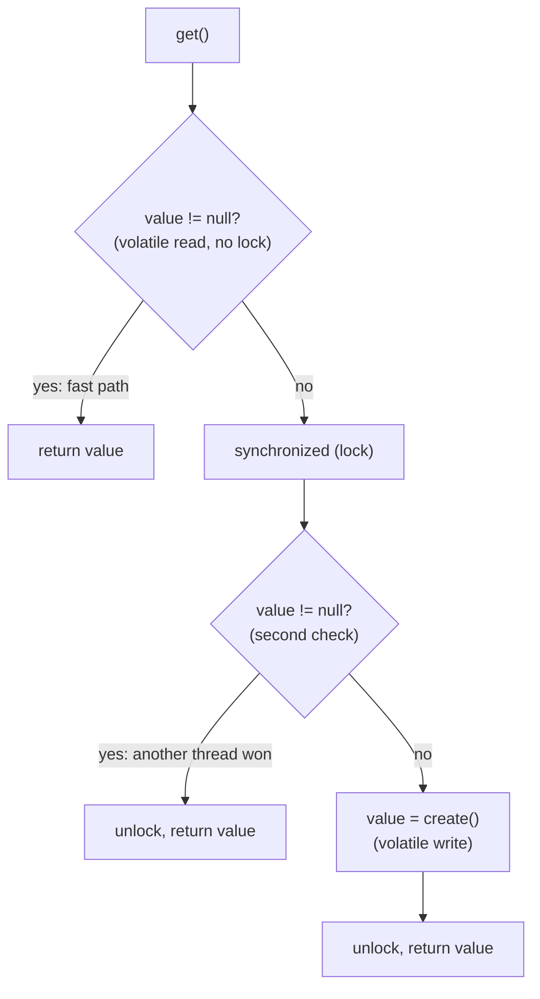
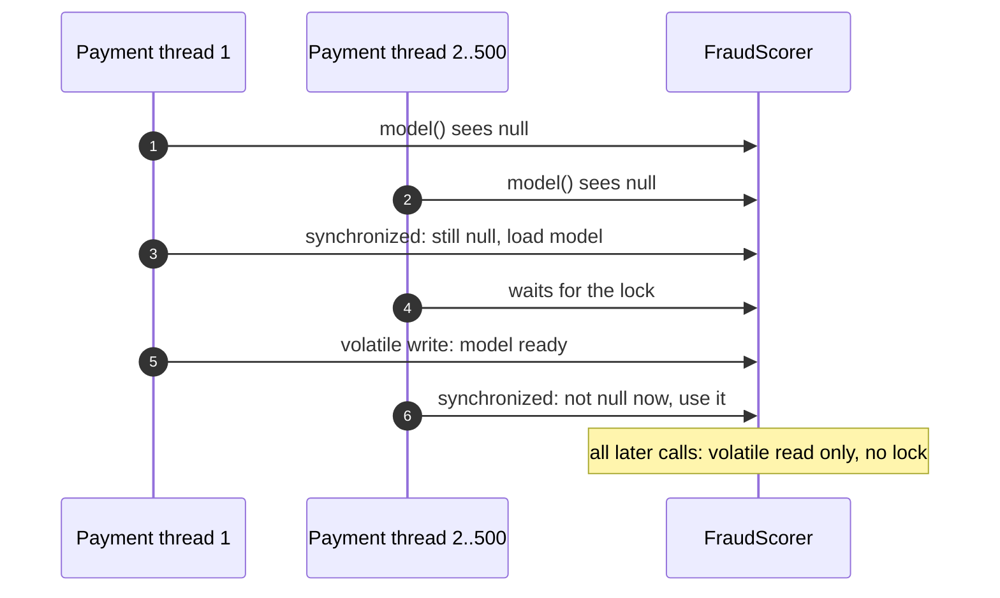
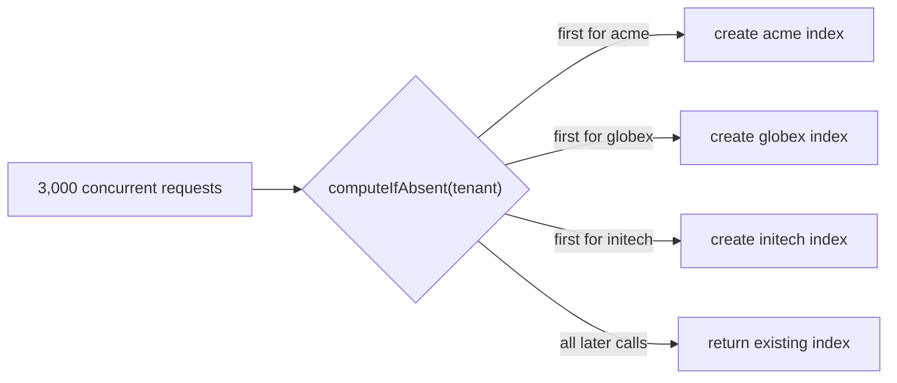
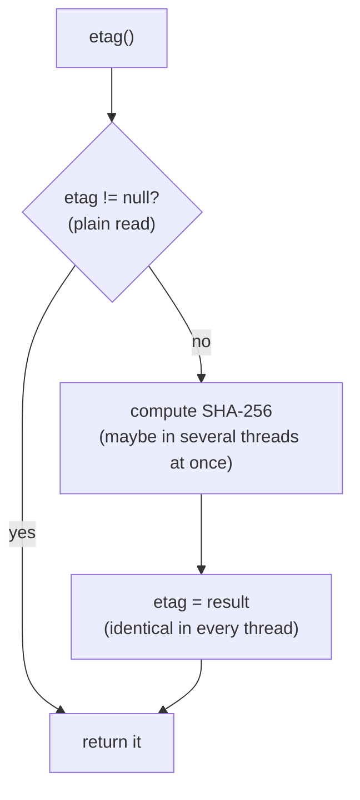

---
tags:
  - Concurrency
  - Advanced
---

# Double-Checked Locking

<span class="badge badge--advanced">🔴 Advanced</span>
<span class="badge badge--category">Concurrency</span>
<span class="badge badge--interview">Interview frequency ⭐⭐⭐⭐</span>

!!! abstract "TL;DR"
    **Double-checked locking (DCL) lazily initializes a field so that only the very first callers ever take a lock: check without the lock, lock, check again, create.**
    In Java it is correct **only with `volatile`**. Often a simpler tool is better: the holder idiom (static), `ConcurrentHashMap.computeIfAbsent` (per key), or a `Lazy<T>` helper.

---

## 1. Intent & Problem It Solves

**The problem in plain English:** a fraud model takes seconds to load and uses 400 MB. Loading it at start-up slows every deploy, even for instances that never score a payment. Loading it on first use is better, but 500 payments may arrive at the same instant, and you must load it **exactly once**. Making `model()` `synchronized` works, but then every call (millions per day) takes a lock forever, just to protect something that only matters for the first few milliseconds.

**Definition:**
> Check whether initialization is needed **without** locking; if it is, acquire the lock and **check again** (another thread may have finished meanwhile) before initializing. The field must be **`volatile`** so that other threads never see a partially constructed object.

## 2. Real-World Analogy

!!! example "Turning on the office coffee machine"
    The first person in the morning glances at the machine (first check: is it on?). If it's off, they go to the switch, and before pressing it, look again (second check), because a colleague may have turned it on while they walked over. After that, everyone just glances and makes coffee; nobody walks to the switch again.

## 3. Structure



**Why `volatile` is mandatory:** `value = new Model()` is three steps (allocate, run constructor, assign the reference), and without a happens-before edge, the assignment can become visible to other threads **before** the constructor's writes. A thread on the fast path could then use a half-built object. `volatile` (Java 5+, JSR-133) forbids that reordering.

## 4. Naive Approach (Without the Pattern)

```java
// (a) Broken: race. Two threads can both see null and load the model twice (or N times)
Model model() {
    if (model == null) model = new Model();
    return model;
}

// (b) Correct but slow forever: every call locks, long after initialization
synchronized Model model() { ... }

// (c) BROKEN DCL: no volatile. Readers may see a partially constructed Model
private Model model;
```

- :material-close-circle:{ style="color:#e53935" } (a) duplicate expensive initialization, possibly inconsistent state.
- :material-close-circle:{ style="color:#e53935" } (b) permanent lock contention on a hot path.
- :material-close-circle:{ style="color:#e53935" } (c) the classic, very hard-to-reproduce memory-model bug.

---

## 5. Three Real-World Examples

### Example 1: Lazily Loaded Fraud Model (Payments) — *instance-field DCL*

**Scenario:** Each payment service instance has a `FraudScorer`. The model is loaded on the first payment, not at start-up, so deploys are fast and instances that only serve refunds never load it. The first burst after a deploy is 500 concurrent payments, and the model must be loaded **once**. After that, scoring must not take any lock.

**Design:**



**Full Code:**

=== "FraudScorer.java"

    ```java
    --8<-- "code/concurrency/src/main/java/com/handbook/concurrency/dcl/fraud/FraudScorer.java"
    ```

    1.  **`volatile`** is what makes DCL correct in Java.
    2.  Read the volatile field **once** into a local: the fast path does a single volatile read (the form recommended in *Effective Java*, Item 83).

=== "FraudDemo.java"

    ```java
    --8<-- "code/concurrency/src/main/java/com/handbook/concurrency/dcl/fraud/FraudDemo.java"
    ```

**Output:**

```text
--8<-- "code/outputs/concurrency/dcl/fraud/FraudDemo.txt"
```

**Why DCL here:**

- The field is an **instance** field (one model per scorer), so the static holder idiom doesn't apply.
- Initialization is **expensive** and must happen **once**.
- The steady-state path is **hot**, so it must be lock-free.

---

### Example 2: Per-Tenant Search Indexes (SaaS) — *`computeIfAbsent` instead of DCL*

**Scenario:** A multi-tenant SaaS opens a search index per tenant (expensive: files, caches) the first time that tenant searches. Thousands of requests across tenants arrive concurrently. Writing DCL by hand **per key** is error-prone (you'd need a lock per tenant). `ConcurrentHashMap.computeIfAbsent` gives "create at most once per key" with fine-grained locking.

**Design:**



**Full Code:**

=== "TenantResources.java"

    ```java
    --8<-- "code/concurrency/src/main/java/com/handbook/concurrency/dcl/tenants/TenantResources.java"
    ```

    1.  **Atomic per key**: if two threads ask for "acme" at once, one creates and the other waits for that result. Different tenants don't block each other. Keep the creation function short and never call back into the same map from inside it.

=== "TenantsDemo.java"

    ```java
    --8<-- "code/concurrency/src/main/java/com/handbook/concurrency/dcl/tenants/TenantsDemo.java"
    ```

**Output:**

```text
--8<-- "code/outputs/concurrency/dcl/tenants/TenantsDemo.txt"
```

**Why this alternative here:**

- **Lazy, once-per-key** initialization without hand-written locking.
- The JDK implementation is well tested; hand-rolled DCL per key is easy to get wrong.
- In production, use a cache (Caffeine) if indexes must also be **evicted**.

---

### Example 3: Cached ETag for a Video Manifest (Streaming) — *racy single-check*

**Scenario:** A streaming service serves video manifests through a CDN, using a content hash (ETag) as the cache key. Manifests are **immutable**; the hash is cheap-ish to compute and always the same for a given manifest. Here even a lock on first use is unnecessary: if two threads compute the hash at the same moment, they get the **same** string, so computing it twice is harmless. This is the "racy single-check" idiom, the same trick `String.hashCode()` uses.

**Design:**



**Full Code:**

=== "VideoManifest.java"

    ```java
    --8<-- "code/concurrency/src/main/java/com/handbook/concurrency/dcl/manifest/VideoManifest.java"
    ```

    1.  **Not volatile, no lock.** Safe only because the cached value is an **immutable** `String` (final-field semantics make it safe to publish through a data race), and every computation produces an **equal** value.
    2.  Read the field once into a local. Reading it twice could see non-null, then null, under the memory model.

=== "ManifestDemo.java"

    ```java
    --8<-- "code/concurrency/src/main/java/com/handbook/concurrency/dcl/manifest/ManifestDemo.java"
    ```

**Output:**

```text
--8<-- "code/outputs/concurrency/dcl/manifest/ManifestDemo.txt"
```

!!! danger "Know exactly when this is allowed"
    Racy single-check is only correct when: the value is **immutable** (or a primitive other than `long`/`double`), recomputing is **cheap and side-effect free**, and every computation returns an **equal** value. For anything else (models, connections, mutable objects), use real DCL with `volatile` or another safe idiom.

**Why this idiom here:**

- The cheapest possible lazy cache for **immutable, derivable** values.
- Same reasoning as the JDK's `String.hashCode()`.
- Shows interviewers you understand *why* DCL needs `volatile`, and when it doesn't.

---

??? example "Unit Tests: `DclTest.java`"

    ```java
    --8<-- "code/concurrency/src/test/java/com/handbook/concurrency/dcl/DclTest.java"
    ```

## 6. Variations & Modern Java Take

| Need | Best tool |
|---|---|
| Lazy **static** singleton | **Initialization-on-demand holder** idiom (or an enum); no locks, no volatile (see [Singleton](../creational/singleton.md)) |
| Lazy **instance** field | DCL with `volatile` (Example 1), or a reusable `Lazy<T>` (coding challenge) |
| Lazy value **per key** | `ConcurrentHashMap.computeIfAbsent` (Example 2), or a Caffeine cache |
| Lazy **immutable derived** value | Racy single-check (Example 3) |
| Library helpers | Guava `Suppliers.memoize`, Vavr `Lazy`, Spring `@Lazy` beans |
| Future JDK | **Stable values** (JEP 502, preview in JDK 25): JVM-supported lazy constants |

**Virtual threads note:** `synchronized` blocks pin the carrier thread in JDK 21–23 if the thread blocks inside them. DCL only holds the lock during one-time initialization, which is fine; if initialization does slow I/O on virtual threads, use a `ReentrantLock` instead of `synchronized`.

## 7. Where It Lives in Real Frameworks

| Where | Lazy initialization |
|---|---|
| JDK | `String.hashCode()` (racy single-check); class initialization (the holder idiom relies on it); `ConcurrentHashMap.computeIfAbsent` |
| Spring | `@Lazy` beans; `SingletonBeanRegistry` (uses locking plus early references internally) |
| Hibernate | Lazy-loaded proxies and collections |
| Guava | `Suppliers.memoize` (DCL internally) |
| Log4j2 / SLF4J | Lazy logger initialization |

## 8. Pros, Cons & Trade-offs

| ✅ Pros | ❌ Cons |
|---|---|
| **Lazy**: pays the cost only if needed | **Subtle**: broken without `volatile`; hard to review |
| Lock taken **only during initialization** | More code than the alternatives |
| Works for instance fields with constructor arguments | Holder idiom / `computeIfAbsent` / `Lazy<T>` are usually clearer |
| Fast path is a single volatile read | Exceptions during init must be handled (retry on next call?) |

## 9. Pitfalls & Anti-Patterns

!!! danger "Missing `volatile`"
    The textbook bug: works on your laptop, fails rarely on many-core servers or other JVMs. Always declare the field `volatile`.

!!! danger "Reading the field twice"
    `if (field != null) return field;` reads twice; under races it can return `null`. Read once into a local.

!!! warning "DCL for statics"
    For static singletons, the holder idiom is simpler and faster. Reserve DCL for instance fields.

!!! warning "Initialization that fails"
    If creation throws, the field stays `null` and the next caller retries. Decide whether that's desired (transient failures) or whether to cache the failure (permanent misconfiguration).

## 10. Senior / Architect Deep Dive (10–15 yrs)

**History.** DCL was famously **broken** in Java before JSR-133 (Java 5) because `volatile` didn't prevent reordering of the constructor's writes. The "Double-Checked Locking is Broken" declaration (Pugh et al.) is why interviewers still ask. Since Java 5, `volatile` makes it correct.

**Lazy vs. eager at service level.** Lazy initialization moves cost from start-up to the **first request**, which can create cold-start latency spikes right after a deploy (exactly when everyone is watching dashboards). Many teams prefer **eager warm-up** during a readiness phase (Kubernetes readiness probe stays false until models and caches are loaded), and keep lazy loading for rarely used resources.

**Memory model essentials to state in interviews:** visibility (volatile write → volatile read creates happens-before), safe publication (volatile, final fields, locks, concurrent collections), and final-field semantics for immutable objects.

!!! bug "War story: the null pointer that only happened on Mondays"
    A pricing service used DCL without `volatile` for a lazily built rules engine. It worked in tests and on most days. On Monday mornings, when a scheduled deploy coincided with peak traffic on 64-core machines, a few requests failed with `NullPointerException` inside the rules engine: they had seen the reference before the constructor's field writes. The bug took weeks to find because it never reproduced locally.
    **Fix:** added `volatile`; later replaced it with eager initialization during the readiness phase, removing the lazy path from request handling.
    **Lesson:** memory-model bugs depend on hardware, load and timing. Use the established idioms exactly, and question whether laziness is needed at all.

## 11. Related Patterns & Comparisons

| | DCL (volatile) | Holder idiom | `synchronized` getter | `computeIfAbsent` | Racy single-check |
|---|---|---|---|---|---|
| Scope | Instance or static field | **Static only** | Any | **Per key** | Immutable derived values |
| Lock after init | None | None | **Every call** | None for existing keys | None |
| Complexity | Medium (subtle) | Low | Low | Low | Low, but strict conditions |
| Computes once? | Yes | Yes | Yes | Yes | **No**: may compute more than once (harmless) |

## 12. Interview Corner

=== "🟢 Beginner / Service Companies"

    **Q1. What is double-checked locking?**

    A lazy-initialization technique: check if the instance exists **without** a lock; if not, lock and **check again** before creating it, so the lock is only used during initialization.

    **Q2. Why check twice?**

    Between the first check and getting the lock, **another thread may have created** the instance. The second check prevents creating it twice.

    **Q3. Why is `volatile` needed?**

    To stop **reordering**: without it, another thread can see the reference before the object is fully constructed and use a half-built object.

    **Q4. Write a DCL Singleton.**

    `private static volatile X instance;` and `getInstance()`: `X i = instance; if (i == null) { synchronized (X.class) { i = instance; if (i == null) instance = i = new X(); } } return i;`

    **Q5. What's a simpler alternative for singletons?**

    The **initialization-on-demand holder** idiom or an **enum** singleton.

=== "🟡 Mid-Level"

    **Q1. Why was DCL broken before Java 5?**

    The old memory model allowed the reference write to be reordered before constructor writes even with `volatile`; JSR-133 (Java 5) strengthened `volatile` semantics, making DCL correct.

    **Q2. How do you lazily create one object per key safely?**

    `ConcurrentHashMap.computeIfAbsent(key, factory)` (atomic per key), or a cache library.

    **Q3. Why read the volatile field into a local variable?**

    Fewer volatile reads on the fast path (performance), and it avoids reading two different values in one call.

    **Q4. What happens if initialization throws an exception in DCL?**

    The field stays `null`; the next call retries. Decide whether that's the behavior you want.

    **Q5. Is DCL OK with virtual threads?**

    Yes, since the lock is only held briefly during initialization. If initialization blocks on I/O, prefer `ReentrantLock` (avoids pinning on JDK 21–23).

=== "🔴 Senior / FAANG / SAP"

    **Q1. "Explain the Java Memory Model reason DCL needs volatile, in terms of happens-before."**

    Without `volatile`, there's no happens-before edge between the constructor's writes in the creating thread and the reads in another thread that sees the non-null reference via a data race. A volatile write of the reference after construction and a volatile read before use create that edge, guaranteeing the fields are visible.

    **Q2. "When is it safe to lazily cache without any synchronization?"**

    Racy single-check: the cached value is **immutable** (safe publication via final fields) or a primitive that's written atomically (not `long`/`double`), and recomputation is **idempotent** and cheap, like `String.hashCode()`.

    **Q3. "Lazy loading caused latency spikes after deploys. What would you change?"**

    **Eager warm-up** behind a readiness probe; pre-load models and caches; traffic shifting (canary); keep lazy loading only for rarely used resources.

    **Q4. "Design a Lazy<T> utility for a large codebase."**

    Volatile value + DCL; clear the supplier after use (avoid memory leaks); reject `null` or support it with a sentinel; decide on exception caching; optional reset for tests; document thread-safety.

    **Q5. "What JDK features are coming for lazy constants?"**

    **Stable values** (JEP 502, preview): JVM-trusted lazily initialized constants that can be constant-folded like `static final`, replacing many DCL and holder use cases.

=== "💻 Coding Challenge"

    **Problem:** Write a reusable, thread-safe `Lazy<T>` (a memoizing `Supplier`) that runs its initializer **exactly once** even under heavy contention, rejects `null`, and releases the initializer after use so anything it captured can be garbage collected.

    ??? success "Solution"

        === "Lazy.java"

            ```java
            --8<-- "code/concurrency/src/main/java/com/handbook/concurrency/dcl/lazy/Lazy.java"
            ```

        === "LazyDemo.java"

            ```java
            --8<-- "code/concurrency/src/main/java/com/handbook/concurrency/dcl/lazy/LazyDemo.java"
            ```

        **Output:**

        ```text
        --8<-- "code/outputs/concurrency/dcl/lazy/LazyDemo.txt"
        ```

        **Key points to say:** DCL with a `volatile` value; the initializer runs inside the lock; `initializer = null` after success avoids holding captured objects forever; `null` is rejected because `null` means "not initialized yet". The unit test releases 100 threads at the same instant with a latch and asserts exactly one initialization, repeated 5 times.

!!! info "Behavioural tie-in (STAR) for experienced candidates"
    - **S:** Rare `NullPointerException`s in pricing appeared only under peak load after deploys.
    - **T:** Find and permanently fix a bug that wouldn't reproduce locally.
    - **A:** Reviewed every lazy-initialization site, found DCL without `volatile`, fixed it, added a shared `Lazy<T>` utility and a lint rule against hand-written DCL, and moved critical resources to eager warm-up.
    - **R:** The errors disappeared; post-deploy p99 also improved because the first requests no longer paid for initialization.

## 13. Quick Revision Card

!!! tip "Remember in 30 seconds"
    - **Check → lock → check again → create**; the lock is used only during initialization.
    - **`volatile` is mandatory** (prevents seeing a half-built object).
    - Read the field **once** into a local.
    - Static: **holder idiom**. Per key: **`computeIfAbsent`**. Immutable derived values: **racy single-check**.
    - Consider **eager warm-up** to avoid post-deploy latency spikes.

    ```java
    private volatile Model model;
    Model m = model; if (m == null) synchronized (this) { m = model; if (m == null) model = m = new Model(); }
    ```

## Practice

- [ ] Remove `volatile` from `FraudScorer` and explain, in writing, the exact failure scenario.
- [ ] Add a `reset()` method to `Lazy<T>` for tests, and make it thread-safe.
- [ ] Replace `TenantResources` with a Caffeine cache that evicts indexes idle for 30 minutes.

---

[:material-arrow-left: Immutable Object](immutable-object.md){ .md-button }
[Next: Virtual Threads :material-arrow-right:](virtual-threads.md){ .md-button .md-button--primary }
