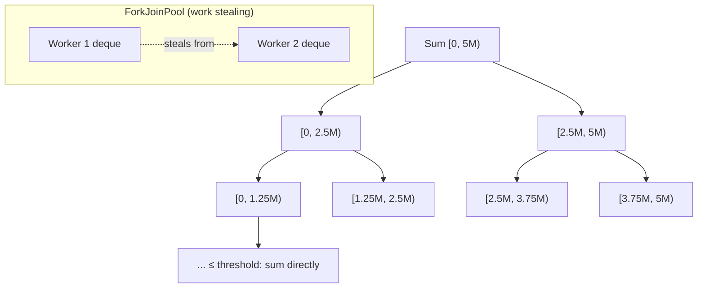
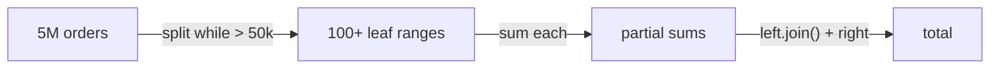
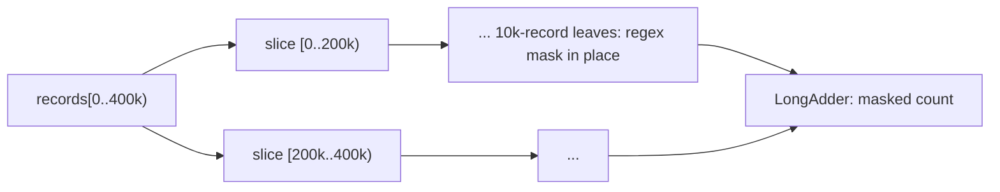
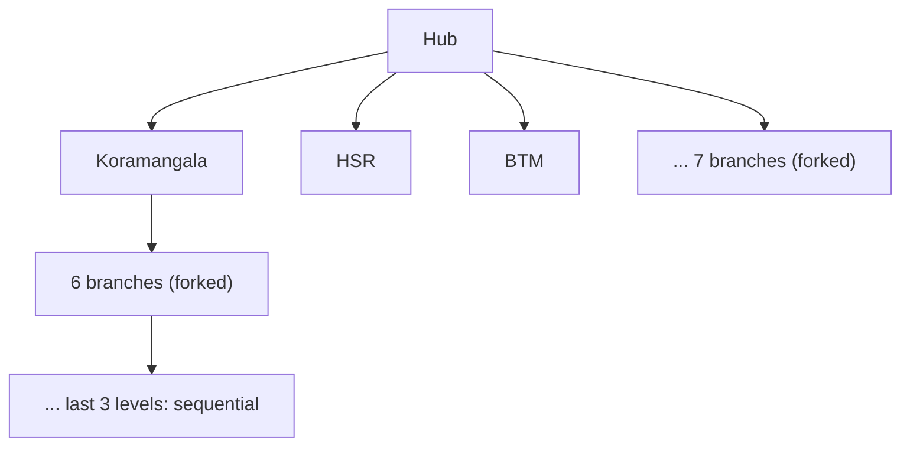

---
tags:
  - Concurrency
  - Intermediate
---

# Fork/Join

<span class="badge badge--intermediate">🟡 Intermediate → 🔴 Advanced</span>
<span class="badge badge--category">Concurrency</span>
<span class="badge badge--interview">Interview frequency ⭐⭐⭐⭐</span>

!!! abstract "TL;DR"
    **Fork/Join splits a big CPU-bound job into halves recursively until the pieces are small, runs the pieces in parallel on a work-stealing pool, and combines the results.**
    Use it (usually through parallel streams) for CPU-heavy work on large in-memory data: sums, searches, transforms, sorting. Don't use it for blocking I/O; that's what [virtual threads](virtual-threads.md) are for.

---

## See It in Motion

<iframe class="motion-embed" src="../../motion/index.html?p=fork-join&amp;embed=1" title="Animated walkthrough of the Fork/Join pattern" loading="lazy"></iframe>

Press **Play** to watch the calls travel between threads, or step through with **Next** and **Back**. Switch to **Without it** to see what goes wrong without the pattern. [Open the full explorer](../motion/index.html#fork-join){ target=_blank }

## 1. Intent & Problem It Solves

**The problem in plain English:** summing 5 million order values, masking IDs in 400,000 records or searching thousands of delivery routes uses one core while the other seven sit idle. A thread pool with one task per element drowns in overhead; one task per core leaves cores idle when some chunks finish early.

**Definition (Doug Lea, *A Java Fork/Join Framework*, 2000):**
> A parallel divide-and-conquer framework: a task **forks** subtasks, **joins** their results, and solves small problems directly. Worker threads keep their own deques and **steal** work from each other when idle, balancing load automatically.

```text
Result solve(Problem p):
    if p is small enough: solve directly
    else: split p; fork the left half; solve the right half; join the left; combine
```

## 2. Real-World Analogy

!!! example "Counting votes in an election"
    The national total isn't counted by one person. Each state splits work among districts, districts among polling booths. Booth counts are added up district by district, then state by state. If one district finishes early, its counters go help a slower district (work stealing).

## 3. Structure



| Participant | Responsibility |
|---|---|
| `ForkJoinPool` | Worker threads, one deque each; idle workers steal from the tail of others' deques |
| `RecursiveTask<V>` | A task that returns a result (`compute()` returns `V`) |
| `RecursiveAction` | A task with no result (works in place) |
| `fork()` / `join()` / `invokeAll()` | Schedule a subtask / wait for its result / fork several and wait |
| **Threshold** | Below it, solve sequentially. The most important tuning knob |

## 4. Naive Approach (Without the Pattern)

```java
long total = 0;
for (long v : orders) total += v;                        // one core busy, seven idle

ExecutorService pool = Executors.newFixedThreadPool(8);
for (long v : orders) futures.add(pool.submit(() -> v)); // 5M tasks: overhead >> work
```

- :material-close-circle:{ style="color:#e53935" } Sequential code wastes cores on CPU-bound work.
- :material-close-circle:{ style="color:#e53935" } Fine-grained tasks on a normal pool: queue contention and allocation dominate.
- :material-close-circle:{ style="color:#e53935" } Static chunking (n/cores) leaves cores idle when chunks are uneven.

---

## 5. Three Real-World Examples

### Example 1: Summing 5 Million Orders (Grocery Analytics)

**Scenario:** A nightly analytics job sums the value of 5 million grocery orders held in memory (INR 50 to INR 5,000 each, stored in paise). It must produce exactly the same total as the sequential loop, and use all available cores. The same job is also shown as a parallel stream, which uses Fork/Join underneath.

**Design:**



**Full Code:**

=== "SalesTotal.java"

    ```java
    --8<-- "code/concurrency/src/main/java/com/handbook/concurrency/forkjoin/sales/SalesTotal.java"
    ```

    1.  The **threshold**: big enough that a leaf does real work (tens of microseconds or more), small enough to create several tasks per core.
    2.  **Fork one half** (push it on this worker's deque, where idle workers can steal it)...
    3.  ...and **compute the other half in the current thread**. Forking both and joining both wastes a thread doing nothing.

=== "SalesDemo.java"

    ```java
    --8<-- "code/concurrency/src/main/java/com/handbook/concurrency/forkjoin/sales/SalesDemo.java"
    ```

**Output:**

```text
--8<-- "code/outputs/concurrency/forkjoin/sales/SalesDemo.txt"
```

**Why Fork/Join here:**

- Pure CPU work over in-memory data, which is exactly what it's built for.
- Integer addition is associative, so splitting doesn't change the result.
- `LongStream.parallel().sum()` gives you the same thing in one line; knowing the task model explains when it helps.

---

### Example 2: Masking IDs Before Sharing Data (Healthcare)

**Scenario:** A hospital shares 400,000 de-identified records with a research partner. Every 12-digit national ID in the free text must be masked to `XXXX-XXXX-1234` before export. Regex replacement is CPU-heavy; the records array can be modified **in place** because each task works on its own slice.

**Design:**



**Full Code:**

=== "MaskIdentifiers.java"

    ```java
    --8<-- "code/concurrency/src/main/java/com/handbook/concurrency/forkjoin/masking/MaskIdentifiers.java"
    ```

    1.  Writing into the shared array is safe because slices are **disjoint**, and `invokeAll`/`join` give happens-before for the results.
    2.  `invokeAll(a, b)` forks one, computes the other, and joins: the idiomatic shortcut.

=== "MaskingDemo.java"

    ```java
    --8<-- "code/concurrency/src/main/java/com/handbook/concurrency/forkjoin/masking/MaskingDemo.java"
    ```

**Output:**

```text
--8<-- "code/outputs/concurrency/forkjoin/masking/MaskingDemo.txt"
```

**Why Fork/Join here:**

- `RecursiveAction` fits "do something to every element" with no combined result.
- A `LongAdder` counts across threads without contention.
- Work stealing balances uneven slices (records with long notes take longer).

---

### Example 3: Searching Delivery Routes (Logistics)

**Scenario:** A last-mile planner picks the shortest order to visit 7 stops after the hub (7! = 5,040 possible routes). The search is a **tree**: each level chooses the next stop. Upper levels fork branches in parallel; near the leaves, branches are evaluated sequentially. Ties must be broken deterministically so the plan is reproducible.

**Design:**



**Full Code:**

=== "RouteSearch.java"

    ```java
    --8<-- "code/concurrency/src/main/java/com/handbook/concurrency/forkjoin/routes/RouteSearch.java"
    ```

    1.  The threshold here is **depth**: the last three levels are cheap, so they run sequentially.
    2.  `invokeAll(collection)` forks every branch and waits; results are reduced with a deterministic "better" function.

=== "RoutesDemo.java"

    ```java
    --8<-- "code/concurrency/src/main/java/com/handbook/concurrency/forkjoin/routes/RoutesDemo.java"
    ```

**Output:**

```text
--8<-- "code/outputs/concurrency/forkjoin/routes/RoutesDemo.txt"
```

**Why Fork/Join here:**

- Recursive search trees are naturally divide-and-conquer.
- Branches are independent (no shared mutable state), so no locks are needed.
- Deterministic reduction makes parallel results reproducible.

---

??? example "Unit Tests: `ForkJoinTest.java`"

    ```java
    --8<-- "code/concurrency/src/test/java/com/handbook/concurrency/forkjoin/ForkJoinTest.java"
    ```

## 6. Variations & Modern Java Take

| Variation | Notes |
|---|---|
| **Parallel streams** | `list.parallelStream()`, `IntStream.range(...).parallel()`: Fork/Join with `Spliterator`s doing the splitting |
| **Custom pool for streams** | `new ForkJoinPool(4).submit(() -> list.parallelStream()...).get()` isolates heavy work from the common pool |
| `RecursiveTask` / `RecursiveAction` | Explicit control of splitting and thresholds |
| `CountedCompleter` | Completion-triggered tasks without blocking joins; used inside the JDK's parallel streams |
| `Arrays.parallelSort`, `parallelPrefix`, `parallelSetAll` | Ready-made Fork/Join algorithms |
| `ForkJoinPool.commonPool()` | Shared, sized `cores - 1`; also runs `CompletableFuture.*Async` without an executor and is the default carrier scheduler for virtual threads |
| Virtual threads | **Not** a replacement: they're for blocking I/O; Fork/Join is for CPU-bound splitting |

## 7. Where It Lives in Real Frameworks

| Where | Fork/Join |
|---|---|
| JDK | Parallel streams, `Arrays.parallelSort`, `ConcurrentHashMap.forEach(parallelismThreshold, ...)`, `CompletableFuture` default async pool |
| JDK virtual threads | A `ForkJoinPool` in FIFO mode is the carrier-thread scheduler |
| Akka / Pekko | Default dispatcher is a fork-join executor |
| Scala | Parallel collections, `ExecutionContext.global` |
| Big data | MapReduce and Spark apply the same divide-and-combine idea across machines |

## 8. Pros, Cons & Trade-offs

| ✅ Pros | ❌ Cons |
|---|---|
| Uses all cores for CPU-bound work | Useless (or harmful) for blocking I/O |
| Work stealing balances uneven work automatically | Threshold tuning matters; wrong values kill the speed-up |
| Simple recursive code; parallel streams make it one line | Shared common pool: one heavy job can slow unrelated code |
| No locks when tasks are independent | Non-associative combines (floating-point sums) give slightly different results |

## 9. Pitfalls & Anti-Patterns

!!! danger "Blocking calls in Fork/Join tasks"
    A task that does JDBC or HTTP blocks a worker; with only `cores - 1` workers in the common pool, a few blocked tasks stall every parallel stream and async `CompletableFuture` in the JVM. Use virtual threads or a dedicated executor for I/O.

!!! danger "Thresholds that are too small"
    A threshold of 1 creates ~20 million tasks for 10 million elements (coding challenge). Task creation and scheduling dominate; it runs *slower* than sequential.

!!! warning "Forking both halves"
    `left.fork(); right.fork(); left.join(); right.join();` leaves the current thread idle. Fork one, `compute()` the other (or use `invokeAll`).

!!! warning "Parallel streams on small or ordered work"
    For a few thousand elements, `LinkedList` sources, `findFirst`/`limit`/`sorted` on ordered streams, or stateful lambdas, parallel is slower or wrong. Measure with JMH.

## 10. Senior / Architect Deep Dive (10–15 yrs)

**Work stealing.** Each worker pushes and pops forked tasks at the **head** of its own deque (LIFO: good cache locality, small tasks first). Thieves take from the **tail** (FIFO: the oldest, biggest tasks), so a single steal moves a lot of work and contention stays low.

**When parallelism pays (the NQ model).** Parallel speed-up roughly needs `N × Q ≥ 10,000`, where N is the number of elements and Q the cost per element in "simple operations". Summing longs (Q≈1) needs ~10k+ elements; an expensive regex per record pays off much sooner. Always benchmark with JMH, not `System.nanoTime` loops.

**Isolate pools.** In servers, don't let request-path code use the common pool for heavy jobs. Give batch work its own `ForkJoinPool` (sized for the job), and keep the common pool for short tasks.

!!! bug "War story: the parallel stream that froze checkout"
    A pricing service used `cart.items().parallelStream().map(this::fetchPromoFromApi)`, which made an HTTP call per item, on the common pool. On a busy evening, slow promo responses blocked all 7 common-pool workers; every other parallel stream and every `CompletableFuture.supplyAsync()` without an executor in the JVM stalled, including checkout's async fraud check. p99 latency went from 300 ms to 12 s.
    **Fix:** I/O moved to virtual threads (`Executors.newVirtualThreadPerTaskExecutor()`); parallel streams were kept for CPU-only work; async calls always pass an explicit executor.
    **Lesson:** Fork/Join is for computing, not waiting.

## 11. Related Patterns & Comparisons

| | Fork/Join | Thread Pool | Virtual Threads | MapReduce |
|---|---|---|---|---|
| Best for | CPU-bound divide and conquer | Independent tasks, bounded concurrency | Blocking I/O, many concurrent waits | Data too big for one machine |
| Scheduling | Work stealing deques | Shared queue | Carrier threads (a Fork/Join pool!) | Cluster scheduler |
| Task size | Recursive, threshold-driven | Arbitrary | Arbitrary | Partitions/blocks |

## 12. Interview Corner

=== "🟢 Beginner / Service Companies"

    **Q1. What is the Fork/Join framework?**

    A Java framework for parallel divide-and-conquer: split a task, run parts in parallel, combine results.

    **Q2. `RecursiveTask` vs `RecursiveAction`?**

    `RecursiveTask<V>` returns a value; `RecursiveAction` doesn't.

    **Q3. What is work stealing?**

    Idle worker threads take tasks from busy workers' queues to balance the load.

    **Q4. How do parallel streams relate to Fork/Join?**

    They run on the common `ForkJoinPool`, using spliterators to split the data.

    **Q5. What's the threshold?**

    The size below which a task is solved directly instead of being split further.

=== "🟡 Mid-Level"

    **Q1. Why fork one half and compute the other?**

    The current thread does useful work instead of waiting; fewer tasks are queued.

    **Q2. When are parallel streams slower?**

    Small data, cheap per-element work, poorly splittable sources (`LinkedList`, `Stream.iterate`), ordered operations, boxing, or blocking I/O.

    **Q3. How do you run a parallel stream in a custom pool?**

    `pool.submit(() -> list.parallelStream()...collect(...)).get()`: tasks started inside a pool stay in that pool.

    **Q4. Why shouldn't you block in Fork/Join tasks?**

    The pool is small (cores − 1 for the common pool); blocked workers starve everything else sharing it.

    **Q5. Is the result always identical to sequential?**

    For associative, side-effect-free operations, yes. Floating-point sums can differ slightly because the addition order changes.

=== "🔴 Senior / FAANG / SAP"

    **Q1. "Explain the deque discipline in work stealing."**

    Owners push/pop LIFO at the head (locality, depth-first); thieves steal FIFO from the tail (big, old tasks), minimizing contention.

    **Q2. "How would you parallelize merge sort?"**

    Recursively sort halves in parallel above a threshold, sequential (insertion/merge) below, then merge; `Arrays.parallelSort` does exactly this.

    **Q3. "What's `ManagedBlocker` for?"**

    It lets a Fork/Join task tell the pool it's about to block, so the pool can add a compensating thread, a mitigation, not a design.

    **Q4. "Why do virtual threads use a ForkJoinPool?"**

    Work-stealing scheduling of many short continuation segments onto a few carrier threads gives good throughput and locality.

    **Q5. "How do you choose between Fork/Join on one box and Spark?"**

    If the data fits in memory and the job finishes in seconds to minutes on one machine, Fork/Join is far simpler; beyond that, distribute.

=== "💻 Coding Challenge"

    **Problem:** Count even numbers in `[0, 10,000,000)` with a `RecursiveTask` and print how many tasks are created for thresholds of 1, 1,000, 100,000 and 10,000,000. Explain which you'd choose.

    ??? success "Solution"

        === "ThresholdDemo.java"

            ```java
            --8<-- "code/concurrency/src/main/java/com/handbook/concurrency/forkjoin/threshold/ThresholdDemo.java"
            ```

        **Output:**

        ```text
        --8<-- "code/outputs/concurrency/forkjoin/threshold/ThresholdDemo.txt"
        ```

        **Key points to say:** the number of tasks is about `2N / threshold`. Aim for "a few hundred to a few thousand tasks", meaning many per core for stealing but each doing thousands of operations. 100,000 here gives 255 tasks; then confirm with JMH.

!!! info "Behavioural tie-in (STAR) for experienced candidates"
    - **S:** Checkout p99 jumped to 12 s because a parallel stream made HTTP calls on the common Fork/Join pool.
    - **T:** Restore latency and prevent the class of bug.
    - **A:** Moved I/O to virtual threads, kept parallel streams for CPU-only transforms, required an explicit executor for every `*Async` call (enforced with ArchUnit), and added common-pool saturation metrics.
    - **R:** p99 back to 280 ms; the rule caught two similar changes in code review the next quarter.

## 13. Quick Revision Card

!!! tip "Remember in 30 seconds"
    - **Split → fork one half → compute the other → join → combine.**
    - `RecursiveTask` returns, `RecursiveAction` doesn't; `invokeAll` is the shortcut.
    - Work stealing balances load; threshold controls overhead.
    - **CPU-bound only**: no blocking I/O (use virtual threads).
    - Parallel streams = Fork/Join; isolate heavy jobs in their own pool.

    ```java
    left.fork(); long r = right.compute(); return left.join() + r;
    ```

## Practice

- [ ] Write a parallel merge sort with `RecursiveAction` and compare with `Arrays.parallelSort`.
- [ ] Add a branch-and-bound cut to `RouteSearch` (skip branches already longer than the best found).
- [ ] Benchmark `SalesTotal` thresholds of 1k, 10k, 100k and 1M with JMH on your laptop.

---

[:material-arrow-left: Active Object](active-object.md){ .md-button }
[Next: Microservices :material-arrow-right:](../microservices/index.md){ .md-button .md-button--primary }
