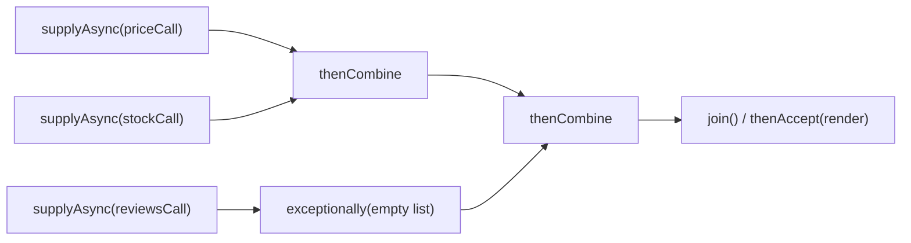
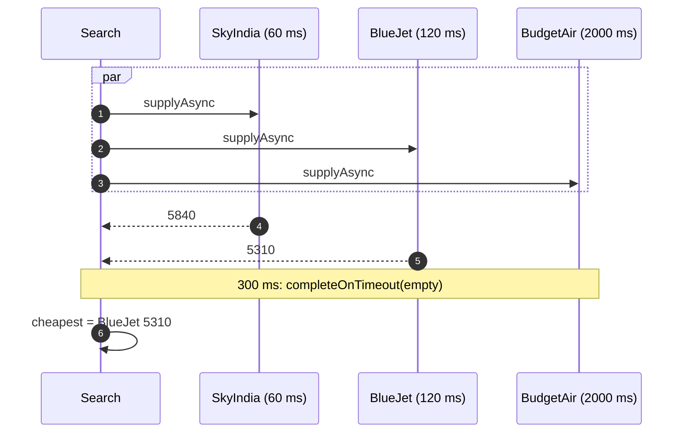
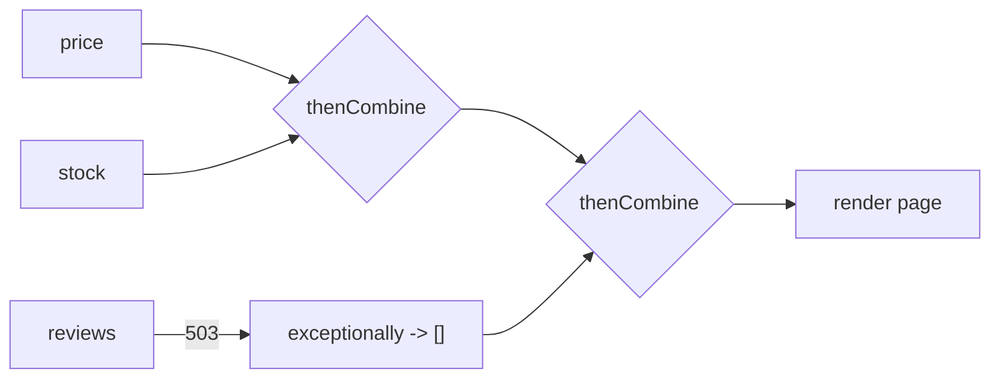
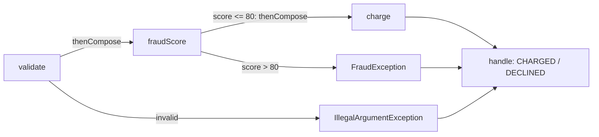

---
tags:
  - Concurrency
  - Intermediate
---

# Future / Promise

<span class="badge badge--intermediate">🟡 Intermediate → 🔴 Advanced</span>
<span class="badge badge--category">Concurrency</span>
<span class="badge badge--interview">Interview frequency ⭐⭐⭐⭐</span>

!!! abstract "TL;DR"
    **A Future is a placeholder for a result that isn't ready yet; a Promise is the side that completes it. Java's `CompletableFuture` is both, and lets you compose async steps: run in parallel, chain, combine, time out and recover.**
    Use it to call several services at once, to build async pipelines, and to add timeouts and fallbacks.

---

## 1. Intent & Problem It Solves

**The problem in plain English:** a fare search asks three airlines. Called one after another (60 ms + 120 ms + 2,000 ms), the customer waits over 2 seconds, and the slowest airline decides everyone's speed. Called **in parallel**, the wait is the slowest call, and with a **timeout**, at most 300 ms. You need a way to start work now, get the result later, combine results, and handle failures and timeouts.

**Definition:**
> A **Future** represents the result of an asynchronous computation. A **Promise** is a writable, single-assignment container that completes that future. `CompletableFuture<T>` implements both: `supplyAsync` starts work; `complete(...)` / `completeExceptionally(...)` fulfill it manually; `thenApply` / `thenCompose` / `thenCombine` / `allOf` / `anyOf` compose it.

## 2. Real-World Analogy

!!! example "A token at a food court"
    You order, pay, and receive a **token** (the future). You don't stand at the counter; you find a table, chat, maybe order a drink elsewhere (other work). When the screen shows your number, you collect your meal. If the kitchen runs out, the token tells you that too (exceptional completion).

## 3. Structure



| Method | Use |
|---|---|
| `supplyAsync(supplier, executor)` | Start async work that returns a value |
| `thenApply(fn)` | Transform the result (like `map`) |
| `thenCompose(fn)` | Chain a step that itself returns a future (like `flatMap`) |
| `thenCombine(other, fn)` | Combine two **independent** futures |
| `allOf(...)` / `anyOf(...)` | Wait for all / the first to complete |
| `exceptionally(fn)` / `handle(fn)` / `whenComplete(fn)` | Recover from / inspect failures |
| `orTimeout(t)` / `completeOnTimeout(v, t)` | Fail / fall back after a timeout (Java 9+) |
| `join()` / `get()` | Block for the result (`join` throws unchecked `CompletionException`) |

## 4. Naive Approach (Without the Pattern)

```java
Quote a = skyIndia.quote();     // 60 ms
Quote b = blueJet.quote();      // 120 ms
Quote c = budgetAir.quote();    // 2,000 ms today: the customer waits for everything
// or raw threads + shared fields + manual joins + ad-hoc error handling...
```

- :material-close-circle:{ style="color:#e53935" } **Sequential** calls add up latencies.
- :material-close-circle:{ style="color:#e53935" } **No timeouts**: the slowest dependency sets your latency.
- :material-close-circle:{ style="color:#e53935" } Hand-rolled threads make composition and error handling error-prone.

---

## 5. Three Real-World Examples

### Example 1: Fare Search with Timeouts (Travel)

**Scenario:** A travel site queries three airline APIs for BLR → DEL. Customers expect results in well under a second. Each airline gets **300 ms**; airlines that don't answer in time are left out rather than delaying the page. The cheapest available quote is shown.

**Design:**



**Full Code:**

=== "FlightQuotesDemo.java"

    ```java
    --8<-- "code/concurrency/src/main/java/com/handbook/concurrency/future/flights/FlightQuotesDemo.java"
    ```

    1.  `allOf` waits for every future, but thanks to the timeouts, never longer than about 300 ms.
    2.  **Always pass an executor** for blocking calls. Here it's virtual threads; without it, `supplyAsync` uses the shared `ForkJoinPool.commonPool()`.
    3.  `completeOnTimeout` turns "too slow" into a **fallback value** (`Optional.empty()`). Use `orTimeout` when a timeout should be an error instead.

**Output:**

```text
--8<-- "code/outputs/concurrency/future/flights/FlightQuotesDemo.txt"
```

!!! warning "Timeouts don't cancel the underlying work"
    `completeOnTimeout` completes the **future**, but BudgetAir's call keeps running in the background (the demo's executor waits for it when closing). Pass timeouts to the HTTP client as well (`HttpClient` request timeout), so the real call is abandoned too.

**Why Future/Promise here:**

- **Parallel fan-out** reduces latency from the sum to the maximum.
- **Per-call timeouts with fallbacks** keep the page fast when one provider is slow.
- Results are combined with ordinary stream code once complete.

---

### Example 2: Product Page Composition (E-commerce)

**Scenario:** A product page needs **price** and **stock** (essential) and **reviews** (nice to have) from three services. They're independent, so they're fetched in parallel. If the reviews service fails, the page must still render, just without reviews; if price fails, the page should fail (you can't sell without a price).

**Design:**



**Full Code:**

=== "ProductPageDemo.java"

    ```java
    --8<-- "code/concurrency/src/main/java/com/handbook/concurrency/future/productpage/ProductPageDemo.java"
    ```

    1.  Recovery is attached **only to the optional dependency**. Price and stock failures still propagate.
    2.  `thenCombine` joins **independent** futures as soon as both are ready, with no explicit waiting or locks.

**Output:**

```text
--8<-- "code/outputs/concurrency/future/productpage/ProductPageDemo.txt"
```

**Why Future/Promise here:**

- **Independent calls in parallel**, combined declaratively.
- **Selective fallbacks**: optional parts degrade gracefully; essential parts fail loudly.
- This is the core of every Backend-for-Frontend (BFF) aggregation.

---

### Example 3: Async Payment Pipeline (Payments)

**Scenario:** A payment goes through **dependent** async steps: validate, then fraud score, then charge. Each step is a call to another service. A high fraud score must stop the pipeline **before** charging. All failures (validation, fraud) must become clear "declined" results, not stack traces, and the original error must be visible (not wrapped in `CompletionException`).

**Design:**



**Full Code:**

=== "PaymentPipelineDemo.java"

    ```java
    --8<-- "code/concurrency/src/main/java/com/handbook/concurrency/future/payments/PaymentPipelineDemo.java"
    ```

    1.  **`thenCompose`** for steps that return futures. `thenApply` would give a `CompletableFuture<CompletableFuture<...>>`. It's `flatMap` for futures.
    2.  **`handle`** sees both outcomes (result or error) and turns them into one value, the async version of try/catch.
    3.  Exceptions thrown inside stages arrive wrapped in **`CompletionException`**. Unwrap to report the real cause.

**Output:**

```text
--8<-- "code/outputs/concurrency/future/payments/PaymentPipelineDemo.txt"
```

**Why Future/Promise here:**

- **Dependent async steps** without blocking threads between them.
- **Short-circuiting**: an exception skips the remaining steps (no charge after a fraud hit).
- One place (`handle`) maps every outcome to a business result.

---

??? example "Unit Tests: `FutureTest.java` (examples + challenge)"

    ```java
    --8<-- "code/concurrency/src/test/java/com/handbook/concurrency/future/FutureTest.java"
    ```

## 6. Variations & Modern Java Take

**`CompletableFuture` vs. virtual threads (Java 21).** With virtual threads, plain **blocking code** is cheap again. The product page could be written as:

```java
try (var io = Executors.newVirtualThreadPerTaskExecutor()) {
    Future<Integer> price = io.submit(() -> price(sku));
    Future<Integer> stock = io.submit(() -> stock(sku));
    Future<List<String>> reviews = io.submit(() -> reviews(sku));
    List<String> r;
    try { r = reviews.get(); } catch (ExecutionException e) { r = List.of(); }
    return new Page(sku, price.get(), stock.get(), r);
}
```

Readable, debuggable, with normal stack traces. **Structured concurrency** (`StructuredTaskScope`, preview in Java 21–24) adds automatic cancellation of sibling tasks when one fails. `CompletableFuture` still shines for **pipelines and composition** (`thenCompose`, `anyOf`, timeouts) and for APIs that return futures.

| Choice | Best for |
|---|---|
| `CompletableFuture` | Composition, async APIs, non-blocking pipelines, timeouts |
| Virtual threads + blocking code | Simple fan-out/fan-in, readability, debugging |
| Reactive (Reactor/RxJava) | Streams of many values with back-pressure |

## 7. Where It Lives in Real Frameworks

| Where | Futures |
|---|---|
| JDK | `java.net.http.HttpClient.sendAsync` returns `CompletableFuture<HttpResponse>` |
| Spring | `@Async` methods returning `CompletableFuture`; Spring MVC controllers returning `CompletableFuture` (async request processing) |
| Spring Kafka | `KafkaTemplate.send()` returns `CompletableFuture<SendResult>` |
| AWS SDK v2 | Async clients return `CompletableFuture` |
| Reactor | `Mono.toFuture()` / `Mono.fromFuture()` bridges |
| JDBC alternatives | R2DBC (reactive), Vert.x SQL client (futures) |

## 8. Pros, Cons & Trade-offs

| ✅ Pros | ❌ Cons |
|---|---|
| **Parallelism** without managing threads | Stack traces are fragmented; harder debugging |
| Rich **composition** (chain, combine, race) | **Exception wrapping** (`CompletionException`, `ExecutionException`) |
| Built-in **timeouts** and **fallbacks** | Easy to block accidentally (`join()` in the wrong place) |
| Non-blocking pipelines save threads | Default executor (common pool) is a trap for blocking calls |
| | Cancellation doesn't interrupt running work |

## 9. Pitfalls & Anti-Patterns

!!! danger "Blocking calls on the common pool"
    `supplyAsync(() -> jdbcCall())` without an executor runs on `ForkJoinPool.commonPool()` (sized to cores). A few slow calls starve every parallel stream and async task in the JVM. **Always pass an executor** for I/O.

!!! danger "Forgetting failures"
    A future that completes exceptionally and is never `join()`ed or `handle()`d fails **silently**. End every chain with `handle`/`exceptionally`/`whenComplete` (logging), or join it.

!!! warning "`thenApply` returning a future"
    `thenApply(x -> callAsync(x))` gives `CompletableFuture<CompletableFuture<T>>`. Use `thenCompose`.

!!! warning "`anyOf` returns the first to complete, even if it failed"
    For "first successful", write a combinator (coding challenge).

!!! warning "`join()` inside a stage"
    Blocking inside a callback holds a pool thread while waiting, which can deadlock small pools. Compose instead.

## 10. Senior / Architect Deep Dive (10–15 yrs)

**Latency budgets and fan-out.** For a page with a 300 ms budget calling 5 services in parallel, the page's p99 is driven by the **slowest** service's tail. Mitigations: per-call timeouts, fallbacks for optional parts, **hedged requests** (send a duplicate request after the p95 latency and take the first answer), and caching.

**Deadline propagation.** Pass a **deadline** (not a fixed timeout) down the call chain (gRPC does this) so inner calls don't keep working after the outer request has given up.

**Cancellation.** `CompletableFuture.cancel(true)` doesn't interrupt the running task. If work must be stopped, use executors and `Future.cancel(true)` (interrupts), structured concurrency, or client-level timeouts.

**Context propagation.** Async stages run on other threads, so `ThreadLocal` context (trace IDs, security context, MDC) is lost unless propagated (Micrometer Context Propagation, Spring's `TaskDecorator`, or `ScopedValue` with structured concurrency).

!!! bug "War story: the parallel stream that froze the service"
    A pricing service used `CompletableFuture.supplyAsync(() -> rulesRepository.load(...))` (a JDBC call) without an executor, and separately used `parallelStream()` for CPU-heavy discount calculations. On a slow-database day, the JDBC calls occupied every common-pool thread; the parallel streams queued behind them, and request latency went from 40 ms to 25 s. Thread dumps showed all `ForkJoinPool.commonPool-worker` threads stuck in socket reads.
    **Fix:** a dedicated executor (later virtual threads) for I/O futures, a timeout on the JDBC queries, and an ArchUnit rule banning `supplyAsync` without an executor.
    **Lesson:** the common pool is for **CPU work**. I/O gets its own threads.

## 11. Related Patterns & Comparisons

| | Future/Promise | Callback | Observer / Reactive stream | Virtual threads |
|---|---|---|---|---|
| Values | **One** (eventually) | One, via a function | **Many** over time | Any (blocking style) |
| Composition | Chain, combine, race | Nested callbacks ("callback hell") | Operators | Plain code |
| Back-pressure | N/A | N/A | Yes (reactive) | Through blocking |
| Readability | Good with care | Poor at depth | Steep learning curve | Best |

## 12. Interview Corner

=== "🟢 Beginner / Service Companies"

    **Q1. What is a `Future` in Java?**

    An object representing the **result of an asynchronous computation**; `get()` blocks until it's available.

    **Q2. Limitations of `Future` (before Java 8)?**

    No way to **chain** steps, **combine** futures, **complete** it manually, or attach **callbacks**; `get()` blocks. `CompletableFuture` fixes these.

    **Q3. `thenApply` vs `thenCompose`?**

    `thenApply` transforms a result with a plain function (`map`); `thenCompose` chains a function that **returns another future** (`flatMap`).

    **Q4. How do you run three calls in parallel and wait for all?**

    Three `supplyAsync` calls, then `CompletableFuture.allOf(f1, f2, f3).join()` and read each result.

    **Q5. `get()` vs `join()`?**

    Both block. `get()` throws **checked** `InterruptedException`/`ExecutionException`; `join()` throws **unchecked** `CompletionException`.

=== "🟡 Mid-Level"

    **Q1. How do you handle exceptions in a `CompletableFuture` chain?**

    `exceptionally` (recover with a value), `handle` (result or error into a value), `whenComplete` (side effects like logging, result unchanged). Unwrap `CompletionException` for the cause.

    **Q2. Which thread runs `supplyAsync` and its callbacks?**

    `supplyAsync` without an executor uses `ForkJoinPool.commonPool()`. Non-async callbacks (`thenApply`) run on the thread that completed the previous stage, or on the caller if it's already done; `*Async` variants use the given or common executor.

    **Q3. How do you add a timeout?**

    `orTimeout(t, unit)` fails with `TimeoutException`; `completeOnTimeout(value, t, unit)` completes with a fallback (Java 9+).

    **Q4. `anyOf` vs a "first successful" combinator?**

    `anyOf` completes with the first future to complete, **even if it failed**. For first success, track failures and complete only on success, or after all fail (challenge).

    **Q5. Should you use `CompletableFuture` with virtual threads?**

    Often you don't need to: virtual threads make simple blocking code scalable. Use `CompletableFuture` for composition, async APIs and timeouts, still with an explicit executor.

=== "🔴 Senior / FAANG / SAP"

    **Q1. "Design a search aggregator calling 20 suppliers with a 1-second SLA."**

    Parallel calls with **per-supplier timeouts** under the SLA, partial results, **hedging** for slow suppliers, circuit breakers per supplier, caching popular searches, streaming results to the UI as they arrive (SSE), and deadline propagation.

    **Q2. "Our async code loses trace IDs and the security context. Why, and how do you fix it?"**

    `ThreadLocal`s don't cross thread boundaries. Use context-propagating executors (`TaskDecorator`, Micrometer Context Propagation), or Reactor context, or `ScopedValue` with structured concurrency.

    **Q3. "How do you cancel in-flight work when the user navigates away?"**

    Propagate cancellation: cancel the top-level future, use executors with interruptible tasks (`Future.cancel(true)`), set **client timeouts**, or use structured concurrency, which cancels child tasks when the scope closes.

    **Q4. "CompletableFuture vs Reactor vs virtual threads for a new service?"**

    Virtual threads for request/response services with blocking libraries (simplest); Reactor when you need **streaming with back-pressure** or are already reactive end-to-end; `CompletableFuture` for targeted fan-out and async APIs.

    **Q5. "Explain hedged requests and when they're worth it."**

    Send a second request to another replica if the first hasn't answered by roughly p95 latency, and use whichever answers first. It cuts tail latency at the cost of extra load (about 5%). Only for **idempotent** reads.

=== "💻 Coding Challenge"

    **Problem:** Download an app update from several mirrors in parallel. Return the **first successful** download; ignore failures unless **all** mirrors fail, in which case fail with a clear message. (`anyOf` isn't enough: it returns the first completion, even a failure.)

    ??? success "Solution"

        === "FirstSuccessful.java"

            ```java
            --8<-- "code/concurrency/src/main/java/com/handbook/concurrency/future/mirrors/FirstSuccessful.java"
            ```

        === "MirrorsDemo.java"

            ```java
            --8<-- "code/concurrency/src/main/java/com/handbook/concurrency/future/mirrors/MirrorsDemo.java"
            ```

        **Output:**

        ```text
        --8<-- "code/outputs/concurrency/future/mirrors/MirrorsDemo.txt"
        ```

        **Key points to say:** a manually completed `CompletableFuture` acts as the **promise**; `complete()` is idempotent (first call wins); an `AtomicInteger` counts failures to detect "all failed"; follow-up: cancel the remaining downloads after the first success.

!!! info "Behavioural tie-in (STAR) for experienced candidates"
    - **S:** Our product page called 6 services sequentially; p99 was 1.8 s and one slow service could stall everything.
    - **T:** Get p99 under 400 ms without changing the downstream services.
    - **A:** Parallelized independent calls with `CompletableFuture` on a dedicated executor, added per-call timeouts with fallbacks for optional sections, and hedged the slowest read.
    - **R:** p99 dropped to 320 ms; when the reviews service had an outage, pages still rendered without reviews.

## 13. Quick Revision Card

!!! tip "Remember in 30 seconds"
    - **Future** = result later; **Promise** = who completes it; `CompletableFuture` = both.
    - Parallel: `supplyAsync` × N + `allOf`; combine: `thenCombine`; chain: **`thenCompose`**.
    - Errors: `exceptionally` / `handle`; unwrap `CompletionException`.
    - Timeouts: `orTimeout` / `completeOnTimeout` (they don't cancel the work).
    - **Always pass an executor** for I/O; consider **virtual threads** for simple fan-out.

    ```java
    CompletableFuture.supplyAsync(() -> call(), io).completeOnTimeout(fallback, 300, MILLISECONDS);
    ```

## Practice

- [ ] Rewrite the product page with virtual threads and blocking `Future.get()` calls; compare readability.
- [ ] Make `FirstSuccessful` cancel the remaining attempts after the first success.
- [ ] Add a 200 ms `orTimeout` to the fraud check and decide whether a timeout should decline or approve.

---

[:material-arrow-left: Thread Pool](thread-pool.md){ .md-button }
[Next: Read-Write Lock :material-arrow-right:](read-write-lock.md){ .md-button .md-button--primary }
