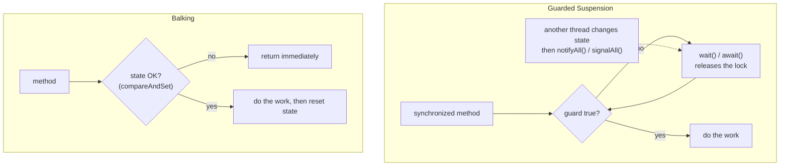
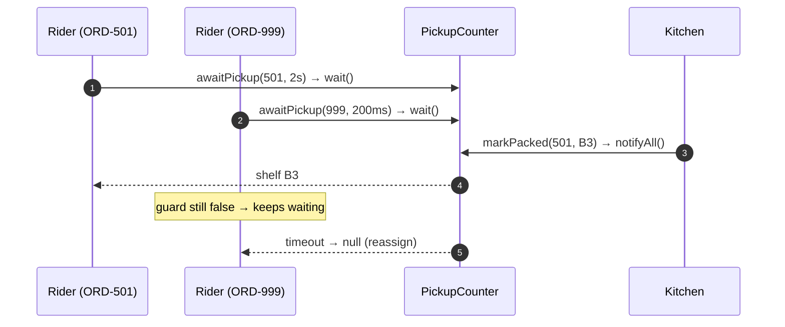
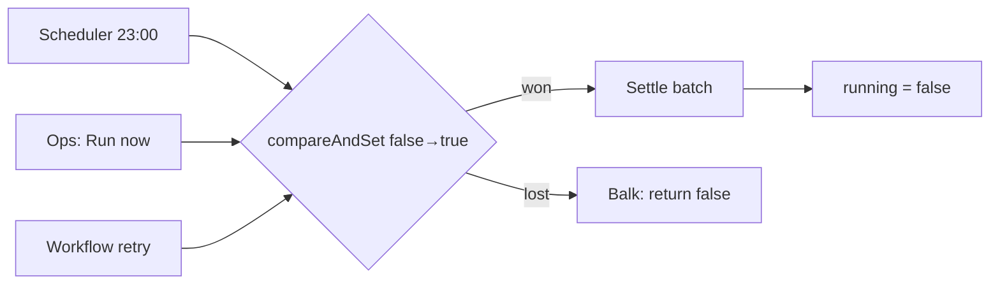
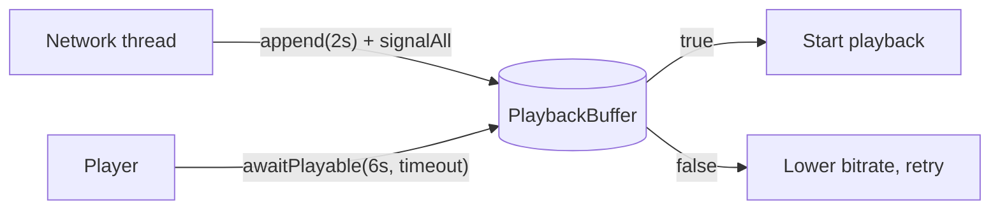

---
tags:
  - Concurrency
  - Intermediate
---

# Guarded Suspension & Balking

<span class="badge badge--intermediate">🟡 Intermediate</span>
<span class="badge badge--category">Concurrency</span>
<span class="badge badge--interview">Interview frequency ⭐⭐⭐⭐</span>

!!! abstract "TL;DR"
    **Both patterns handle "a method can only run when a condition (the *guard*) is true". Guarded Suspension *waits* until the guard becomes true; Balking *gives up immediately* if it isn't.**
    Wait when the condition will soon be true and the caller needs the result (a rider waiting for a packed order). Balk when the work is already being done or isn't needed (a second "run settlement" click).

---

## See It in Motion

<iframe class="motion-embed" src="../../motion/index.html?p=guarded-suspension-balking&amp;embed=1" title="Animated walkthrough of the Guarded Suspension &amp; Balking pattern" loading="lazy"></iframe>

Press **Play** to watch the calls travel between threads, or step through with **Next** and **Back**. Switch to **Without it** to see what goes wrong without the pattern. [Open the full explorer](../motion/index.html#guarded-suspension-balking){ target=_blank }

## 1. Intent & Problem It Solves

**The problem in plain English:** a rider arrives at the restaurant before the food is ready. Checking in a loop (`while (!ready) {}`) burns a CPU core; sleeping a fixed second wastes time or misses the moment. Separately, a nightly settlement job is triggered by the scheduler, by an operator and by a retry at the same time. Running it three times means three payouts.

**Definitions (Doug Lea, *Concurrent Programming in Java*; Mark Grand, *Patterns in Java*):**
> **Guarded Suspension:** if a precondition for an operation isn't met, suspend the calling thread until it is, then proceed.
>
> **Balking:** if an object is not in an appropriate state for an operation, return immediately without doing it.

Both are the building blocks of every blocking queue, latch, future and "only one at a time" job you'll ever use.

## 2. Real-World Analogy

!!! example "The pickup counter and the lift button"
    **Guarded suspension:** you wait at the pickup counter (not pacing around the kitchen) and the staff call your name when the order is ready.
    **Balking:** pressing a lift's call button when it's already lit does nothing. The lift is already coming; a second request is pointless.

## 3. Structure



| Element | Guarded Suspension | Balking |
|---|---|---|
| Guard | Condition that will *become* true (item available, order packed) | State that makes the call pointless (already running, not dirty) |
| When false | Block (with a timeout) | Return a "not done" result |
| Java tools | `synchronized` + `wait/notifyAll`, `Lock` + `Condition`, `BlockingQueue`, `CountDownLatch` | `AtomicBoolean.compareAndSet`, `tryLock()`, a state field |

## 4. Naive Approach (Without the Pattern)

```java
while (!counter.isPacked(orderId)) { }               // busy-wait: 100% CPU, and maybe never sees the change (no visibility)
while (!counter.isPacked(orderId)) Thread.sleep(1000); // up to 1 s late, and still racy

if (!running) { running = true; settle(); running = false; }   // check-then-act race: two threads both see false
```

- :material-close-circle:{ style="color:#e53935" } Busy waiting wastes CPU and may spin forever without `volatile`/locks.
- :material-close-circle:{ style="color:#e53935" } Sleep-polling adds latency.
- :material-close-circle:{ style="color:#e53935" } Check-then-act without atomicity lets duplicates through.

---

## 5. Three Real-World Examples

### Example 1: Riders Wait for Packed Orders (Food Delivery)

**Scenario:** A cloud kitchen hands 1,500 orders an hour to riders. Riders arrive early; each waits for **their** order. If the kitchen hasn't packed an order within the rider's slot, the rider must be released and reassigned rather than waiting forever. Thousands of waiting riders are modelled as virtual threads.

**Design:**



**Full Code:**

=== "PickupCounter.java"

    ```java
    --8<-- "code/concurrency/src/main/java/com/handbook/concurrency/guarded/delivery/PickupCounter.java"
    ```

    1.  `notifyAll`, not `notify`: riders wait for *different* orders, so waking just one might wake the wrong one.
    2.  The guard is re-checked in a **`while`** loop after every wake-up (spurious wake-ups, or another order was packed).
    3.  A **timeout** turns "wait forever" into a decision the caller can act on.

=== "DeliveryDemo.java"

    ```java
    --8<-- "code/concurrency/src/main/java/com/handbook/concurrency/guarded/delivery/DeliveryDemo.java"
    ```

**Output:**

```text
--8<-- "code/outputs/concurrency/guarded/delivery/DeliveryDemo.txt"
```

**Why guarded suspension here:**

- The rider **needs** the result and it will usually arrive soon.
- Waiting threads release the lock and use no CPU.
- Timeouts keep the system live when the guard never comes true.

---

### Example 2: Balking Duplicate Settlement Runs (Payments)

**Scenario:** A payment aggregator settles merchant balances nightly. The scheduler fires at 23:00; operators sometimes click "run now"; the workflow engine retries on a timeout. A second concurrent run would pay merchants twice. Duplicate triggers must return **immediately** (not queue up and run again afterwards).

**Design:**



**Full Code:**

=== "SettlementJob.java"

    ```java
    --8<-- "code/concurrency/src/main/java/com/handbook/concurrency/guarded/settlement/SettlementJob.java"
    ```

    1.  **Atomic check-and-set**: exactly one caller can flip `false → true`. Everyone else balks.
    2.  Reset in `finally`, so a failed run doesn't block every future run.

=== "SettlementDemo.java"

    ```java
    --8<-- "code/concurrency/src/main/java/com/handbook/concurrency/guarded/settlement/SettlementDemo.java"
    ```

**Output:**

```text
--8<-- "code/outputs/concurrency/guarded/settlement/SettlementDemo.txt"
```

**Why balking here:**

- A second run adds **no value** and real risk (double payouts).
- Callers get an instant answer ("already running") instead of piling up.
- Across several instances, the same idea becomes a distributed lock or [leader election](../microservices/leader-election.md).

---

### Example 3: Start Playback When Enough Is Buffered (Streaming)

**Scenario:** A video player must not start until 6 seconds are buffered, or viewers see stalls in the first seconds, which is the biggest churn driver. On a weak network the player waits at most 150 ms before switching to a lower bitrate. The network thread appends 2-second segments as they arrive.

**Design:**



**Full Code:**

=== "PlaybackBuffer.java"

    ```java
    --8<-- "code/concurrency/src/main/java/com/handbook/concurrency/guarded/buffer/PlaybackBuffer.java"
    ```

    1.  A `Condition` is a named wait set. One lock can have several (`notFull`, `notEmpty`), so you signal only the threads that care.
    2.  `awaitNanos` returns the time **remaining**, which makes correct timeouts inside a `while` loop easy.

=== "BufferDemo.java"

    ```java
    --8<-- "code/concurrency/src/main/java/com/handbook/concurrency/guarded/buffer/BufferDemo.java"
    ```

**Output:**

```text
--8<-- "code/outputs/concurrency/guarded/buffer/BufferDemo.txt"
```

**Why guarded suspension here:**

- The player should react the moment the guard is met, not on the next polling tick.
- The timeout encodes a product decision (degrade quality rather than stall).
- `Lock`/`Condition` work well with virtual threads, which don't pin a carrier while waiting.

---

??? example "Unit Tests: `GuardedSuspensionTest.java`"

    ```java
    --8<-- "code/concurrency/src/test/java/com/handbook/concurrency/guarded/GuardedSuspensionTest.java"
    ```

## 6. Variations & Modern Java Take

| Variation | Notes |
|---|---|
| `wait/notifyAll` | Built in; one wait set per object; must hold the monitor |
| `Lock` + `Condition` | Several wait sets, `awaitNanos`, interruptible and fair options |
| **Ready-made guarded objects** | `BlockingQueue.take/poll(timeout)`, `CountDownLatch.await`, `CompletableFuture.get(timeout)`, `Semaphore.acquire` |
| **Balking with `tryLock()`** | `if (!lock.tryLock()) return;` for "skip if busy" sections |
| **Balking with state** | `if (!dirty) return;` (autosave), `if (closed) return;` (idempotent `close()`) |
| Virtual threads (Java 21+) | Waiting is cheap, so blocking designs scale again; prefer `ReentrantLock` over `synchronized` around long waits until JDK 24's fix for monitor pinning |

## 7. Where It Lives in Real Frameworks

| Where | Guarded Suspension / Balking |
|---|---|
| JDK | `ArrayBlockingQueue` (two Conditions: `notEmpty`, `notFull`), `FutureTask.get`, `CountDownLatch`, `Thread.join` |
| JDK balking | `AtomicBoolean.compareAndSet` idioms, `Closeable.close()` "has no effect if already closed", `ExecutorService.shutdown()` |
| Spring | `@Scheduled` with ShedLock (`@SchedulerLock`) balks duplicate runs across instances |
| Kafka | `KafkaConsumer.poll(timeout)` guarded waiting; consumer `wakeup()` |
| Netty / OkHttp | Connection pools wait for a free connection with a timeout |

## 8. Pros, Cons & Trade-offs

| ✅ Pros | ❌ Cons |
|---|---|
| No CPU wasted while waiting | Easy to get wrong (`if` vs `while`, `notify` vs `notifyAll`, missed signals) |
| Reacts immediately when the guard changes | Waiting forever without timeouts causes hangs |
| Balking prevents duplicate, harmful work | Balking can silently drop requests that *should* have run later |
| Foundation of all blocking concurrency utilities | Hand-rolled versions are rarely better than JDK ones |

## 9. Pitfalls & Anti-Patterns

!!! danger "`if` instead of `while`"
    After waking, another thread may already have consumed what you were waiting for, or the wake-up was spurious. Always re-check the guard in a loop (coding challenge).

!!! danger "Waiting without a timeout"
    If the notifier crashes, waiters hang forever. Use `wait(ms)`, `awaitNanos` or `poll(timeout)` and handle the "not ready" outcome.

!!! warning "`notify()` with different guards"
    `notify` wakes one arbitrary waiter. If waiters wait for different things, the wrong one may wake and go back to sleep: a **missed signal**. Use `notifyAll` or separate `Condition`s.

!!! warning "Balking that should have been queuing"
    If a skipped request carries new data (a new file to process), balking loses it. Then you want "run again once afterwards" (a dirty flag) or a queue.

## 10. Senior / Architect Deep Dive (10–15 yrs)

**Why the lock is released.** `wait()` atomically releases the monitor and suspends; on wake-up it re-acquires the monitor before returning. That atomicity is what prevents a lost wake-up between "check guard" and "start waiting". Hand-rolled alternatives with `volatile` flags and `sleep` reintroduce exactly that race.

**Balking across machines.** A JVM-local `AtomicBoolean` only balks within one instance. With three replicas, use a database row lock (`SELECT ... FOR UPDATE SKIP LOCKED`), a lease in Redis/ZooKeeper, ShedLock, or a Kubernetes `CronJob` with `concurrencyPolicy: Forbid`. And still make the job **idempotent**, because leases can expire mid-run.

**Observability.** Track how long threads wait on guards and how often callers balk or time out. A rising balk rate means a job is overrunning its schedule; rising wait times are an early capacity signal.

!!! bug "War story: double payouts on a Friday night"
    A payments team protected settlement with `if (!running) { running = true; ... }` on a plain boolean. When the scheduler and an operator's "run now" arrived within a millisecond, both threads saw `false`. 1,200 merchants were paid twice; recovering the money took three weeks.
    **Fix:** `AtomicBoolean.compareAndSet` locally, ShedLock across instances, and an idempotency key per merchant per settlement date in the payout table.
    **Lesson:** balking needs an **atomic** check-and-set, and money movement needs idempotency as a second line of defence.

## 11. Related Patterns & Comparisons

| | Guarded Suspension | Balking | Producer-Consumer | Double-Checked Locking |
|---|---|---|---|---|
| Guard false → | Wait | Return | Producer/consumer wait on full/empty | Lock, check again |
| Typical guard | "Data ready" | "Already running / nothing to do" | Buffer capacity | "Already initialized" |
| Relationship | Basis of blocking queues | Basis of idempotent triggers | Two guarded suspensions | Balking on the fast path |

## 12. Interview Corner

=== "🟢 Beginner / Service Companies"

    **Q1. What is guarded suspension?**

    Waiting (without using CPU) until a condition becomes true, then continuing.

    **Q2. What is balking?**

    Returning immediately when the object isn't in the right state, e.g. a job that's already running.

    **Q3. Why must `wait()` be called inside `synchronized`?**

    It releases and re-acquires the object's monitor; calling it without holding the monitor throws `IllegalMonitorStateException`.

    **Q4. `wait()` vs `sleep()`?**

    `wait` releases the lock and waits for a notification; `sleep` keeps any locks and just pauses.

    **Q5. `notify` vs `notifyAll`?**

    `notify` wakes one waiter, `notifyAll` wakes all. Prefer `notifyAll` unless all waiters wait for the same thing.

=== "🟡 Mid-Level"

    **Q1. Why re-check the guard in a `while` loop?**

    Spurious wake-ups and competing threads: the condition may no longer be true when you wake.

    **Q2. `Condition` vs `wait/notify`?**

    Several conditions per lock, timed and interruptible waits, works with `ReentrantLock`.

    **Q3. How do you balk safely?**

    Atomic check-and-set: `AtomicBoolean.compareAndSet(false, true)` or `tryLock()`, and reset in `finally`.

    **Q4. How do you add a timeout correctly?**

    Compute a deadline; in the loop, wait for the remaining time and return a "not ready" result when it reaches zero.

    **Q5. Which JDK classes implement guarded suspension?**

    `BlockingQueue`, `CountDownLatch`, `CyclicBarrier`, `Semaphore`, `FutureTask`, `Exchanger`.

=== "🔴 Senior / FAANG / SAP"

    **Q1. "Implement a bounded blocking queue."**

    One lock, two conditions (`notFull`, `notEmpty`), `while` loops for both guards, `signal` the opposite condition after each put/take.

    **Q2. "Make a cron job run at most once across 5 replicas."**

    Lease-based lock (DB row/Redis/ZooKeeper) with expiry, or Kubernetes `CronJob` `Forbid`; plus idempotent processing keyed by business date.

    **Q3. "What is a lost wake-up?"**

    A notification sent between a thread's guard check and its call to wait, so it waits forever. `wait()` inside the same monitor as the state change prevents it.

    **Q4. "Balk or queue?"**

    Balk when a later run would cover the skipped request anyway; queue (or set a 'run again' flag) when each request carries distinct work.

    **Q5. "How do virtual threads change these patterns?"**

    Blocking becomes cheap, so guarded waits on millions of threads are fine; avoid `synchronized` around long blocking calls on older JDKs (pinning) and prefer `ReentrantLock`.

=== "💻 Coding Challenge"

    **Problem:** Two consumers wait on an empty mailbox; a producer adds **one** item and calls `notifyAll`. Show what happens with `if (empty) wait()` versus `while (empty) wait()`.

    ??? success "Solution"

        === "IfVersusWhileDemo.java"

            ```java
            --8<-- "code/concurrency/src/main/java/com/handbook/concurrency/guarded/ifwhile/IfVersusWhileDemo.java"
            ```

        **Output:**

        ```text
        --8<-- "code/outputs/concurrency/guarded/ifwhile/IfVersusWhileDemo.txt"
        ```

        **Key points to say:** `notifyAll` wakes both consumers; with `if`, both proceed and one reads an empty queue (`null`, or an exception with `remove()`). With `while`, the loser re-checks, sees the queue empty and goes back to waiting until the next item arrives.

!!! info "Behavioural tie-in (STAR) for experienced candidates"
    - **S:** Merchants were paid twice when two settlement triggers raced on a plain boolean flag.
    - **T:** Guarantee one settlement per night across all replicas.
    - **A:** Replaced the flag with `compareAndSet`, added ShedLock for cross-instance balking, and added an idempotency key per merchant and date in the payouts table.
    - **R:** No duplicate payouts in 18 months; overlapping runs now show up as a balk metric and alert.

## 13. Quick Revision Card

!!! tip "Remember in 30 seconds"
    - **Guarded suspension:** guard false → **wait** (in a `while` loop, with a timeout).
    - **Balking:** guard false → **return** (atomic `compareAndSet`).
    - `notifyAll` unless all waiters share one guard; or use separate `Condition`s.
    - Prefer JDK utilities: `BlockingQueue`, `CountDownLatch`, `CompletableFuture`.
    - Across machines: leases/locks **plus** idempotency.

    ```java
    synchronized T take() throws InterruptedException { while (q.isEmpty()) wait(); return q.poll(); }
    ```

## Practice

- [ ] Rewrite `PickupCounter` with `ReentrantLock` and one `Condition` per order.
- [ ] Add a "run again after the current run" flag to `SettlementJob` instead of pure balking.
- [ ] Implement `BoundedMailbox` with `notFull` and `notEmpty` conditions.

---

[:material-arrow-left: Virtual Threads](virtual-threads.md){ .md-button }
[Next: Active Object :material-arrow-right:](active-object.md){ .md-button .md-button--primary }
