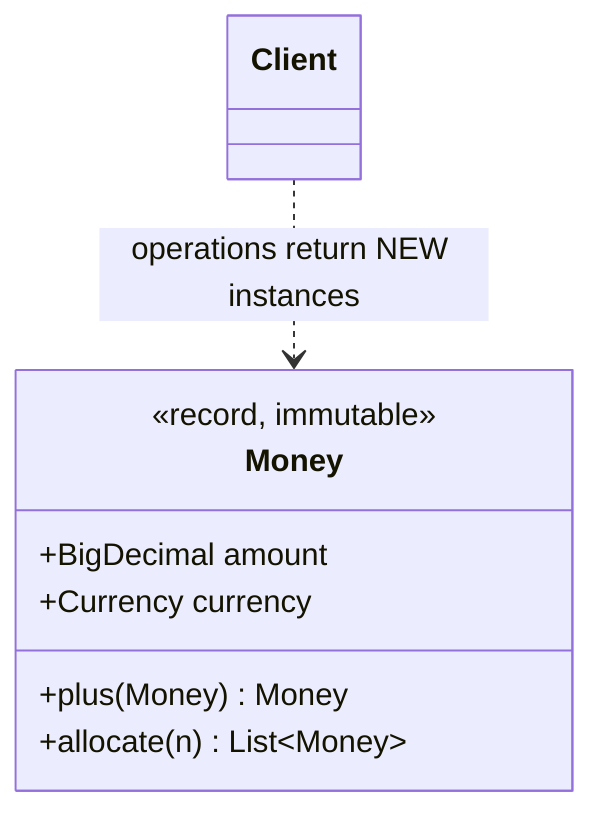
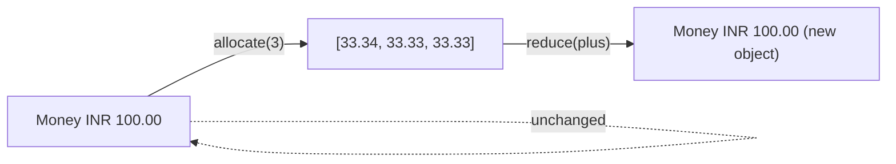
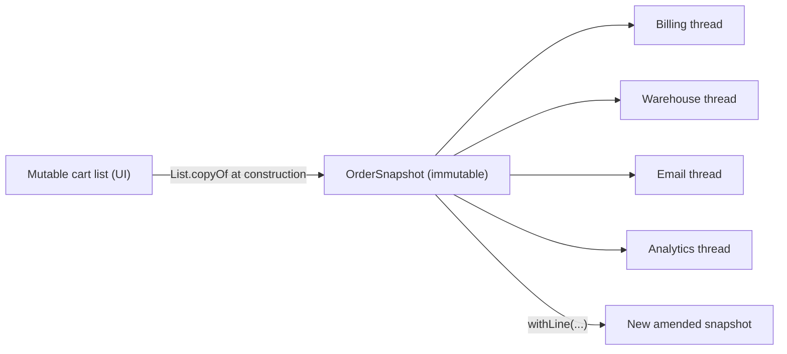
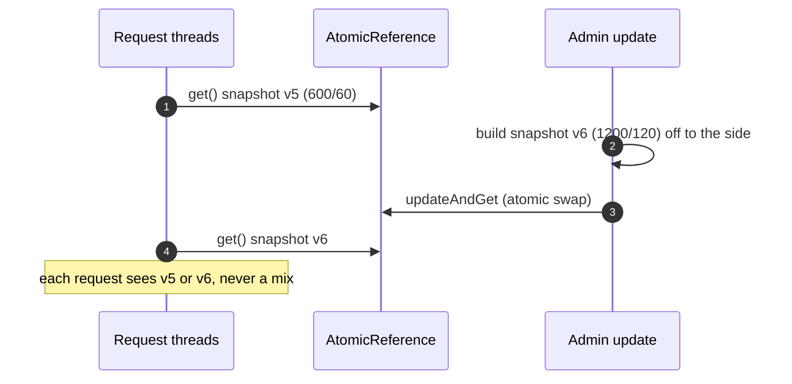

---
tags:
  - Concurrency
  - Beginner
---

# Immutable Object

<span class="badge badge--beginner">🟢 Beginner → 🔴 Advanced</span>
<span class="badge badge--category">Concurrency</span>
<span class="badge badge--interview">Interview frequency ⭐⭐⭐⭐</span>

!!! abstract "TL;DR"
    **An immutable object can't change after it's built. "Changes" create new objects.**
    Immutable objects are **automatically thread-safe**, can be shared freely and cached, and make reasoning easy. In Java: records (with defensive copies), `final` fields, `List.copyOf`, `java.time`, `BigDecimal`, `String`.

---

## 1. Intent & Problem It Solves

**The problem in plain English:** an order snapshot is shared with billing, the warehouse and the email service, each on its own thread. If the snapshot is mutable, any of them (or the cart UI that created it) can change it while others are reading, and you need locks everywhere. If it's **immutable**, nobody can change it, so nobody needs a lock. Every reader sees exactly what was agreed at checkout.

**Definition:**
> An object whose state cannot be modified after construction. To "change" it, create a new object with the new state (a "wither" or copy-on-write).

**The rules (from *Java Concurrency in Practice* and *Effective Java* Item 17):**

1. All fields `final` (records do this for you).
2. No setters or other mutators.
3. The class can't be subclassed in a way that adds mutability (`final` class or record).
4. **Defensive copies** of mutable inputs (lists, arrays, `Date`) in the constructor, and never hand out internal mutable objects.
5. `this` doesn't escape during construction.

Follow these and the Java Memory Model guarantees that **any thread** sees the fully constructed state (final-field semantics), even without synchronization.

## 2. Real-World Analogy

!!! example "A printed receipt"
    Once a receipt is printed, it doesn't change. Copies can go to the customer, the accountant and the auditor, and they'll always agree. If something needs correcting, you issue a **new** document (a credit note); you don't scribble on the old receipt.

## 3. Structure



| Technique | Purpose |
|---|---|
| `record` / `final` fields | No reassignment after construction |
| Compact constructor validation | Invalid objects can't exist |
| `List.copyOf`, `Map.copyOf` | Defensive copy in, unmodifiable out |
| Withers (`withX(...)`) | Create modified copies |
| `AtomicReference<Immutable>` | Swap whole snapshots atomically |

## 4. Naive Approach (Without the Pattern)

```java
public class Order {
    private List<Line> lines;               // mutable list, shared
    public List<Line> getLines() { return lines; }        // caller can add lines
    public void setLines(List<Line> lines) { this.lines = lines; }  // caller keeps a reference
}
// Billing reads total while the cart UI is still adding lines -> invoice != charged amount.
```

- :material-close-circle:{ style="color:#e53935" } **Shared mutable state**: races, locks everywhere.
- :material-close-circle:{ style="color:#e53935" } **Aliasing bugs**: changing "my" list changes yours.
- :material-close-circle:{ style="color:#e53935" } Objects can enter **invalid states** halfway through updates.

---

## 5. Three Real-World Examples

### Example 1: Money as an Immutable Value (Banking)

**Scenario:** A banking app splits bills, sums transactions and converts currencies across many threads. Money must never lose a paisa: splitting INR 100 three ways must give 33.34 + 33.33 + 33.33, not 99.99. Amounts like INR 10.005 are invalid. A single `Money` instance (INR 1) is shared by a million parallel additions without any locks.

**Design:**



**Full Code:**

=== "Money.java"

    ```java
    --8<-- "code/concurrency/src/main/java/com/handbook/concurrency/immutable/money/Money.java"
    ```

    1.  The **compact constructor** validates and **normalizes** (scale to 2 for INR). An invalid `Money` can never exist, so no method needs to re-check.
    2.  Every operation returns a **new** `Money`. Nothing is ever modified, so instances can be shared across threads with no locks.

=== "MoneyDemo.java"

    ```java
    --8<-- "code/concurrency/src/main/java/com/handbook/concurrency/immutable/money/MoneyDemo.java"
    ```

    1.  A **parallel** reduction over a shared object: safe because `plus` never mutates. With a mutable accumulator this would be a race.

**Output:**

```text
--8<-- "code/outputs/concurrency/immutable/money/MoneyDemo.txt"
```

**Why immutability here:**

- Money is a **value**: two INR 5.00s are the same thing, so `equals`/`hashCode` by value (records give this).
- **Thread-safe by construction** for parallel computations.
- Validation in one place, the constructor, so invalid amounts can't exist.

---

### Example 2: Order Snapshot Shared by Services (E-commerce)

**Scenario:** At checkout, the order is frozen into a snapshot and handed to billing, warehouse, email and analytics, all running concurrently. The cart UI keeps its own mutable list (customers sometimes add items after paying, by mistake), and that must **not** change what was charged. Amendments (adding a screen guard after checkout) create a **new** snapshot.

**Design:**



**Full Code:**

=== "OrderSnapshot.java"

    ```java
    --8<-- "code/concurrency/src/main/java/com/handbook/concurrency/immutable/order/OrderSnapshot.java"
    ```

    1.  **Defensive copy in, unmodifiable out**: `List.copyOf` copies the caller's list (later cart changes can't leak in) and returns an unmodifiable list (callers can't modify it). Record components alone aren't enough: a record holding an `ArrayList` is *shallowly* immutable.
    2.  A **wither**: the "change" produces a new snapshot; the original is untouched for everyone still using it.

=== "OrderDemo.java"

    ```java
    --8<-- "code/concurrency/src/main/java/com/handbook/concurrency/immutable/order/OrderDemo.java"
    ```

**Output:**

```text
--8<-- "code/outputs/concurrency/immutable/order/OrderDemo.txt"
```

**Why immutability here:**

- **One agreed version** of the order, shared by many threads without coordination.
- No aliasing bugs from the cart UI.
- Amendments are explicit new versions, which is good for auditing.

---

### Example 3: Lock-Free Config Snapshots (SaaS)

**Scenario:** An API gateway enforces per-tenant rate limits read on **every** request (here 400,000 reads), while an admin tool updates the limits. The per-minute limit and burst must always be **consistent with each other** (burst = rpm / 10, and burst ≤ rpm). With an immutable snapshot inside an `AtomicReference`, readers never lock: they grab the current snapshot in one step and use it for the whole request.

**Design:**



**Full Code:**

=== "RateLimitConfig.java"

    ```java
    --8<-- "code/concurrency/src/main/java/com/handbook/concurrency/immutable/config/RateLimitConfig.java"
    ```

    1.  An immutable **snapshot record** with its invariant enforced in the constructor. An invalid config can't even be built, so it can't be published.
    2.  Reading is a single volatile read: **wait-free**, no locks.
    3.  `updateAndGet` applies the change atomically (retrying if another update raced). The update function must be **side-effect free**, because it may run more than once.

=== "ConfigDemo.java"

    ```java
    --8<-- "code/concurrency/src/main/java/com/handbook/concurrency/immutable/config/ConfigDemo.java"
    ```

**Output:**

```text
--8<-- "code/outputs/concurrency/immutable/config/ConfigDemo.txt"
```

**Why immutability here:**

- The read path is **hot**: no locks, no contention.
- Consistency comes from **swapping whole snapshots**, not from locking fields.
- Rollback is easy: keep the previous snapshot and swap it back.

---

??? example "Unit Tests: `ImmutableTest.java`"

    ```java
    --8<-- "code/concurrency/src/test/java/com/handbook/concurrency/immutable/ImmutableTest.java"
    ```

## 6. Variations & Modern Java Take

| Tool | Notes |
|---|---|
| **Records** (Java 16+) | Final fields, value `equals`/`hashCode`, compact constructors for validation; **shallowly** immutable, so copy mutable components |
| `List.of`/`copyOf`, `Map.of`/`copyOf`, `Set.of` | Truly unmodifiable; `null` not allowed; `copyOf` returns the same instance if it's already immutable |
| `Collections.unmodifiableList(list)` | A **view**: if the original list changes, the view shows it. Not a copy |
| `java.time` (`LocalDate`, `Instant`, `Duration`) | Immutable replacements for `Date`/`Calendar` |
| `BigDecimal`, `String`, wrapper types | Immutable values |
| Withers | `order.withLine(...)`; with many fields, builders with `toBuilder()` |
| Persistent collections (Vavr, PCollections) | Efficient "modified copies" via structural sharing |

## 7. Where It Lives in Real Frameworks

| Where | Immutable |
|---|---|
| JDK | `String`, `Integer` and other wrappers, `BigDecimal`, `java.time.*`, `Path`, `URI`, `Optional` |
| JDK collections | `List.of`, `Map.of`, `Set.of`, `Stream.toList()` |
| Spring | `HttpHeaders.readOnlyHttpHeaders`, `ResponseEntity`, `MediaType`; immutable `@ConfigurationProperties` with constructor binding (records) |
| Jackson | Deserializes records and immutable classes via constructors |
| Kafka | Records sent are effectively immutable once handed to the producer |
| Guava | `ImmutableList`, `ImmutableMap` |

## 8. Pros, Cons & Trade-offs

| ✅ Pros | ❌ Cons |
|---|---|
| **Thread-safe** without locks | **New object per change**: allocation and GC (usually cheap) |
| Safe to **share, cache, use as map keys** | Large objects copied on every change can be expensive |
| **Invariants checked once**, at construction | Deeply nested updates are verbose without lenses/withers |
| Easy reasoning, no aliasing bugs | Some frameworks (JPA entities) expect mutability |

## 9. Pitfalls & Anti-Patterns

!!! danger "Shallow immutability"
    `record Order(List<Line> lines)` is not immutable if `lines` is an `ArrayList`: callers can still change it. Copy in the compact constructor (`List.copyOf`).

!!! danger "Leaking mutable internals"
    Returning an internal `Date`, array or list lets callers change your "immutable" object (see the coding challenge). Return copies or immutable types.

!!! warning "`Collections.unmodifiableList` is a view, not a copy"
    If the backing list changes, so does the "unmodifiable" view. Use `List.copyOf`.

!!! warning "Escaping `this` in the constructor"
    Registering `this` with a listener inside the constructor lets other threads see a partially constructed object, voiding the final-field guarantee.

## 10. Senior / Architect Deep Dive (10–15 yrs)

**Final-field semantics.** The JMM guarantees that once a constructor finishes, any thread that gets a reference to the object sees the correctly initialized values of its `final` fields, **without synchronization**, as long as `this` didn't escape. That's why immutable objects can be published through data races (e.g., a non-volatile field) and still be safe.

**Immutability at architecture scale:** event sourcing (events are immutable facts), Kafka logs, CRDTs, Git, and container images are all immutable data. Systems built on immutable data are easier to cache, replicate, audit and debug.

**Performance reality.** Short-lived small objects are almost free on modern JVMs (TLAB allocation, young-gen GC). Profile before introducing mutable "optimizations". For big structures with frequent small changes, use persistent data structures or confine mutation to one thread and publish immutable snapshots.

!!! bug "War story: the invoice that didn't match the charge"
    An e-commerce checkout passed the same mutable `Order` object to the payment thread and the invoice thread. A "recommended add-on" widget on the confirmation page added an item to the same object a few hundred milliseconds after payment. The payment charged the old total; the invoice, generated slightly later, included the add-on. About 0.3% of invoices didn't match the charged amount, and every one was a support ticket and a manual credit note.
    **Fix:** checkout now creates an immutable `OrderSnapshot` (record + `List.copyOf`) that payment, invoicing and email all receive; add-ons after payment create a separate order.
    **Lesson:** anything shared between threads, or meant to represent "what was agreed", should be immutable.

## 11. Related Patterns & Comparisons

| | Immutable Object | Read-Write Lock | Prototype | Flyweight |
|---|---|---|---|---|
| Thread safety | **Inherent**, no locks | Locks | N/A | Requires immutability |
| Changes | New objects | In place under a write lock | Copy then modify | Never (shared) |
| Relationship | Basis for safe sharing | Alternative when mutation is needed | Copying mutable objects | Flyweights **must** be immutable |

## 12. Interview Corner

=== "🟢 Beginner / Service Companies"

    **Q1. What is an immutable object?**

    An object whose **state can't change** after creation, like `String`, `Integer`, `LocalDate`.

    **Q2. How do you create an immutable class?**

    `final` class (or record), `private final` fields, no setters, **defensive copies** of mutable inputs and outputs, and initialize everything in the constructor.

    **Q3. Why is `String` immutable?**

    For **security** (class names, file paths can't be changed after checks), **thread safety**, the **string pool** (sharing literals), and **cached hash codes** (fast map keys).

    **Q4. Are immutable objects thread-safe?**

    **Yes**: no thread can modify them, so no synchronization is needed to read them.

    **Q5. Is a record automatically immutable?**

    **Shallowly**: its fields are final, but if a field holds a mutable object (an `ArrayList`), that object can still change. Copy it in the compact constructor.

=== "🟡 Mid-Level"

    **Q1. `List.copyOf` vs `Collections.unmodifiableList`?**

    `copyOf` makes an **independent, unmodifiable copy**. `unmodifiableList` is a **read-only view** of the original, which still reflects later changes to it.

    **Q2. How do you "modify" an immutable object?**

    Return a **new** instance with the change (`withX`, `plus`), or use a builder with `toBuilder()`.

    **Q3. What are final-field semantics in the JMM?**

    Correctly constructed objects' `final` fields are visible to all threads after construction **without synchronization**, provided `this` doesn't escape the constructor.

    **Q4. How do you share changing configuration safely without locks?**

    Keep an **immutable snapshot** in an `AtomicReference`; readers `get()`; writers build a new snapshot and swap (Example 3).

    **Q5. Why are immutable objects good map keys?**

    Their `hashCode` can't change after insertion; a mutated key in a `HashMap` becomes unreachable.

=== "🔴 Senior / FAANG / SAP"

    **Q1. "Design a thread-safe, high-read configuration system with rollback."**

    Versioned **immutable snapshots** in an `AtomicReference`; validate before publishing; keep the last N snapshots for **instant rollback**; distribute with a version number; log which version each request used.

    **Q2. "What are the costs of immutability, and how do you mitigate them?"**

    Allocation and copying. Mitigate with **structural sharing** (persistent collections), batching changes into one new snapshot, and confining mutation to a builder or one thread before publishing.

    **Q3. "How does immutability help distributed systems?"**

    Immutable data can be **cached and replicated** without invalidation problems; events and logs can be replayed; conflicts are avoided (CRDTs, append-only stores).

    **Q4. "Can you safely publish an immutable object through a non-volatile field?"**

    Yes, if it's **properly immutable** (all fields final, no escaping `this`). Readers may see a stale reference but never a partially constructed object. Mutable objects need safe publication (volatile, locks).

    **Q5. "Records vs. Lombok `@Value` vs. hand-written immutable classes?"**

    Records: language-level, concise, no inheritance, value semantics. `@Value`: works on older Java, supports more customization. Hand-written: when you need caching, lazy derived fields or a custom API. All need defensive copies for mutable components.

=== "💻 Coding Challenge"

    **Problem:** `MutableBooking` has `final` fields and no setters, but it isn't immutable. Show **two ways** it leaks mutable state, then write an immutable `Booking`.

    ??? success "Solution"

        === "BookingDemo.java"

            ```java
            --8<-- "code/concurrency/src/main/java/com/handbook/concurrency/immutable/booking/BookingDemo.java"
            ```

        **Output:**

        ```text
        --8<-- "code/outputs/concurrency/immutable/booking/BookingDemo.txt"
        ```

        **Key points to say:** leak 1: storing the caller's `Date`/list (the caller can change them later); leak 2: returning internal objects (anyone can change them). Fix: an immutable **type** (`LocalDate` instead of `Date`) and `List.copyOf` in the compact constructor, which copies in **and** makes the list unmodifiable.

!!! info "Behavioural tie-in (STAR) for experienced candidates"
    - **S:** 0.3% of invoices didn't match charged amounts because a shared mutable order changed after payment.
    - **T:** Guarantee every downstream service sees exactly the paid order.
    - **A:** Introduced an immutable order snapshot (record + defensive copies) created at payment time; all consumers moved to it; post-payment add-ons became separate orders.
    - **R:** Invoice/charge mismatches went to zero; support tickets for "wrong invoice" dropped by 95%.

## 13. Quick Revision Card

!!! tip "Remember in 30 seconds"
    - **Can't change after construction**; changes create **new** objects.
    - **Thread-safe for free**; great keys, cache entries and shared snapshots.
    - Records are **shallowly** immutable: `List.copyOf` mutable components.
    - Don't leak internals; prefer `java.time` over `Date`.
    - **Config pattern:** immutable snapshot + `AtomicReference` swap.

    ```java
    record Money(BigDecimal amount, Currency currency) { Money plus(Money o) { return new Money(amount.add(o.amount), currency); } }
    ```

## Practice

- [ ] Add `minus` and `times(int)` to `Money`, keeping exact paise.
- [ ] Add a "previous snapshot" to `RateLimitConfig` and implement `rollback()`.
- [ ] Find a mutable DTO in your own project and make it a record with defensive copies.

---

[:material-arrow-left: Read-Write Lock](read-write-lock.md){ .md-button }
[Next: Double-Checked Locking :material-arrow-right:](double-checked-locking.md){ .md-button .md-button--primary }
