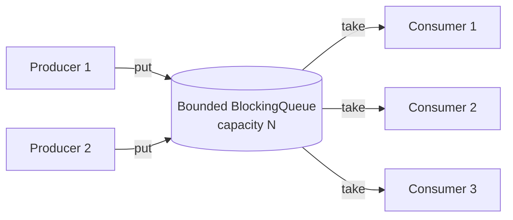
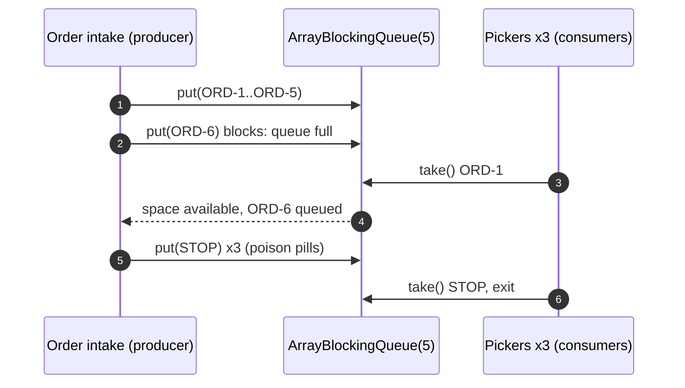
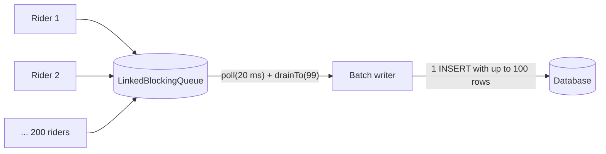
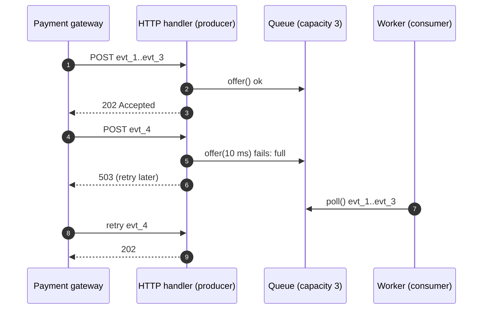

---
tags:
  - Concurrency
  - Intermediate
---

# Producer-Consumer

<span class="badge badge--intermediate">🟡 Intermediate</span>
<span class="badge badge--category">Concurrency</span>
<span class="badge badge--interview">Interview frequency ⭐⭐⭐⭐⭐</span>

!!! abstract "TL;DR"
    **Producers put work into a shared buffer (queue); consumers take work out and process it, at their own pace.**
    The buffer decouples the two sides, smooths bursts, and, when it's **bounded**, applies **back-pressure** so fast producers can't overwhelm slow consumers. In Java, use a `BlockingQueue`.

---

## 1. Intent & Problem It Solves

**The problem in plain English:** orders arrive at a dark store in bursts (a hundred at 7 pm, ten at 3 pm). Pickers work at a steady pace. If the order system hands each order directly to a picker, it has to wait when all pickers are busy, or orders get lost. A queue between them lets orders arrive at any rate and lets pickers take the next one when they're free. If the queue fills up, the system knows it's overloaded and can slow intake.

**Definition:**
> Separate the code that **produces** work from the code that **consumes** it, connected by a thread-safe **buffer**. Producers block (or are rejected) when the buffer is full; consumers block when it's empty.

## 2. Real-World Analogy

!!! example "A restaurant's order rail"
    Waiters (producers) clip orders onto the rail. Cooks (consumers) take the next ticket when they're ready. If the rail is full, waiters stop taking new tables for a moment (back-pressure). Waiters never need to know which cook will cook the order.

## 3. Structure



| Participant | Responsibility |
|---|---|
| **Producer** | Creates work items and `put`s/`offer`s them |
| **Buffer** | Thread-safe queue; **bounded** to apply back-pressure |
| **Consumer** | `take`s/`poll`s items and processes them |
| **Shutdown signal** | Poison pill, interrupt, or a "done" flag |

**`BlockingQueue` methods, the interview table:**

| | Throws | Returns special value | Blocks | Times out |
|---|---|---|---|---|
| Insert | `add(e)` | `offer(e)` → false | `put(e)` | `offer(e, t, unit)` |
| Remove | `remove()` | `poll()` → null | `take()` | `poll(t, unit)` |

## 4. Naive Approach (Without the Pattern)

```java
List<Order> orders = new ArrayList<>();          // not thread-safe
// producer
orders.add(order);
// consumer
while (true) {
    if (!orders.isEmpty()) {                     // busy-waiting burns CPU
        Order o = orders.remove(0);              // race: two consumers take the same order,
        pick(o);                                 // or one gets IndexOutOfBoundsException
    }
}
```

- :material-close-circle:{ style="color:#e53935" } **Races** on an unsynchronized list.
- :material-close-circle:{ style="color:#e53935" } **Busy-waiting** wastes CPU.
- :material-close-circle:{ style="color:#e53935" } **Unbounded** growth: a burst eventually causes `OutOfMemoryError`.

---

## 5. Three Real-World Examples

### Example 1: Dark-Store Order Picking (Grocery)

**Scenario:** Order intake produces pick tasks; three pickers (consumers) collect items. The queue holds at most 5 waiting tasks; when it's full, intake **blocks** until a picker frees a slot, so the floor never has an ever-growing backlog. At closing time, the system must stop pickers cleanly after the last order.

**Design:**



**Full Code:**

=== "PickingDemo.java"

    ```java
    --8<-- "code/concurrency/src/main/java/com/handbook/concurrency/producerconsumer/picking/PickingDemo.java"
    ```

    1.  A **poison pill**: a special item that tells a consumer to stop. Send **one per consumer**. Compared with `==`, so a real order can never be mistaken for it.
    2.  **Bounded** to 5. This is what creates back-pressure; an unbounded queue just hides overload until memory runs out.
    3.  `take()` **blocks** while the queue is empty: no busy-waiting. With virtual threads, a blocked consumer costs almost nothing.

**Output:**

```text
--8<-- "code/outputs/concurrency/producerconsumer/picking/PickingDemo.txt"
```

The demo prints only what's guaranteed (totals, the queue bound). Which picker took which order varies from run to run, as it should.

**Why Producer-Consumer here:**

- Arrival rate (bursty) and processing rate (steady) are **decoupled**.
- The bound gives **natural back-pressure** on intake.
- Adding a picker is adding a consumer; the producer doesn't change.

---

### Example 2: Batched GPS Ingestion (Logistics)

**Scenario:** 200 delivery riders' phones send GPS pings constantly. Writing each ping with its own `INSERT` overwhelms the database. Instead, rider connections (many producers) put pings on a queue, and **one writer** (consumer) drains up to 100 at a time and writes them in a single batch insert. Under light load, batches are small and latency stays low; under heavy load, batches grow automatically.

**Design:**



**Full Code:**

=== "GpsIngestDemo.java"

    ```java
    --8<-- "code/concurrency/src/main/java/com/handbook/concurrency/producerconsumer/gps/GpsIngestDemo.java"
    ```

    1.  **`drainTo`** grabs everything already waiting (up to a limit) in one call: the key to **adaptive batching**. Wait for the first item with a timeout, then take whatever else is ready.

**Output:**

```text
--8<-- "code/outputs/concurrency/producerconsumer/gps/GpsIngestDemo.txt"
```

**Why Producer-Consumer here:**

- **Many producers, one consumer**: a classic fan-in.
- The consumer turns a stream of tiny writes into **efficient batches**.
- Producers never wait for the database; the queue absorbs the difference.

---

### Example 3: Webhook Intake with Back-pressure (Payments)

**Scenario:** A payment gateway sends webhooks (`payment.captured`, `refund.created`) to a merchant's server. The HTTP handler must respond fast, so it only **enqueues** the event and returns `202 Accepted`; a worker processes events afterwards. If the queue is full (worker down or slow), the handler returns **`503`** within milliseconds, and the gateway **retries later**. That's back-pressure across a network boundary.

**Design:**



**Full Code:**

=== "WebhookDemo.java"

    ```java
    --8<-- "code/concurrency/src/main/java/com/handbook/concurrency/producerconsumer/webhooks/WebhookDemo.java"
    ```

    1.  `offer` **with a timeout** never blocks an HTTP thread for long. A full queue becomes a fast, explicit "try again later" instead of a hung request.

**Output:**

```text
--8<-- "code/outputs/concurrency/producerconsumer/webhooks/WebhookDemo.txt"
```

!!! warning "In-memory queues lose data on crash"
    Accepted-but-unprocessed webhooks are gone if the process dies. In production, persist them first (a database table or Kafka topic) and return 202 only after the write. The in-memory queue is fine for work you can afford to lose or rebuild.

**Why Producer-Consumer here:**

- **Fast acknowledgement**, slow processing.
- Explicit **back-pressure** (503) pushes the problem back to a sender that knows how to retry.
- The worker can be restarted or scaled independently.

---

??? example "Unit Test: `ProducerConsumerTest.java`"

    ```java
    --8<-- "code/concurrency/src/test/java/com/handbook/concurrency/producerconsumer/ProducerConsumerTest.java"
    ```

## 6. Variations & Modern Java Take

| Queue | Bounded? | Notes |
|---|---|---|
| `ArrayBlockingQueue` | Yes (fixed array) | One lock; predictable memory; optional fairness |
| `LinkedBlockingQueue` | Optional (default unbounded!) | Separate put/take locks: higher throughput. **Always pass a capacity** |
| `LinkedTransferQueue` | No | `transfer()` waits until a consumer takes the item (hand-off) |
| `SynchronousQueue` | Zero capacity | Direct hand-off; used by `Executors.newCachedThreadPool()` |
| `PriorityBlockingQueue` | No | Consumers get the highest-priority item first (express orders) |
| `DelayQueue` | No | Items become available after a delay (retries, scheduled reminders) |
| LMAX **Disruptor** | Ring buffer | Lock-free, very high throughput (trading systems) |

**Virtual threads (Java 21):** blocking `take()`/`put()` is cheap on virtual threads, so "one virtual thread per consumer" or "per producer" is fine even at large scale. Bound the **queue** (and the downstream resource), not the threads.

**Shutdown options:** poison pills (Example 1), a "done" flag plus a timed `poll` (Example 2), or **interrupting** consumers (`executor.shutdownNow()`), where consumers must handle `InterruptedException` by exiting.

## 7. Where It Lives in Real Frameworks

| Where | Producer-Consumer |
|---|---|
| JDK | `ThreadPoolExecutor` (submitters produce tasks into a `BlockingQueue`; worker threads consume) |
| Logback / Log4j2 | `AsyncAppender` / async loggers: application threads produce log events, a background thread writes them |
| Spring Batch | `ItemReader` → chunk → `ItemWriter` |
| Kafka / RabbitMQ / SQS | The same pattern across processes; consumer groups are pools of consumers |
| Netty | Event loops consuming I/O events |
| Reactive Streams | `Publisher`/`Subscriber` with **request(n)** back-pressure |

## 8. Pros, Cons & Trade-offs

| ✅ Pros | ❌ Cons |
|---|---|
| **Decouples** production and consumption rates | Extra latency (items wait in the buffer) |
| Absorbs **bursts** | In-memory buffers **lose data** on crash |
| **Back-pressure** with bounded queues | Shutdown and error handling need care |
| Easy to **scale consumers** | Ordering only per queue; parallel consumers process out of order |
| Enables **batching** | Unbounded queues hide overload until OOM |

## 9. Pitfalls & Anti-Patterns

!!! danger "Unbounded queues"
    `new LinkedBlockingQueue<>()` has a capacity of `Integer.MAX_VALUE`. Under sustained overload it grows until the JVM dies. **Always bound** and decide what happens when full (block, reject, drop oldest).

!!! danger "Swallowing InterruptedException"
    `catch (InterruptedException e) {}` inside a consumer loop makes it impossible to stop. Restore the flag (`Thread.currentThread().interrupt()`) and exit.

!!! danger "One poison pill for many consumers"
    Only one consumer gets it; the others block forever. Send one per consumer, or have the consumer that receives it put it back.

!!! warning "Slow consumers and ordering"
    With several consumers, items for the same entity (same order, same account) may be processed out of order. Partition by key (one queue per partition) if order matters.

## 10. Senior / Architect Deep Dive (10–15 yrs)

**Sizing.** Little's Law again: queue length ≈ arrival rate × time in queue. Choose capacity from the **latency you can tolerate**, not from memory alone: a queue that holds 10 minutes of work means 10-minute-old results.

**What to do when full**: block the producer (in-process, trusted producers), **reject** with a retryable error (network edges, as in Example 3), **drop** (metrics, telemetry), or **shed load by priority**. Make the policy explicit and observable (queue depth, wait time, rejections).

**From in-process to distributed.** The same pattern at system scale is a **message broker**. Kafka adds durability, replay, partition-level ordering and consumer groups; SQS adds visibility timeouts and dead-letter queues. Consumers must be **idempotent** because delivery is at-least-once.

**Batching trade-off.** Bigger batches mean higher throughput and higher latency. Adaptive batching (Example 2) gives small batches under light load and large ones under heavy load. Add a max wait time so items never sit too long.

!!! bug "War story: the async logger that took down checkout"
    A team switched to an asynchronous log appender with an **unbounded** queue to "make logging free". During an incident, a downstream log collector slowed down; the queue grew to 9 GB of log events, triggered long GC pauses, and then an `OutOfMemoryError` on every checkout pod at once.
    **Fix:** a bounded queue (8,192 events) with **"discard DEBUG/INFO when 80% full, never block on ERROR"**, plus a metric and alert on queue depth.
    **Lesson:** every queue is a decision about overload. "Unbounded" is a decision too: the decision to crash later.

## 11. Related Patterns & Comparisons

| | Producer-Consumer | Thread Pool | Observer / Pub-Sub | Pipeline |
|---|---|---|---|---|
| Core idea | Buffer between producers and consumers | Workers consuming a task queue (a specific Producer-Consumer) | Notify all subscribers | Chain of producer-consumer stages |
| Delivery | Each item to **one** consumer | One worker per task | **Every** subscriber gets each event | Each stage to the next |
| Back-pressure | Bounded queue | Bounded queue + rejection policy | Usually none (reactive streams add it) | Bounded queues between stages |

## 12. Interview Corner

=== "🟢 Beginner / Service Companies"

    **Q1. What is the Producer-Consumer problem?**

    Producers create data and consumers process it, sharing a **buffer**. The challenge is to coordinate them safely: producers wait when the buffer is **full**, consumers wait when it's **empty**, without races.

    **Q2. How do you solve it in Java?**

    Use a **`BlockingQueue`**: producers call `put()`, consumers call `take()`; the queue handles all locking and waiting.

    **Q3. `put()` vs `offer()`?**

    `put()` **blocks** until space is available; `offer()` returns **false** immediately (or after a timeout) if the queue is full.

    **Q4. How do you stop consumers?**

    Send a **poison pill** (one per consumer), or interrupt the consumer threads (`shutdownNow`).

    **Q5. Write it with `wait()`/`notify()`.**

    A `synchronized` buffer: `put` waits **in a while loop** while full, adds, then `notifyAll()`; `take` waits while empty, removes, then `notifyAll()` (see the coding challenge).

=== "🟡 Mid-Level"

    **Q1. Why must `wait()` be called in a loop?**

    Because of **spurious wakeups** and because another thread may have changed the condition between `notifyAll()` and this thread reacquiring the lock. Always re-check the condition.

    **Q2. `notify()` vs `notifyAll()`?**

    `notify()` wakes **one** arbitrary waiter, which may be the wrong kind (a producer when a consumer is needed), causing a **lost wakeup** and a hang. `notifyAll()` is safer for shared conditions; or use `ReentrantLock` with **separate `Condition`s** (`notFull`, `notEmpty`).

    **Q3. `ArrayBlockingQueue` vs `LinkedBlockingQueue`?**

    Array: fixed, bounded, single lock. Linked: optionally bounded (**unbounded by default**), separate locks for head and tail, usually higher throughput.

    **Q4. How does `ThreadPoolExecutor` use this pattern?**

    `submit()` produces tasks into its `BlockingQueue`; worker threads consume them. When the queue is full and max threads are busy, the **rejection policy** applies.

    **Q5. How do you implement batching on the consumer side?**

    `poll(timeout)` for the first item, then `drainTo(batch, max - 1)`; write the batch; repeat (Example 2).

=== "🔴 Senior / FAANG / SAP"

    **Q1. "Design an ingestion pipeline for 1 million events per second."**

    Partitioned **Kafka** topics (key by entity for ordering), stateless producers with batching and compression, consumer groups sized to partitions, idempotent consumers, batch writes to storage, DLQ for poison messages, back-pressure via consumer lag monitoring and autoscaling.

    **Q2. "The queue keeps growing. Diagnose and fix."**

    Measure **arrival rate vs. service rate** and consumer latency; look for slow dependencies, GC, lock contention. Fix: scale consumers (if the downstream allows), batch, optimize consumers, shed or degrade low-priority work, and bound the queue with an explicit full policy.

    **Q3. "Guarantee per-customer ordering with multiple consumers."**

    **Partition by key** (hash customer ID to N queues, one consumer each, or Kafka partitions); within a partition processing is sequential.

    **Q4. "In-memory queue vs. message broker?"**

    In-memory: fast and simple, but no durability, single process. Broker: durability, replay, cross-service fan-out, at the cost of operations and latency. Use in-memory for best-effort work (logs, metrics) and brokers for business events.

    **Q5. "How do reactive streams handle back-pressure differently?"**

    Consumers **request(n)** items; producers emit at most what was requested (pull-based), instead of blocking threads on a full queue.

=== "💻 Coding Challenge"

    **Problem:** Implement a bounded buffer **without** `java.util.concurrent`: `put` blocks when full, `take` blocks when empty, using `synchronized`, `wait()` and `notifyAll()`. Prove nothing is lost with one producer and one consumer (sum of 1..1000).

    ??? success "Solution"

        === "BoundedBuffer.java"

            ```java
            --8<-- "code/concurrency/src/main/java/com/handbook/concurrency/producerconsumer/buffer/BoundedBuffer.java"
            ```

        === "BufferDemo.java"

            ```java
            --8<-- "code/concurrency/src/main/java/com/handbook/concurrency/producerconsumer/buffer/BufferDemo.java"
            ```

        **Output:**

        ```text
        --8<-- "code/outputs/concurrency/producerconsumer/buffer/BufferDemo.txt"
        ```

        **Key points to say:** circular array with `head`, `tail`, `count`; **`while`, not `if`**, around `wait()`; `notifyAll()` to avoid lost wakeups; null out taken slots for GC. The unit test runs 4 producers and 4 consumers on virtual threads and checks all 10,000 items arrive. In real code, use `ArrayBlockingQueue`.

!!! info "Behavioural tie-in (STAR) for experienced candidates"
    - **S:** An unbounded async-logging queue caused OOM on all checkout pods during an incident.
    - **T:** Make logging safe under downstream failure.
    - **A:** Bounded the queue, added priority-based discarding, exposed queue depth as a metric with alerts, and wrote a load test that slows the log collector.
    - **R:** The next collector outage caused dropped debug logs, not an outage.

## 13. Quick Revision Card

!!! tip "Remember in 30 seconds"
    - Producers → **bounded `BlockingQueue`** → consumers.
    - `put`/`take` block; `offer`/`poll` with timeouts for **back-pressure** at edges.
    - Shutdown: **poison pill per consumer** or interrupts; never swallow `InterruptedException`.
    - `drainTo` for **batching**; partition by key for **ordering**.
    - `wait()` in a **loop**, prefer **`notifyAll()`**.

    ```java
    BlockingQueue<Task> q = new ArrayBlockingQueue<>(100); q.put(task); Task t = q.take();
    ```

## Practice

- [ ] Use a `PriorityBlockingQueue` so express orders are picked first.
- [ ] Rewrite `BoundedBuffer` with `ReentrantLock` and two `Condition`s.
- [ ] Add a max wait (50 ms) to the GPS writer so partial batches are flushed promptly.

---

[:material-arrow-left: Concurrency overview](index.md){ .md-button }
[Next: Thread Pool :material-arrow-right:](thread-pool.md){ .md-button .md-button--primary }
