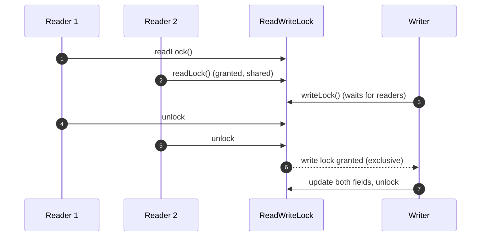
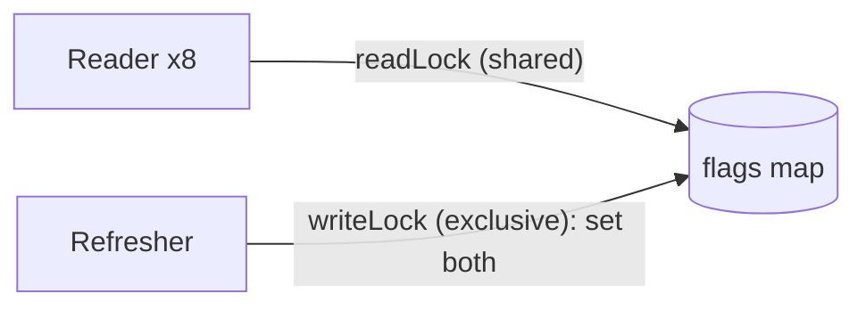
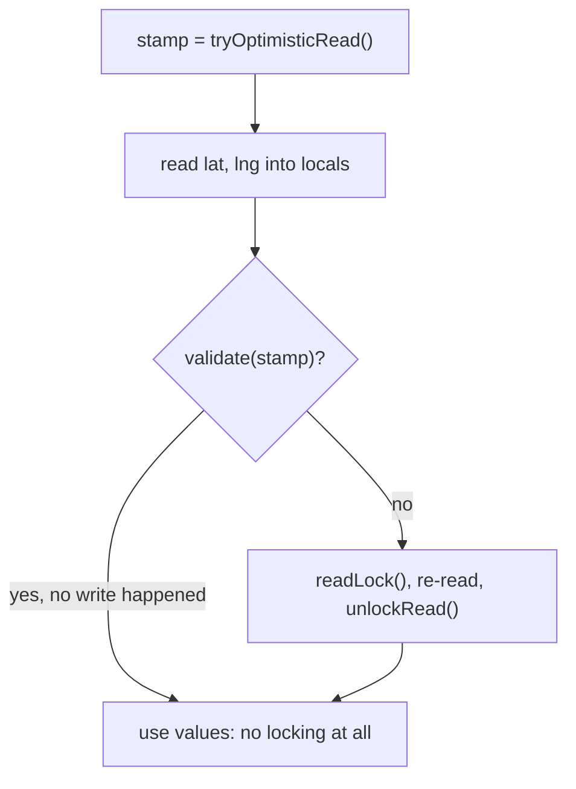
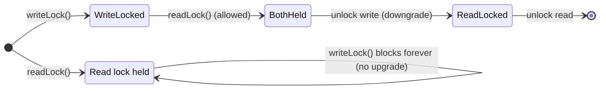

---
tags:
  - Concurrency
  - Advanced
---

# Read-Write Lock

<span class="badge badge--advanced">🔴 Advanced</span>
<span class="badge badge--category">Concurrency</span>
<span class="badge badge--interview">Interview frequency ⭐⭐⭐</span>

!!! abstract "TL;DR"
    **A read-write lock lets many readers proceed at the same time, but gives a writer exclusive access.**
    Use it for **read-mostly** shared data that must be updated **consistently** (caches, configuration, positions). For extremely read-heavy data, consider `StampedLock` optimistic reads or immutable snapshots instead.

---

## 1. Intent & Problem It Solves

**The problem in plain English:** a feature-flag cache is read thousands of times per second and refreshed every few seconds. With a plain `synchronized` lock, readers block **each other**, though reading never conflicts with reading. With **no** lock, a reader can see a half-applied refresh: `checkout-v2` on but `payments-v2` still off, a combination that was never released. A read-write lock allows concurrent reads and exclusive, atomic writes.

**Definition:**
> A read-write lock maintains a pair of locks: a **read lock** that any number of threads can hold at once (as long as no writer holds the write lock), and a **write lock** that is exclusive.

| | Another reader | Another writer |
|---|---|---|
| **Reader holds the lock** | ✅ allowed | ❌ waits |
| **Writer holds the lock** | ❌ waits | ❌ waits |

## 2. Real-World Analogy

!!! example "A museum exhibit"
    Any number of visitors can look at an exhibit at the same time (readers). When staff need to rearrange it (a writer), they close the room, wait for visitors to leave, make all the changes, and reopen. Visitors never see a half-rearranged exhibit.

## 3. Structure



| Java type | Notes |
|---|---|
| `ReentrantReadWriteLock` | Reentrant, optional fairness, supports **downgrading** (write → read) |
| `StampedLock` (Java 8) | Adds **optimistic reads** (no locking at all if no write happened); not reentrant |
| Immutable snapshot + `AtomicReference` | Not a lock: readers never block; writers replace the whole snapshot |

## 4. Naive Approach (Without the Pattern)

```java
// (a) No locking: readers may see a half-applied update
flags.put("checkout-v2", true);
flags.put("payments-v2", true);       // a reader between these two lines sees an invalid pair

// (b) synchronized everywhere: correct, but readers serialize behind each other
synchronized boolean[] read() { ... }  // 8 reader threads take turns doing something that could run in parallel
```

- :material-close-circle:{ style="color:#e53935" } No lock: **inconsistent reads** (and visibility problems).
- :material-close-circle:{ style="color:#e53935" } One exclusive lock: **needless contention** for read-mostly data.

---

## 5. Three Real-World Examples

### Example 1: Feature-Flag Cache (SaaS)

**Scenario:** A SaaS platform releases "checkout v2" and "payments v2" **together**; the two flags must always be read as a consistent pair. Eight request threads read the flags constantly while a background job refreshes them. Readers must never see one flag on and the other off.

**Design:**



**Full Code:**

=== "FeatureFlags.java"

    ```java
    --8<-- "code/concurrency/src/main/java/com/handbook/concurrency/rwlock/flags/FeatureFlags.java"
    ```

    1.  **Read lock**: any number of readers at once. Always unlock in `finally`.
    2.  **Write lock**: waits for all readers to leave, then excludes everyone while **both** flags change. Readers see the old pair or the new pair, never a mix.

=== "FlagsDemo.java"

    ```java
    --8<-- "code/concurrency/src/main/java/com/handbook/concurrency/rwlock/flags/FlagsDemo.java"
    ```

**Output:**

```text
--8<-- "code/outputs/concurrency/rwlock/flags/FlagsDemo.txt"
```

**Why a read-write lock here:**

- **Read-mostly** data (160,000 reads vs. 200 writes).
- Writes update **several fields** that must change atomically together.
- Readers don't block each other.

---

### Example 2: Optimistic Reads of a Driver's Position (Ride-hailing) — *StampedLock*

**Scenario:** A driver's latitude and longitude are updated every second and read constantly by the matching and ETA services. Even a read lock has a cost under heavy contention (readers update a shared counter). `StampedLock`'s **optimistic read** takes no lock at all: read the fields, then **validate** that no write happened; only if one did, retry under a real read lock. Reading lat and lng from two different updates (a "torn" read) would put the driver in the sea.

**Design:**



**Full Code:**

=== "DriverLocation.java"

    ```java
    --8<-- "code/concurrency/src/main/java/com/handbook/concurrency/rwlock/location/DriverLocation.java"
    ```

    1.  **Optimistic read**: returns a stamp without blocking anyone, including writers.
    2.  **Validate**: if a write happened since the stamp, the values read may be inconsistent, so fall back to a real read lock. Copy fields into **locals** before validating, and only use them afterwards.

=== "LocationDemo.java"

    ```java
    --8<-- "code/concurrency/src/main/java/com/handbook/concurrency/rwlock/location/LocationDemo.java"
    ```

**Output:**

```text
--8<-- "code/outputs/concurrency/rwlock/location/LocationDemo.txt"
```

**Why StampedLock here:**

- **Very read-heavy**, small state (two numbers), short critical sections.
- Optimistic reads avoid even shared-lock contention.
- Validation guarantees **no torn reads**.

---

### Example 3: Hospital Bed Board (Healthcare) — *downgrading, and why upgrading fails*

**Scenario:** A hospital's bed board is read by nurses' stations all day and updated on admissions. After admitting a patient, the admission desk prints the board, and that printout must reflect the admission **without** another admission sneaking in between. That's **lock downgrading**: hold the write lock, acquire the read lock, then release the write lock. The opposite, **upgrading** a read lock to a write lock, isn't supported by `ReentrantReadWriteLock`, and trying it with `lock()` deadlocks the thread.

**Design:**



**Full Code:**

=== "BedBoard.java"

    ```java
    --8<-- "code/concurrency/src/main/java/com/handbook/concurrency/rwlock/beds/BedBoard.java"
    ```

    1.  **Downgrade, step 1**: while holding the write lock, take the read lock (allowed, the lock is reentrant).
    2.  **Downgrade, step 2**: release the write lock. Other readers can now proceed, but no writer can change the board until we release the read lock.
    3.  **No upgrade**: a thread holding the read lock can never get the write lock (the write lock waits for **all** readers, including itself). `tryLock` with a timeout shows it; `lock()` would hang.

=== "BedsDemo.java"

    ```java
    --8<-- "code/concurrency/src/main/java/com/handbook/concurrency/rwlock/beds/BedsDemo.java"
    ```

**Output:**

```text
--8<-- "code/outputs/concurrency/rwlock/beds/BedsDemo.txt"
```

**Why a read-write lock here:**

- Shows the two subtle rules interviewers ask about: **downgrade OK, upgrade deadlocks**.
- Read-mostly shared state with occasional consistent updates.

---

??? example "Unit Tests: `ReadWriteLockTest.java`"

    ```java
    --8<-- "code/concurrency/src/test/java/com/handbook/concurrency/rwlock/ReadWriteLockTest.java"
    ```

## 6. Variations & Modern Java Take

| Option | Readers block? | Writers | Best for |
|---|---|---|---|
| `synchronized` / `ReentrantLock` | Yes, on each other | Exclusive | Small, balanced read/write workloads |
| **`ReentrantReadWriteLock`** | No (with each other) | Exclusive | Read-mostly, longer reads, multi-field updates |
| **`StampedLock` optimistic** | Never (optimistically) | Exclusive | Very read-heavy, tiny state, short reads |
| **Immutable snapshot + `AtomicReference`** | Never | Copy + swap | Read-mostly config/caches; see [Immutable Object](immutable-object.md) |
| `ConcurrentHashMap` | No | Fine-grained | Independent keys (no multi-key consistency needed) |
| `CopyOnWriteArrayList` | No | Copy the whole list | Tiny, rarely changed lists (listeners) |

**Fairness:** `new ReentrantReadWriteLock(true)` grants locks roughly in arrival order (no writer starvation, lower throughput). The default non-fair mode can starve writers under a constant stream of readers.

**Virtual threads:** `ReentrantReadWriteLock` and `StampedLock` don't pin virtual threads (unlike `synchronized` before JDK 24), so they're good choices in virtual-thread code.

## 7. Where It Lives in Real Frameworks

| Where | Usage |
|---|---|
| JDK | `ReentrantReadWriteLock`, `StampedLock`; `ConcurrentHashMap` (lock striping, lock-free reads) |
| Caffeine / Guava caches | Fine-grained, mostly lock-free reads |
| Spring | `ConcurrentReferenceHashMap`; singleton registries with read-mostly access |
| Databases | Shared (S) and exclusive (X) row/table locks; MVCC (readers don't block writers at all) |
| Linux kernel | `rwlock_t`, RCU (read-copy-update: the extreme "readers never wait" design) |

## 8. Pros, Cons & Trade-offs

| ✅ Pros | ❌ Cons |
|---|---|
| **Concurrent readers** | More overhead than a simple lock for short critical sections |
| **Atomic multi-field updates** | **Writer starvation** (non-fair mode) |
| Downgrading for consistent read-after-write | **No upgrade**: a classic deadlock source |
| `StampedLock`: lock-free optimistic reads | `StampedLock` isn't reentrant; misuse is easy |

## 9. Pitfalls & Anti-Patterns

!!! danger "Upgrading read → write"
    `readLock().lock(); ... writeLock().lock();` deadlocks the thread. Release the read lock first, then take the write lock and **re-check** the condition (another writer may have acted in between).

!!! danger "Forgetting to unlock"
    Always `lock(); try { ... } finally { unlock(); }`. A missed unlock blocks writers forever.

!!! warning "Using a read-write lock for tiny critical sections"
    For a counter or a single field, `AtomicLong`/`volatile` or a plain lock is faster. Read-write locks pay off when reads are frequent **and** non-trivial.

!!! warning "StampedLock mistakes"
    Using values read optimistically **before** validating; calling methods that could throw on inconsistent data inside the optimistic section; trying to reenter (not supported).

## 10. Senior / Architect Deep Dive (10–15 yrs)

**Measure before choosing.** Under low contention, `synchronized` is often fastest (biased-lock removal in JDK 15+ notwithstanding). Use JMH and JFR lock profiling. Read-write locks shine at high read concurrency with meaningful work per read.

**Prefer designs that avoid locks.** For read-mostly configuration, an **immutable snapshot** behind an `AtomicReference` gives wait-free reads and simple reasoning: build the new snapshot off to the side, then swap. That's MVCC/RCU in miniature.

**Distributed equivalents.** Across processes, read-write semantics show up as database row locks (`SELECT ... FOR SHARE` vs. `FOR UPDATE`), **MVCC** snapshot reads (Postgres readers never block writers), and leases. Distributed read-write locks (Redis/ZooKeeper) are rarely worth their complexity; prefer versioned data and optimistic concurrency (`@Version`).

!!! bug "War story: the cache refresh that froze checkout"
    A pricing cache used `ReentrantReadWriteLock`. The refresh job took the **write lock** and then called a remote pricing service (2–3 s) while holding it. Every checkout request blocked on the read lock for the duration. Under load, refreshes every 30 s caused a 3-second checkout freeze every 30 s.
    **Fix:** fetch and build the new price table **outside** the lock, then take the write lock only to swap a reference (microseconds), and later replace the lock entirely with an `AtomicReference` to an immutable snapshot.
    **Lesson:** never do I/O while holding a write lock. Prepare outside, swap inside.

## 11. Related Patterns & Comparisons

| | Read-Write Lock | Immutable Object | Copy-on-Write | Mutex (`synchronized`) |
|---|---|---|---|---|
| Readers block? | Only during writes | **Never** | **Never** | Yes |
| Writers | Exclusive, in place | Create new objects | Copy, then swap | Exclusive |
| Memory | In-place | New objects per change | Full copy per change | In-place |
| Best for | Read-mostly, in-place updates | Values, snapshots | Small, rarely changed collections | Simple or write-heavy |

## 12. Interview Corner

=== "🟢 Beginner / Service Companies"

    **Q1. What is a read-write lock?**

    A lock with a **shared read lock** (many readers at once) and an **exclusive write lock** (one writer, no readers).

    **Q2. When should you use it?**

    For **read-heavy** shared data with occasional writes, like caches and configuration.

    **Q3. Which Java class implements it?**

    `ReentrantReadWriteLock` (and `StampedLock` for optimistic reads).

    **Q4. Can a reader and a writer hold it at the same time?**

    **No.** Readers can share with readers only.

    **Q5. Why not just use `synchronized`?**

    `synchronized` makes readers wait for **each other** unnecessarily; a read-write lock lets them run in parallel.

=== "🟡 Mid-Level"

    **Q1. Can you upgrade a read lock to a write lock?**

    **No** with `ReentrantReadWriteLock`: it deadlocks. Release the read lock, acquire the write lock, and re-check the condition. **Downgrading** (write → read) is allowed.

    **Q2. What is writer starvation?**

    In non-fair mode, a continuous stream of readers can keep a writer waiting indefinitely. Fair mode or a writer-preference policy prevents it.

    **Q3. What is a `StampedLock` optimistic read?**

    `tryOptimisticRead()` returns a stamp without locking; read fields into locals; `validate(stamp)` tells you whether a write happened; if so, retry with a real read lock.

    **Q4. When is `ConcurrentHashMap` better than a map with a read-write lock?**

    When operations are **per key** and you don't need consistency across several keys. It has lock-free reads and fine-grained writes.

    **Q5. Do read-write locks work well with virtual threads?**

    Yes. `java.util.concurrent` locks don't pin carrier threads (unlike `synchronized` before JDK 24).

=== "🔴 Senior / FAANG / SAP"

    **Q1. "Design an in-memory config service read 100k times per second, updated once a minute."**

    **Immutable snapshot + `AtomicReference`**: readers do one volatile read; the updater builds a new snapshot off-lock, validates it, swaps it, and publishes a version. No read locks at all. Add a version for cache invalidation downstream.

    **Q2. "A cache refresh under a write lock causes latency spikes. Fix it."**

    Move I/O and computation **outside** the lock; hold the write lock only for the swap, or replace it with copy-on-write snapshots.

    **Q3. "How do databases let readers and writers proceed concurrently?"**

    **MVCC**: writers create new row versions; readers see a consistent snapshot of older versions, with no read locks. Conflicts are detected at write time.

    **Q4. "When would you pick StampedLock over ReentrantReadWriteLock?"**

    Very read-heavy, short reads of a few fields, no reentrancy needed, and the team is comfortable with the validation idiom. Benchmark first.

    **Q5. "Explain lock striping."**

    Split one lock into N locks by key hash (like early `ConcurrentHashMap` segments), so operations on different keys rarely contend. It increases concurrency for keyed data structures.

=== "💻 Coding Challenge"

    **Problem:** Implement a read-write lock **from scratch** with `synchronized`, `wait()` and `notifyAll()`: multiple concurrent readers, one exclusive writer, and **writer preference** so writers aren't starved. Prove it with transfers that keep `A + B = 1000` while readers check the invariant.

    ??? success "Solution"

        === "SimpleReadWriteLock.java"

            ```java
            --8<-- "code/concurrency/src/main/java/com/handbook/concurrency/rwlock/custom/SimpleReadWriteLock.java"
            ```

        === "CustomLockDemo.java"

            ```java
            --8<-- "code/concurrency/src/main/java/com/handbook/concurrency/rwlock/custom/CustomLockDemo.java"
            ```

        **Output:**

        ```text
        --8<-- "code/outputs/concurrency/rwlock/custom/CustomLockDemo.txt"
        ```

        **Key points to say:** counters for active readers, an active writer and waiting writers, all guarded by the object's monitor; readers wait if a writer is active **or waiting** (writer preference); conditions checked in `while` loops; `notifyAll` on release. Not reentrant and no fairness among writers; that's what `ReentrantReadWriteLock` adds.

!!! info "Behavioural tie-in (STAR) for experienced candidates"
    - **S:** Checkout froze for 3 s every 30 s; profiling showed threads waiting on a read lock.
    - **T:** Remove the freeze without losing price consistency.
    - **A:** Found remote calls inside the write lock; moved them outside, then replaced the lock with an immutable snapshot behind an `AtomicReference`.
    - **R:** The periodic spikes disappeared; p99 dropped from 3.1 s to 140 ms.

## 13. Quick Revision Card

!!! tip "Remember in 30 seconds"
    - **Shared reads, exclusive writes**: `ReentrantReadWriteLock`.
    - **Downgrade OK, upgrade deadlocks.**
    - `StampedLock`: **optimistic reads** + `validate`; not reentrant.
    - Never do **I/O while holding a write lock**.
    - Often better: **immutable snapshot + `AtomicReference`**.

    ```java
    lock.readLock().lock(); try { return read(); } finally { lock.readLock().unlock(); }
    ```

## Practice

- [ ] Replace `FeatureFlags`' lock with an immutable `Map` in an `AtomicReference` and compare the code.
- [ ] Make the flag refresh fetch new values from a (fake) slow service **outside** the write lock.
- [ ] Benchmark `synchronized` vs `ReentrantReadWriteLock` vs `StampedLock` with JMH at 1, 4 and 16 reader threads.

---

[:material-arrow-left: Future / Promise](future-promise.md){ .md-button }
[Next: Immutable Object :material-arrow-right:](immutable-object.md){ .md-button .md-button--primary }
