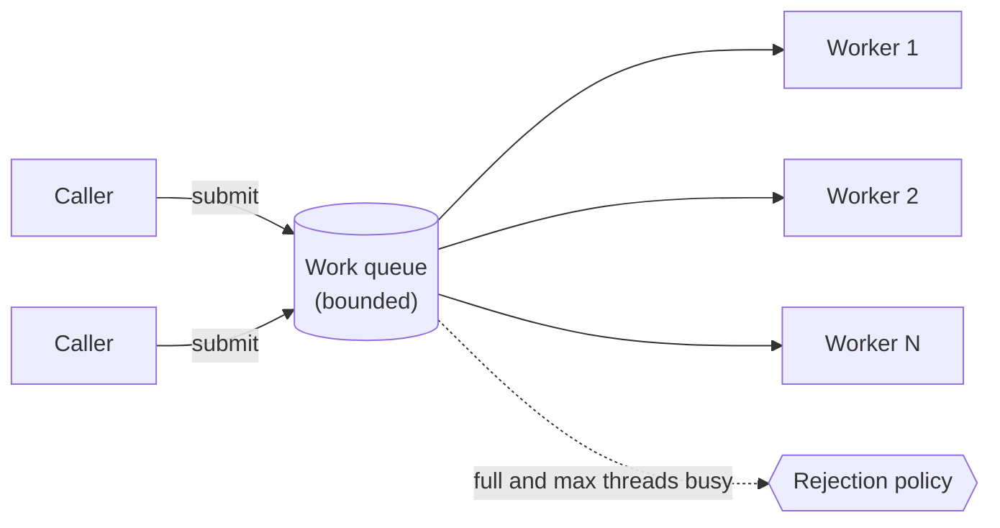
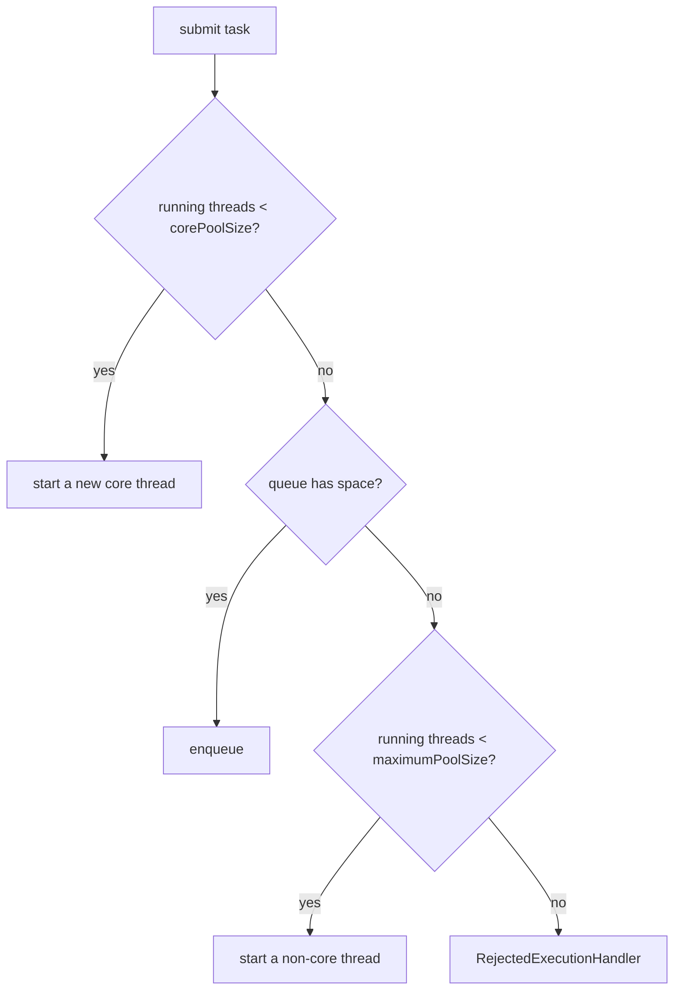
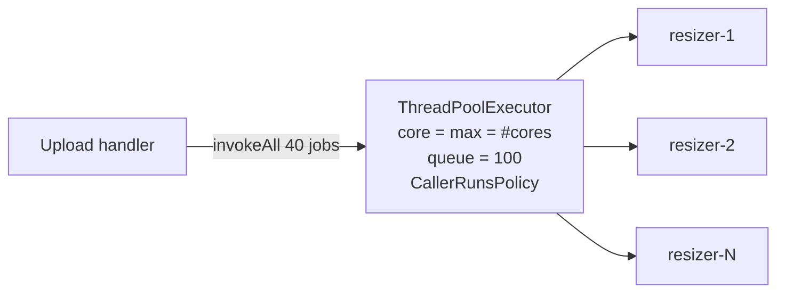
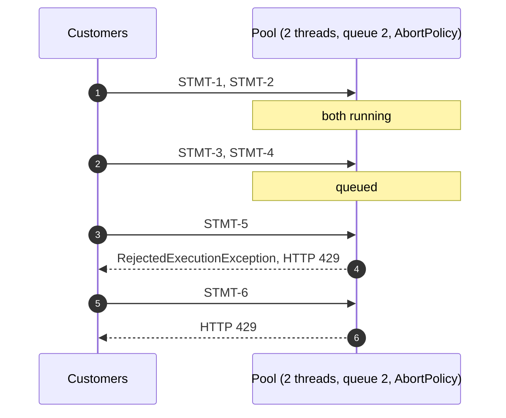
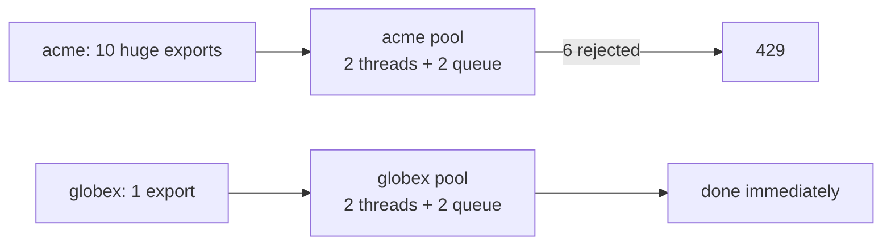

---
tags:
  - Concurrency
  - Intermediate
---

# Thread Pool

<span class="badge badge--intermediate">🟡 Intermediate → 🔴 Advanced</span>
<span class="badge badge--category">Concurrency</span>
<span class="badge badge--interview">Interview frequency ⭐⭐⭐⭐⭐</span>

!!! abstract "TL;DR"
    **A thread pool keeps a fixed set of worker threads that take tasks from a queue, instead of creating a thread per task.**
    It caps concurrency, reuses threads, and gives you a policy for overload (queue, reject, or run in the caller). In Java: `ThreadPoolExecutor`. With Java 21, use pools for **CPU-bound** work and **bulkheads**, and virtual threads for blocking I/O.

---

## 1. Intent & Problem It Solves

**The problem in plain English:** creating a platform thread costs memory (around 1 MB of stack) and time. A server that starts `new Thread()` for every request runs out of memory under load. Even with enough memory, 2,000 CPU-heavy threads on an 8-core machine just fight over the CPU. A pool limits how many tasks run at once and queues the rest.

**Definition:**
> Maintain a pool of reusable worker threads consuming tasks from a shared queue. The pool's size, its queue, and its **rejection policy** determine behavior under load.

It's a specialized [Producer-Consumer](producer-consumer.md): `submit()` produces tasks; workers consume them.

## 2. Real-World Analogy

!!! example "A bank with four tellers"
    Customers take a token and wait in the lobby (the **queue**). Four tellers (**worker threads**) serve one customer at a time. The bank doesn't hire a new teller per customer. When the lobby is full, the guard asks new customers to come back later (**rejection policy**).

## 3. Structure



**How `ThreadPoolExecutor` decides what to do with a new task** (a classic interview question):



| Rejection policy | Behavior |
|---|---|
| `AbortPolicy` (default) | Throws `RejectedExecutionException` |
| `CallerRunsPolicy` | Runs the task **on the submitting thread**, which slows submitters (natural back-pressure) |
| `DiscardPolicy` | Silently drops the task (dangerous) |
| `DiscardOldestPolicy` | Drops the oldest queued task and retries |

## 4. Naive Approach (Without the Pattern)

```java
for (Request r : incoming) {
    new Thread(() -> handle(r)).start();   // 10,000 requests = 10,000 threads
}
// or the opposite mistake:
Executors.newFixedThreadPool(10);          // unbounded LinkedBlockingQueue inside!
Executors.newCachedThreadPool();           // unbounded number of threads!
```

- :material-close-circle:{ style="color:#e53935" } **Unbounded threads**: memory exhaustion, context-switch thrashing.
- :material-close-circle:{ style="color:#e53935" } **Unbounded queues** hidden in `Executors` factory methods: tasks pile up until OOM.
- :material-close-circle:{ style="color:#e53935" } No overload policy, no names, no metrics.

---

## 5. Three Real-World Examples

### Example 1: Generating Thumbnails (E-commerce) — *CPU-bound pool*

**Scenario:** When sellers upload product photos, the catalog service generates thumbnails. Resizing is **CPU-bound**, so running more threads than cores only adds context switching. The pool is sized to the number of cores, has a **bounded** queue, **named** threads (so profilers and thread dumps make sense), and `CallerRunsPolicy` so that, if uploads outpace resizing, the uploading thread does some work itself and naturally slows down.

**Design:**



**Full Code:**

=== "ImageResizeDemo.java"

    ```java
    --8<-- "code/concurrency/src/main/java/com/handbook/concurrency/threadpool/images/ImageResizeDemo.java"
    ```

    1.  For **CPU-bound** work, `threads ≈ number of cores`. More threads don't make the CPU faster.
    2.  A **bounded** queue, unlike `Executors.newFixedThreadPool`, which uses an unbounded one.
    3.  A **ThreadFactory** that names threads. In a thread dump, "resizer-3" is far more useful than "pool-7-thread-3".
    4.  **CallerRunsPolicy**: when saturated, the submitting thread runs the task, which throttles submission. No task is lost.

**Output:**

```text
--8<-- "code/outputs/concurrency/threadpool/images/ImageResizeDemo.txt"
```

**Why a thread pool here:**

- **CPU-bound** work needs a **cap** equal to cores, not more threads.
- `invokeAll` waits for a batch and returns results in submission order.
- Explicit construction makes size, queue and overload policy **visible** in code review.

---

### Example 2: Report Generation Under Load (Banking) — *saturation and rejection*

**Scenario:** Customers download account statements as PDFs. Each report hits a slow reporting database. The service allows **2** concurrent reports and **2** waiting; beyond that it rejects quickly with HTTP 429 instead of queueing for minutes and timing out everywhere. The demo holds the first reports "in progress" with a latch so the saturation point is visible and deterministic.

**Design:**



**Full Code:**

=== "ReportServiceDemo.java"

    ```java
    --8<-- "code/concurrency/src/main/java/com/handbook/concurrency/threadpool/reports/ReportServiceDemo.java"
    ```

    1.  **Fixed size + small bounded queue + AbortPolicy**: the service promises a maximum amount of work in flight.
    2.  Rejection becomes a **fast, honest answer** to the client. Failing fast protects the database and keeps latency predictable for accepted requests.

**Output:**

```text
--8<-- "code/outputs/concurrency/threadpool/reports/ReportServiceDemo.txt"
```

**Why a thread pool here:**

- The pool size is the **concurrency limit** the slow database can handle.
- The queue bound limits **waiting time**; the rejection policy defines **overload behavior**.
- Everything is configurable and measurable (active count, queue size, rejections).

---

### Example 3: Per-Tenant Bulkheads (SaaS)

**Scenario:** A B2B SaaS lets tenants export data. One tenant, "acme", schedules 10 huge exports at once. With a single shared pool, acme would fill every thread and the queue, and **every other tenant's** exports would wait or fail. With a small pool **per tenant** (a **bulkhead**, named after ship compartments), acme can only exhaust its own capacity; "globex" is unaffected.

**Design:**



**Full Code:**

=== "BulkheadDemo.java"

    ```java
    --8<-- "code/concurrency/src/main/java/com/handbook/concurrency/threadpool/bulkhead/BulkheadDemo.java"
    ```

    1.  globex's task runs on **its own** threads, so acme's saturation can't delay it.

**Output:**

```text
--8<-- "code/outputs/concurrency/threadpool/bulkhead/BulkheadDemo.txt"
```

**Why a thread pool here:**

- **Isolation**: one tenant, endpoint or dependency can't starve the others.
- This is the **Bulkhead** resilience pattern (Resilience4j has `ThreadPoolBulkhead`).
- With many tenants, use pools per **tier** or semaphores per tenant instead of a pool each.

---

??? example "Unit Tests: `ThreadPoolTest.java` (examples + challenge)"

    ```java
    --8<-- "code/concurrency/src/test/java/com/handbook/concurrency/threadpool/ThreadPoolTest.java"
    ```

## 6. Variations & Modern Java Take

| Executor | Use for | Watch out |
|---|---|---|
| `new ThreadPoolExecutor(...)` | Production pools: explicit size, **bounded** queue, policy, names | More code, but every choice is visible |
| `Executors.newFixedThreadPool(n)` | Quick demos | **Unbounded** queue |
| `Executors.newCachedThreadPool()` | Short, bursty tasks | **Unbounded** threads |
| `Executors.newScheduledThreadPool(n)` | Delayed and periodic tasks | Exceptions silently cancel periodic tasks; catch them |
| `ForkJoinPool` / `parallelStream()` | Divide-and-conquer CPU work | Common pool is shared JVM-wide; don't block in it |
| **`Executors.newVirtualThreadPerTaskExecutor()`** (Java 21) | **Blocking I/O** tasks: one cheap virtual thread per task | Not a pool. Limit **resources** (connections, semaphores), not threads |

**Sizing rules of thumb:**

- **CPU-bound:** threads ≈ cores (maybe cores + 1).
- **I/O-bound (platform threads):** threads ≈ cores × (1 + wait time / compute time). In Java 21, prefer **virtual threads** for this instead of huge pools.
- Then **measure**: CPU utilization, queue wait time, latency percentiles.

**Always shut down** executors (or use try-with-resources: `ExecutorService` is `AutoCloseable` since Java 19). Non-daemon pool threads keep the JVM alive.

## 7. Where It Lives in Real Frameworks

| Where | Pool |
|---|---|
| Tomcat / Jetty | Request-handling thread pools (`server.tomcat.threads.max`); virtual threads with `spring.threads.virtual.enabled=true` |
| Spring | `ThreadPoolTaskExecutor` for `@Async`; `ThreadPoolTaskScheduler` for `@Scheduled` |
| Spring Boot | Auto-configured task executor (`spring.task.execution.pool.*`) |
| Resilience4j | `ThreadPoolBulkhead` |
| Kafka clients | Consumer threads per partition assignment |
| JDK | `ForkJoinPool.commonPool()` behind parallel streams and `CompletableFuture.*Async` (default) |
| Netty | Event loop groups (a small, fixed number of threads) |

## 8. Pros, Cons & Trade-offs

| ✅ Pros | ❌ Cons |
|---|---|
| **Caps concurrency** and memory | Wrong sizing means idle CPUs or overload |
| **Reuses** threads (no creation cost per task) | Tasks queue up and latency grows when saturated |
| Explicit **overload policy** | Thread-local state leaks between tasks on reused threads |
| Isolation via **bulkheads** | Deadlocks if tasks wait for other tasks in the same full pool |
| Metrics: active, queued, completed, rejected | Platform threads blocked on I/O waste the pool (use virtual threads) |

## 9. Pitfalls & Anti-Patterns

!!! danger "Unbounded queues from `Executors` factories"
    `newFixedThreadPool` and `newSingleThreadExecutor` use unbounded queues: overload becomes an `OutOfMemoryError` an hour later. Construct `ThreadPoolExecutor` explicitly with a bounded queue.

!!! danger "Thread-pool deadlock"
    A task submits a sub-task to the **same** bounded pool and waits for it. If all threads do this, none are free to run sub-tasks, and everything hangs. Use separate pools, `ForkJoinPool` for recursive work, or non-blocking composition.

!!! danger "Swallowed exceptions"
    Exceptions in tasks submitted with `submit()` are captured in the `Future`; if nobody calls `get()`, they vanish. Log inside tasks, or use `execute()` with an `UncaughtExceptionHandler`. For scheduled tasks, an exception **cancels all future runs**.

!!! warning "ThreadLocal leaks"
    Pool threads live forever; a `ThreadLocal` set by one task (a user ID, a tenant) is visible to the next task on that thread unless removed in `finally`.

!!! warning "Blocking the common pool"
    `CompletableFuture.supplyAsync(() -> blockingCall())` without an executor runs on `ForkJoinPool.commonPool()`, which is sized for CPU work and shared by the whole JVM. Pass your own executor for blocking work (or use virtual threads).

## 10. Senior / Architect Deep Dive (10–15 yrs)

**Little's Law for pools.** Required concurrency = throughput × latency. At 400 requests/s with 50 ms each, you need about 20 concurrent workers. If downstream latency jumps to 500 ms, you suddenly need 200, and if the pool has 20, the queue grows without bound. This is why **timeouts** on downstream calls matter as much as pool size.

**Virtual threads change the picture.** For I/O-bound request handling, Java 21 virtual threads remove the need for large platform-thread pools: create one per request and limit the **scarce resources** (DB connections, downstream concurrency) with pools and semaphores. Keep platform-thread pools for **CPU-bound** work and for **bulkheads** where you want a hard cap.

**Observability.** Export pool metrics (Micrometer `ExecutorServiceMetrics`): active threads, queue size, task wait time, rejections. Alert on queue wait time, not just queue length.

**Graceful shutdown.** On deploy: stop accepting new tasks (`shutdown()`), wait for in-flight work with a deadline (`awaitTermination`), then `shutdownNow()` and log what was dropped. Spring Boot's graceful shutdown coordinates this.

!!! bug "War story: the @Async that ate the heap"
    An order service sent confirmation emails with `@Async`. Spring's default executor at the time used an **unbounded queue**. The email provider slowed to 10 s per call during an outage; emails queued in memory, 1.2 million tasks and 6 GB later, the service died, and the queued emails were lost.
    **Fix:** an explicit `ThreadPoolTaskExecutor` (core 10, max 20, queue 1,000, CallerRunsPolicy), a 3 s timeout on the email client, and email moved to a durable queue (outbox + worker) so a crash loses nothing.
    **Lesson:** every executor has a queue. If you didn't choose its size, you chose "until OOM".

## 11. Related Patterns & Comparisons

| | Thread Pool | Object Pool | Producer-Consumer | Virtual Threads |
|---|---|---|---|---|
| Pools | **Threads** (workers) | **Resources** (connections) | N/A (a queue between roles) | Nothing: threads are cheap |
| Caps | Concurrent **tasks** | Concurrent **resource users** | Queue length | Nothing by default; add semaphores |
| Best for | CPU-bound work, bulkheads | Expensive, limited resources | Decoupling rates | Blocking I/O at high concurrency |

## 12. Interview Corner

=== "🟢 Beginner / Service Companies"

    **Q1. What is a thread pool and why use it?**

    A set of **reusable worker threads** that execute submitted tasks. It avoids the cost of creating threads per task and **limits concurrency**.

    **Q2. What does `ExecutorService` provide?**

    `execute`, `submit` (returns a `Future`), `invokeAll`/`invokeAny`, and lifecycle methods `shutdown`, `shutdownNow`, `awaitTermination`.

    **Q3. `execute()` vs `submit()`?**

    `execute(Runnable)` returns nothing (exceptions go to the thread's handler); `submit()` returns a **`Future`** that holds the result or exception.

    **Q4. `shutdown()` vs `shutdownNow()`?**

    `shutdown()` stops accepting new tasks and lets queued ones finish; `shutdownNow()` interrupts running tasks and returns the queued ones.

    **Q5. Types of pools in `Executors`?**

    `newFixedThreadPool`, `newCachedThreadPool`, `newSingleThreadExecutor`, `newScheduledThreadPool`, `newWorkStealingPool`, and (Java 21) `newVirtualThreadPerTaskExecutor`.

=== "🟡 Mid-Level"

    **Q1. Explain `corePoolSize`, `maximumPoolSize` and the queue.**

    New tasks start core threads first; then they go to the **queue**; only when the queue is **full** are extra threads up to max created; beyond that the **rejection policy** applies. (So with an unbounded queue, max is never reached.)

    **Q2. How do you size a pool?**

    CPU-bound: about the **number of cores**. I/O-bound: cores × (1 + wait/compute), or use virtual threads. Then measure.

    **Q3. Why avoid `Executors.newFixedThreadPool` in production?**

    Its **unbounded queue** hides overload until OOM. Build a `ThreadPoolExecutor` with a bounded queue and an explicit policy.

    **Q4. What is `CallerRunsPolicy` good for?**

    **Back-pressure** without losing tasks: when saturated, the submitter runs the task itself, slowing the rate of submission.

    **Q5. How do you handle exceptions in pool tasks?**

    Catch and log inside tasks; check `Future.get()` (`ExecutionException`); set an `UncaughtExceptionHandler` via a `ThreadFactory` for `execute()`.

=== "🔴 Senior / FAANG / SAP"

    **Q1. "Our API's p99 jumped from 200 ms to 30 s but CPU is at 20%. Diagnose."**

    Likely **pool exhaustion**: threads blocked on a slow dependency, requests waiting in the queue. Check thread dumps (many `WAITING` on sockets), pool metrics, downstream latency. Fix: **timeouts**, bulkheads per dependency, circuit breakers, virtual threads for I/O, and limits on concurrent downstream calls.

    **Q2. "Design thread usage for a service that does CPU-heavy pricing and calls 4 downstream APIs per request."**

    Virtual threads per request for I/O orchestration; a **bounded CPU pool** (cores) for pricing computation; **semaphores/bulkheads** per downstream; timeouts and fallbacks; metrics per pool.

    **Q3. "Explain thread-pool-induced deadlock and how to avoid it."**

    Tasks waiting on sub-tasks in the **same** saturated pool. Avoid with separate pools per stage, `ForkJoinPool` (work-stealing handles joins), async composition without blocking, or virtual threads.

    **Q4. "When do you still need thread pools with virtual threads?"**

    **CPU-bound** work (cap at cores), **bulkheads** (hard concurrency caps for isolation), integration with libraries that need executors, and scheduled tasks.

    **Q5. "How do you shut down a service with in-flight work safely?"**

    Stop accepting (readiness probe false, `shutdown()`), finish in-flight tasks with a deadline (`awaitTermination`), then `shutdownNow()`; make tasks **idempotent** and durable (outbox) so interrupted work can be retried.

=== "💻 Coding Challenge"

    **Problem:** Build a minimal fixed-size thread pool from scratch: N worker threads, a bounded task queue (submission blocks when full), a failing task must not kill its worker, and `shutdownAndWait()` must finish all queued work before stopping.

    ??? success "Solution"

        === "SimpleThreadPool.java"

            ```java
            --8<-- "code/concurrency/src/main/java/com/handbook/concurrency/threadpool/custom/SimpleThreadPool.java"
            ```

        === "SimplePoolDemo.java"

            ```java
            --8<-- "code/concurrency/src/main/java/com/handbook/concurrency/threadpool/custom/SimplePoolDemo.java"
            ```

        **Output:**

        ```text
        --8<-- "code/outputs/concurrency/threadpool/custom/SimplePoolDemo.txt"
        ```

        **Key points to say:** workers loop on `take()`; a `try/catch` per task keeps workers alive; shutdown enqueues **one sentinel per worker** behind the real tasks (graceful), then `join()`s; `volatile accepting` stops new submissions. Follow-ups: futures/results, `shutdownNow` with interrupts, dynamic resizing (all of which `ThreadPoolExecutor` already does).

!!! info "Behavioural tie-in (STAR) for experienced candidates"
    - **S:** An `@Async` email executor with an unbounded queue crashed the order service during a provider outage.
    - **T:** Make async work safe under downstream failure.
    - **A:** Replaced default executors with explicit bounded pools and CallerRunsPolicy, added client timeouts, moved emails to an outbox-backed worker, and added pool metrics and alerts.
    - **R:** The next email-provider outage delayed emails by 20 minutes; no crash, no lost messages.

## 13. Quick Revision Card

!!! tip "Remember in 30 seconds"
    - **Reusable workers + task queue** = capped concurrency.
    - Order: core threads → **queue** → extra threads up to max → **rejection policy**.
    - Production: explicit `ThreadPoolExecutor`, **bounded queue**, **named threads**, chosen policy, metrics.
    - CPU-bound: threads ≈ cores. Blocking I/O in Java 21: **virtual threads**.
    - Beware: unbounded queues, swallowed exceptions, same-pool deadlock, ThreadLocal leaks.

    ```java
    new ThreadPoolExecutor(8, 8, 0, SECONDS, new ArrayBlockingQueue<>(100), namedFactory, new CallerRunsPolicy());
    ```

## Practice

- [ ] Add Micrometer-style counters (submitted, completed, rejected) to the report pool.
- [ ] Reproduce a thread-pool deadlock with a 2-thread pool, then fix it with a second pool.
- [ ] Make the bulkhead per **plan tier** (free, pro, enterprise) instead of per tenant.

---

[:material-arrow-left: Producer-Consumer](producer-consumer.md){ .md-button }
[Next: Future / Promise :material-arrow-right:](future-promise.md){ .md-button .md-button--primary }
