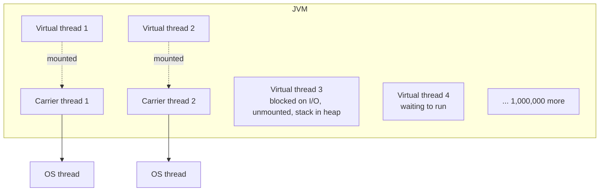
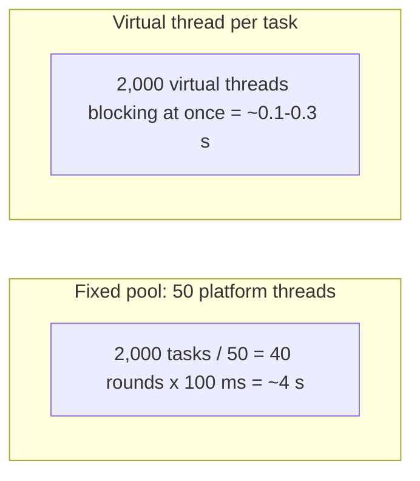
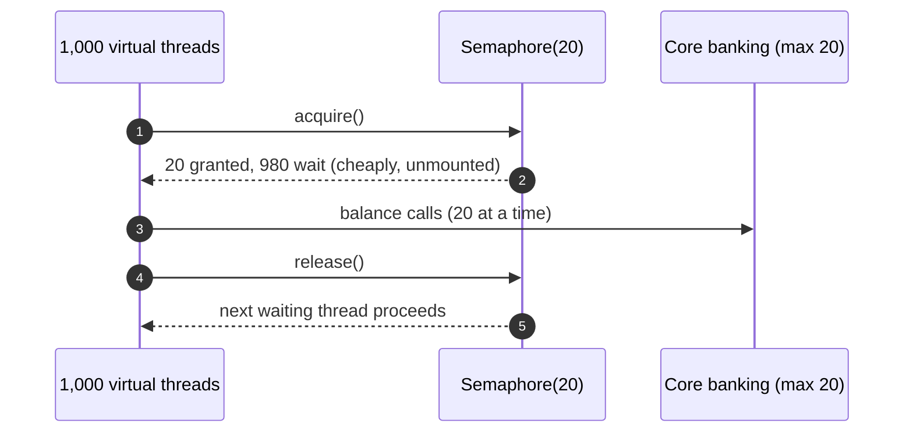
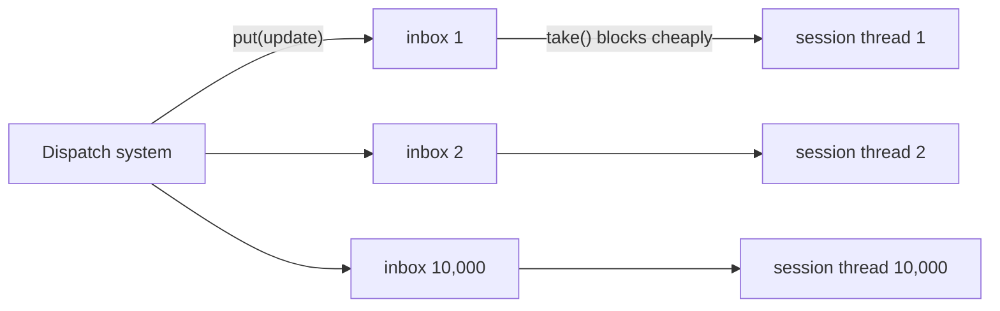

---
tags:
  - Concurrency
  - Intermediate
---

# Virtual Threads

<span class="badge badge--intermediate">🟡 Intermediate → 🔴 Advanced</span>
<span class="badge badge--category">Concurrency</span>
<span class="badge badge--interview">Interview frequency ⭐⭐⭐⭐⭐</span>

!!! abstract "TL;DR"
    **Virtual threads (Java 21, Project Loom) are lightweight threads managed by the JVM. You can have millions, and blocking one costs almost nothing.**
    Write simple **thread-per-task, blocking** code for I/O-heavy workloads and get the scalability of async code. Limit **scarce resources** (connections, downstream calls) with semaphores and pools, not by limiting threads.

---

## 1. Intent & Problem It Solves

**The problem in plain English:** a checkout page checks delivery availability for 2,000 pincodes, each a 100 ms network call. With a pool of 50 platform threads, that's 40 rounds of 100 ms, about **4 seconds**, while the CPU sits idle because threads are just waiting on the network. You could rewrite everything with `CompletableFuture` or reactive streams, but that code is harder to read, debug and profile. Virtual threads let blocking code scale: each call gets its own cheap thread, and the whole batch finishes in roughly **100 ms**.

**Definition (JEP 444, final in Java 21):**
> Virtual threads are lightweight threads that dramatically reduce the effort of writing, maintaining, and observing high-throughput concurrent applications. When a virtual thread blocks on I/O, the JVM **unmounts** it from its **carrier** (platform) thread, which immediately runs another virtual thread.

## 2. Real-World Analogy

!!! example "Restaurant waiters and order tickets"
    Platform threads are like waiters who stand at the kitchen window waiting for each dish: you can only serve as many tables as you have waiters. Virtual threads are like order **tickets**: a few waiters (carrier threads) handle thousands of tickets, picking up whichever dish is ready. Waiting costs nothing because a ticket, not a person, does the waiting.

## 3. Structure



| Concept | Meaning |
|---|---|
| **Virtual thread** | A `java.lang.Thread` scheduled by the JVM; its stack lives on the heap and grows as needed |
| **Carrier thread** | A platform thread (from a `ForkJoinPool`, about one per core) that runs virtual threads |
| **Mount / unmount** | Blocking I/O, `sleep`, `BlockingQueue.take`, locks: the virtual thread is unmounted, freeing the carrier |
| **Pinning** | A virtual thread that can't unmount (inside `synchronized` before JDK 24, or native frames), which blocks its carrier |

**Creating them:**

```java
Thread.ofVirtual().name("worker-", 0).start(task);          // one thread
Thread.startVirtualThread(task);                           // shortcut
try (var ex = Executors.newVirtualThreadPerTaskExecutor()) { ex.submit(task); }  // one per task
```

## 4. Naive Approach (Without the Pattern)

```java
ExecutorService pool = Executors.newFixedThreadPool(50);   // 50 threads mostly waiting on the network
// to go faster: 2,000 platform threads? ~2 GB of stacks, heavy context switching.
// or rewrite everything as CompletableFuture/reactive chains: hard to read and debug.
```

- :material-close-circle:{ style="color:#e53935" } **Thread pools cap throughput** for I/O-bound work (Little's Law: concurrency = throughput × latency).
- :material-close-circle:{ style="color:#e53935" } **Huge platform-thread pools** waste memory and CPU on context switches.
- :material-close-circle:{ style="color:#e53935" } **Async rewrites** fragment stack traces and complicate error handling.

---

## 5. Three Real-World Examples

### Example 1: Availability Fan-Out (E-commerce)

**Scenario:** A seller dashboard checks whether 2,000 pincodes are serviceable by calling an availability service (100 ms per call). The current implementation uses a fixed pool of 50 platform threads. Switching to virtual threads changes **one line** and the same blocking code finishes about 25× faster. Results must be identical.

**Design:**



**Full Code:**

=== "AvailabilityDemo.java"

    ```java
    --8<-- "code/concurrency/src/main/java/com/handbook/concurrency/virtualthreads/fanout/AvailabilityDemo.java"
    ```

    1.  `ExecutorService` is `AutoCloseable` (Java 19+): leaving the `try` waits for all submitted tasks.
    2.  50 platform threads: at most 50 calls in flight.
    3.  One virtual thread per task: all 2,000 calls in flight at once. **Same task code.**

**Output:**

```text
--8<-- "code/outputs/concurrency/virtualthreads/fanout/AvailabilityDemo.txt"
```

(Timing results are printed as true/false checks so the output is stable across machines.)

**Why virtual threads here:**

- **I/O-bound** work: threads spend almost all their time waiting.
- The code stays **blocking and simple**; only the executor changes.
- Throughput is bounded by the remote service, not by an artificial thread count.

---

### Example 2: Protecting the Core Banking System (Banking) — *Semaphore*

**Scenario:** A mobile banking backend serves 1,000 concurrent balance requests on virtual threads. The **core banking system** (a mainframe) accepts at most **20** concurrent connections from this service. With platform-thread pools, the pool size used to be the limit by accident; with virtual threads, there is no natural limit, so the limit must be **explicit**: a `Semaphore` with 20 permits.

**Design:**



**Full Code:**

=== "CoreBankingDemo.java"

    ```java
    --8<-- "code/concurrency/src/main/java/com/handbook/concurrency/virtualthreads/semaphore/CoreBankingDemo.java"
    ```

    1.  The **resource** limit, made explicit. With virtual threads, "limit concurrency" means semaphores, connection pools and bulkheads around the scarce thing.
    2.  Waiting on a semaphore **unmounts** the virtual thread, so 980 waiting threads cost a few KB each, not 980 MB.

**Output:**

```text
--8<-- "code/outputs/concurrency/virtualthreads/semaphore/CoreBankingDemo.txt"
```

**Why virtual threads + semaphore here:**

- **Many cheap threads** for requests, **few permits** for the fragile downstream.
- Back-pressure is explicit and easy to tune.
- The same idea applies to JDBC: the connection pool (e.g. HikariCP with 20 connections) is the real limit.

---

### Example 3: 10,000 Live Tracking Sessions (Logistics)

**Scenario:** During the evening peak, 10,000 customers watch their delivery on a tracking page. Each session waits for the next status update. With one **virtual** thread per session blocked on its own queue, the code is a simple loop ("wait for update, push it"), with no callbacks, and the JVM holds 10,000 blocked threads at negligible cost.

**Design:**



**Full Code:**

=== "TrackingSessionsDemo.java"

    ```java
    --8<-- "code/concurrency/src/main/java/com/handbook/concurrency/virtualthreads/sessions/TrackingSessionsDemo.java"
    ```

    1.  A **blocking** `take()` in 10,000 threads at once. With platform threads that's around 10 GB of reserved stack; with virtual threads it's a few MB of heap.

**Output:**

```text
--8<-- "code/outputs/concurrency/virtualthreads/sessions/TrackingSessionsDemo.txt"
```

**Why virtual threads here:**

- **Massive concurrency** of mostly idle, waiting tasks.
- **Sequential, readable** per-session logic instead of callback state machines.
- Plays well with blocking APIs (`BlockingQueue`, sockets, JDBC).

---

??? example "Unit Tests: `VirtualThreadsTest.java`"

    ```java
    --8<-- "code/concurrency/src/test/java/com/handbook/concurrency/virtualthreads/VirtualThreadsTest.java"
    ```

## 6. Variations & Modern Java Take

| Feature | Status | Notes |
|---|---|---|
| Virtual threads | **Final in Java 21** | `Thread.ofVirtual()`, `Executors.newVirtualThreadPerTaskExecutor()` |
| `synchronized` pinning fixed | **JDK 24** (JEP 491) | Before 24, blocking inside `synchronized` pins the carrier; prefer `ReentrantLock` on 21–23 |
| Structured concurrency | Preview (JDK 21–25) | `StructuredTaskScope`: fork subtasks, cancel siblings on failure, join as a unit |
| Scoped values | Preview (JDK 21–24), final in JDK 25 | Immutable, inheritable context (a `ThreadLocal` replacement for virtual threads) |
| Spring Boot 3.2+ | `spring.threads.virtual.enabled=true` | Tomcat/Jetty request handling and `@Async` on virtual threads |

**When NOT to use virtual threads:** CPU-bound work (no benefit, use a pool sized to cores), code that relies heavily on `ThreadLocal` caches (each virtual thread gets its own, so millions of copies), and long blocking inside `synchronized` on JDK 21–23 (pinning).

## 7. Where It Lives in Real Frameworks

| Where | Support |
|---|---|
| Spring Boot 3.2+ | `spring.threads.virtual.enabled=true` for web servers, `@Async`, schedulers, Kafka/Rabbit listeners |
| Tomcat / Jetty / Undertow / Helidon Níma | Virtual-thread request handling (Helidon 4 is built on them) |
| Quarkus | `@RunOnVirtualThread` |
| JDBC drivers | Work unchanged; recent versions replaced `synchronized` to avoid pinning |
| `java.net.http.HttpClient`, sockets, `BlockingQueue`, `ReentrantLock` | Virtual-thread friendly (unmount on block) |

## 8. Pros, Cons & Trade-offs

| ✅ Pros | ❌ Cons |
|---|---|
| **Millions** of threads; blocking is cheap | No speed-up for **CPU-bound** work |
| **Simple blocking code** with real stack traces | **Pinning** (JDK 21–23 `synchronized`, native calls) can block carriers |
| One-line migration from pools in many cases | Unlimited concurrency can **overwhelm downstreams**: add explicit limits |
| Great observability (`jcmd Thread.dump_to_file` shows virtual threads) | `ThreadLocal`-heavy libraries can use lots of memory |
| Works with existing APIs | Pooling virtual threads is an anti-pattern (they're meant to be disposable) |

## 9. Pitfalls & Anti-Patterns

!!! danger "Removing the only limit on a fragile downstream"
    A pool of 200 platform threads was an accidental cap on database load. With virtual threads, 10,000 requests can hit the database at once. **Add explicit limits**: connection pools, semaphores, bulkheads (Example 2).

!!! danger "Pinning on JDK 21–23"
    Blocking I/O inside `synchronized` keeps the carrier thread busy. With few carriers (one per core), a handful of pinned threads can stall the whole application. Use `ReentrantLock`, upgrade to JDK 24+, and detect with `-Djdk.tracePinnedThreads=full` (JDK 21–23) or JFR's `jdk.VirtualThreadPinned` event.

!!! warning "Pooling virtual threads"
    `Executors.newFixedThreadPool(100, Thread.ofVirtual().factory())` brings back the limits virtual threads were meant to remove. Create one per task; limit resources instead.

!!! warning "ThreadLocal caches"
    Libraries that cache expensive objects in `ThreadLocal` (formatters, buffers) assumed few long-lived threads. With a million short-lived virtual threads, those caches are recreated constantly and multiplied. Use shared thread-safe objects or `ScopedValue`.

## 10. Senior / Architect Deep Dive (10–15 yrs)

**Little's Law, revisited.** Concurrency needed = throughput × latency. At 5,000 requests/s with 200 ms of I/O wait each, you need about 1,000 concurrent requests. Platform threads make that expensive; virtual threads make it trivial. The bottleneck moves to **downstream capacity**, which you must now manage explicitly (pools, semaphores, rate limiters, circuit breakers).

**Migration strategy.** (1) Upgrade to a recent JDK (24+ removes most pinning concerns). (2) Enable virtual threads in the web server. (3) Find and size **resource limits** (DB pool, HTTP client connection pool, semaphores per downstream). (4) Watch for pinning and `ThreadLocal` memory with JFR. (5) Load test; compare p99 latency and throughput against the old pools.

**Virtual threads vs. reactive.** Reactive stacks (WebFlux, Reactor) solved the same scalability problem with non-blocking I/O and back-pressure. With virtual threads, most request/response services can go back to blocking, imperative code. Reactive still makes sense for **streaming** with back-pressure and for teams already invested in it.

!!! bug "War story: virtual threads and the database meltdown"
    A team enabled virtual threads in a Spring Boot service and celebrated the load test: 6× throughput. In production, the first traffic spike opened 4,000 concurrent queries against Postgres. The old Tomcat pool (200 threads) had silently limited database concurrency; virtual threads removed that limit. The HikariCP pool was set to 500 connections "to be safe", so the database hit `max_connections` and started refusing everyone.
    **Fix:** HikariCP sized to what the database can handle (40 connections per pod, with a short connection timeout), a semaphore bulkhead around a heavy reporting query, and load tests against a production-sized database.
    **Lesson:** virtual threads remove the thread limit, so every other limit must now be deliberate.

## 11. Related Patterns & Comparisons

| | Virtual threads | Thread pool (platform) | `CompletableFuture` / reactive |
|---|---|---|---|
| Programming style | Blocking, sequential | Blocking, sequential | Callbacks / operators |
| Scales for I/O waits | ✅ millions | ❌ limited by pool size | ✅ |
| CPU-bound work | No benefit | ✅ sized to cores | No benefit |
| Debugging | Normal stack traces | Normal stack traces | Fragmented traces |
| Concurrency limit | Must be explicit (semaphores, pools) | Pool size | Operators / back-pressure |

## 12. Interview Corner

=== "🟢 Beginner / Service Companies"

    **Q1. What are virtual threads?**

    Lightweight threads managed by the JVM (Java 21). They're cheap to create and block, so you can run **millions** of concurrent tasks with simple blocking code.

    **Q2. How do you create one?**

    `Thread.ofVirtual().start(task)`, `Thread.startVirtualThread(task)`, or `Executors.newVirtualThreadPerTaskExecutor()`.

    **Q3. Virtual vs. platform threads?**

    Platform threads map 1:1 to OS threads (expensive, about 1 MB stack). Virtual threads are scheduled by the JVM on a few **carrier** threads and store their stacks on the heap.

    **Q4. Do virtual threads make code run faster?**

    Not faster per task. They increase **throughput** for **I/O-bound** workloads by letting many more tasks wait concurrently. CPU-bound work doesn't benefit.

    **Q5. Should you pool virtual threads?**

    **No.** Create one per task. Limit **resources** (connections, permits) instead.

=== "🟡 Mid-Level"

    **Q1. What is pinning?**

    When a virtual thread **can't unmount** from its carrier while blocking: inside `synchronized` (before JDK 24) or during native calls. It ties up a carrier and can reduce throughput or even deadlock.

    **Q2. How do you limit concurrency with virtual threads?**

    `Semaphore` permits, bounded connection pools, Resilience4j bulkheads and rate limiters, all around the **scarce resource**.

    **Q3. How do you enable virtual threads in Spring Boot?**

    `spring.threads.virtual.enabled=true` (Boot 3.2+, Java 21+).

    **Q4. What happens to `ThreadLocal` with virtual threads?**

    It works, but each virtual thread has its own copy; with millions of threads, `ThreadLocal` caches multiply memory. Prefer `ScopedValue` or shared objects.

    **Q5. How do you detect pinning?**

    JFR event `jdk.VirtualThreadPinned`, or `-Djdk.tracePinnedThreads=full` on JDK 21–23.

=== "🔴 Senior / FAANG / SAP"

    **Q1. "Migrate a high-traffic Spring service from Tomcat's 200-thread pool to virtual threads. Plan and risks?"**

    Upgrade JDK (24+ ideally), enable virtual threads, inventory **implicit limits** the pool provided, size DB/HTTP pools and add semaphores per downstream, scan for pinning and `ThreadLocal` usage, load test with production-like downstreams, roll out gradually with p99 and error-rate monitoring.

    **Q2. "Virtual threads vs. WebFlux for a new service?"**

    Virtual threads for request/response with blocking libraries (simpler code and debugging); WebFlux for streaming with back-pressure or an existing reactive ecosystem. Both need explicit downstream limits.

    **Q3. "What is structured concurrency and why does it matter?"**

    `StructuredTaskScope` treats related subtasks as a unit: fork, join, cancel siblings on failure, and propagate errors, so no orphaned threads and clear lifetimes. It's the natural companion to virtual threads.

    **Q4. "A service on JDK 21 with virtual threads hangs under load. What do you check?"**

    **Pinning** (`synchronized` around blocking I/O in your code or libraries), exhausted resource pools (connections), deadlocks, carrier saturation by CPU-heavy tasks; collect a thread dump (`jcmd <pid> Thread.dump_to_file -format=json`) and JFR.

    **Q5. "Do virtual threads change how you size HikariCP?"**

    No. The database's capacity does. Size the pool to what the database can serve (often 10–50 per instance), use a short connection timeout, and let virtual threads wait cheaply for connections.

=== "💻 Coding Challenge"

    **Problem:** A profile page needs the user, their recent orders and recommendations. Recommendations are optional and sometimes very slow. Write it with **plain blocking code on virtual threads**: run the three calls in parallel, give recommendations 200 ms, fall back to trending titles and **cancel** the slow call.

    ??? success "Solution"

        === "ProfilePageDemo.java"

            ```java
            --8<-- "code/concurrency/src/main/java/com/handbook/concurrency/virtualthreads/blocking/ProfilePageDemo.java"
            ```

        **Output:**

        ```text
        --8<-- "code/outputs/concurrency/virtualthreads/blocking/ProfilePageDemo.txt"
        ```

        **Key points to say:** `submit` + `Future.get(timeout)` replaces `CompletableFuture` chains; `cancel(true)` **interrupts** the virtual thread, so the slow call actually stops (unlike `completeOnTimeout`); exceptions surface as normal `ExecutionException`s with readable stack traces. With structured concurrency, the scope would also cancel siblings automatically on failure.

!!! info "Behavioural tie-in (STAR) for experienced candidates"
    - **S:** Our order API needed 3× more throughput; it spent 80% of request time waiting on downstream calls.
    - **T:** Scale without a reactive rewrite.
    - **A:** Upgraded to Java 21, enabled virtual threads, replaced `synchronized` in hot I/O paths with `ReentrantLock`, added semaphores per downstream and right-sized HikariCP, and load-tested against production-sized dependencies.
    - **R:** Throughput went up 4.2× on the same hardware with unchanged business code; p99 improved 35%; no database overload thanks to the explicit limits.

## 13. Quick Revision Card

!!! tip "Remember in 30 seconds"
    - **Cheap JVM-managed threads** (Java 21): one per task, blocking is fine.
    - Great for **I/O-bound** concurrency; **no benefit** for CPU-bound work.
    - **Limit resources, not threads**: semaphores, connection pools, bulkheads.
    - Watch **pinning** (`synchronized` on JDK 21–23) and **`ThreadLocal`** memory.
    - Don't pool them. Spring Boot: `spring.threads.virtual.enabled=true`.

    ```java
    try (var ex = Executors.newVirtualThreadPerTaskExecutor()) { for (var t : tasks) ex.submit(t); }
    ```

## Practice

- [ ] Add a JDBC-style connection pool (an `ArrayBlockingQueue` of 10 fake connections) to the banking example instead of a semaphore.
- [ ] Reproduce pinning on JDK 21 with `synchronized` + `Thread.sleep` and observe it with `-Djdk.tracePinnedThreads=full`.
- [ ] Rewrite `ProfilePageDemo` with `StructuredTaskScope` (enable preview features).

---

[:material-arrow-left: Double-Checked Locking](double-checked-locking.md){ .md-button }
[Next: Microservices :material-arrow-right:](../microservices/index.md){ .md-button .md-button--primary }
