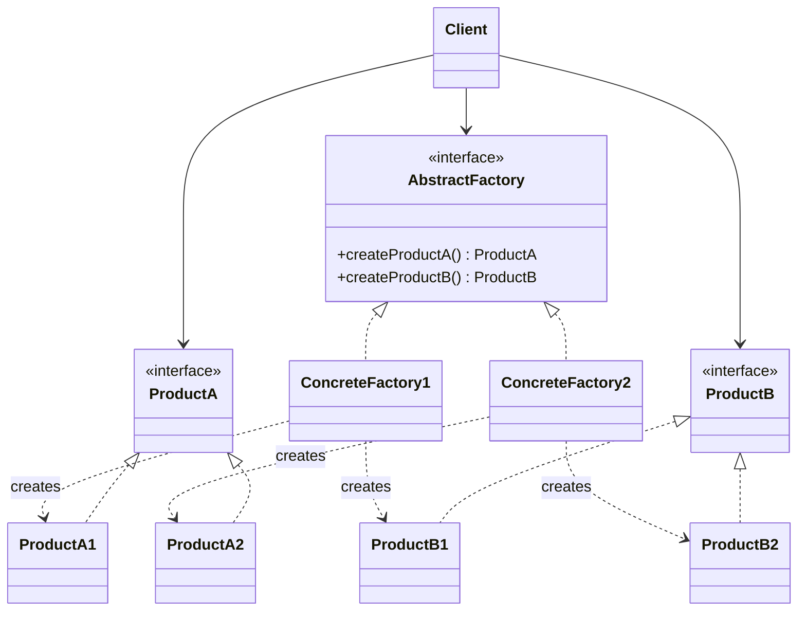
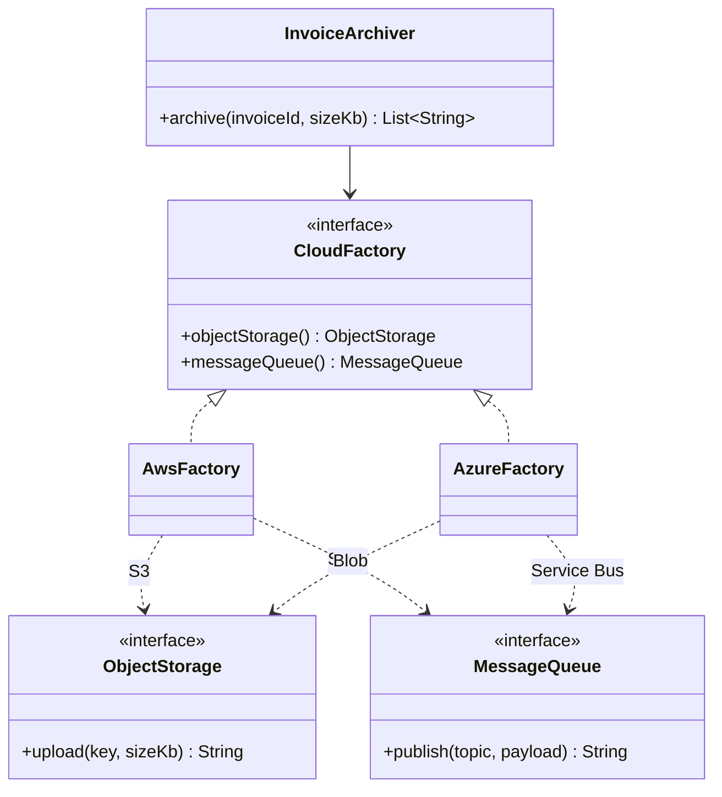
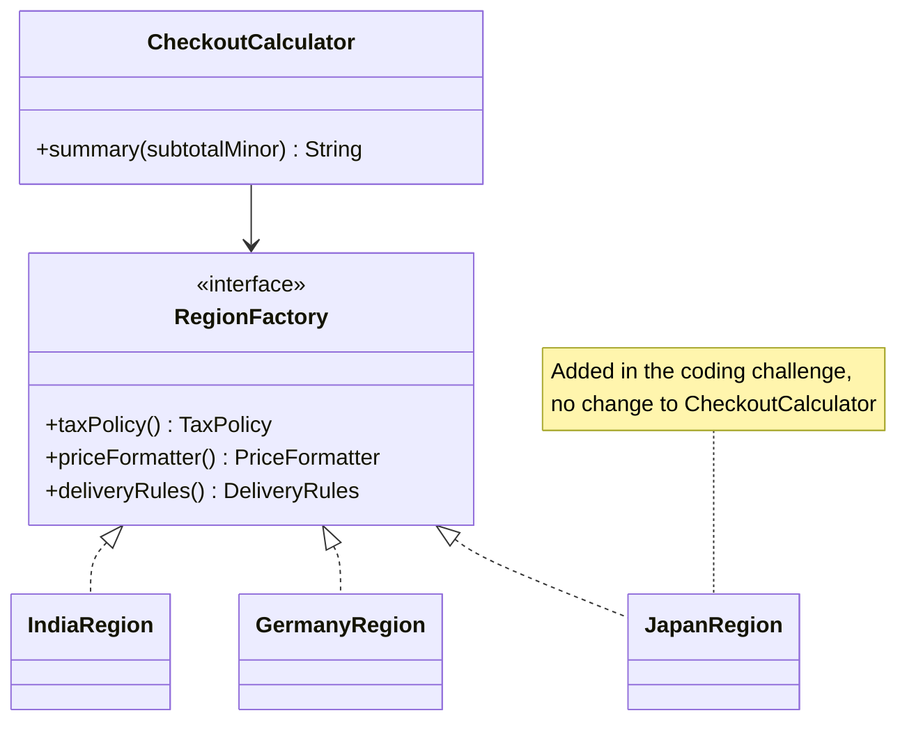
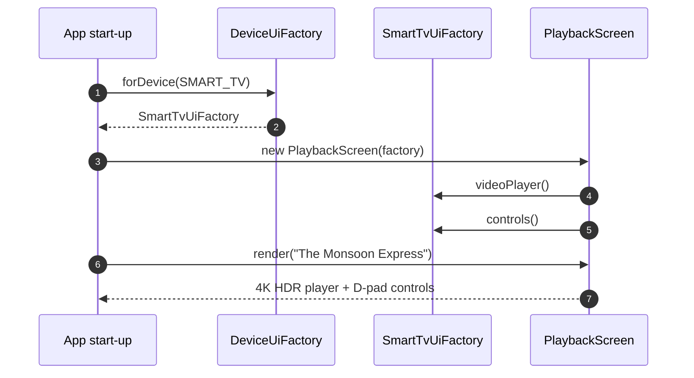

---
tags:
  - Creational
  - Intermediate
---

# Abstract Factory

<span class="badge badge--intermediate">🟡 Intermediate</span>
<span class="badge badge--category">Creational</span>
<span class="badge badge--interview">Interview frequency ⭐⭐⭐⭐</span>

!!! abstract "TL;DR"
    **Abstract Factory creates whole *families* of related objects that are designed to work together, without naming their concrete classes.**
    Use it when several objects must always match (same cloud, same country, same device) and you want to switch the whole family by changing one object.

---

## 1. Intent & Problem It Solves

**The problem in plain English:** a grocery checkout needs a tax policy, a price formatter and delivery rules. In India that's GST, `INR 182.50` and 10-minute delivery. In Germany it's VAT (MwSt), `53,50 EUR` and a 2-hour slot. If each piece is chosen separately, sooner or later someone combines **German tax with Indian formatting**, and customers see wrong prices.

**Formal definition (GoF):**
> Provide an interface for creating families of related or dependent objects without specifying their concrete classes.

The key word is **families**. Factory Method answers "which class?" for **one** product. Abstract Factory answers "which **family**?" for **several** products at once, and guarantees they're consistent.

## 2. Real-World Analogy

!!! example "IKEA furniture collections"
    You furnish a room from **one collection**, say "Scandinavian Oak". You ask for a chair, a table and a sofa, and they all match. Switch to the "Industrial Metal" collection and you get a different chair, table and sofa that match **each other**. You never end up with an oak chair next to a metal table, because you choose the collection once, not each item.

## 3. Structure



| Participant | Responsibility |
|---|---|
| **AbstractFactory** | Interface with **one creation method per product** in the family |
| **ConcreteFactory** | Implements all creation methods for **one family** (AWS, India, Smart TV) |
| **AbstractProduct** | Interface for each kind of product (`ObjectStorage`, `TaxPolicy`) |
| **ConcreteProduct** | One family's version of a product (S3 storage, GST policy) |
| **Client** | Uses only the abstract factory and abstract products |

## 4. Naive Approach (Without the Pattern)

```java
public class CheckoutCalculator {
    public String summary(String country, long subtotal) {
        long tax;
        if (country.equals("IN")) tax = subtotal * 5 / 100;
        else if (country.equals("DE")) tax = subtotal * 7 / 100;
        else throw new IllegalArgumentException(country);

        long fee;
        if (country.equals("IN")) fee = subtotal >= 19900 ? 0 : 2500;
        else fee = subtotal >= 4000 ? 0 : 299;

        String total;
        if (country.equals("IN")) total = "INR " + ...;
        else total = ... + " EUR";
        // ...and the same country checks again in invoices, emails, receipts
    }
}
```

**What goes wrong:**

- :material-close-circle:{ style="color:#e53935" } **Scattered `if (country)` checks.** Launching Japan means finding and editing every one of them.
- :material-close-circle:{ style="color:#e53935" } **Inconsistent families.** Nothing stops one check from saying "IN" while another falls through to the German branch.
- :material-close-circle:{ style="color:#e53935" } **Untestable.** You can't test the checkout without real tax rules.

---

## 5. Three Real-World Examples

### Example 1: Multi-Cloud Invoice Archiving (SaaS / ERP)

**Scenario:** A SaaS ERP vendor (think SAP-style business software) sells to enterprises that each insist on their own cloud. Retail customers run on AWS; a pharma customer has an Azure-only policy. When an invoice is finalized, the ERP stores the PDF and publishes an "invoice archived" event for downstream systems. Mixing clouds (storing on S3 but notifying via Azure Service Bus) would break data-residency contracts, so **storage and messaging must always come from the same cloud**. The cloud is chosen once per tenant, from configuration.

**Design:**



**Full Code:**

=== "CloudFactory.java"

    ```java
    --8<-- "code/creational/src/main/java/com/handbook/creational/abstractfactory/cloud/CloudFactory.java"
    ```

=== "AwsFactory.java"

    ```java
    --8<-- "code/creational/src/main/java/com/handbook/creational/abstractfactory/cloud/AwsFactory.java"
    ```

=== "AzureFactory.java"

    ```java
    --8<-- "code/creational/src/main/java/com/handbook/creational/abstractfactory/cloud/AzureFactory.java"
    ```

=== "InvoiceArchiver.java"

    ```java
    --8<-- "code/creational/src/main/java/com/handbook/creational/abstractfactory/cloud/InvoiceArchiver.java"
    ```

    1.  The client receives **one** object and pulls **every** product from it. Because there's a single source, the storage and the queue can't come from different clouds.

=== "Products"

    ```java
    --8<-- "code/creational/src/main/java/com/handbook/creational/abstractfactory/cloud/ObjectStorage.java"
    ```

    ```java
    --8<-- "code/creational/src/main/java/com/handbook/creational/abstractfactory/cloud/MessageQueue.java"
    ```

    The products are functional interfaces, so the factories return lambdas. In production each would be a real class wrapping the AWS or Azure SDK client.

=== "MultiCloudDemo.java"

    ```java
    --8<-- "code/creational/src/main/java/com/handbook/creational/abstractfactory/cloud/MultiCloudDemo.java"
    ```

**Output:**

```text
--8<-- "code/outputs/creational/abstractfactory/cloud/MultiCloudDemo.txt"
```

The same `InvoiceArchiver` code ran twice. Each tenant's storage **and** messaging came from its own cloud.

**Why Abstract Factory here:**

- Two (and soon more: secrets, key management, CDN) products that **must belong to the same provider**.
- The cloud is **chosen once per tenant**; business code is cloud-agnostic.
- Adding GCP means **one new factory class**, not edits across the ERP.
- Tests can pass an **in-memory family** (see the unit test) with no cloud SDK at all.

??? example "Unit Test: `InvoiceArchiverTest.java`"

    ```java
    --8<-- "code/creational/src/test/java/com/handbook/creational/abstractfactory/InvoiceArchiverTest.java"
    ```

---

### Example 2: Country-Specific Checkout (Grocery Delivery)

**Scenario:** A quick-commerce grocery company is expanding from India to Germany, with Japan next. Three things vary by country and must stay **consistent with each other**: the **tax** (GST 5% vs. the 7% reduced VAT rate for food), the **price format** (`INR 182.50` vs. `53,50 EUR`) and the **delivery rules** (minimum order, small-order fee, delivery promise). The checkout, receipt and email code must contain **zero** country checks, so a new country is a one-team change.

**Design:**



**Full Code:**

=== "RegionFactory.java"

    ```java
    --8<-- "code/creational/src/main/java/com/handbook/creational/abstractfactory/region/RegionFactory.java"
    ```

=== "IndiaRegion.java"

    ```java
    --8<-- "code/creational/src/main/java/com/handbook/creational/abstractfactory/region/IndiaRegion.java"
    ```

=== "GermanyRegion.java"

    ```java
    --8<-- "code/creational/src/main/java/com/handbook/creational/abstractfactory/region/GermanyRegion.java"
    ```

=== "CheckoutCalculator.java"

    ```java
    --8<-- "code/creational/src/main/java/com/handbook/creational/abstractfactory/region/CheckoutCalculator.java"
    ```

    1.  All three products come from the **same** `region` object, so tax, formatting and delivery rules always belong to the same country.

=== "Products"

    ```java
    --8<-- "code/creational/src/main/java/com/handbook/creational/abstractfactory/region/TaxPolicy.java"
    ```

    ```java
    --8<-- "code/creational/src/main/java/com/handbook/creational/abstractfactory/region/PriceFormatter.java"
    ```

    ```java
    --8<-- "code/creational/src/main/java/com/handbook/creational/abstractfactory/region/DeliveryRules.java"
    ```

=== "RegionDemo.java"

    ```java
    --8<-- "code/creational/src/main/java/com/handbook/creational/abstractfactory/region/RegionDemo.java"
    ```

**Output:**

```text
--8<-- "code/outputs/creational/abstractfactory/region/RegionDemo.txt"
```

!!! note "Money is stored in minor units"
    Amounts are `long` paise or cents, never `double`. `0.1 + 0.2 != 0.3` in floating point, and rounding errors in tax are a compliance problem. In a real system use `BigDecimal` or a money library (JSR 354 / Moneta) and the country's legal rounding rule.

**Why Abstract Factory here:**

- Tax, formatting and delivery rules form a **family that must match**.
- `CheckoutCalculator` has **no country logic**; launching a country is **one new class**, as the coding challenge proves with Japan.
- The country is decided **once** (from the user's store or domain) and flows everywhere.

??? example "Unit Test: `CheckoutCalculatorTest.java`"

    ```java
    --8<-- "code/creational/src/test/java/com/handbook/creational/abstractfactory/CheckoutCalculatorTest.java"
    ```

---

### Example 3: Device-Specific Playback (Streaming)

**Scenario:** A video streaming service (Netflix/Prime-style) ships the same app logic to phones and smart TVs. Each device needs a **video player** tuned for it (720p adaptive bitrate on mobile networks vs. 4K HDR on TV) and a **control scheme** that fits the hardware (touch gestures vs. a remote's D-pad). A TV player with touch controls would be unusable, so the player and controls must **always come as a pair**. The device type is detected once at app start.

**Design:**



**Full Code:**

=== "DeviceUiFactory.java"

    ```java
    --8<-- "code/creational/src/main/java/com/handbook/creational/abstractfactory/streaming/DeviceUiFactory.java"
    ```

    1.  A **Factory Method that returns an Abstract Factory**. This is very common: one static method picks the family; the family then creates the products.

=== "MobileUiFactory.java"

    ```java
    --8<-- "code/creational/src/main/java/com/handbook/creational/abstractfactory/streaming/MobileUiFactory.java"
    ```

=== "SmartTvUiFactory.java"

    ```java
    --8<-- "code/creational/src/main/java/com/handbook/creational/abstractfactory/streaming/SmartTvUiFactory.java"
    ```

=== "PlaybackScreen.java"

    ```java
    --8<-- "code/creational/src/main/java/com/handbook/creational/abstractfactory/streaming/PlaybackScreen.java"
    ```

=== "Products"

    ```java
    --8<-- "code/creational/src/main/java/com/handbook/creational/abstractfactory/streaming/VideoPlayer.java"
    ```

    ```java
    --8<-- "code/creational/src/main/java/com/handbook/creational/abstractfactory/streaming/ControlScheme.java"
    ```

    ```java
    --8<-- "code/creational/src/main/java/com/handbook/creational/abstractfactory/streaming/DeviceType.java"
    ```

=== "StreamingDemo.java"

    ```java
    --8<-- "code/creational/src/main/java/com/handbook/creational/abstractfactory/streaming/StreamingDemo.java"
    ```

**Output:**

```text
--8<-- "code/outputs/creational/abstractfactory/streaming/StreamingDemo.txt"
```

**Why Abstract Factory here:**

- The player and controls are a **matched pair** per device.
- `PlaybackScreen` is **written once** and works for every device, including future ones (tablet, car display).
- This is the classic GoF motivating example (cross-platform widget toolkits), in a modern setting.

??? example "Unit Test: `DeviceUiFactoryTest.java`"

    ```java
    --8<-- "code/creational/src/test/java/com/handbook/creational/abstractfactory/DeviceUiFactoryTest.java"
    ```

---

## 6. Variations & Modern Java Take

**Lambdas as products.** When a product interface has a single method, the factory can return lambdas (all three examples do). That cuts the "class explosion" this pattern is criticized for. Promote to real classes once a product has state or several methods.

**Records as factories.** If a family is just data plus small behaviors, a record can be the factory:

```java
record Region(TaxPolicy taxPolicy, PriceFormatter priceFormatter, DeliveryRules deliveryRules) {}

Region india = new Region(new GstPolicy(), paise -> "INR " + ..., new QuickCommerceRules());
```

**Choosing the family:**

| Mechanism | Example |
|---|---|
| Static method | `DeviceUiFactory.forDevice(type)` (Example 3) |
| Map lookup per tenant | `Map<String, CloudFactory>` (Example 1) |
| Spring profiles | `@Profile("aws") @Configuration class AwsConfig { @Bean ObjectStorage ...; @Bean MessageQueue ...; }` |
| Spring Boot auto-configuration | `@ConditionalOnProperty(name = "cloud.provider", havingValue = "azure")` |
| `ServiceLoader` | Each family ships as a plug-in JAR |

!!! tip "Spring `@Configuration` *is* an Abstract Factory"
    A `@Configuration` class with several `@Bean` methods, switched on by `@Profile` or `@ConditionalOnProperty`, creates a consistent family of beans. Spring Boot's auto-configuration for `DataSource`, `JdbcTemplate` and `TransactionManager` works this way.

## 7. Where It Lives in Real Frameworks

| Where | Example | Family |
|---|---|---|
| JDK | `javax.xml.parsers.DocumentBuilderFactory`, `TransformerFactory`, `XPathFactory` | XML implementation (Xerces, Saxon) |
| JDK | `java.sql.Connection` | Creates a matched `Statement`, `PreparedStatement`, `CallableStatement` for one driver |
| JDK | `javax.swing.UIManager` + LookAndFeel | Matching widgets per look-and-feel (the classic GoF example) |
| JDK | `java.nio.file.FileSystem` | `Path`, `PathMatcher`, `WatchService` for the default disk, a ZIP file system, etc. |
| Spring | `@Configuration` + `@Profile` | Beans per environment |
| JPA | `EntityManagerFactory` | `EntityManager`, `CriteriaBuilder`, `Metamodel` for one persistence unit |
| AWS / Azure SDKs | Client builders per region/credentials | Clients configured consistently |

## 8. Pros, Cons & Trade-offs

| ✅ Pros | ❌ Cons |
|---|---|
| **Guarantees consistency**: products from one family always match | **Adding a new *product type*** (e.g. `SecretsManager`) means changing the interface **and every factory** |
| Swap the **entire family** by changing one object | **Many classes and interfaces**; heavy for small problems |
| Client code free of `if (provider)` / `if (country)` | Extra indirection to trace when debugging |
| New family = **one new class** (OCP for families) | Pointless if you only ever have one family |
| Easy **in-memory test families** | Family members can drift if teams own them separately; needs contract tests |

!!! question "The asymmetry interviewers love"
    Abstract Factory makes adding **families** easy (new `JapanRegion`) and adding **product types** hard (new method on `RegionFactory` means touching every region). If you expect more product types than families, reconsider. Default methods on the interface can soften the blow.

## 9. Pitfalls & Anti-Patterns

!!! danger "Mixing families behind the factory's back"
    `new CheckoutCalculator(region)` plus a hard-coded `new GstPolicy()` somewhere else defeats the whole pattern. Code review rule: **products of the family are only obtained from the factory**.

!!! danger "Choosing the family per call"
    `cloudFor(tenant).objectStorage()` and later `cloudFor(otherTenantVar).messageQueue()` in the same flow can mix families. Resolve the family **once** at the edge (request filter, tenant context) and pass it in.

!!! warning "Abstract Factory for a single family"
    If there's only `AwsFactory` and no real plan for another, you've added interfaces for nothing. Start with concrete classes; extract the interfaces when the second family arrives.

!!! warning "Fat factory interfaces"
    A factory with 15 creation methods is usually several families glued together. Split it by bounded context (storage family, messaging family, security family).

## 10. Senior / Architect Deep Dive (10–15 yrs)

**Abstract Factory is a hexagonal-architecture tool.** In Ports & Adapters, the *ports* are your product interfaces (`ObjectStorage`, `MessageQueue`) and each *adapter family* (AWS, Azure, in-memory) is a concrete factory. Domain code depends only on ports. That's how you get:

- **Cloud portability** that is real, not theoretical: the domain compiles without any cloud SDK on the classpath.
- **Fast tests**: the in-memory family runs in milliseconds; a separate **contract test suite** runs the same assertions against every family (in-memory, LocalStack, Azurite) so they behave identically.

**Multi-tenancy.** In SaaS, the family is often chosen **per tenant**: store a `TenantContext` (from the JWT or subdomain) and resolve the factory once per request in a filter. Cache factories per tenant (each holds expensive SDK clients), and **evict on tenant config change**.

**Evolving the product set.** When you must add a product type to an established family:

1. Add the method to the interface as a `default` method that throws `UnsupportedOperationException` (or returns a no-op product).
2. Roll out implementations family by family behind a feature flag.
3. Remove the default once all families implement it, so the compiler enforces completeness again.

**Know when to stop.** Full multi-cloud abstraction has a cost: you can only use the **lowest common denominator** of features. Many teams pick one cloud and abstract only at a few strategic seams (storage, queues). Say this in a design review; it shows judgement.

!!! bug "War story: the cross-region data leak"
    A healthcare SaaS served EU and US customers. Storage clients were picked by tenant region, but the **audit-event publisher** was a global singleton bean pointing at a US queue. EU patient-access events (which contained patient IDs) flowed into US infrastructure for months, a GDPR data-residency breach found during an external audit.
    **Fix:** introduced a `RegionInfrastructureFactory` that creates storage, queue, cache and KMS clients **together** per region; banned direct injection of those clients through an ArchUnit rule; added a contract test asserting every product from a factory reports the same region.
    **Lesson:** when objects *must* match, don't let them be chosen independently. That's the whole reason Abstract Factory exists.

## 11. Related Patterns & Comparisons

| | Abstract Factory | Factory Method | Builder | Prototype |
|---|---|---|---|---|
| Creates | **A family** of products | **One** product | One complex product | Copies of an existing object |
| Main guarantee | Products **match** each other | The right **class** is picked | Valid, **fully built** object | Pre-configured **clone** |
| Extension point | New factory class (family) | New subclass / registration | New builder steps | New prototype instance |
| Structure | Object **composition** (pass the factory in) | Often **inheritance** (override `createX()`) | Fluent API | `copy()` / copy constructor |

**Often combined with:** Factory Method (each creation method *is* a factory method; Example 3 also uses a factory method to choose the factory), Singleton (one factory instance per family), Prototype (factories that clone pre-configured products), Facade (a facade built on top of one family).

## 12. Interview Corner

=== "🟢 Beginner / Service Companies"

    **Q1. What is the Abstract Factory pattern?**

    A creational pattern that provides an **interface for creating families of related objects** without specifying their concrete classes. The client picks a **concrete factory** once and gets **matching products** from it.

    **Q2. Difference between Factory Method and Abstract Factory?**

    **Factory Method** creates **one product** and usually relies on **inheritance** (a subclass overrides the creation method). **Abstract Factory** creates a **family of products** and relies on **composition** (you pass a factory object in). Abstract Factory is often built *from* several factory methods.

    **Q3. Give a real example.**

    A UI toolkit with `WindowsFactory` and `MacFactory`, each creating a matching `Button` and `Checkbox`. In the JDK: `DocumentBuilderFactory`, and `java.sql.Connection` creating statements for one driver.

    **Q4. What problem does it prevent?**

    **Mixing incompatible objects**, for example a Mac button with a Windows checkbox, or German tax with Indian currency formatting. Since every product comes from one factory, they are **consistent**.

    **Q5. What's the main drawback?**

    Adding a **new kind of product** means changing the abstract factory interface and **every** concrete factory. It also adds many classes.

=== "🟡 Mid-Level"

    **Q1. How do you choose which concrete factory to use?**

    Once, at the **edge** of the system: from configuration (Spring `@Profile`, `@ConditionalOnProperty`), from a request attribute (tenant, country, device), or with a static factory method like `DeviceUiFactory.forDevice(type)`. Then pass it in through **dependency injection**.

    **Q2. How would you test code that uses an Abstract Factory?**

    Create an **in-memory family** (a test factory returning fakes) and inject it, as in `InvoiceArchiverTest`. For the real families, write **contract tests**: the same test class run against each factory to prove they behave the same way.

    **Q3. How does Spring implement this pattern?**

    A `@Configuration` class with several `@Bean` methods is a concrete factory for a family; `@Profile` / `@Conditional` picks which configuration is active. Auto-configured `DataSource` + `JdbcTemplate` + `TransactionManager` is a real-world family.

    **Q4. Can you add a new product to the family without breaking all factories?**

    Yes, temporarily, with a **`default` method** on the factory interface (a no-op or an exception), then implement it in each family and remove the default. That keeps the build green during a gradual rollout.

    **Q5. Is it over-engineering for two databases (MySQL and Postgres)?**

    Usually, yes. JDBC already abstracts the family (`Connection` creates matching statements), and JPA/Hibernate dialects handle the differences. Only add your own abstract factory where **your code** must create **several matching objects** per variant.

=== "🔴 Senior / FAANG / SAP"

    **Q1. "Design a multi-cloud storage and messaging layer for a SaaS product. What would you abstract and what would you not?"**

    Abstract only the **seams that matter** (object storage, queues, secrets) as **ports**, with one **adapter family** per cloud created by an abstract factory. Don't abstract cloud-specific strengths you depend on (e.g., DynamoDB streams) unless portability is a hard requirement. Cover **per-tenant selection**, **client lifecycle and pooling**, **contract tests** per family against local emulators (LocalStack, Azurite), **observability tagged by family**, and the cost of the **lowest-common-denominator** problem.

    **Q2. "Products in a family are owned by different teams and drift apart. How do you keep them consistent?"**

    **Contract tests** shared by all families; an **ArchUnit rule** banning direct construction of products outside factories; versioned family modules released together; and a runtime **self-check** at start-up (each product reports its region/provider, and the factory asserts they match).

    **Q3. "Add a new country to a global checkout in a week. Walk me through it."**

    New `RegionFactory` implementation (tax, formatting, delivery, and in reality payment methods, address format, legal texts); register it in the region lookup; run the shared **contract tests**; dark-launch to internal users using a feature flag; and check **legal rounding rules** and **tax-inclusive vs. exclusive pricing**. No changes to checkout, cart or receipts, and that is the measurable win of the pattern.

    **Q4. "When does Abstract Factory turn into an anti-pattern?"**

    When there's only **one family**, when the interface keeps growing (a sign it should be split), when families are chosen **per call** (risking mixes), or when it duplicates what the **DI container** already does with profiles.

    **Q5. "Relate Abstract Factory to Hexagonal / Clean Architecture."**

    Product interfaces are **ports** owned by the domain; each concrete factory is an **adapter family** in the infrastructure layer; the composition root (Spring config) chooses the family. Dependencies point **inwards**: the domain compiles without any vendor SDK.

=== "💻 Coding Challenge"

    **Problem:** Launch Japan on the grocery checkout from Example 2 **without changing `CheckoutCalculator`**. Rules: yen has no minor unit; consumption tax is 8% for food (round down); minimum order JPY 1,000; delivery is free from JPY 2,000, otherwise JPY 330; promise "same-day delivery"; format as `JPY 3,240`.

    ??? success "Solution: a new concrete factory"

        === "JapanRegion.java"

            ```java
            --8<-- "code/creational/src/main/java/com/handbook/creational/abstractfactory/region/JapanRegion.java"
            ```

        === "JapanDemo.java"

            ```java
            --8<-- "code/creational/src/main/java/com/handbook/creational/abstractfactory/region/JapanDemo.java"
            ```

        **Output:**

        ```text
        --8<-- "code/outputs/creational/abstractfactory/region/JapanDemo.txt"
        ```

        **Key points to say:** one new class, zero edits to the client, which is **Open/Closed at the family level**. The existing `CheckoutCalculatorTest` gets one more test that runs the Japan family through the *unchanged* calculator. Using `Locale.ROOT` keeps the output identical on every machine.

!!! info "Behavioural tie-in (STAR) for experienced candidates"
    - **S:** Our ERP was hard-wired to AWS; a large pharma prospect required Azure.
    - **T:** Support Azure for that tenant within a quarter, without forking the codebase.
    - **A:** Defined storage, queue and secrets ports; wrapped AWS in an adapter family; built the Azure family; selected the family per tenant; ran one contract suite against LocalStack and Azurite.
    - **R:** Closed the deal; a third family (on-prem MinIO + RabbitMQ) later took two weeks instead of a quarter.

## 13. Quick Revision Card

!!! tip "Remember in 30 seconds"
    - **Families of matching products**: one factory per family, one method per product.
    - **Client depends only on interfaces**; the family is chosen **once** and injected.
    - **Easy:** new family. **Hard:** new product type (touches every factory).
    - **vs Factory Method:** family vs one product; composition vs inheritance.
    - **JDK:** `DocumentBuilderFactory`, `Connection`, Swing LookAndFeel. **Spring:** `@Configuration` + `@Profile`.

    ```java
    interface RegionFactory { TaxPolicy taxPolicy(); PriceFormatter priceFormatter(); DeliveryRules deliveryRules(); }
    ```

## Practice

- [ ] Add a `SecretsStore` product to `CloudFactory` using a `default` method first, then implement it for both clouds.
- [ ] Add a `TABLET` device family to Example 3.
- [ ] Write a contract test class that runs the same assertions against `IndiaRegion`, `GermanyRegion` and `JapanRegion`.
- [ ] Rebuild Example 1 with Spring `@Profile("aws")` / `@Profile("azure")` configuration classes.

---

[:material-arrow-left: Factory Method](factory-method.md){ .md-button }
[Next: Builder :material-arrow-right:](builder.md){ .md-button .md-button--primary }
