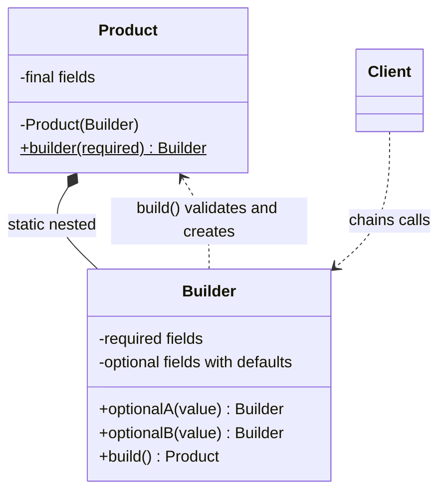
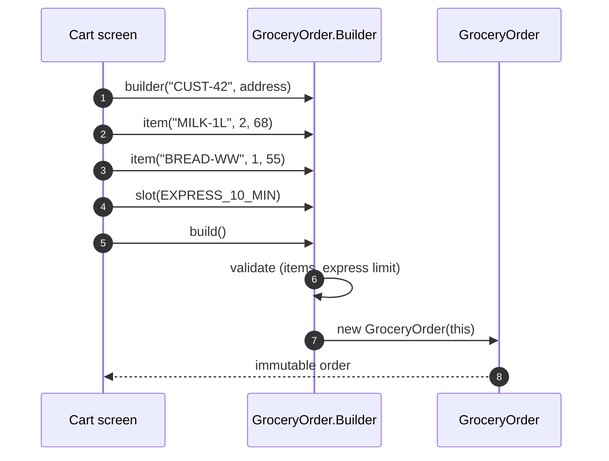
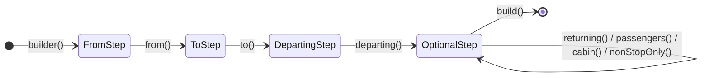
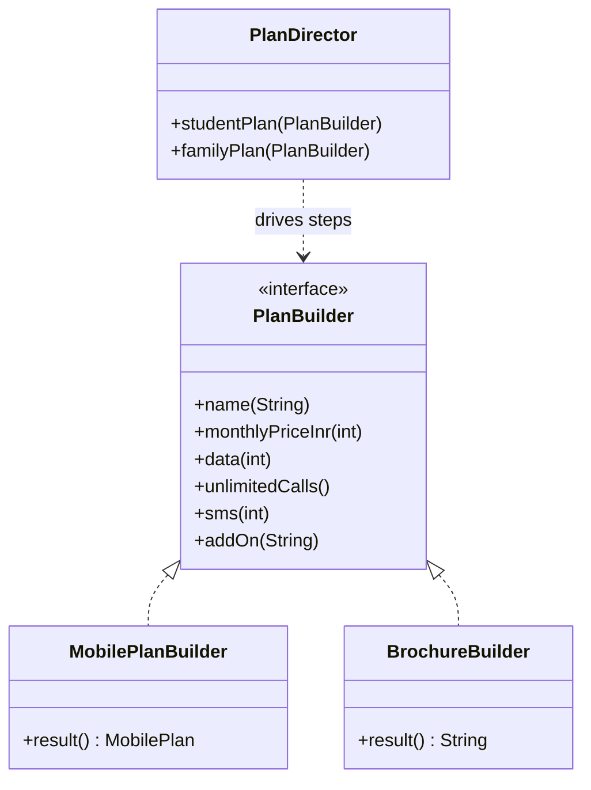

---
tags:
  - Creational
  - Beginner
---

# Builder

<span class="badge badge--beginner">🟢 Beginner → 🟡 Intermediate</span>
<span class="badge badge--category">Creational</span>
<span class="badge badge--interview">Interview frequency ⭐⭐⭐⭐⭐</span>

!!! abstract "TL;DR"
    **Builder constructs a complex object step by step and hands you a finished, valid, usually immutable object at the end.**
    Use it when an object has many parameters (especially optional ones), needs validation across fields, or must be immutable.

---

## 1. Intent & Problem It Solves

**The problem in plain English:** an order has a customer, an address, a list of items, a delivery slot, a coupon, instructions and a contactless flag. Most are optional. With constructors you end up with either 7-argument constructors where nobody remembers which `null` is which, or setters that leave the object half-built and mutable.

**Formal definition (GoF):**
> Separate the construction of a complex object from its representation so that the same construction process can create different representations.

In modern Java "Builder" usually means Joshua Bloch's **fluent builder** (*Effective Java*, Item 2), which solves the *telescoping constructor* problem. The original GoF version (Director + Builder interface) is about building **different representations** from the same steps. You'll see both below.

## 2. Real-World Analogy

!!! example "Ordering a custom sandwich"
    At a sandwich counter you say: "Wheat bread, chicken, add cheese, no onions, toast it." You add choices one at a time, in any order, and skip what you don't want. Only when you say "that's it" does the staff check the order (no meat on the vegan bread) and hand you the finished sandwich. You never receive half a sandwich.

## 3. Structure



| Participant | Responsibility |
|---|---|
| **Product** | Immutable object with a **private** constructor that takes the builder |
| **Builder** | Collects values, applies defaults, **validates** in `build()` |
| **Director** *(GoF form only)* | Knows a recipe (the order of steps), not the concrete product |
| **Client** | Chains builder calls and calls `build()` once |

## 4. Naive Approach (Without the Pattern)

```java
// Telescoping constructors
new GroceryOrder("CUST-7", "4 Park St", items, null, "WEEKLY50", null, true);
//                                              ^slot? ^coupon     ^note? ^contactless?

// JavaBeans setters
GroceryOrder o = new GroceryOrder();
o.setCustomerId("CUST-7");
o.setItems(items);
// forgot setAddress(): the object exists, is invalid, and is already in use
o.setContactless(true);  // mutable: another thread can change it later
```

**What goes wrong:**

- :material-close-circle:{ style="color:#e53935" } **Unreadable calls.** Which `null` is the coupon? Swapping two `String` arguments compiles fine and ships a bug.
- :material-close-circle:{ style="color:#e53935" } **Inconsistent state.** With setters, the object exists before it's valid.
- :material-close-circle:{ style="color:#e53935" } **No immutability.** Setters make thread-safety and safe sharing much harder.
- :material-close-circle:{ style="color:#e53935" } **Validation is scattered.** Nowhere is the right place to check "express delivery only for small orders".

---

## 5. Three Real-World Examples

### Example 1: Building Grocery Orders (Grocery Delivery)

**Scenario:** A grocery app builds an order from what's in the cart, the chosen slot, an optional coupon and delivery notes. Orders are passed between threads (checkout, pricing, dispatch), so they must be **immutable**. Some rules involve several fields at once: an order needs at least one item, and 10-minute express delivery is only allowed up to INR 2,000 (bigger orders don't fit a scooter). Bad orders must be rejected **before** they exist.

**Design:**



**Full Code:**

=== "GroceryOrder.java"

    ```java
    --8<-- "code/creational/src/main/java/com/handbook/creational/builder/grocery/GroceryOrder.java"
    ```

    1.  The **private** constructor takes the builder. The builder is the only way in.
    2.  `List.copyOf` makes a **defensive, unmodifiable copy**. Later `item()` calls on the builder can't change an order that's already built.
    3.  **Required** parameters go into `builder(...)`, so you can't forget them. Optional ones are chainable methods.
    4.  Returning `this` is what makes the API **fluent** (chainable).
    5.  `build()` is the single place for **cross-field validation**. If it throws, no invalid order ever exists.

=== "GroceryOrderDemo.java"

    ```java
    --8<-- "code/creational/src/main/java/com/handbook/creational/builder/grocery/GroceryOrderDemo.java"
    ```

**Output:**

```text
--8<-- "code/outputs/creational/builder/grocery/GroceryOrderDemo.txt"
```

**Why Builder here:**

- **Seven fields, four optional.** The builder call reads like a sentence, and defaults (the slot) live in one place.
- **Immutability** makes orders safe to pass between threads and services.
- **Cross-field rules** (express + amount) are enforced at the only point where all values are known: `build()`.

---

### Example 2: Flight Search with a Step Builder (Travel Booking)

**Scenario:** A travel booking site sends flight searches to airline and aggregator APIs. A search **must** have an origin, a destination and a departure date, in that order. Return date, passengers, cabin and "non-stop only" are optional. With a normal builder, forgetting `to(...)` is a runtime error discovered in production logs. The team wants the **compiler** to enforce the required steps, so the IDE's autocomplete only offers the next valid step.

**Design:**



**Full Code:**

=== "FlightSearch.java"

    ```java
    --8<-- "code/creational/src/main/java/com/handbook/creational/builder/travel/FlightSearch.java"
    ```

    1.  The **record's compact constructor** holds the validation, so it runs however the record is created, by the builder or directly.
    2.  Each step interface has **exactly one method** that returns the **next** step. After `builder()` the only thing you *can* call is `from()`.
    3.  Only the last step exposes the optional settings and `build()`.
    4.  One private class implements every step. Callers only ever see it through the narrow step interfaces.

=== "TravelDemo.java"

    ```java
    --8<-- "code/creational/src/main/java/com/handbook/creational/builder/travel/TravelDemo.java"
    ```

**Output:**

```text
--8<-- "code/outputs/creational/builder/travel/TravelDemo.txt"
```

**Why a Step Builder here:**

- Required fields are enforced at **compile time**: `FlightSearch.builder().to("DEL")` doesn't compile.
- **Autocomplete guides the developer** through the API, so there's no need to read docs to know what's required.
- Records + compact constructors give **immutability, `equals`/`hashCode`** (useful as a cache key for search results) and validation for free.

---

### Example 3: Mobile Plans with a Director (Telecom)

**Scenario:** A telecom operator defines plans (Student Saver, Family Max) that appear in **two places**: the billing system needs a structured record, and the website needs marketing copy. Product managers change plan contents often, and in the past the website and billing drifted apart ("the site says 3 GB/day, my bill says 2"). The recipe for each plan must live in **one place**, with each output format produced from it.

**Design:**



**Full Code:**

=== "PlanDirector.java"

    ```java
    --8<-- "code/creational/src/main/java/com/handbook/creational/builder/telecom/PlanDirector.java"
    ```

=== "PlanBuilder.java"

    ```java
    --8<-- "code/creational/src/main/java/com/handbook/creational/builder/telecom/PlanBuilder.java"
    ```

=== "MobilePlanBuilder.java"

    ```java
    --8<-- "code/creational/src/main/java/com/handbook/creational/builder/telecom/MobilePlanBuilder.java"
    ```

    ```java
    --8<-- "code/creational/src/main/java/com/handbook/creational/builder/telecom/MobilePlan.java"
    ```

=== "BrochureBuilder.java"

    ```java
    --8<-- "code/creational/src/main/java/com/handbook/creational/builder/telecom/BrochureBuilder.java"
    ```

=== "TelecomDemo.java"

    ```java
    --8<-- "code/creational/src/main/java/com/handbook/creational/builder/telecom/TelecomDemo.java"
    ```

**Output:**

```text
--8<-- "code/outputs/creational/builder/telecom/TelecomDemo.txt"
```

**Why the GoF Builder here:**

- **One recipe, many representations.** Billing and marketing can't drift, because both come from `familyPlan(...)`.
- A new output (a PDF tariff sheet, a JSON feed for comparison sites) is **one new builder** with no change to the recipes.
- The director is the "construction process"; the builders are the "representations". That's exactly the GoF intent.

---

??? example "Unit Tests: `BuilderTest.java` (all three examples + challenge)"

    ```java
    --8<-- "code/creational/src/test/java/com/handbook/creational/builder/BuilderTest.java"
    ```

## 6. Variations & Modern Java Take

| Variant | When |
|---|---|
| **Fluent nested builder** (Example 1) | Default choice for classes with 4+ fields or several optional ones |
| **Step builder** (Example 2) | Required fields must be enforced at compile time; public APIs and SDKs |
| **GoF Director + Builder interface** (Example 3) | Same steps produce different outputs (documents, reports, UIs) |
| **`toBuilder()`** (coding challenge) | Create a modified copy of an immutable object |
| **Records with "withers"** | Few fields: `order.withSlot(EXPRESS)` returning a new record |
| **Lombok `@Builder`** / **`@Builder(toBuilder = true)`** | Lots of DTOs; less code, but generated, and weak at cross-field validation |

**Records and builders work well together.** Keep the record as the product (immutable, `equals`, validation in the compact constructor) and add a small static nested builder only when there are many optional fields. Java has no named parameters, so the builder is how you get them.

**Generic self-typed builders for class hierarchies** (*Effective Java*, Item 2):

```java
abstract static class Builder<T extends Builder<T>> {
    abstract T self();
    public T topping(String t) { toppings.add(t); return self(); }
}
```

This lets `NyPizza.Builder` chain parent methods without casts.

## 7. Where It Lives in Real Frameworks

| Where | Example |
|---|---|
| JDK | `StringBuilder`, `Stream.builder()`, `Locale.Builder`, `HttpRequest.newBuilder()`, `HttpClient.newBuilder()` |
| JDK | `Thread.ofVirtual().name("worker-", 0).start(task)` (Java 21 thread builders) |
| Spring | `UriComponentsBuilder`, `ResponseEntity.ok().header(..).body(..)`, `RestClient.builder()`, `MockMvcRequestBuilders` |
| Spring Boot | `SpringApplicationBuilder`, `DataSourceBuilder` |
| Spring Security | `HttpSecurity` DSL (`http.authorizeHttpRequests(..).oauth2Login(..)`) |
| Others | Lombok `@Builder`, Protobuf / gRPC message builders, Guava `ImmutableList.builder()`, OkHttp `Request.Builder`, AWS SDK v2 request builders |

## 8. Pros, Cons & Trade-offs

| ✅ Pros | ❌ Cons |
|---|---|
| **Readable** construction, like named parameters | **More code**: a second class per product (Lombok or records reduce this) |
| Products can be **immutable** and thread-safe | Required fields aren't enforced unless you use a step builder or builder-constructor arguments |
| **One place** for defaults and cross-field validation | A small allocation for the builder (negligible except in very hot loops) |
| Easy to add optional fields **without breaking callers** | Easy to forget to copy a new field in `toBuilder()` or the product constructor |
| GoF form: same steps, **many representations** | Step builders need many small interfaces |

## 9. Pitfalls & Anti-Patterns

!!! danger "Exposing mutable collections"
    If the product stores the builder's `ArrayList` directly, later calls on the same builder silently change "immutable" objects. Always `List.copyOf` / `Map.copyOf` in the product constructor.

!!! danger "Validating in setters instead of `build()`"
    Field-by-field checks can't see combinations ("express *and* over INR 2,000"). Do cross-field validation in `build()` or the record's compact constructor.

!!! warning "Sharing a builder between threads"
    Builders are **mutable and not thread-safe**. Create one per object being built; never cache one in a static field.

!!! warning "Builder for a 2-field object"
    `new Money(100, "INR")` doesn't need a builder. Use builders when the parameter list is long or has several optional values.

!!! warning "Lombok `@Builder` on JPA entities"
    It skips no-arg constructors and field defaults unless you add `@Builder.Default`, and it bypasses invariants. Use builders for value objects and DTOs; be deliberate with entities.

## 10. Senior / Architect Deep Dive (10–15 yrs)

**Builders are API-evolution tools.** In a public SDK, adding a constructor parameter is a breaking change; adding a builder method isn't. That's why the JDK's newer APIs (`HttpClient`, thread builders) and cloud SDKs use builders. When designing a library: builder for configuration, immutable product, and `toBuilder()` for "copy with changes".

**Validation strategy.** Put **invariants** (things that must always hold) in the product's constructor or compact constructor, so they hold however the object is created, including by deserialization frameworks. Put **construction-only rules** (defaults, "at least one item") in `build()`. Report all violations at once for user-facing input (collect errors, then throw one exception) and fail fast for programmer errors.

**Performance.** The builder is a short-lived object; escape analysis often removes it entirely. Don't avoid builders for speed without a profiler showing a problem. On the other hand, `toBuilder()` + `build()` in a tight loop copies collections every time, so batch the changes.

**Serialization.** Jackson can build immutable objects through builders with `@JsonDeserialize(builder = X.Builder.class)` + `@JsonPOJOBuilder(withPrefix = "")`, or directly with records (Jackson 2.12+). This keeps DTOs immutable at the API boundary.

**Test data builders.** In tests, a builder with **valid defaults** for every field (`anOrder().withItems(3).build()`) makes tests short and focused on what matters. This is one of the most effective uses of the pattern in large codebases.

!!! bug "War story: the retry storm that double-charged customers"
    A payments client was configured through a builder. A developer turned on `retries(3)` for a POST charge call to "improve reliability". The gateway timed out under load, the client retried, and the gateway processed the same charge up to 4 times. About 2,300 customers were double-charged in 40 minutes.
    **Fix:** the request builder's `build()` now **refuses** retried POSTs that lack an `Idempotency-Key` header (exactly the coding challenge below), and the gateway de-duplicates on that key.
    **Lesson:** `build()` is the right place for *safety* rules between options, not only for null checks.

## 11. Related Patterns & Comparisons

| | Builder | Factory Method | Abstract Factory | Prototype |
|---|---|---|---|---|
| Focus | **How** one complex object is assembled | **Which** class to create | **Which family** of objects | **Copy** an existing object |
| Steps | Many, client-controlled | One call | One call per product | One `copy()` |
| Result | Usually immutable, validated | Any implementation of an interface | Matching products | A configured clone |
| Typical sign | Many optional params | `switch` on type | Products that must match | Expensive setup reused |

**Often combined with:** Factory Method (`builder()` is a static factory), Composite (builders that assemble trees, like UI or query builders), Prototype (`toBuilder()` is a "copy and modify" prototype).

## 12. Interview Corner

=== "🟢 Beginner / Service Companies"

    **Q1. What is the Builder pattern and why use it?**

    A creational pattern that builds a complex object **step by step** and returns it with `build()`. It solves the **telescoping constructor** problem, improves **readability**, and allows **immutable** objects.

    **Q2. Write a Builder for a `User` with required `name` and optional `email`, `phone`.**

    Static nested `Builder` class; `User.builder(name)` takes the required field; `email()`/`phone()` return `this`; `build()` calls a **private** `User(Builder)` constructor. All `User` fields `final`, no setters (see Example 1).

    **Q3. What is the telescoping constructor problem?**

    Many overloaded constructors with growing parameter lists (`User(name)`, `User(name, email)`, `User(name, email, phone)`...). They're **hard to read**, and arguments of the same type are **easy to swap**.

    **Q4. Builder vs. setters (JavaBeans)?**

    Setters leave the object **mutable** and possibly **half-built**; a builder returns a **complete, validated, immutable** object in one step.

    **Q5. Name builders in the JDK.**

    `StringBuilder`, `Stream.builder()`, `HttpRequest.newBuilder()`, `Locale.Builder`, and Java 21's `Thread.ofVirtual()`.

=== "🟡 Mid-Level"

    **Q1. Where do you validate, in the builder methods or `build()`?**

    Single-field checks can go in the methods (fail early), but **cross-field rules belong in `build()`** or in the product's constructor. **Invariants** belong in the product, so they hold however it's created.

    **Q2. How do you enforce required fields?**

    Pass them to `builder(...)` (Example 1) or use a **step builder** (Example 2) so the compiler enforces the order. Checking for `null` in `build()` works but only fails at runtime.

    **Q3. What is `toBuilder()` and when is it useful?**

    It returns a builder **pre-filled** from an existing immutable object, so you can make a modified copy (`base.toBuilder().timeout(10s).build()`). It's useful for configuration objects and test data.

    **Q4. Builder vs. records?**

    Records give immutability and `equals`/`hashCode` for free but have only a **canonical constructor**. For a few fields that's enough; for **many optional fields**, add a nested builder that constructs the record.

    **Q5. What does the GoF Director do?**

    It holds a **construction recipe** (the order of steps) and works with any builder that implements the builder interface, so the **same recipe produces different representations** (Example 3).

=== "🔴 Senior / FAANG / SAP"

    **Q1. "Design the configuration API for an HTTP client SDK used by 500 internal teams."**

    An immutable `ClientConfig` built by a **builder** with safe defaults (timeouts, connection pool sizes, TLS), `toBuilder()` for overrides, and `build()` enforcing **safety rules** (retries only for idempotent requests, max timeout). Builders let you **add options without breaking** 500 callers. Also discuss documentation via method names, deprecating options, and exposing the effective config in logs and metrics.

    **Q2. "Builders allocate an extra object. Is that a problem at 100k RPS?"**

    Usually **no**: short-lived objects die young in the TLAB, and the JIT's **escape analysis** often removes them. Measure with JFR/JMH before optimizing. The real costs are **defensive copies** of big collections; avoid repeated `toBuilder()` in hot loops.

    **Q3. "How do you keep a builder, a product and `toBuilder()` in sync as fields are added?"**

    Code generation (Lombok, Immutables, AutoValue, records + a generated builder), or a **round-trip test**: build with all fields set, `toBuilder().build()`, assert equal. Reflection-based tests can also check that every product field has a builder setter.

    **Q4. "Design a fluent query builder (like jOOQ or Criteria API). What are the hard parts?"**

    **Type safety** (step interfaces so `WHERE` comes after `FROM`), **immutability** (each call returns a new builder, so partial queries can be shared and reused), **SQL injection** (bind parameters, never string concatenation), and **dialect differences** (render via a visitor per database). It's Builder + Composite + Visitor.

    **Q5. "When would you *not* use a builder?"**

    Small value objects (2–3 required fields), objects created only by frameworks (JPA entities, where builders fight the no-arg constructor), and very hot paths where profiling shows the builder matters.

=== "💻 Coding Challenge"

    **Problem (fintech SDK):** Build an immutable `ApiRequest` with: required HTTPS URL; method GET by default, `post(body)` switches to POST; headers (keep insertion order, but the product must be immutable); timeout (default 2 s); retries (default 0). Add `toBuilder()`. **Safety rule:** a POST with retries > 0 must have an `Idempotency-Key` header.

    ??? success "Solution"

        === "ApiRequest.java"

            ```java
            --8<-- "code/creational/src/main/java/com/handbook/creational/builder/api/ApiRequest.java"
            ```

        === "ApiRequestDemo.java"

            ```java
            --8<-- "code/creational/src/main/java/com/handbook/creational/builder/api/ApiRequestDemo.java"
            ```

        **Output:**

        ```text
        --8<-- "code/outputs/creational/builder/api/ApiRequestDemo.txt"
        ```

        **Key points to say:** `Map.copyOf` in the compact constructor makes headers immutable; `toBuilder()` copies every field so the original is untouched; the idempotency rule is **cross-field** so it lives in `build()`; and `LinkedHashMap` in the builder keeps headers in the order they were added.

!!! info "Behavioural tie-in (STAR) for experienced candidates"
    - **S:** Our order service had 9 constructors and frequent bugs from swapped `String` arguments.
    - **T:** Make order creation safe and readable without a big-bang rewrite.
    - **A:** Introduced an immutable `Order` with a builder that validated cross-field rules, plus a test-data builder; migrated callers module by module and deprecated the old constructors.
    - **R:** Argument-order bugs dropped to zero; tests became about 40% shorter; adding a "gift message" field touched 2 files instead of 31.

## 13. Quick Revision Card

!!! tip "Remember in 30 seconds"
    - **Step-by-step construction**, then `build()` returns a **complete, validated, immutable** object.
    - Fixes **telescoping constructors** and **half-built JavaBeans**.
    - **Required** fields in `builder(...)` or a **step builder**; **cross-field** validation in `build()`.
    - **GoF form:** Director + Builder interface means the same steps give different representations.
    - **JDK:** `StringBuilder`, `HttpRequest.newBuilder()`, `Thread.ofVirtual()`. **Spring:** `UriComponentsBuilder`, `ResponseEntity`.

    ```java
    Order o = Order.builder("CUST-1", addr).item("MILK", 2, 68).coupon("SAVE10").build();
    ```

## Practice

- [ ] Add a `giftMessage` field to `GroceryOrder` and write the round-trip test from Senior Q3.
- [ ] Make Example 2 report **all** validation errors at once instead of the first one.
- [ ] Add a `JsonFeedBuilder` to Example 3 that outputs the plan as JSON.
- [ ] Rewrite `ApiRequest` with Lombok `@Builder(toBuilder = true)` and compare what you lose.

---

[:material-arrow-left: Abstract Factory](abstract-factory.md){ .md-button }
[Next: Prototype :material-arrow-right:](prototype.md){ .md-button .md-button--primary }
