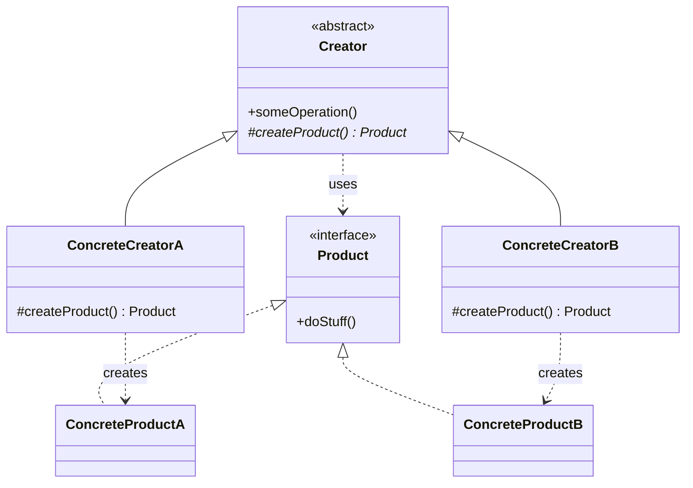
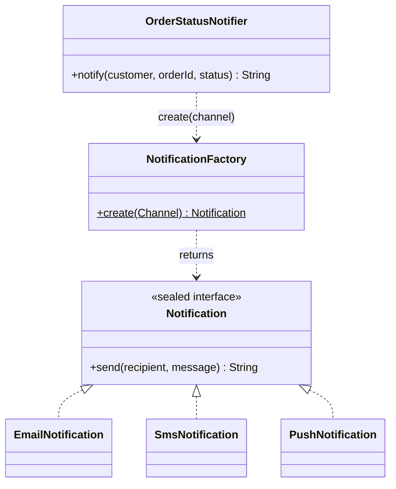
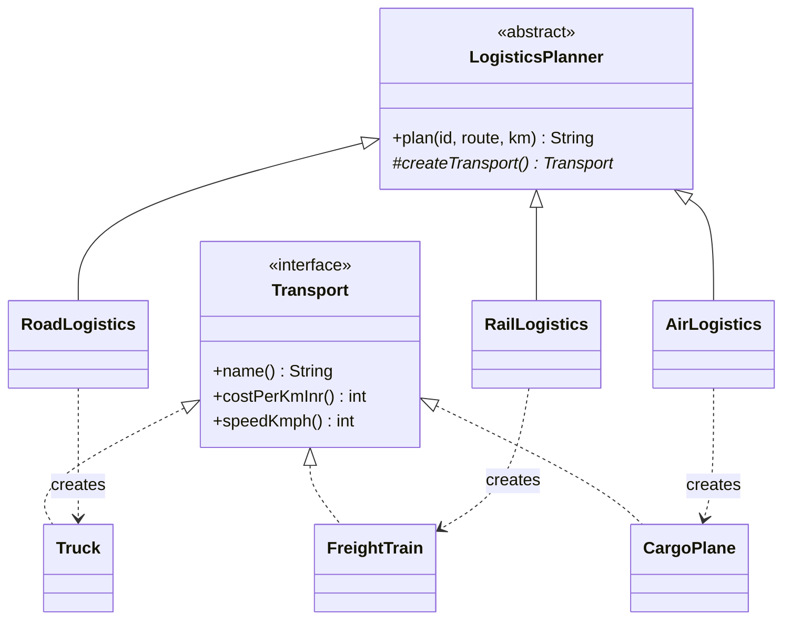
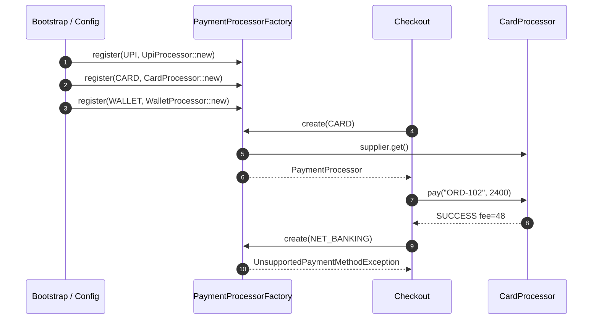

---
tags:
  - Creational
  - Beginner
---

# Factory Method

<span class="badge badge--beginner">🟢 Beginner → 🟡 Intermediate</span>
<span class="badge badge--category">Creational</span>
<span class="badge badge--interview">Interview frequency ⭐⭐⭐⭐⭐</span>

!!! abstract "TL;DR"
    **Factory Method moves the `new` keyword out of your business code into one place that decides which concrete class to create.**
    Use it when the exact class depends on input, configuration or a subclass, and you want to add new types without editing the code that uses them.

---

## 1. Intent & Problem It Solves

**The problem in plain English:** your checkout code needs a payment processor. Today it's `new UpiProcessor()`. Tomorrow you add cards, then wallets, then net banking. If every caller writes `if (method == UPI) new UpiProcessor() else if ...`, each new payment method means editing (and re-testing) every one of those places.

**Formal definition (GoF):**
> Define an interface for creating an object, but let subclasses decide which class to instantiate. Factory Method lets a class defer instantiation to subclasses.

In everyday Java the term covers three closely related forms. You'll meet all three in the examples:

| Form | What it looks like | Example below |
|---|---|---|
| **Static factory method** (a.k.a. Simple Factory) | `NotificationFactory.create(channel)` | Example 1 |
| **Classic GoF Factory Method** | abstract `createTransport()` overridden by subclasses | Example 2 |
| **Registry-based factory** | `Map<Type, Supplier<Product>>` filled at start-up | Example 3 |

## 2. Real-World Analogy

!!! example "Ordering at a restaurant"
    You order "a pizza" from the menu. You don't walk into the kitchen and build it. The kitchen (the factory) decides whether it comes from the wood-fired oven or the electric one, and which chef makes it. You get *a pizza* either way. If the restaurant adds a new oven, your way of ordering doesn't change.

## 3. Structure



| Participant | Responsibility |
|---|---|
| **Product** | The interface every created object implements |
| **ConcreteProduct** | A real implementation (`Truck`, `UpiProcessor`) |
| **Creator** | Declares the factory method; often contains the business logic that *uses* the product |
| **ConcreteCreator** | Overrides the factory method to return a specific product |

## 4. Naive Approach (Without the Pattern)

```java
public class CheckoutService {
    public PaymentResult pay(String method, String orderId, int amount) {
        PaymentProcessor processor;
        if (method.equals("UPI")) {
            processor = new UpiProcessor();
        } else if (method.equals("CARD")) {
            processor = new CardProcessor();
        } else if (method.equals("WALLET")) {
            processor = new WalletProcessor();
        } else {
            throw new IllegalArgumentException(method);
        }
        return processor.pay(orderId, amount);
    }
}
// The same if/else is copied into RefundService, ReconciliationJob, ...
```

**What goes wrong:**

- :material-close-circle:{ style="color:#e53935" } **Breaks Open/Closed.** Every new payment method means editing working code in several places.
- :material-close-circle:{ style="color:#e53935" } **Tight coupling.** `CheckoutService` depends on *every* concrete processor class.
- :material-close-circle:{ style="color:#e53935" } **Hard to test.** You can't swap in a fake processor without changing the code under test.
- :material-close-circle:{ style="color:#e53935" } **Stringly typed.** A typo like `"UPl"` is only caught at runtime.

---

## 5. Three Real-World Examples

### Example 1: Order Status Notifications (Food Delivery)

**Scenario:** A food delivery app (like Swiggy, Zomato or DoorDash) sends "out for delivery" updates. Each customer picks a channel: email, SMS or push. Each channel formats differently, and SMS has a strict length limit. On a Friday night the app sends hundreds of thousands of these, so the code that *decides* what to say must not care *how* it is sent. New channels (WhatsApp, in-app chat) are on the roadmap.

**Design:**



**Full Code:**

=== "Notification.java"

    ```java
    --8<-- "code/creational/src/main/java/com/handbook/creational/factorymethod/notification/Notification.java"
    ```

    1.  `sealed` (Java 17+) lists every allowed implementation. The compiler then knows the full set, which is what makes the `switch` in the factory **exhaustive**.

=== "NotificationFactory.java"

    ```java
    --8<-- "code/creational/src/main/java/com/handbook/creational/factorymethod/notification/NotificationFactory.java"
    ```

    1.  A `switch` expression over an enum has **no `default`**. If someone adds `WHATSAPP` to `Channel` and forgets to handle it here, the code **doesn't compile**. That's much safer than an `if/else` chain.

=== "OrderStatusNotifier.java"

    ```java
    --8<-- "code/creational/src/main/java/com/handbook/creational/factorymethod/notification/OrderStatusNotifier.java"
    ```

    1.  The only line that deals with creation. The notifier never mentions `EmailNotification`, `SmsNotification` or `PushNotification`.

=== "Products"

    ```java
    --8<-- "code/creational/src/main/java/com/handbook/creational/factorymethod/notification/EmailNotification.java"
    ```

    ```java
    --8<-- "code/creational/src/main/java/com/handbook/creational/factorymethod/notification/SmsNotification.java"
    ```

    ```java
    --8<-- "code/creational/src/main/java/com/handbook/creational/factorymethod/notification/PushNotification.java"
    ```

    ```java
    --8<-- "code/creational/src/main/java/com/handbook/creational/factorymethod/notification/Channel.java"
    ```

=== "FoodDeliveryDemo.java"

    ```java
    --8<-- "code/creational/src/main/java/com/handbook/creational/factorymethod/notification/FoodDeliveryDemo.java"
    ```

**Output:**

```text
--8<-- "code/outputs/creational/factorymethod/notification/FoodDeliveryDemo.txt"
```

Same call, three different products. Note how the SMS product applies its own length limit, which the caller never has to know about.

**Why Factory Method here:**

- The **channel is only known at runtime** (it's the customer's preference).
- Creation logic lives in **one place**; adding WhatsApp means one new class and one new `case`.
- `sealed` + `switch` gives **compile-time exhaustiveness**, so a forgotten channel is a build error, not a production bug.

??? example "Unit Test: `NotificationFactoryTest.java`"

    ```java
    --8<-- "code/creational/src/test/java/com/handbook/creational/factorymethod/NotificationFactoryTest.java"
    ```

---

### Example 2: Shipment Planning (Logistics)

**Scenario:** A logistics company plans shipments across India. Every plan follows the same steps: pick a vehicle, work out cost from distance, estimate arrival. Only the **vehicle** differs: trucks for short hauls, freight trains for long, cheap routes, and cargo planes for urgent medical supplies. The planning workflow is reviewed by finance and must not be copied per vehicle type. New modes (drones, ships) are expected.

**Design:**



**Full Code:**

=== "LogisticsPlanner.java"

    ```java
    --8<-- "code/creational/src/main/java/com/handbook/creational/factorymethod/logistics/LogisticsPlanner.java"
    ```

    1.  **This is the GoF Factory Method**: an abstract, overridable method that returns the product. Subclasses decide the concrete class.
    2.  `final` stops subclasses from changing the workflow. They may only change *what is created*. This is Factory Method working together with **Template Method**.

=== "Creators"

    ```java
    --8<-- "code/creational/src/main/java/com/handbook/creational/factorymethod/logistics/RoadLogistics.java"
    ```

    ```java
    --8<-- "code/creational/src/main/java/com/handbook/creational/factorymethod/logistics/RailLogistics.java"
    ```

    ```java
    --8<-- "code/creational/src/main/java/com/handbook/creational/factorymethod/logistics/AirLogistics.java"
    ```

=== "Products"

    ```java
    --8<-- "code/creational/src/main/java/com/handbook/creational/factorymethod/logistics/Transport.java"
    ```

    ```java
    --8<-- "code/creational/src/main/java/com/handbook/creational/factorymethod/logistics/Truck.java"
    ```

    ```java
    --8<-- "code/creational/src/main/java/com/handbook/creational/factorymethod/logistics/FreightTrain.java"
    ```

    ```java
    --8<-- "code/creational/src/main/java/com/handbook/creational/factorymethod/logistics/CargoPlane.java"
    ```

=== "LogisticsDemo.java"

    ```java
    --8<-- "code/creational/src/main/java/com/handbook/creational/factorymethod/logistics/LogisticsDemo.java"
    ```

**Output:**

```text
--8<-- "code/outputs/creational/factorymethod/logistics/LogisticsDemo.txt"
```

One workflow (`plan`), three transports. The trade-off is visible in the numbers: the plane is about 22× the cost of the train for a 6× faster delivery.

**Why Factory Method here:**

- The **algorithm is fixed** and the **object it needs varies**. That's the textbook GoF case.
- Adding drones means **one new subclass**; `plan()` doesn't change. The unit test below proves it with an anonymous `DroneLogistics`.
- Each subclass can be **tested on its own**.

??? example "Unit Test: `LogisticsPlannerTest.java`"

    ```java
    --8<-- "code/creational/src/test/java/com/handbook/creational/factorymethod/LogisticsPlannerTest.java"
    ```

---

### Example 3: Pluggable Payment Processors (Banking / Payments)

**Scenario:** A payments team runs checkout for a large e-commerce site. It supports UPI (no fee), cards (2% merchant fee) and wallets (regulatory limit of INR 10,000 per transaction). Net banking is being built by another team and isn't live yet. Payment methods are switched on per country and per merchant through configuration, so the factory can't be a hard-coded `switch`. It has to be a **registry** that's filled at start-up, and asking for a method that isn't registered must **fail fast** with a clear error.

**Design:**



**Full Code:**

=== "PaymentProcessorFactory.java"

    ```java
    --8<-- "code/creational/src/main/java/com/handbook/creational/factorymethod/payments/PaymentProcessorFactory.java"
    ```

    1.  `EnumMap` is a compact, fast array-backed map for enum keys. Each value is a `Supplier`, which is a **factory method passed as a value**. `UpiProcessor::new` is a constructor reference.
    2.  **Fail fast** with a domain exception. A `null` return would turn into a confusing `NullPointerException` far away from the cause.
    3.  The supplier is called on every request, so each caller gets a **new** processor. Register a supplier that returns a shared instance if the processor is stateless and expensive to build.

=== "CheckoutDemo.java"

    ```java
    --8<-- "code/creational/src/main/java/com/handbook/creational/factorymethod/payments/CheckoutDemo.java"
    ```

=== "Processors"

    ```java
    --8<-- "code/creational/src/main/java/com/handbook/creational/factorymethod/payments/PaymentProcessor.java"
    ```

    ```java
    --8<-- "code/creational/src/main/java/com/handbook/creational/factorymethod/payments/UpiProcessor.java"
    ```

    ```java
    --8<-- "code/creational/src/main/java/com/handbook/creational/factorymethod/payments/CardProcessor.java"
    ```

    ```java
    --8<-- "code/creational/src/main/java/com/handbook/creational/factorymethod/payments/WalletProcessor.java"
    ```

=== "Supporting types"

    ```java
    --8<-- "code/creational/src/main/java/com/handbook/creational/factorymethod/payments/PaymentMethod.java"
    ```

    ```java
    --8<-- "code/creational/src/main/java/com/handbook/creational/factorymethod/payments/PaymentResult.java"
    ```

    ```java
    --8<-- "code/creational/src/main/java/com/handbook/creational/factorymethod/payments/UnsupportedPaymentMethodException.java"
    ```

**Output:**

```text
--8<-- "code/outputs/creational/factorymethod/payments/CheckoutDemo.txt"
```

Three outcomes worth noticing: a normal success, a **business failure** handled by the product itself (wallet limit), and a **configuration failure** caught by the factory (net banking isn't registered).

**Why Factory Method here:**

- The set of products is **decided by configuration**, not by code, so a registry is the natural fit.
- **Open/Closed for real:** the net-banking team adds `register(NET_BANKING, NetBankingProcessor::new)` and touches nothing else.
- Tests can **register a fake** for any method (see `canSwapInATestDouble` below).
- This is exactly how Spring injects `Map<String, PaymentProcessor>`; see section 6.

??? example "Unit Test: `PaymentProcessorFactoryTest.java`"

    ```java
    --8<-- "code/creational/src/test/java/com/handbook/creational/factorymethod/PaymentProcessorFactoryTest.java"
    ```

---

## 6. Variations & Modern Java Take

**Static factory methods on the type itself.** Modern Java APIs prefer these to public constructors (*Effective Java*, Item 1):

```java
List<String> names = List.of("a", "b");       // immutable list
Optional<User> user = Optional.ofNullable(u);
Path path = Path.of("/tmp", "x.txt");
Duration timeout = Duration.ofSeconds(30);
```

Naming conventions: `of`, `from`, `valueOf`, `getInstance`, `newInstance`, `create`, `getType` / `newType`.

**Factory method on an interface** (Java 8+): the coding challenge below puts `FareCalculator.of(type)` right on the interface, with lambdas as the products.

**Spring does the registry for you.** Name each bean after the enum value and inject a map:

```java
public interface PaymentProcessor { PaymentResult pay(String orderId, int amountInr); }

@Component("UPI")  class UpiProcessor  implements PaymentProcessor { /* ... */ }
@Component("CARD") class CardProcessor implements PaymentProcessor { /* ... */ }

@Service
class PaymentProcessorFactory {
    private final Map<String, PaymentProcessor> processors; // bean name -> bean

    PaymentProcessorFactory(Map<String, PaymentProcessor> processors) {
        this.processors = processors;
    }

    PaymentProcessor create(PaymentMethod method) {
        PaymentProcessor p = processors.get(method.name());
        if (p == null) throw new UnsupportedPaymentMethodException(method);
        return p;
    }
}
```

Adding a payment method is now **one new `@Component` class**, and nothing else changes. Combine this with `@ConditionalOnProperty` to switch methods on per environment.

**`ServiceLoader` for plug-ins.** `ServiceLoader.load(PaymentProcessor.class)` discovers implementations on the classpath (from `META-INF/services` or `module-info` `provides`). It's how JDBC drivers and many JDK SPIs are found.

## 7. Where It Lives in Real Frameworks

| Where | Example | Form |
|---|---|---|
| JDK | `Calendar.getInstance()`, `NumberFormat.getCurrencyInstance(locale)` | Static factory picks a subclass by locale |
| JDK | `List.of`, `Map.of`, `EnumSet.of` | Static factory; `EnumSet.of` returns `RegularEnumSet` or `JumboEnumSet` depending on size |
| JDK | `Collection.iterator()` | **Classic GoF**: each collection subclass creates its own iterator |
| JDK | `URLStreamHandlerFactory`, `ThreadFactory` | Factory interfaces you plug in |
| JDK | `DriverManager.getConnection(url)`, `ServiceLoader` | Registry/discovery-based |
| Spring | `FactoryBean<T>`, `@Bean` methods, `BeanFactory.getBean()` | The container is one big factory |
| Spring | `RestClient.builder()`, `WebClient.create()` | Static factory methods |
| Hibernate | `SessionFactory.openSession()` | Factory method on a long-lived factory |
| SLF4J | `LoggerFactory.getLogger(...)` | Static factory with a pluggable back-end |

## 8. Pros, Cons & Trade-offs

| ✅ Pros | ❌ Cons |
|---|---|
| Callers depend on an **interface**, not on concrete classes | **More classes**: one per product, plus creators in the GoF form |
| New products **without editing** client code (OCP) | A factory with a giant `switch` just moves the `if/else`, unless it's `sealed`/exhaustive or a registry |
| Creation logic (validation, caching, pooling) in **one place** | Indirection makes it harder to "jump to definition" in an IDE |
| Easy to **swap in test doubles** | The GoF subclass form uses inheritance, which is rigid. Prefer composition (pass a `Supplier`) when you can |
| Static factories can have **descriptive names** and return **cached instances or subtypes** | Static factories can't be overridden or mocked easily |

## 9. Pitfalls & Anti-Patterns

!!! danger "The 'god factory'"
    One `ObjectFactory.create(String type)` that builds *everything* in the app is a service locator in disguise. Keep one factory per product family.

!!! danger "Returning `null` for unknown types"
    It turns a clear configuration error into a `NullPointerException` three layers away. Throw a **domain exception** with the bad key in the message (Example 3).

!!! warning "Stringly typed keys"
    `create("upi")` vs `create("UPI")` bugs. Use an **enum** (or sealed types) as the key, and convert external strings once at the boundary.

!!! warning "Factory for a single class"
    If there is, and will only ever be, one implementation, a factory is ceremony. YAGNI. Add it when the second implementation shows up.

!!! warning "Calling the factory method from a constructor"
    In the GoF form, if the base class constructor calls the abstract `createX()`, the subclass's fields aren't initialized yet. Call it lazily, or from a method (as `plan()` does).

## 10. Senior / Architect Deep Dive (10–15 yrs)

**Which form to pick:**

| Situation | Choose |
|---|---|
| Fixed, small set of types known at compile time | **Static factory + `sealed` + exhaustive `switch`** |
| Shared workflow, only one collaborator varies, a class hierarchy already exists | **GoF Factory Method** (with a `final` template method) |
| Types are switched on by config, tenant or feature flag, or contributed by other teams/modules | **Registry** (`Map<K, Supplier<T>>`, Spring map injection, `ServiceLoader`) |
| Several related products that must match | Move up to **[Abstract Factory](abstract-factory.md)** |

**Factories as a seam for operational concerns.** Because every instance goes through one point, the factory is where you add **metrics** (`processor.created{method=CARD}`), **circuit breakers** (wrap the product in a Resilience4j-decorated proxy), **feature flags** (return the new implementation for 5% of traffic), and **caching** of stateless products.

**Feature-flagged migrations.** Migrating from an old payment provider to a new one? Register both and let the factory decide per request:

```java
PaymentProcessor create(PaymentMethod m, String merchantId) {
    if (m == CARD && flags.isEnabled("new-card-gateway", merchantId)) {
        return newCardGateway.get();
    }
    return registry.get(m).get();
}
```

That's the **Strangler Fig** pattern at class level. Roll out per merchant, roll back instantly.

**Testing strategy.** Unit-test each product on its own; test the factory's *mapping* (every enum value maps to something, using `@EnumSource` as in Example 1's test); test the clients with a fake registry.

!!! bug "War story: the missing `default` that charged the wrong fee"
    A checkout service picked a fee calculator with an old-style `switch` statement that ended in `default: return new StandardFeeCalculator();`. A new `BNPL` (buy now, pay later) method was added to the enum. Nobody updated the switch, and BNPL silently fell through to the standard card fee calculator. For three weeks BNPL merchants were charged 2% instead of the contracted 3.5%, a revenue leak only found in a quarterly audit.
    **Fix:** replaced it with a `switch` *expression* with no `default`, so the compiler flags unhandled constants, and added a parameterized test over `PaymentMethod.values()` asserting each one maps to a calculator.
    **Lesson:** "silent default" in a factory is a bug waiting to happen. Make missing cases a **compile error** or a **loud failure**.

## 11. Related Patterns & Comparisons

| | Factory Method | Abstract Factory | Builder | Simple constructor |
|---|---|---|---|---|
| Creates | **One** product | A **family** of related products | **One complex** product, step by step | One known class |
| Decides | **Which class** | **Which family** | **How** it's put together | Nothing to decide |
| Typical API | `create(type)` / overridden `createX()` | `ui.button()`, `ui.checkbox()` | `Order.builder().item(..).build()` | `new Order(...)` |
| Use when | Type varies at runtime | Products must be consistent with each other | Many optional params, immutability | One implementation, simple setup |

**Works well with:** Template Method (Example 2), Strategy (the products are often strategies), Singleton (cache stateless products), Prototype (factory clones a template instead of calling `new`).

## 12. Interview Corner

=== "🟢 Beginner / Service Companies"

    **Q1. What is the Factory pattern?**

    A creational pattern that **hides object-creation logic** behind a method. The caller asks for an object by type and gets back an **interface**, without knowing the concrete class. It reduces **coupling** and follows the **Open/Closed Principle**.

    **Q2. Difference between Simple Factory and Factory Method?**

    **Simple Factory** is a single method (often static) with a `switch` that returns different classes. **Factory Method** (GoF) is an **abstract method that subclasses override** to decide the class. Simple Factory isn't one of the 23 GoF patterns, but it's the one used most often in practice.

    **Q3. Give a JDK example.**

    `Calendar.getInstance()`, `NumberFormat.getInstance(locale)`, `List.of(...)`, and `Collection.iterator()`, which is the textbook GoF Factory Method because each collection subclass creates its own iterator.

    **Q4. Why not just use `new`?**

    `new` ties the caller to **one concrete class**. With a factory the caller depends on an **interface**, so you can add or swap implementations, return cached objects, or inject fakes in tests **without changing the caller**.

    **Q5. Write a factory for shapes (Circle, Square, Rectangle).**

    Interface `Shape { double area(); }`, three implementations, and `ShapeFactory.create(ShapeType type)` using a `switch` expression on an enum with no `default`, as in Example 1.

=== "🟡 Mid-Level"

    **Q1. How do you avoid the giant `switch` in a factory?**

    Use a **registry**: `Map<Type, Supplier<Product>>` filled at start-up (Example 3), or let Spring inject `Map<String, Product>`. New types are **registered**, not added to a switch. Alternatively, use `sealed` + an exhaustive `switch` expression so the compiler guards completeness.

    **Q2. How does Factory Method relate to Template Method?**

    They're often used **together**. A `final` template method defines the workflow and calls an abstract factory method for the object it needs (Example 2's `plan()` calls `createTransport()`).

    **Q3. How would you unit test code that uses a factory?**

    Inject the factory (or a `Supplier`) into the client, then pass a **fake factory** that returns stubs. Test the factory separately: every key maps to the expected type, and unknown keys **fail fast**.

    **Q4. When is a factory over-engineering?**

    When there's **one implementation** and no realistic second one, when creation is trivial, or when a DI container already gives you the instance. **YAGNI.**

    **Q5. Should a factory return a new instance or a cached one?**

    It depends on the product. **Stateless and thread-safe** products (most processors, strategies) can be cached and shared. **Stateful** ones must be new per call. A good factory hides this decision from the caller, which is one of its main benefits.

=== "🔴 Senior / FAANG / SAP"

    **Q1. "Design a notification system that supports email, SMS and push, and a new channel every quarter."**

    Channel interface + **registry-based factory**; channels are **plug-ins** (Spring beans or `ServiceLoader`). Then go beyond creation: user **preferences and fallbacks** (push fails, so send SMS), **rate limits per channel**, **templates** per locale, **async dispatch** via a queue per channel so one slow provider doesn't block others, **idempotency keys** to avoid duplicate sends on retry, and **delivery status** callbacks. The factory is the small part; say so, and show how it isolates the rest.

    **Q2. "Your factory creates an expensive client (HTTP connection pool) per call and p99 latency spikes. Fix it."**

    The product is **stateless and thread-safe**, so cache it: make the registry hold **instances** (or memoized suppliers) instead of constructors. Be clear about **lifecycle**: who closes the pools on shutdown? In Spring, make them singleton beans with `@PreDestroy`. Measure before and after (allocation rate, connection churn, p99).

    **Q3. "How would you roll out a new payment gateway to 1% of merchants safely?"**

    Put the decision in the **factory**: a feature flag keyed by merchant picks the new or old implementation (see the deep dive). Add **metrics per implementation**, an automatic **kill switch** on error-rate SLO breach, and **shadow traffic** if possible. Callers don't change, which is the point of the pattern.

    **Q4. "Factory Method vs. Dependency Injection: aren't they the same?"**

    DI is a **generalized, external factory**: the container builds the object graph. Use DI for **wiring at start-up** (singletons, long-lived services). Use a factory when the **choice depends on runtime data** (the request's payment method, the tenant). In Spring they combine: inject the factory, and the factory picks a bean per request.

    **Q5. "How do plug-in architectures (JDBC drivers, IDE plug-ins) find implementations?"**

    **Service Provider Interface** + `ServiceLoader`: implementations declare themselves in `META-INF/services/<interface>` or `module-info` (`provides X with Y`), and the host discovers them at runtime. It's a **registry factory filled by the classpath**. Discuss class-loader isolation, versioning, and failing fast when a required provider is missing.

=== "💻 Coding Challenge"

    **Problem (ride-hailing):** This code is repeated in three services. Refactor it so callers write `FareCalculator.of(type).fareInr(km)`, the compiler catches a missing ride type, and Sedan has a minimum fare of INR 150.

    ```java
    int fare;
    if (type.equals("AUTO")) fare = 30 + 12 * km;
    else if (type.equals("MINI")) fare = 50 + 14 * km;
    else if (type.equals("SEDAN")) fare = 80 + 18 * km;
    else fare = 0; // silent default!
    ```

    ??? success "Solution: factory method on a functional interface"

        === "FareCalculator.java"

            ```java
            --8<-- "code/creational/src/main/java/com/handbook/creational/factorymethod/ride/FareCalculator.java"
            ```

        === "RideDemo.java"

            ```java
            --8<-- "code/creational/src/main/java/com/handbook/creational/factorymethod/ride/RideDemo.java"
            ```

        **Output:**

        ```text
        --8<-- "code/outputs/creational/factorymethod/ride/RideDemo.txt"
        ```

        **Key points to say:** the enum replaces strings; the `switch` *expression* has no `default`, so adding `BIKE` without a fare is a **compile error**; each product is a lambda because `FareCalculator` has one abstract method; and the minimum-fare rule lives with its product, not in the callers.

!!! info "Behavioural tie-in (STAR) for experienced candidates"
    - **S:** Payment-method logic was copy-pasted across checkout, refunds and reconciliation; adding a wallet took 3 sprints and caused a refund bug.
    - **T:** Make adding a payment method a one-team, one-PR change.
    - **A:** Introduced a `PaymentProcessor` interface and a Spring map-injected factory, moved each method into its own module, and added an enum-driven completeness test.
    - **R:** The next method (BNPL) shipped in 4 days with zero changes to checkout; the refund defect class disappeared.

## 13. Quick Revision Card

!!! tip "Remember in 30 seconds"
    - **Hide `new` behind a method**; callers get an **interface**.
    - **Three forms:** static factory, GoF (subclass overrides `createX()`), registry (`Map<K, Supplier<T>>`).
    - **OCP:** new product = new class (+ registration), no edits to callers.
    - **No silent `default`:** use `sealed`/enum `switch` expressions, or throw on unknown keys.
    - **JDK:** `List.of`, `Calendar.getInstance`, `Collection.iterator()`. **Spring:** `FactoryBean`, map injection.

    ```java
    static Notification create(Channel c) { return switch (c) { case EMAIL -> new Email(); case SMS -> new Sms(); case PUSH -> new Push(); }; }
    ```

## Practice

- [ ] Add a `WHATSAPP` channel to Example 1. Notice which line fails to compile first.
- [ ] Add a `DroneLogistics` creator to Example 2 as a real class with its own test.
- [ ] Rewrite Example 3 as a Spring Boot app using `Map<String, PaymentProcessor>` injection.
- [ ] Make `PaymentProcessorFactory` cache stateless processors and prove it with a test.

---

[:material-arrow-left: Singleton](singleton.md){ .md-button }
[Next: Abstract Factory :material-arrow-right:](abstract-factory.md){ .md-button .md-button--primary }
