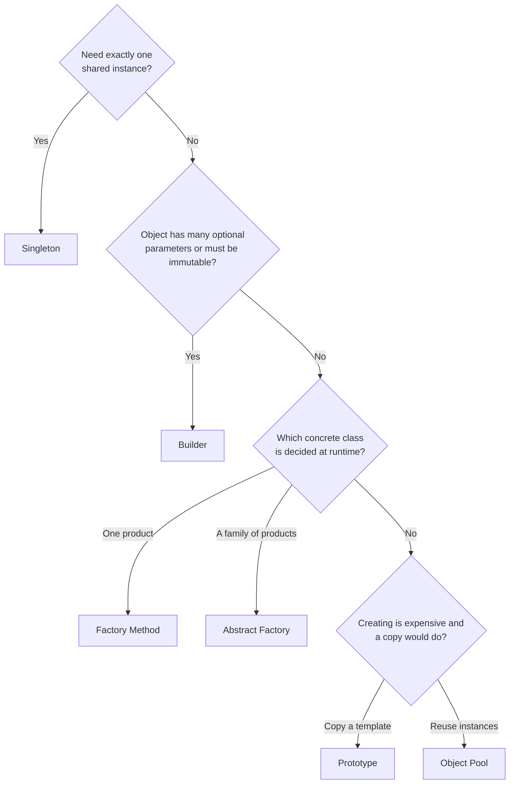

# Creational Patterns

Creational patterns answer one question: **who creates an object, when, and how?**
They separate *using* an object from *constructing* it, so the rest of your code doesn't depend on concrete classes or complicated set-up steps.

| Pattern | Problem it solves | Interview frequency | Status |
|---|---|---|---|
| [Singleton](singleton.md) | Exactly one shared instance (config, ID generator, registry) | ⭐⭐⭐⭐⭐ | ✅ |
| [Factory Method](factory-method.md) | Let subclasses or a method decide which class to instantiate | ⭐⭐⭐⭐⭐ | ✅ |
| [Abstract Factory](abstract-factory.md) | Create *families* of related objects that work together | ⭐⭐⭐⭐ | ✅ |
| [Builder](builder.md) | Build complex or immutable objects step by step | ⭐⭐⭐⭐⭐ | ✅ |
| [Prototype](prototype.md) | Create new objects by copying a configured one | ⭐⭐⭐ | ✅ |
| [Object Pool](object-pool.md) | Reuse expensive objects (connections, buffers) | ⭐⭐⭐ | ✅ |

