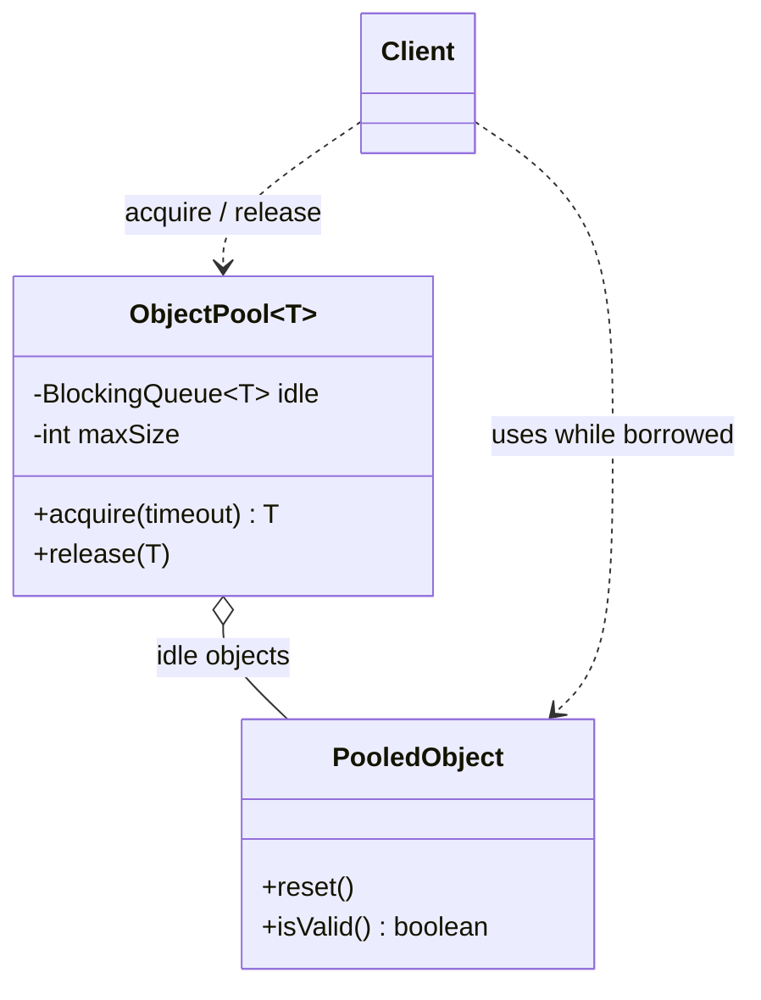
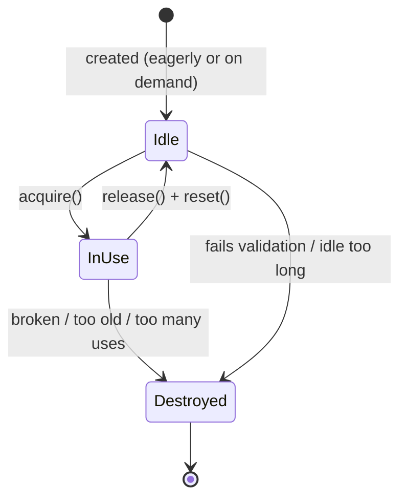
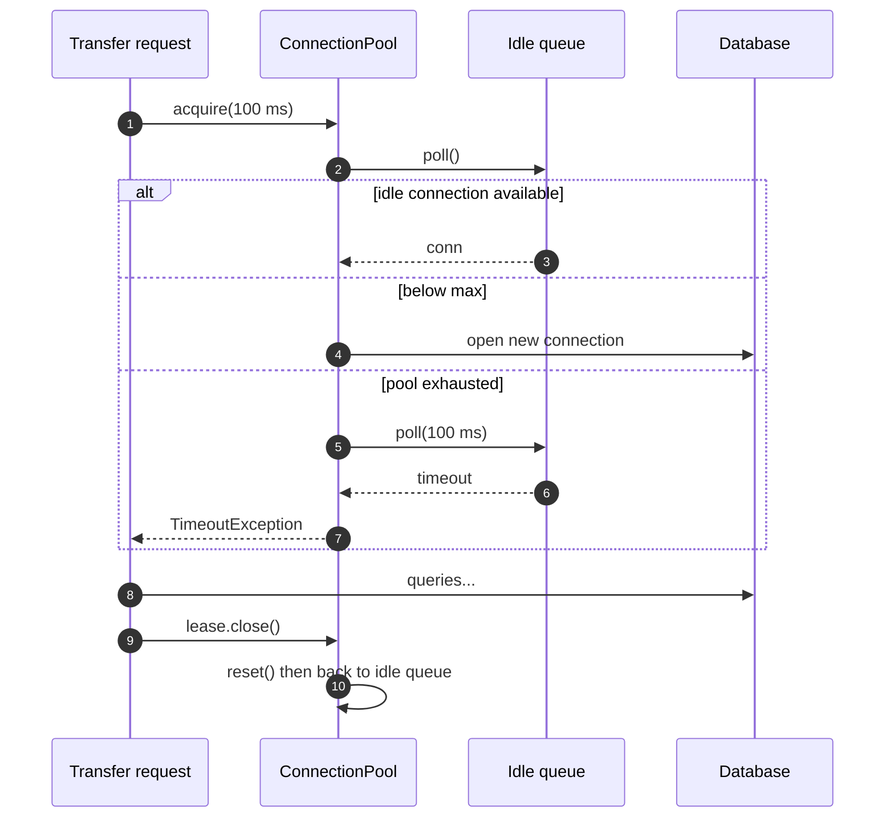
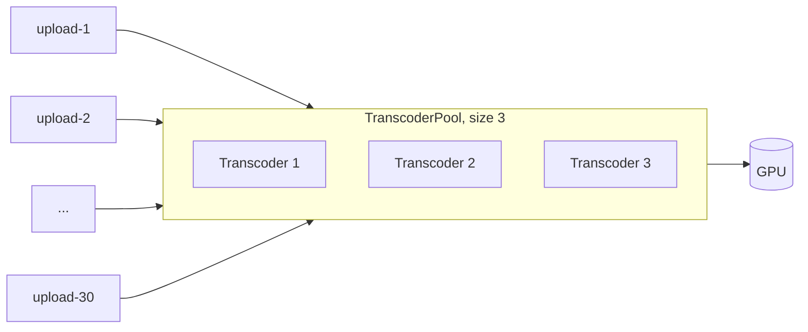
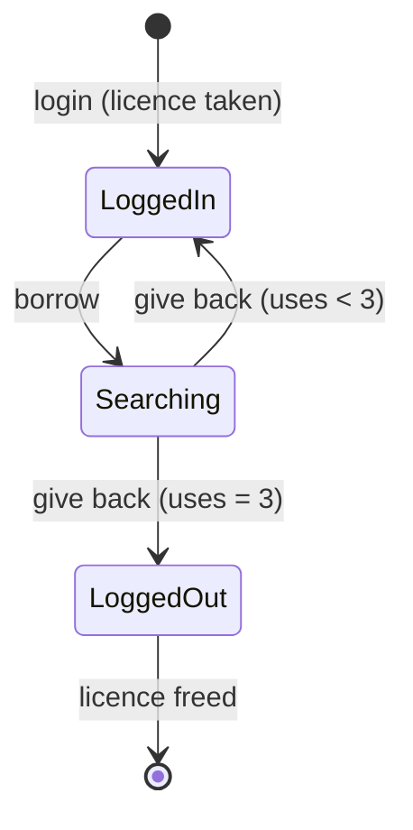

---
tags:
  - Creational
  - Advanced
---

# Object Pool

<span class="badge badge--advanced">🟡 Intermediate → 🔴 Advanced</span>
<span class="badge badge--category">Creational</span>
<span class="badge badge--interview">Interview frequency ⭐⭐⭐</span>

!!! abstract "TL;DR"
    **Object Pool keeps a set of expensive, reusable objects and lends them out instead of creating and destroying one per request.**
    Use it for objects that are **costly to create** or **limited in number** (database connections, licensed sessions, GPU workers). Don't use it for ordinary objects; the JVM allocates those faster than any pool.

---

## 1. Intent & Problem It Solves

**The problem in plain English:** opening a database connection takes a TCP handshake, a TLS handshake and authentication, around 20–100 ms. A banking API handling 2,000 requests per second can't afford that on every request. The database also allows only so many connections. So you open a fixed number once and **lend** them to requests, taking them back afterwards.

**Definition:** Object Pool isn't one of the 23 GoF patterns, but it's a classic creational pattern that appears in every production Java system:
> Manage a set of initialized objects that are ready to use. Clients **acquire** an object from the pool, use it, and **release** it back instead of destroying it.

The pool decides **how many** objects exist (bounded), **when** they're created (eagerly or lazily), and **whether** a returned object is still healthy.

## 2. Real-World Analogy

!!! example "A library's study rooms"
    A university library has 10 bookable study rooms. You borrow a key, use the room, and return the key. The library cleans the room between users (**reset**), takes a broken room out of service (**validation**), and if all rooms are taken you wait at the desk for a while (**timeout**). Building a new room for each student would be absurd.

## 3. Structure



| Participant | Responsibility |
|---|---|
| **Pool** | Tracks idle and in-use objects, enforces the **maximum**, creates objects on demand, **validates and resets** them |
| **Pooled object** | The expensive resource. Must be resettable to a clean state |
| **Client** | Acquires, uses and **always** releases (ideally via try-with-resources) |

**The lifecycle of a pooled object:**



## 4. Naive Approach (Without the Pattern)

```java
public BigDecimal balance(long accountId) throws SQLException {
    try (Connection c = DriverManager.getConnection(url, user, pass)) { // new connection EVERY call
        return queryBalance(c, accountId);
    }
}
```

**What goes wrong:**

- :material-close-circle:{ style="color:#e53935" } **Latency.** Each request pays 20–100 ms just to connect.
- :material-close-circle:{ style="color:#e53935" } **Overload.** A traffic spike opens thousands of connections and the database falls over (`too many connections`).
- :material-close-circle:{ style="color:#e53935" } **No back-pressure.** Nothing limits concurrency, so the system degrades for everyone instead of making some requests wait.

---

## 5. Three Real-World Examples

### Example 1: Connection Pool for a Ledger Service (Banking)

**Scenario:** A bank's ledger service reads balances and runs transfers against a database that allows this service **at most 2 connections** (a small number to keep the demo readable; real pools are often 10–50). Connections are opened lazily, reused, **reset** when returned (any open transaction is rolled back), **validated** when borrowed (a dropped connection is thrown away), and callers who can't get one within 100 ms get a clear error rather than hanging.

**Design:**



**Full Code:**

=== "ConnectionPool.java"

    ```java
    --8<-- "code/creational/src/main/java/com/handbook/creational/objectpool/banking/ConnectionPool.java"
    ```

    1.  A **bounded `BlockingQueue`** holds idle connections. It's thread-safe and supports "wait up to N ms", which is all a pool needs.
    2.  The **lease** implements `AutoCloseable`, so `try (var lease = pool.acquire(..))` returns the connection **even if the code throws**. Leaked connections are the most common pool bug. The `returned` flag makes double-close harmless.
    3.  **Validate on borrow.** A connection broken by a network drop is evicted and its slot freed.
    4.  **Lazy creation**, bounded by `maxSize`. The atomic counter makes "check and reserve a slot" a single step, so two threads can't both create the last connection.
    5.  At the limit, **wait** for a connection to come back, but only for `timeoutMs`. This is the pool's **back-pressure**.
    6.  **Reset on release.** The next borrower must never inherit an open transaction, session variables or a different schema.

=== "DbConnection.java"

    ```java
    --8<-- "code/creational/src/main/java/com/handbook/creational/objectpool/banking/DbConnection.java"
    ```

=== "BankingDemo.java"

    ```java
    --8<-- "code/creational/src/main/java/com/handbook/creational/objectpool/banking/BankingDemo.java"
    ```

**Output:**

```text
--8<-- "code/outputs/creational/objectpool/banking/BankingDemo.txt"
```

Follow the connection IDs: #1 is opened once and reused; #2 is opened only when two transfers overlap; the third request times out instead of overloading the database; and the broken #2 is evicted and replaced by #3.

**Why Object Pool here:**

- Connections are **expensive to create** and **limited by the database**.
- The pool provides **reuse**, a **hard concurrency limit**, **health checks** and **clean state**, all in one place.
- In production you'd use **HikariCP** (Spring Boot's default), which does all of this and much more. This example shows what it does internally.

---

### Example 2: Pre-Warmed Transcoder Workers (Streaming)

**Scenario:** A video platform transcodes every upload into several resolutions. A transcoder loads codec libraries and allocates GPU memory on start-up, which is slow, and the machine's GPU can only run **3** at once. Uploads arrive in bursts (here, 30 at once, each handled on its own virtual thread). The pool is **pre-warmed** with 3 transcoders at start-up, so no upload pays the start-up cost and the GPU is never oversubscribed.

**Design:**



**Full Code:**

=== "TranscoderPool.java"

    ```java
    --8<-- "code/creational/src/main/java/com/handbook/creational/objectpool/streaming/TranscoderPool.java"
    ```

    1.  **Eager (pre-warmed) creation**: pay the cost at start-up, never during a request. Good when the objects are always needed and slow to create.
    2.  `take()` **blocks** until a transcoder is free. With virtual threads, blocking is cheap: 27 waiting uploads cost almost nothing.
    3.  Returned in `finally`, so a failed transcode never loses a worker.

=== "Transcoder.java"

    ```java
    --8<-- "code/creational/src/main/java/com/handbook/creational/objectpool/streaming/Transcoder.java"
    ```

=== "StreamingDemo.java"

    ```java
    --8<-- "code/creational/src/main/java/com/handbook/creational/objectpool/streaming/StreamingDemo.java"
    ```

**Output:**

```text
--8<-- "code/outputs/creational/objectpool/streaming/StreamingDemo.txt"
```

30 uploads, 3 transcoders, never more than 3 busy at once. The pool turned a burst into an orderly queue.

**Why Object Pool here:**

- Workers are **expensive to start** and the hardware allows only a **fixed number**.
- The pool doubles as a **concurrency limiter**: it's the GPU's admission control.
- **Virtual threads + a pool** is a clean modern combination: threads are cheap, so you limit the **resource**, not the threads.

---

### Example 3: Licensed GDS Sessions with a Refresh Policy (Travel)

**Scenario:** An online travel agency searches fares through an airline Global Distribution System (GDS) such as Amadeus or Sabre. Each session requires a slow login, and the contract licenses only **2 concurrent sessions**. Sessions also go stale, so the provider recommends logging out and back in after a number of uses. The pool reuses sessions, enforces the licence limit, and **retires** a session after 3 uses (like HikariCP's `maxLifetime`).

**Design:**



**Full Code:**

=== "GdsSessionPool.java"

    ```java
    --8<-- "code/creational/src/main/java/com/handbook/creational/objectpool/travel/GdsSessionPool.java"
    ```

    1.  `withSession(work)` is the **"execute around"** idiom: the pool borrows, runs your code and **always** gives back. Callers can't forget to return a session. Only `borrow` and `giveBack` are `synchronized`, so the slow search itself runs without holding the lock.
    2.  **Retirement policy**: sessions that hit the use limit are logged out instead of being reused, which frees the licence for a fresh login.

=== "GdsSession.java"

    ```java
    --8<-- "code/creational/src/main/java/com/handbook/creational/objectpool/travel/GdsSession.java"
    ```

=== "TravelDemo.java"

    ```java
    --8<-- "code/creational/src/main/java/com/handbook/creational/objectpool/travel/TravelDemo.java"
    ```

**Output:**

```text
--8<-- "code/outputs/creational/objectpool/travel/TravelDemo.txt"
```

S1 serves 3 searches and is retired (its logout line prints before the third result because `giveBack` runs before the result is printed). The nested search shows two sessions in use at once: S2 for the outer search and a fresh login S3 for the inner one.

**Why Object Pool here:**

- Sessions are **slow to create** and **contractually limited**: the pool enforces the licence.
- **Retirement** keeps sessions fresh without callers knowing.
- **Execute-around** makes leaks impossible by design.

---

??? example "Unit Tests: `ObjectPoolTest.java` (all three examples + challenge)"

    ```java
    --8<-- "code/creational/src/test/java/com/handbook/creational/objectpool/ObjectPoolTest.java"
    ```

## 6. Variations & Modern Java Take

| Variation | Notes |
|---|---|
| **Lazy vs. eager (pre-warmed)** | Lazy saves resources at low load; eager avoids first-request latency (`minimumIdle` in HikariCP) |
| **Validate on borrow / on return / in the background** | Borrow-time checks are safest; background checks keep borrow fast |
| **Max lifetime / max uses / idle timeout** | Retire objects before infrastructure (firewalls, load balancers) kills them silently |
| **Lease objects (`AutoCloseable`)** | try-with-resources guarantees release |
| **Execute-around (`withX(work)`)** | The pool controls the whole borrow/use/return cycle |
| **Semaphore-limited pools** (challenge) | A `Semaphore` enforces the maximum, and a queue holds idle objects |

!!! warning "Virtual threads change the thread-pool story, not the resource-pool story"
    With Java 21 virtual threads you should **stop pooling threads** (create one per task; they're cheap). But you still **pool the resources** those threads use: database connections, HTTP connections, GPU workers. If anything, virtual threads make resource pools **more** important, because a million cheap threads can easily overwhelm a database. Use pools or `Semaphore`s to cap concurrent access.

**Don't pool cheap objects.** Pooling ordinary objects (DTOs, small buffers) to "help the GC" was common advice in the early 2000s. Modern JVM allocation is a pointer bump, and young-generation GC is extremely efficient. Pools add contention, complexity, and bugs (stale state, leaks). Pool only when **creation is expensive** (I/O, native memory) or **the count must be limited**.

## 7. Where It Lives in Real Frameworks

| Where | Pooled resource |
|---|---|
| **HikariCP** (Spring Boot default), Apache DBCP, c3p0 | JDBC connections |
| Apache HttpClient `PoolingHttpClientConnectionManager`, OkHttp `ConnectionPool`, JDK `HttpClient` | HTTP keep-alive connections |
| Netty `PooledByteBufAllocator` | Direct (off-heap) byte buffers |
| Lettuce / Jedis (`JedisPool`) | Redis connections |
| Apache Commons Pool 2 `GenericObjectPool` | Anything; the general-purpose pool library |
| `java.util.concurrent.ThreadPoolExecutor` | Platform threads (see **Thread Pool** in the Concurrency section) |
| Jakarta EE | Stateless EJB pools, JCA connection pools |
| JDK | `Integer.valueOf(-128..127)` cache (a fixed pool of immutable objects; really Flyweight) |

## 8. Pros, Cons & Trade-offs

| ✅ Pros | ❌ Cons |
|---|---|
| Removes **expensive creation** from the request path | **Leaks**: a borrower that doesn't return an object shrinks the pool forever |
| **Bounds concurrency** to what the downstream can handle | **Stale state**: forgetting to reset leaks data between borrowers |
| **Back-pressure** with timeouts instead of overload | **Contention**: the pool becomes a bottleneck if it's too small |
| Central place for **health checks** and retirement | **Sizing is hard**: too small means waiting, too big overloads the downstream |
| | Pointless (and harmful) for cheap objects |

## 9. Pitfalls & Anti-Patterns

!!! danger "Connection leaks"
    A code path that forgets to release (an exception before `close()`) slowly drains the pool until every request times out. **Always** use try-with-resources or execute-around. Turn on leak detection (HikariCP's `leakDetectionThreshold`).

!!! danger "Not resetting state"
    A connection returned mid-transaction, or with `SET search_path` changed, poisons the next borrower. Reset on release (Example 1) and validate on borrow.

!!! danger "Holding a pooled object during slow work"
    Borrowing a DB connection, then calling a slow external API before running the query, keeps the connection idle-but-taken. Acquire **late**, release **early**.

!!! warning "Pool size = thread count"
    "200 Tomcat threads, so 200 DB connections" overloads most databases. A common starting point for HikariCP is `connections = (core_count * 2) + effective_spindle_count`, which is often 10–20, not hundreds. Measure.

!!! warning "Waiting forever"
    `take()` without a timeout turns a downstream outage into a thread pile-up. Always bound the wait (`connectionTimeout`) and fail fast.

## 10. Senior / Architect Deep Dive (10–15 yrs)

**Sizing with Little's Law.** Average connections in use = **throughput × average time holding a connection**. At 1,000 requests/s with each request holding a connection for 5 ms, you need about **5** connections on average; add headroom for bursts (say 10–15). If the math says you need 200, the fix is usually **shorter hold times** (better queries, release earlier), not a bigger pool.

**Fleet-wide limits.** A pool of 20 in each of 50 pods means **1,000** connections to one database. Pool sizing is a **system-level** decision: sum over all instances, or put a proxy in front (PgBouncer, RDS Proxy) that multiplexes many client connections onto few server connections.

**Observability.** Export pool metrics (HikariCP exposes them to Micrometer): active, idle, pending threads, acquire-time percentiles, timeouts. Alert on **pending > 0 for minutes** and **acquire p99** rising, which are early warnings before timeouts.

**Bulkheads.** Separate pools per downstream or per workload (critical payments vs. reporting queries) so one slow dependency can't drain the pool everyone needs. This is the **Bulkhead** pattern, covered in the microservices section.

**Retirement matters.** Firewalls and cloud load balancers silently drop idle TCP connections (often after 350 s on AWS NLBs). Set the pool's max lifetime and idle timeout **below** infrastructure timeouts, or borrowers get dead connections.

!!! bug "War story: Black Friday and the 30-second hang"
    An e-commerce checkout called a fraud-scoring API **while holding** a database connection (it opened a transaction, called fraud, then wrote the order). On Black Friday the fraud API slowed from 50 ms to 4 s. Every checkout thread held a connection for 4 s, the pool of 30 drained in under a second, and `connectionTimeout` was the default **30 seconds**, so threads piled up waiting. The whole site, including product pages that only needed a quick read, timed out.
    **Fix:** moved the fraud call **before** acquiring the connection; set `connectionTimeout` to 2 s with a clear error; split pools for checkout and catalogue reads (a bulkhead); added an alert on pending connection requests.
    **Lesson:** the pool reflects how you use it. Hold time drives everything, so acquire late and release early.

## 11. Related Patterns & Comparisons

| | Object Pool | Flyweight | Singleton | Prototype |
|---|---|---|---|---|
| Objects | Many, **reusable**, mutable while borrowed | Many, **shared**, immutable | **One** | Many **copies** |
| Exclusive use? | **Yes**: one borrower at a time | No: shared by everyone at once | No | Each copy is its own |
| Purpose | Avoid expensive creation, **limit count** | Save **memory** | One global instance | Avoid expensive **setup** |
| Example | DB connections | `Integer.valueOf` cache, glyphs | Config | Templates |

**Related:** Thread Pool (a pool of workers), Bulkhead (separate pools to isolate failures), Factory Method (the pool's `create` step), Proxy (a pooled connection's `close()` often returns it to the pool instead of closing it; HikariCP wraps connections in a proxy to do exactly that).

## 12. Interview Corner

=== "🟢 Beginner / Service Companies"

    **Q1. What is the Object Pool pattern?**

    A creational pattern that keeps a **set of reusable objects**. Clients **borrow** an object and **return** it instead of creating and destroying one each time. It's used for **expensive** objects like database connections.

    **Q2. Give real examples.**

    **JDBC connection pools** (HikariCP), HTTP connection pools, thread pools (`ExecutorService`) and Redis connection pools.

    **Q3. What happens when the pool is empty?**

    Depending on configuration, the pool **creates a new object** (if below the maximum), makes the caller **wait** (with a timeout), or **fails** immediately.

    **Q4. Why reset an object when it's returned?**

    So the next borrower gets a **clean state**: no open transaction, no leftover data from the previous user.

    **Q5. Should we pool every object?**

    **No.** Only **expensive or limited** resources. For normal objects, the JVM's allocation and garbage collection are faster than a pool.

=== "🟡 Mid-Level"

    **Q1. How do you prevent leaks?**

    Make release **automatic**: return an `AutoCloseable` lease for try-with-resources, or use **execute-around** (`pool.withSession(work)`). Add **leak detection** that logs where an object was borrowed if it isn't returned within N seconds.

    **Q2. How would you implement a thread-safe pool?**

    A `BlockingQueue` for idle objects plus a **`Semaphore`** or atomic counter for the maximum (see the coding challenge). Validate on borrow, reset on return, and always bound waits with a **timeout**.

    **Q3. How do you size a DB connection pool?**

    Start from **Little's Law** (throughput × hold time), add headroom, and check the **database's total limit across all instances**. Then load-test and watch acquire-time percentiles. It's usually much smaller than the thread count.

    **Q4. With virtual threads, do we still need pools?**

    You stop pooling **threads**, but you still pool **connections and other limited resources**. Virtual threads make it easy to create far more concurrent work than a database can handle, so resource limits matter more.

    **Q5. What does HikariCP's `maxLifetime` do and why?**

    It **retires** connections after a set time, so they're replaced before the database or network infrastructure kills them silently. It should be shorter than any infrastructure idle timeout.

=== "🔴 Senior / FAANG / SAP"

    **Q1. "Our service times out under load and the DB is at 20% CPU. Diagnose."**

    Likely **pool starvation**: check pending acquires, active connections and acquire-time p99. Common causes: slow calls **while holding** a connection, long transactions, **leaks**, or a pool that's too small for the hold time. Fix hold time first (acquire late, release early), add **bulkheads**, set aggressive acquire timeouts, and only then resize.

    **Q2. "100 pods each with a pool of 25 connect to one Postgres. What breaks, and what do you do?"**

    **2,500 connections**, and each Postgres connection is a process with real memory cost, so the database thrashes. Options: **smaller per-pod pools**, a **connection proxy** (PgBouncer in transaction mode, RDS Proxy), read replicas for reads, or moving work to async queues. Size pools as a **fleet-wide budget**.

    **Q3. "Design a pool for an external API that allows 10 concurrent sessions per API key, shared by 30 instances."**

    A local pool can't enforce a **global** limit. Use a **distributed semaphore** (Redis with leases and TTLs), or route all calls through a **dedicated gateway service** that owns the 10 sessions. Discuss lease expiry when an instance dies, fairness, and back-pressure to callers.

    **Q4. "When is pooling a bad idea?"**

    For **cheap objects** (allocation is faster), **objects that are hard to reset** (risk of leaking data between users or tenants), and when pooling hides a design problem like long hold times. Also for objects that can't be safely shared between threads sequentially.

    **Q5. "Pool vs. Flyweight: what's the difference?"**

    A pool gives **exclusive, temporary** use of a **mutable** object. A flyweight is an **immutable, shared** object used by many at once. Connections are pooled; `Integer.valueOf` cached instances are flyweights.

=== "💻 Coding Challenge"

    **Problem:** Write a generic, thread-safe `ObjectPool<T>` with a maximum size, a factory (`Supplier<T>`), a validator (`Predicate<T>`, discard invalid objects), a reset step (`Consumer<T>`) and a borrow timeout. Creation failures must not "leak" capacity.

    ??? success "Solution"

        === "ObjectPool.java"

            ```java
            --8<-- "code/creational/src/main/java/com/handbook/creational/objectpool/generic/ObjectPool.java"
            ```

        === "GenericPoolDemo.java"

            ```java
            --8<-- "code/creational/src/main/java/com/handbook/creational/objectpool/generic/GenericPoolDemo.java"
            ```

        **Output:**

        ```text
        --8<-- "code/outputs/creational/objectpool/generic/GenericPoolDemo.txt"
        ```

        **Key points to say:** the **semaphore** caps borrowed objects (in use, not just created), so the maximum holds even while objects are being created; invalid idle objects are dropped and replaced; if the factory throws, the permit is **released** so capacity isn't lost; and `giveBack` releases the permit in `finally`, so a failing reset can't shrink the pool. A follow-up would add leak detection and metrics.

!!! info "Behavioural tie-in (STAR) for experienced candidates"
    - **S:** Checkout timed out site-wide on our biggest sale day while the database looked idle.
    - **T:** Restore service, then make sure one slow dependency couldn't take down the site again.
    - **A:** Identified connection-pool starvation from a fraud call made inside a transaction; moved the call out, cut the acquire timeout to 2 s, split pools per workload, and added pending-acquire alerts.
    - **R:** Checkout p99 fell from 30 s to 180 ms; the next year's sale ran at 3× the traffic without pool alerts.

## 13. Quick Revision Card

!!! tip "Remember in 30 seconds"
    - **Borrow, use, return** expensive or limited objects instead of creating them per request.
    - **Bounded** (max size), **validated** (on borrow), **reset** (on return), **timeouts** (never wait forever).
    - **Prevent leaks** with try-with-resources or execute-around.
    - **Size with Little's Law** and think fleet-wide; hold time matters more than pool size.
    - **Don't pool cheap objects. With virtual threads, pool resources, not threads.**

    ```java
    try (var lease = pool.acquire(100)) { lease.connection().query("SELECT 1"); } // auto-returned
    ```

## Practice

- [ ] Add leak detection to `ConnectionPool`: log a warning if a lease isn't closed within 1 second.
- [ ] Add an idle timeout to `GdsSessionPool` (log out sessions unused for N seconds).
- [ ] Replace `ConnectionPool` with HikariCP in a Spring Boot app and look at its metrics in `/actuator/metrics`.
- [ ] Load-test `TranscoderPool` with sizes 1–6 and plot throughput against pool size.

---

[:material-arrow-left: Prototype](prototype.md){ .md-button }
[Next: Structural Patterns :material-arrow-right:](../structural/index.md){ .md-button .md-button--primary }
