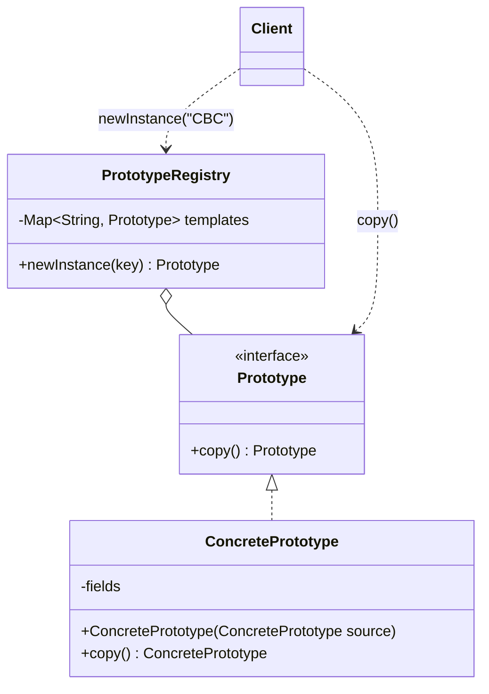
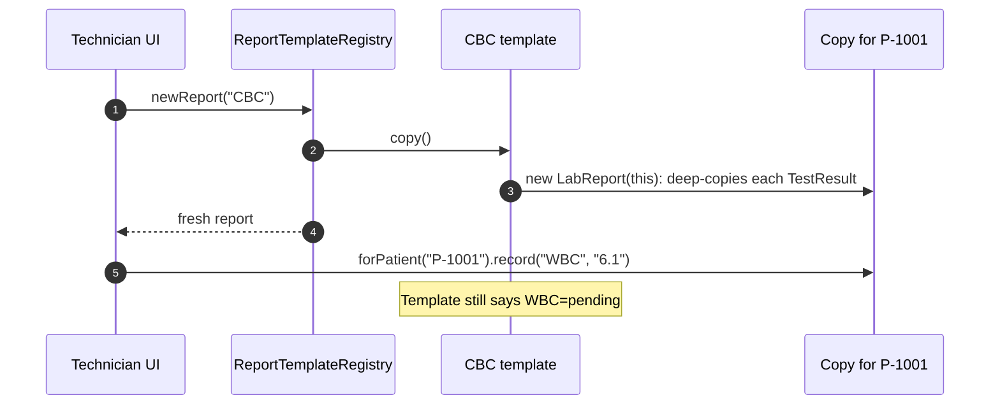
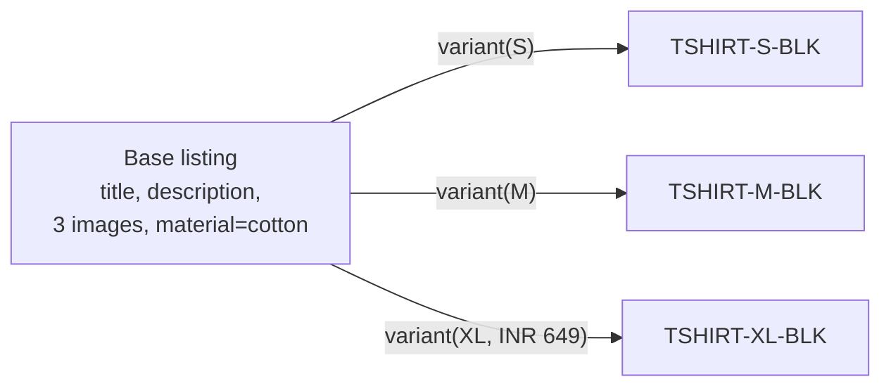
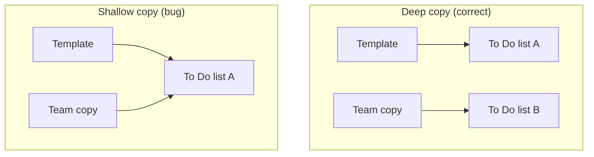

---
tags:
  - Creational
  - Intermediate
---

# Prototype

<span class="badge badge--intermediate">🟡 Intermediate</span>
<span class="badge badge--category">Creational</span>
<span class="badge badge--interview">Interview frequency ⭐⭐⭐</span>

!!! abstract "TL;DR"
    **Prototype creates new objects by copying an existing, already-configured object instead of building from scratch.**
    Use it when setting up an object is expensive or complex, and most new objects are "the same as that one, with small changes". The hard part is **deep vs. shallow copy**.

---

## 1. Intent & Problem It Solves

**The problem in plain English:** a hospital's "Complete Blood Count" report has a fixed list of tests and reference ranges, loaded from a slow master-data service. Every patient gets one. Rebuilding it from scratch for each patient is slow and repetitive. Copying a ready-made template and filling in the patient details is fast and simple, **as long as the copy doesn't share anything mutable with the template**.

**Formal definition (GoF):**
> Specify the kinds of objects to create using a prototypical instance, and create new objects by copying this prototype.

## 2. Real-World Analogy

!!! example "Photocopying a form"
    A clinic doesn't typeset a new intake form for each patient. It keeps one master copy and photocopies it. Each patient writes on **their** copy. If the clinic instead handed everyone the *same sheet of paper* (a shallow copy), every patient would be writing on top of each other.

## 3. Structure



| Participant | Responsibility |
|---|---|
| **Prototype** | Declares the copy operation (`copy()`, or a copy constructor) |
| **ConcretePrototype** | Copies itself correctly, deep-copying mutable parts |
| **Registry** *(optional)* | Stores named, pre-configured prototypes and hands out **copies** |
| **Client** | Asks for a copy and customizes it |

## 4. Naive Approach (Without the Pattern)

```java
// Rebuilding the template for every patient
LabReport report = new LabReport("Complete Blood Count",
        masterData.loadTests("CBC"));        // slow remote call, every time

// ...or "reusing" the template directly
LabReport report = templates.get("CBC");    // NOT a copy!
report.record("WBC", "6.1");                // every future patient now sees WBC=6.1
```

**What goes wrong:**

- :material-close-circle:{ style="color:#e53935" } **Repeated expensive setup.** The same data is loaded and assembled again and again.
- :material-close-circle:{ style="color:#e53935" } **Shared mutable state.** Handing out the template itself (or a shallow copy) leaks one patient's data into the next report, a serious privacy incident in healthcare.

---

## 5. Three Real-World Examples

### Example 1: Lab Reports from Templates (Healthcare)

**Scenario:** A hospital lab runs thousands of panels a day: blood counts, lipid profiles and so on. Each panel has a fixed set of tests and reference ranges that come from a master-data service. When a sample arrives, a technician needs a fresh report for that patient. The templates are loaded **once** into a registry; each new report is a **deep copy**, so results for one patient can never appear on another's report.

**Design:**



**Full Code:**

=== "LabReport.java"

    ```java
    --8<-- "code/creational/src/main/java/com/handbook/creational/prototype/healthcare/LabReport.java"
    ```

    1.  A **private copy constructor** does the real work. Making it private keeps `copy()` as the one public way to clone.
    2.  **Deep copy:** each `TestResult` is mutable (its `value` changes), so each one is copied. Copying only the list would leave both reports pointing at the same `TestResult` objects.
    3.  `copy()` returns the concrete type, so callers don't need a cast (unlike `Object.clone()`).

=== "ReportTemplateRegistry.java"

    ```java
    --8<-- "code/creational/src/main/java/com/handbook/creational/prototype/healthcare/ReportTemplateRegistry.java"
    ```

    1.  The registry **never** returns the template itself, only a copy.

=== "LabDemo.java"

    ```java
    --8<-- "code/creational/src/main/java/com/handbook/creational/prototype/healthcare/LabDemo.java"
    ```

**Output:**

```text
--8<-- "code/outputs/creational/prototype/healthcare/LabDemo.txt"
```

**Why Prototype here:**

- Templates are **expensive to assemble** (master data) and **cheap to copy**.
- The **registry** gives "named templates" that the lab can extend without code changes.
- A **deep copy** guarantees patient data never leaks between reports.

---

### Example 2: Product Variants (E-commerce)

**Scenario:** A fashion marketplace lists a T-shirt in many sizes and colours. Each variant shares the title, long description, image gallery and most attributes, and differs only in SKU, size and sometimes price. Sellers upload one **base listing**; the catalogue service generates the variants by copying it and changing a few fields. Editing one variant (adding a size attribute) must never change the base listing or another variant.

**Design:**



**Full Code:**

=== "ProductListing.java"

    ```java
    --8<-- "code/creational/src/main/java/com/handbook/creational/prototype/ecommerce/ProductListing.java"
    ```

    1.  A **public copy constructor** is the idiomatic Java Prototype (*Effective Java*, Item 13 recommends it over `clone()`): explicit, type-safe, works with `final` fields, and doesn't need `Cloneable`.
    2.  It delegates to the main constructor, which already makes **defensive copies** of the list and map. Strings and `int` are immutable, so sharing them is safe.

=== "FashionCatalogDemo.java"

    ```java
    --8<-- "code/creational/src/main/java/com/handbook/creational/prototype/ecommerce/FashionCatalogDemo.java"
    ```

**Output:**

```text
--8<-- "code/outputs/creational/prototype/ecommerce/FashionCatalogDemo.txt"
```

**Why Prototype here:**

- Variants are **"the base, plus a few changes"**, which is exactly what copying expresses.
- Adding `size` to a variant's attributes doesn't affect the base, because each copy has its **own map**.
- Sellers manage **one** listing; the system generates the rest.

---

### Example 3: Workspace Templates and the Shallow-Copy Bug (SaaS)

**Scenario:** A project-management SaaS (Jira/Asana-style) lets companies define board templates, such as "Product Launch" with standard columns and starter tasks. When a team starts a launch, it gets its **own** board copied from the template and adds team-specific tasks. A real incident at a company like this: a "copy" shared its column lists with the template, so one team's tasks appeared in **every** board created afterwards. This example shows the correct deep copy **and** reproduces the bug.

**Design:**



**Full Code:**

=== "Board.java"

    ```java
    --8<-- "code/creational/src/main/java/com/handbook/creational/prototype/saas/Board.java"
    ```

    1.  **New list for each column.** The `Task` objects inside are immutable records, so they can safely be shared. Deep-copy what's mutable, share what's immutable.
    2.  `putAll` copies the **map**, but the values are the **same list objects**, so adding a task to the copy also adds it to the template.

=== "Task.java"

    ```java
    --8<-- "code/creational/src/main/java/com/handbook/creational/prototype/saas/Task.java"
    ```

=== "WorkspaceDemo.java"

    ```java
    --8<-- "code/creational/src/main/java/com/handbook/creational/prototype/saas/WorkspaceDemo.java"
    ```

**Output:**

```text
--8<-- "code/outputs/creational/prototype/saas/WorkspaceDemo.txt"
```

The last line shows the bug: the template went from 2 to 3 tasks because the shallow copy shared its lists.

**Why Prototype here:**

- Templates are complex **nested structures** that users configure through the UI, so there's no code that could "build" them from scratch.
- Copying preserves exactly what the admin configured.
- The example makes the **depth of the copy** visible, which is the one thing that decides whether Prototype is safe.

---

??? example "Unit Tests: `PrototypeTest.java` (all three examples + challenge)"

    ```java
    --8<-- "code/creational/src/test/java/com/handbook/creational/prototype/PrototypeTest.java"
    ```

## 6. Variations & Modern Java Take

| Technique | Verdict |
|---|---|
| **Copy constructor** `new X(other)` | ✅ Preferred. Explicit, type-safe, works with `final` fields |
| **Static copy factory** `X.copyOf(other)` | ✅ Same benefits, and can return a subtype or cached instance |
| **`copy()` method** (Example 1) | ✅ Good when callers have only the interface type (polymorphic copy) |
| **`Object.clone()` + `Cloneable`** | ⚠️ Avoid in new code: shallow by default, bypasses constructors, checked `CloneNotSupportedException`, doesn't work with `final` fields |
| **Serialization round-trip** | ⚠️ Deep, but slow, and requires everything to be `Serializable`; fine in tests only |
| **Immutable objects** (records) | ✅ Often removes the need to copy at all. Share them, and use "withers" for changes |

**Immutability is the best Prototype.** If `TestResult` were an immutable record and changes returned new instances, copying the list (or using `List.copyOf`) would be enough. Prefer immutable leaves and deep-copy only the mutable containers, as Example 3 does with `Task`.

**Copying arrays and collections:**

```java
int[] a2 = a.clone();                 // arrays: clone() is fine (shallow for object arrays)
List<Item> l2 = new ArrayList<>(l);   // new list, SAME Item objects (shallow)
List<Item> l3 = l.stream().map(Item::copy).toList();  // deep
Map<K, List<V>> deep = new HashMap<>();
src.forEach((k, v) -> deep.put(k, new ArrayList<>(v))); // deep one level
```

## 7. Where It Lives in Real Frameworks

| Where | Example |
|---|---|
| JDK | `Object.clone()` / `Cloneable`; `ArrayList.clone()`, `HashMap.clone()` (shallow); array `clone()` |
| JDK | Copy constructors: `new ArrayList<>(collection)`, `new HashMap<>(map)`, `new String(chars)` |
| JDK | `List.copyOf`, `Map.copyOf`, `EnumSet.copyOf` (static copy factories) |
| Spring | **`prototype` bean scope**: a new instance every time the bean is requested (named after this pattern, though it creates rather than copies) |
| Spring | `BeanDefinition` "parent" definitions: child beans inherit and override a template definition |
| Jackson | `objectMapper.copy()`, `JsonNode.deepCopy()` |
| Others | Protobuf `message.toBuilder()`, game engines cloning entity prefabs, document editors' "duplicate slide" |

## 8. Pros, Cons & Trade-offs

| ✅ Pros | ❌ Cons |
|---|---|
| **Avoids repeating expensive setup** (I/O, computation, configuration) | **Deep vs. shallow** copy is easy to get wrong, and the bugs are subtle |
| Create objects whose exact class you don't know (polymorphic `copy()`) | Circular references make deep copies tricky |
| **Registry** of templates is configurable at runtime, without new classes | Every new mutable field must be added to the copy logic |
| Works well with user-configured objects (templates, presets) | `clone()` in Java is badly designed; you need to know the pitfalls |

## 9. Pitfalls & Anti-Patterns

!!! danger "Shallow copies of mutable fields"
    The single biggest Prototype bug (Example 3). Every mutable field (collections, arrays, `Date`, mutable objects) needs its own copy. Immutable fields (`String`, records, `LocalDate`) can be shared.

!!! danger "Handing out the prototype itself"
    A registry that returns `templates.get(key)` instead of `templates.get(key).copy()` makes every caller share one object.

!!! warning "`clone()` surprises"
    `super.clone()` copies fields **bit for bit** without running constructors, so `final` fields that need deep copies can't be reassigned, and invariants set up in constructors are skipped.

!!! warning "Forgetting new fields"
    Someone adds `List<String> tags` to the class and not to the copy constructor; now copies share tags. Guard it with a test that mutates every field of the copy and checks the original.

!!! warning "Copying identity"
    IDs, database keys, version numbers and audit timestamps usually must **not** be copied. Reset them in the copy (Example 1 resets nothing because patient ID is set right after; in real code, reset it in the copy constructor).

## 10. Senior / Architect Deep Dive (10–15 yrs)

**Copy semantics are part of the API contract.** Document whether a copy is deep or shallow and which fields are reset (IDs, timestamps, version). In code review, look for every mutable field and ask "who else holds a reference to this?"

**Prefer immutability over clever copying.** Immutable value objects (records, `List.copyOf`) make sharing safe and copying trivial. In large systems the long-term fix for copy bugs is to make leaves immutable and keep mutation inside a few aggregate roots.

**Copy-on-write and persistent data structures.** For read-heavy shared state (configuration, routing tables), keep an immutable snapshot and replace it atomically on change: `AtomicReference<Config>` + build-new-then-swap. Readers never see a half-updated object and never need locks. `CopyOnWriteArrayList` does the same for lists.

**Templates in multi-tenant SaaS.** Store templates as data (JSON) and create instances by copying, while recording the **template version** in each copy. Later you can answer "which teams were created from v3 of the template?" and offer migrations.

**Performance.** Copying is usually far cheaper than recreating objects that need I/O. For large object graphs, measure: a deep copy of a huge graph can be more expensive than rebuilding, and a lazy copy-on-write scheme may be better.

!!! bug "War story: one tenant's settings in another tenant's workspace"
    A B2B SaaS created new customer workspaces by copying a "default workspace" object held in memory. The copy constructor copied the `Map<String, Object>` of settings with `new HashMap<>(settings)`, but some values were nested mutable maps (notification rules). When customer A edited their notification rules, the shared nested map changed, and every workspace created afterwards on that pod got A's rules, including A's internal email addresses.
    **Fix:** settings moved to immutable records; templates stored as JSON and deserialized for each new workspace; a test now mutates every field of a copy and asserts the template is unchanged.
    **Lesson:** "deep enough" isn't one level deep. Copy depth must match the depth of mutability.

## 11. Related Patterns & Comparisons

| | Prototype | Builder | Factory Method | Singleton |
|---|---|---|---|---|
| Creates by | **Copying** an existing object | Step-by-step **assembly** | Choosing a **class** | Returning **the one** instance |
| Best when | Setup is expensive or user-configured | Many optional parameters | Type depends on input | Exactly one instance needed |
| Key risk | Shallow-copy bugs | Forgetting fields in `toBuilder()` | Silent defaults | Global mutable state |

**Shallow vs. deep copy**, the classic interview table:

| | Shallow copy | Deep copy |
|---|---|---|
| Top-level object | New | New |
| Primitive / immutable fields | Copied (safe) | Copied (safe) |
| Mutable referenced objects | **Shared** | **Copied recursively** |
| Cost | Cheap | Proportional to graph size |
| Java default | `Object.clone()`, `new ArrayList<>(list)` | You write it |

## 12. Interview Corner

=== "🟢 Beginner / Service Companies"

    **Q1. What is the Prototype pattern?**

    A creational pattern that creates new objects by **copying an existing object** (the prototype) instead of creating them from scratch. It's useful when creation is **expensive** or the object is pre-configured.

    **Q2. What is the difference between a shallow copy and a deep copy?**

    A **shallow** copy copies field values, so referenced objects are **shared**. A **deep** copy also copies the referenced mutable objects, so the two are **fully independent**.

    **Q3. How does `clone()` work in Java?**

    The class implements the **`Cloneable`** marker interface and overrides `clone()`, calling `super.clone()`, which makes a **field-by-field shallow copy** without calling constructors. Without `Cloneable` it throws `CloneNotSupportedException`.

    **Q4. Why do many experts avoid `clone()`?**

    It's **shallow by default**, **skips constructors**, doesn't work well with **`final` fields**, returns `Object`, and uses a checked exception. **Copy constructors** or static copy factories are clearer.

    **Q5. Give a real-world example.**

    Document or report templates, product variants, game characters spawned from a prefab, and Spring's `prototype` scope (a new bean per request).

=== "🟡 Mid-Level"

    **Q1. How do you deep-copy an object that contains a `List<Order>`?**

    Create a new list and copy each `Order` (`list.stream().map(Order::copy).toList()`). If `Order` is **immutable**, copying the list alone is enough.

    **Q2. What is a prototype registry?**

    A map of **named, pre-configured** prototypes; clients ask for a key and receive a **copy** (Example 1). It allows new "types" to be added as data at runtime.

    **Q3. Spring `prototype` scope vs. the Prototype pattern?**

    Spring's `prototype` scope means **a new instance per request**, built by the container, **not copied**. The pattern is about **cloning** a configured instance. They share a name, not a mechanism. Also note: Spring doesn't manage the destruction of prototype beans.

    **Q4. How would you test a copy method?**

    Copy, then **mutate every mutable field** of the copy and assert the original is unchanged; also assert the copy's values are equal right after copying. Add the test when you add a field.

    **Q5. How do you handle circular references in a deep copy?**

    Keep an **`IdentityHashMap<original, copy>`** of objects already copied. Before copying a node, check the map and reuse the existing copy. This also preserves shared references inside the graph.

=== "🔴 Senior / FAANG / SAP"

    **Q1. "Design 'create project from template' for a SaaS with 50k tenants."**

    Templates as **versioned data** (JSON) in a store; instances created by deserializing and **resetting identity** (new IDs, owners, timestamps); copy is **deep by construction** because it comes from serialized data. Record the **template ID and version** in each instance. Discuss **large templates** (async creation with progress), **permissions** (who can publish templates), and **migrations** when templates change.

    **Q2. "A shared config object is read by 200 threads and occasionally updated. How do you avoid locks and torn reads?"**

    **Immutable snapshot + atomic swap**: build a new config (copying and modifying the old one), then `AtomicReference.set()`. Readers call `get()` and see a consistent snapshot without locking. This is copy-on-write.

    **Q3. "Our deep-copy code is 15% of CPU in a hot path. What do you do?"**

    Profile to confirm; then **avoid copying**: make objects immutable and share them, use **persistent data structures** (structural sharing), copy **lazily** (copy-on-write when a mutation actually happens), or reduce what's copied (only the mutable part).

    **Q4. "Is `clone()` broken? Defend your answer."**

    Its **design** is flawed: `Cloneable` has no `clone` method, so you can't call `clone()` through the interface; the copy bypasses constructors; it's shallow by default; and it fights `final`. It works for **arrays** and simple classes, but copy constructors are safer and clearer. Bloch: "a fine approach to object copying is to provide a copy constructor or copy factory."

    **Q5. "Where does Prototype show up in distributed systems?"**

    **Immutable snapshots** shipped between services; **container images and VM templates** (clone a golden image); **database template schemas** (Postgres `CREATE DATABASE ... TEMPLATE`); and **infrastructure as code** modules instantiated per environment.

=== "💻 Coding Challenge"

    **Problem (grocery "Reorder"):** A customer taps "Reorder" on last week's cart. Implement `Cart.copy()` so that changing quantities or adding lines in the new cart **never** changes last week's cart. Lines are mutable (the quantity can change).

    ??? success "Solution"

        === "Cart.java"

            ```java
            --8<-- "code/creational/src/main/java/com/handbook/creational/prototype/cart/Cart.java"
            ```

        === "ReorderDemo.java"

            ```java
            --8<-- "code/creational/src/main/java/com/handbook/creational/prototype/cart/ReorderDemo.java"
            ```

        **Output:**

        ```text
        --8<-- "code/outputs/creational/prototype/cart/ReorderDemo.txt"
        ```

        **Key points to say:** `Line` is mutable, so each line is copied (`Line.copy()`), not just the list. The customer ID is a `String`, which is immutable, so it can be shared. A follow-up improvement is to make `Line` an immutable record, so `setQuantity` returns a new line and copying becomes trivial.

!!! info "Behavioural tie-in (STAR) for experienced candidates"
    - **S:** Tenants were seeing other tenants' notification settings after workspace creation.
    - **T:** Find the cause fast and make it impossible to recur.
    - **A:** Traced it to a one-level copy of nested mutable maps; replaced settings with immutable records, created workspaces from versioned JSON templates, and added a mutate-every-field copy test to CI.
    - **R:** Closed the incident in a day; no recurrence in two years; the template versioning later enabled a "what changed" feature for admins.

## 13. Quick Revision Card

!!! tip "Remember in 30 seconds"
    - **Create by copying** a configured object; great when setup is expensive.
    - **Deep-copy mutable fields, share immutable ones.** Shallow copies leak changes.
    - Prefer **copy constructors / `copy()`** over `clone()` + `Cloneable`.
    - **Registry** = named templates that always hand out copies.
    - **Immutability** is the best defence: immutable objects can be shared freely.

    ```java
    public LabReport copy() { return new LabReport(this); } // copy ctor deep-copies results
    ```

## Practice

- [ ] Make `LabReport.TestResult` an immutable record and simplify the copy logic.
- [ ] Add a `tags` list to `ProductListing` and write the "mutate every field" test first.
- [ ] Add nested sub-tasks to `Board` and handle the deeper copy.
- [ ] Implement `copy()` for a graph with cycles using an `IdentityHashMap`.

---

[:material-arrow-left: Builder](builder.md){ .md-button }
[Next: Object Pool :material-arrow-right:](object-pool.md){ .md-button .md-button--primary }
