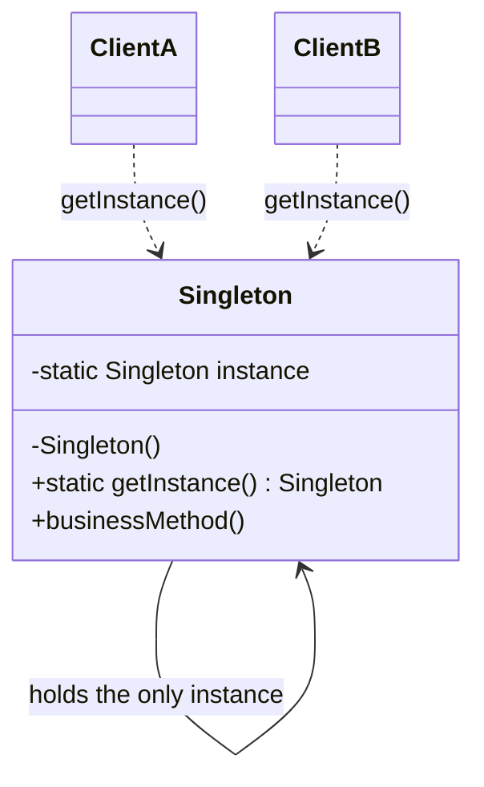
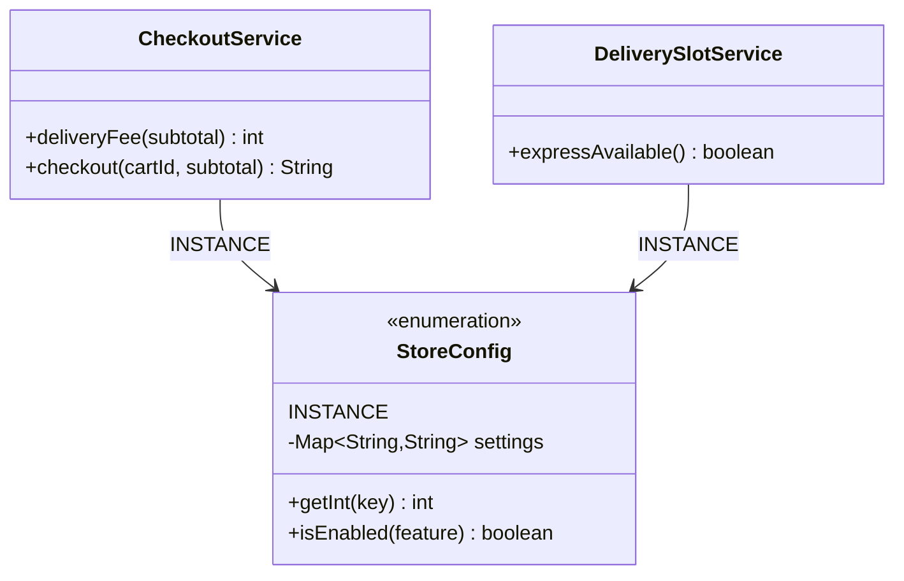
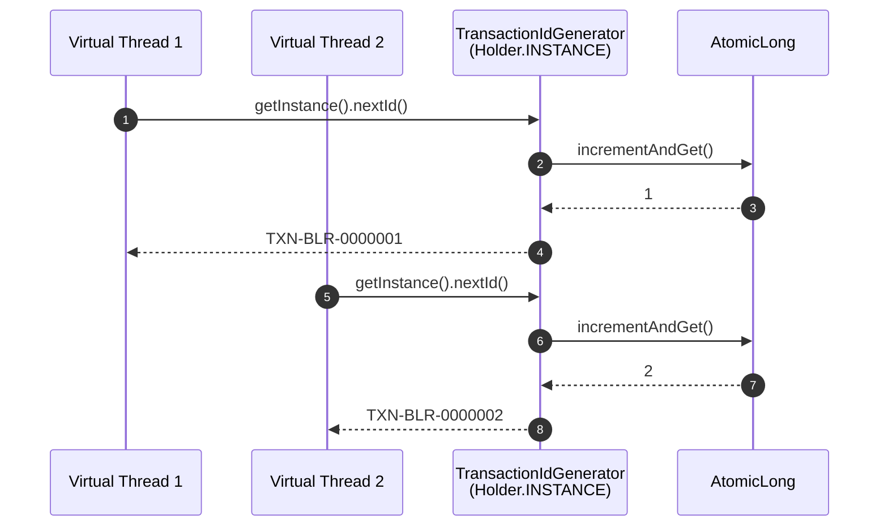
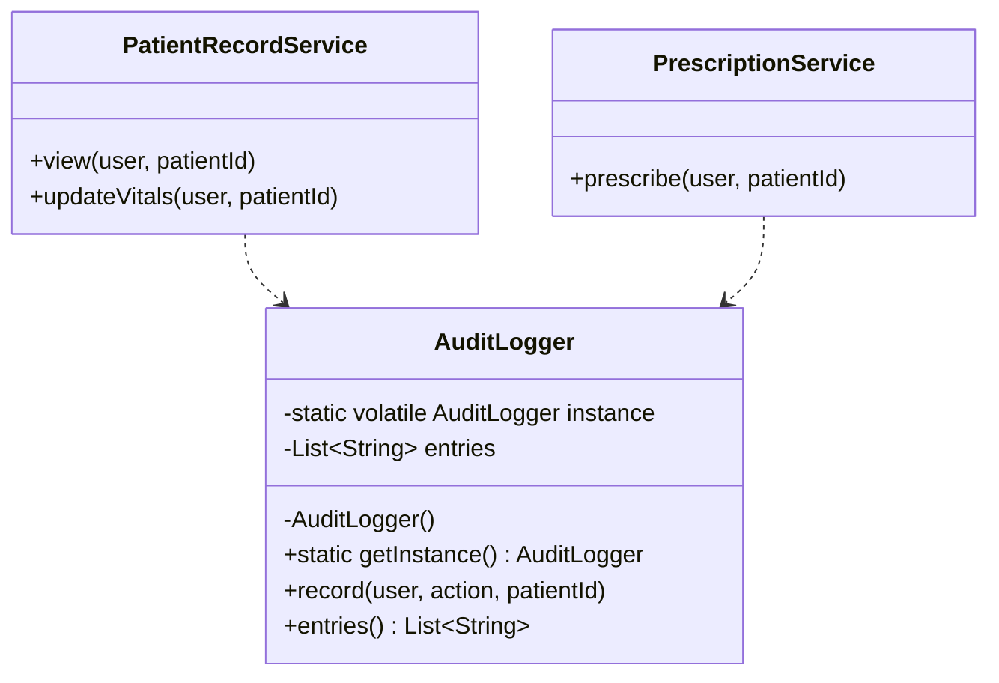

---
tags:
  - Creational
  - Beginner
---

# Singleton

<span class="badge badge--beginner">🟢 Beginner → 🔴 Advanced</span>
<span class="badge badge--category">Creational</span>
<span class="badge badge--interview">Interview frequency ⭐⭐⭐⭐⭐</span>

!!! abstract "TL;DR"
    **Singleton makes sure a class has exactly one instance and gives everyone a single global point of access to it.**
    Use it for things that really are one-per-application, like configuration, an ID sequence or an audit trail. Prefer letting a DI container (Spring) manage the "one instance" rule whenever you can.

---

## 1. Intent & Problem It Solves

**The problem in plain English:** some objects only make sense once. If two parts of your app each build their own configuration object, they might read different values. If two threads each create their own ID generator, they'll hand out duplicate IDs. If every service writes to its own audit log, auditors can't see one ordered trail.

**Formal definition (GoF):**
> Ensure a class only has one instance, and provide a global point of access to it.

Two responsibilities:

1. **Control instantiation:** nobody outside the class can call `new`.
2. **Provide access:** a well-known way (`getInstance()` or `INSTANCE`) to reach the one object.

## 2. Real-World Analogy

!!! example "The country's President"
    A country has exactly **one** sitting President at a time. You don't "create" a new President when you need one; you go through a well-known channel (the President's office) and reach the same person everyone else reaches. The constitution (the private constructor) stops anyone from appointing a second one.

## 3. Structure



| Participant | Responsibility |
|---|---|
| **Singleton** | Holds the single instance in a `static` field, hides its constructor, exposes `getInstance()` |
| **Client** | Never calls `new`; always asks the class for the shared instance |

## 4. Naive Approach (Without the Pattern)

```java
public class ConfigLoader {
    private final Map<String, String> settings;

    public ConfigLoader() {                 // anyone can call new
        settings = loadFromDisk();          // expensive I/O every time
    }
    // ...
}

// Somewhere in CheckoutService
ConfigLoader cfg1 = new ConfigLoader();     // reads file
// Somewhere in DeliveryService
ConfigLoader cfg2 = new ConfigLoader();     // reads file AGAIN; may see a different version
```

**What goes wrong:**

- :material-close-circle:{ style="color:#e53935" } **Wasted work.** The file or remote config is read over and over.
- :material-close-circle:{ style="color:#e53935" } **Inconsistent state.** Two copies can disagree if the file changes between reads.
- :material-close-circle:{ style="color:#e53935" } **Broken invariants.** With a counter (an ID generator), two instances means **duplicate IDs**.

And the "obvious" lazy fix isn't thread-safe:

```java
public static ConfigLoader getInstance() {
    if (instance == null) {          // two threads can both see null here...
        instance = new ConfigLoader(); // ...and both create an instance
    }
    return instance;
}
```

---

## 5. Three Real-World Examples

Each example uses a **different Singleton implementation**, so by the end you'll have seen the three you should know for interviews: **enum**, **holder idiom** and **double-checked locking**.

### Example 1: Store Configuration (Grocery Delivery)

**Scenario:** A grocery delivery app (think Blinkit/Instacart) has a checkout service and a delivery-slot service. Both need the same business settings: the delivery fee (INR 30), the free-delivery threshold (INR 499) and feature flags such as *express delivery*. Loading the settings is expensive (in production it's a call to a config server), and every service **must** see the same values. Otherwise the cart page and the checkout page could show different delivery fees, which leads straight to customer complaints.

**Design:**



**Full Code:**

=== "StoreConfig.java"

    ```java
    --8<-- "code/creational/src/main/java/com/handbook/creational/singleton/grocery/StoreConfig.java"
    ```

    1.  An enum with one constant **is** a Singleton. The JVM guarantees that `INSTANCE` is created exactly once, lazily (on first access to the enum class) and thread-safely.
    2.  Enum constructors are implicitly `private`. Reflection *cannot* call them: `Constructor.newInstance` throws `IllegalArgumentException: Cannot reflectively create enum objects`.

=== "CheckoutService.java"

    ```java
    --8<-- "code/creational/src/main/java/com/handbook/creational/singleton/grocery/CheckoutService.java"
    ```

    1.  The first line that touches `StoreConfig` triggers class initialization, and that's when the constructor runs and the "Loading configuration" line prints.

=== "DeliverySlotService.java"

    ```java
    --8<-- "code/creational/src/main/java/com/handbook/creational/singleton/grocery/DeliverySlotService.java"
    ```

=== "GroceryDemo.java"

    ```java
    --8<-- "code/creational/src/main/java/com/handbook/creational/singleton/grocery/GroceryDemo.java"
    ```

**Output:**

```text
--8<-- "code/outputs/creational/singleton/grocery/GroceryDemo.txt"
```

Notice that the loading message appears **once**, even though two services use the config, and only **after** the demo header. That shows the enum Singleton is lazy.

**Why Singleton here:**

- Config is expensive to load and must be loaded **once**.
- Every service must see **identical** values.
- The enum form is the shortest correct implementation, and it's safe against reflection and serialization.
- Joshua Bloch (*Effective Java*, Item 3): "a single-element enum type is often the best way to implement a singleton."

??? example "Unit Test: `StoreConfigTest.java`"

    ```java
    --8<-- "code/creational/src/test/java/com/handbook/creational/singleton/StoreConfigTest.java"
    ```

---

### Example 2: Transaction ID Generator (Banking / Payments)

**Scenario:** A payment switch for a bank's Bengaluru node issues an ID for every UPI/card transaction, such as `TXN-BLR-0000001`. At peak it processes thousands of payments per second on **virtual threads**. Two transactions with the same ID would be a serious reconciliation incident, so the sequence must be **unique and gap-free within the node**. There must be exactly one sequence per JVM, and it must be safe to use from thousands of threads at once.

**Design:**



**Full Code:**

=== "TransactionIdGenerator.java"

    ```java
    --8<-- "code/creational/src/main/java/com/handbook/creational/singleton/payments/TransactionIdGenerator.java"
    ```

    1.  The Singleton guarantees one *object*. `AtomicLong` makes that object's *state* thread-safe. You need **both**: a Singleton with a plain `long++` would still hand out duplicates.
    2.  The private constructor stops `new TransactionIdGenerator(...)` from outside.
    3.  **Initialization-on-demand holder idiom.** The JVM doesn't initialize the nested `Holder` class until `getInstance()` first touches it, and class initialization is guaranteed thread-safe by the JLS (§12.4.2). You get lazy loading with **no `synchronized` and no `volatile`**.
    4.  After the first call this is a plain static field read, about as fast as Java gets.

=== "PaymentsDemo.java"

    ```java
    --8<-- "code/creational/src/main/java/com/handbook/creational/singleton/payments/PaymentsDemo.java"
    ```

**Output:**

```text
--8<-- "code/outputs/creational/singleton/payments/PaymentsDemo.txt"
```

10,000 concurrent requests, 0 duplicates, and the next ID continues exactly where the sequence left off (2 + 10,000 + 1 = 10,003).

**Why Singleton here:**

- Uniqueness is a **business invariant**: two generators means two sequences means duplicate IDs.
- The holder idiom gives lazy, lock-free access, so there's no contention even with thousands of threads.
- The singleton is per JVM. Across nodes, the branch code (`BLR`) keeps IDs globally unique. (In a real cluster you'd use a Snowflake-style ID or a DB sequence. See the [deep dive](#10-senior-architect-deep-dive-1015-yrs).)

??? example "Unit Test: `TransactionIdGeneratorTest.java`"

    ```java
    --8<-- "code/creational/src/test/java/com/handbook/creational/singleton/TransactionIdGeneratorTest.java"
    ```

---

### Example 3: Patient Record Audit Trail (Healthcare)

**Scenario:** A hospital information system must record **every** read and write of a patient record, as required by health-data regulations (for example HIPAA, or India's DPDP Act). Doctors view records, nurses update vitals, and the prescription module writes prescriptions. Compliance auditors need **one ordered trail** across all modules, not a separate log per module. The audit store is expensive to open, so it should only be created when first needed.

**Design:**



**Full Code:**

=== "AuditLogger.java"

    ```java
    --8<-- "code/creational/src/main/java/com/handbook/creational/singleton/healthcare/AuditLogger.java"
    ```

    1.  **`volatile` is mandatory.** Without it, the JIT or CPU may publish the reference *before* the constructor finishes. Another thread could then see a non-null but half-built object. `volatile` creates a *happens-before* edge between the write and later reads.
    2.  **Reflection guard.** If someone uses `setAccessible(true)` to call the constructor after the instance exists, it fails loudly instead of quietly creating a second audit trail.
    3.  Reading the volatile field into a local means the common path (already initialized) does **one** volatile read instead of two. This is the form recommended in *Effective Java*, Item 83.

=== "PatientRecordService.java"

    ```java
    --8<-- "code/creational/src/main/java/com/handbook/creational/singleton/healthcare/PatientRecordService.java"
    ```

=== "PrescriptionService.java"

    ```java
    --8<-- "code/creational/src/main/java/com/handbook/creational/singleton/healthcare/PrescriptionService.java"
    ```

=== "HealthcareDemo.java"

    ```java
    --8<-- "code/creational/src/main/java/com/handbook/creational/singleton/healthcare/HealthcareDemo.java"
    ```

**Output:**

```text
--8<-- "code/outputs/creational/singleton/healthcare/HealthcareDemo.txt"
```

Two different services wrote into **one** ordered trail, with continuous sequence numbers.

**Why Singleton here:**

- Regulations require **one** complete, ordered trail.
- The store is expensive to open, so lazy creation (DCL) avoids paying for it in modules that never audit.
- DCL is the version interviewers most often ask you to write **and explain** (`volatile`, two null checks).
- The reflection guard shows you know how a Singleton can be broken.

??? example "Unit Test: `AuditLoggerTest.java`"

    ```java
    --8<-- "code/creational/src/test/java/com/handbook/creational/singleton/AuditLoggerTest.java"
    ```

---

## 6. Variations & Modern Java Take

| Variant | Lazy? | Thread-safe? | Reflection-safe? | Serialization-safe? | Use when |
|---|---|---|---|---|---|
| Eager `static final` field | ❌ | ✅ | ❌ (guard needed) | ❌ (`readResolve` needed) | Cheap object, always used |
| `synchronized getInstance()` | ✅ | ✅ | ❌ | ❌ | Never in hot paths (locks every call) |
| Double-checked locking | ✅ | ✅ (with `volatile`) | ❌ (guard needed) | ❌ | You need lazy init **and** constructor arguments from runtime |
| **Holder idiom** | ✅ | ✅ | ❌ (guard needed) | ❌ | Default choice for a lazy class-based Singleton |
| **Enum** | ✅ (on class init) | ✅ | ✅ | ✅ | Default choice when you don't need to extend a class |

**Making a class-based Singleton serialization-safe:**

```java
public final class AppClock implements Serializable {
    private static final AppClock INSTANCE = new AppClock();
    private AppClock() {}
    public static AppClock getInstance() { return INSTANCE; }

    @Serial
    private Object readResolve() {   // deserialization returns the existing instance
        return INSTANCE;
    }
}
```

**Modern Java notes:**

- **Virtual threads (Java 21):** avoid holding a `synchronized` lock around slow I/O inside a Singleton. Before JDK 24 (JEP 491) that *pins* the carrier thread. Use `ReentrantLock` or the holder/enum forms, which need no lock at all.
- **Records can't be Singletons by themselves** (their canonical constructor is public), but a record is great as the immutable *state* that a Singleton holds.
- **Multiton:** one instance *per key*, for example per tenant. `ConcurrentHashMap.computeIfAbsent` makes it trivial. See the coding challenge below.

## 7. Where It Lives in Real Frameworks

| Where | Example | Notes |
|---|---|---|
| JDK | `Runtime.getRuntime()` | Classic eager Singleton |
| JDK | `java.awt.Desktop.getDesktop()`, `System.console()` | One per JVM |
| JDK | `Collections.emptyList()`, `Comparator.naturalOrder()` | Shared immutable instances |
| JDK | `Enum` constants, `Boolean.TRUE` | Built-in singletons |
| Spring | Default bean scope is **singleton** | One instance **per `ApplicationContext`**, not per JVM, and *without* a private constructor |
| Spring | `@Configuration` classes | CGLIB proxies make `@Bean` methods return the same instance |
| Logging | `LoggerFactory.getLogger(X.class)` | Cached per name (a Multiton) |
| Hibernate | `SessionFactory` | Expensive; built once per app |
| Kafka | `KafkaProducer` | Thread-safe; recommended to share one instance |

## 8. Pros, Cons & Trade-offs

| ✅ Pros | ❌ Cons |
|---|---|
| Guarantees one instance, so invariants hold (unique IDs, one config) | **Global state**: hidden dependencies make code harder to reason about |
| Lazy creation saves start-up time and memory | **Hard to unit-test**: you can't easily swap in a mock; state leaks between tests |
| Single point of access, no passing it around | Violates **Single Responsibility** (manages its own lifecycle *and* does business work) |
| Can be made lock-free (holder, enum) | Becomes a **bottleneck** if it holds a contended lock |
| | Only "single" **per class loader**. In app servers or with multiple class loaders you can get several |
| | Doesn't scale across **JVMs or pods**; that needs a distributed solution |

## 9. Pitfalls & Anti-Patterns

!!! danger "Forgetting `volatile` in double-checked locking"
    Without `volatile`, another thread can see a **partially constructed** object. The code passes every test on your laptop and fails at 3 a.m. under load on a many-core server.

!!! danger "Reflection and serialization attacks"
    `setAccessible(true)` can call a private constructor. Deserializing creates a **new** object. Defend with a constructor guard and `readResolve()`, or just use an **enum**.

!!! danger "Mutable shared state"
    A Singleton holding a `HashMap` that many threads write to is a race condition with a global access point. Make its state immutable, or use concurrent structures (`AtomicLong`, `ConcurrentHashMap`).

!!! warning "Singleton as a service locator / god object"
    `AppContext.getInstance().getOrderService().getRepo()...` hides dependencies and couples everything to one class. Prefer **constructor injection**.

!!! warning "Thinking it's 'one per system'"
    In Kubernetes with 10 pods you have **10 singletons**. A per-JVM `AtomicLong` sequence across pods produces **duplicate IDs**. That's exactly why Example 2 includes a node code.

!!! warning "Testing pain"
    Tests share the same instance, so test order changes results. Workarounds: inject the singleton through an interface, or let Spring manage the scope so you can use `@MockitoBean`.

## 10. Senior / Architect Deep Dive (10–15 yrs)

**Java Memory Model view.** `instance = new AuditLogger()` is really three steps: allocate memory, run the constructor, publish the reference. Without a happens-before edge, steps 2 and 3 may be reordered. `volatile` (JSR-133, Java 5+) forbids that reordering. Class initialization (holder and enum) is protected by the JVM's initialization lock, which gives the same guarantee for free. That's why holder and enum are preferred.

**Prefer container-managed singletons.** In a Spring Boot service, write a plain class with a public constructor and let Spring make it a singleton bean:

```java
@Service                       // singleton scope by default
public class TransactionIdService {
    private final AtomicLong sequence = new AtomicLong();
    public String nextId() { return "TXN-%07d".formatted(sequence.incrementAndGet()); }
}
```

You get one instance, constructor injection, easy mocking, and lifecycle hooks (`@PostConstruct`, `@PreDestroy`), without the downsides of global static state.

**Distributed "singletons".** When you need *one* of something across a cluster:

| Need | Tool |
|---|---|
| Unique IDs across nodes | Snowflake / ULID / UUIDv7, DB sequences, Redis `INCR` |
| One scheduled job runner | ShedLock, Quartz clustered mode, Kubernetes `CronJob` |
| One leader | Leader election (ZooKeeper, etcd, Kubernetes Lease, Spring Integration `LockRegistryLeaderInitiator`) |
| One shared config | Spring Cloud Config, Consul, AWS AppConfig, with refresh events |

**How to defend it in a design review:** "This object enforces an invariant that only holds if there's one instance (a sequence or an ordered log). It's per-JVM by design, it's lock-free, it has no mutable state that can be seen from outside, and it's injected through an interface so tests can replace it. For cross-node uniqueness we rely on X."

**When NOT to use it:** to avoid passing parameters; for request- or user-specific data; for anything that needs different configurations in tests; for caches that should be bounded or evicted (use Caffeine instead).

!!! bug "War story: duplicate invoice numbers after scaling out"
    A billing service generated invoice numbers with a Singleton `AtomicLong` that was seeded from `MAX(invoice_no)` at start-up. It worked perfectly for two years on one VM. During a migration to Kubernetes, the service was scaled to **3 replicas**. Each pod seeded from the same max and started issuing the **same numbers**. Finance found 1,200 duplicate invoices at month-end close.
    **Fix:** switched to a database sequence (`nextval`) with an allocation size of 50 per pod (Hibernate `pooled` optimizer) and added a unique constraint on `invoice_no`.
    **Lesson:** a Singleton is a **per-process** guarantee. Write down that assumption, and add a database constraint as the last line of defense.

## 11. Related Patterns & Comparisons

| | Singleton | Static utility class | Spring singleton bean | Monostate |
|---|---|---|---|---|
| Instances | 1 per class loader | 0 | 1 per `ApplicationContext` | Many objects, shared static state |
| Can implement interfaces | ✅ | ❌ | ✅ | ✅ |
| Polymorphism / mocking | Hard | ❌ | ✅ Easy | Hard |
| Lazy init | ✅ | N/A | ✅ (`@Lazy`) | ❌ |
| Holds state | ✅ | Should not | ✅ | ✅ |
| Use for | Real one-per-process invariants | Pure functions (`Math`, `Collections`) | Almost every service in a Spring app | Rarely; legacy code |

**Patterns that often use Singleton:** Abstract Factory (one factory per family), Facade (one entry point), Flyweight factory, Object Pool manager, State objects without fields.

## 12. Interview Corner

=== "🟢 Beginner / Service Companies"

    Typical of Cognizant, TCS, Infosys, Accenture, Wipro and Capgemini technical rounds.

    **Q1. What is the Singleton pattern?**

    A creational pattern that ensures a class has **only one instance** and provides a **global point of access** to it. It's done with a **private constructor**, a **static field** that holds the instance, and a **static `getInstance()` method**.

    **Q2. Write a thread-safe Singleton.**

    The cleanest answer is the **holder idiom** (Example 2) or an **enum** (Example 1). If they want lazy initialization with explicit locking, write **double-checked locking with `volatile`** (Example 3) and explain both null checks.

    **Q3. Difference between eager and lazy initialization?**

    **Eager** creates the instance when the class loads (simple and thread-safe, but it costs memory even if never used). **Lazy** creates it on first `getInstance()` call (saves resources, but needs thread-safety care).

    **Q4. Why is the constructor private?**

    To **stop other classes from calling `new`**. That's how the class controls the number of instances.

    **Q5. Can we break a Singleton? How?**

    Yes, in three ways: **reflection** (`setAccessible(true)` on the constructor), **serialization** (deserializing creates a new object), and **cloning** (if it implements `Cloneable`). Defences: a constructor guard, `readResolve()`, overriding `clone()` to throw. Or use an **enum**, which is immune to all three.

=== "🟡 Mid-Level"

    **Q1. Why is `volatile` needed in double-checked locking?**

    Because `instance = new X()` isn't atomic. **Reordering** can publish the reference before the constructor finishes. `volatile` sets up a **happens-before** relationship so other threads never see a half-built object.

    **Q2. Why does the holder idiom work without synchronization?**

    The JVM initializes a class **lazily and exactly once**, under an internal lock (JLS §12.4.2). `Holder` is only initialized when `getInstance()` first touches it, so you get **lazy and thread-safe for free**.

    **Q3. How do you unit test code that depends on a Singleton?**

    Don't call `getInstance()` deep inside business logic. **Extract an interface**, make the singleton implement it, and **inject** it through the constructor. In tests, pass a fake. In Spring, use `@MockitoBean`.

    **Q4. Spring singleton vs. GoF Singleton?**

    A GoF Singleton is **one per class loader**, enforced by the class itself. A Spring singleton is **one per `ApplicationContext`**, enforced by the container. The class has a public constructor and can be created again in tests.

    **Q5. Is Singleton an anti-pattern?**

    It's **overused**, not wrong. It becomes an anti-pattern when it's used as **global mutable state** or a **service locator**. It's fine for real one-per-process invariants, especially when it's **injected**, not looked up.

=== "🔴 Senior / FAANG / SAP"

    Open-ended, with follow-up chains typical of Google, Microsoft, Amazon and SAP.

    **Q1. "Design a unique ID generator. Start with one JVM, then make it distributed."**

    Single JVM: **Singleton + `AtomicLong`** (Example 2). Distributed: a single counter is a bottleneck, so use **Snowflake-style IDs** (timestamp + node ID + per-node sequence), which are **k-sortable** with no coordination. Discuss **clock skew** (refuse to issue IDs or wait when the clock moves backwards), **node-ID assignment** (from ZooKeeper or the pod ordinal), and the **throughput limit** (4,096 IDs/ms per node with a 12-bit sequence).

    *Follow-up: "What if IDs must be gap-free?"* → you need a **central sequence** (DB or Raft log). Gap-free and highly available pull against each other, so be explicit about the trade-off.

    **Q2. "Your Singleton cache becomes a lock-contention hotspot at 50k RPS. What do you do?"**

    Profile first (JFR, async-profiler). Then **remove the global lock**: switch to `ConcurrentHashMap` or **Caffeine**, **stripe** the state, or keep immutable snapshots that are swapped atomically (`AtomicReference`, copy-on-write). With virtual threads, make sure no `synchronized` block wraps I/O.

    **Q3. "How many instances of a Singleton can exist in one JVM?"**

    **One per class loader.** In app servers (Tomcat, SAP NetWeaver), OSGi or plugin systems, the same class loaded by two loaders gives **two singletons**. Real JVM-wide singletons need a class loaded by a **shared parent** loader.

    **Q4. "Run a nightly job exactly once across 12 pods."**

    A JVM Singleton doesn't help. Use **distributed locking/leader election**: ShedLock on a DB table, a Kubernetes Lease, or move it to a Kubernetes **CronJob**. Make the job **idempotent** anyway, because locks can expire mid-run.

    **Q5. "When would you *reject* a Singleton in code review?"**

    When it holds **request/user-scoped data**, when it's a **service locator** that hides dependencies, when tests have to **reset static state** with reflection, or when a DI container already gives **singleton scope** for free.

=== "💻 Coding Challenge"

    **Problem (SAP-style multi-tenant SaaS):** Your ERP serves many tenants (countries). Each tenant needs **exactly one** `TenantConfig` instance, created lazily on first use, and creation must be **thread-safe**. `TenantConfig.forTenant("IN")` must always return the same object, and `forTenant("DE")` a different one. India uses `INR`, Germany `EUR`, everyone else `USD`.

    ??? success "Solution: Multiton with `computeIfAbsent`"

        === "TenantConfig.java"

            ```java
            --8<-- "code/creational/src/main/java/com/handbook/creational/singleton/tenant/TenantConfig.java"
            ```

        === "TenantDemo.java"

            ```java
            --8<-- "code/creational/src/main/java/com/handbook/creational/singleton/tenant/TenantDemo.java"
            ```

        **Output:**

        ```text
        --8<-- "code/outputs/creational/singleton/tenant/TenantDemo.txt"
        ```

        **Key points to say:** `computeIfAbsent` on `ConcurrentHashMap` is **atomic per key**, so two threads asking for `"IN"` at once still build only one. Keep the mapping function **short and non-recursive**, because it runs while that map bin is locked.

!!! info "Behavioural tie-in (STAR) for experienced candidates"
    - **S:** Billing service produced duplicate invoice numbers after we scaled to 3 pods.
    - **T:** Restore uniqueness without a long outage before month-end close.
    - **A:** Found the per-JVM Singleton counter, replaced it with a DB sequence using pooled allocation, added a unique constraint and a reconciliation script.
    - **R:** Zero duplicates since. I also added "per-process assumptions" to our design-review checklist.

## 13. Quick Revision Card

!!! tip "Remember in 30 seconds"
    - **One instance + global access.** Private constructor, static holder, `getInstance()`.
    - **Best forms:** `enum` (safest) or the **holder idiom** (lazy, lock-free).
    - **DCL needs `volatile`.** Say "happens-before" and "partially constructed object".
    - **Breakers:** reflection, serialization, cloning. Enum beats all three.
    - **One per class loader / per JVM**, never per cluster. In Spring, prefer singleton-scoped beans.

    ```java
    public enum Config { INSTANCE; public String get(String k) { return "..."; } }
    ```

## Practice

- [ ] Rewrite Example 1 using the holder idiom and compare the two.
- [ ] Remove `volatile` from `AuditLogger` and explain, in writing, what could go wrong.
- [ ] Add `implements Serializable` to `TransactionIdGenerator`, serialize and deserialize it, and show that you get a second instance. Then fix it with `readResolve()`.
- [ ] Turn `TransactionIdGenerator` into a Spring `@Service` and write a test that mocks it.

---

[:material-arrow-left: Creational overview](index.md){ .md-button }
[Next: Factory Method :material-arrow-right:](factory-method.md){ .md-button .md-button--primary }
