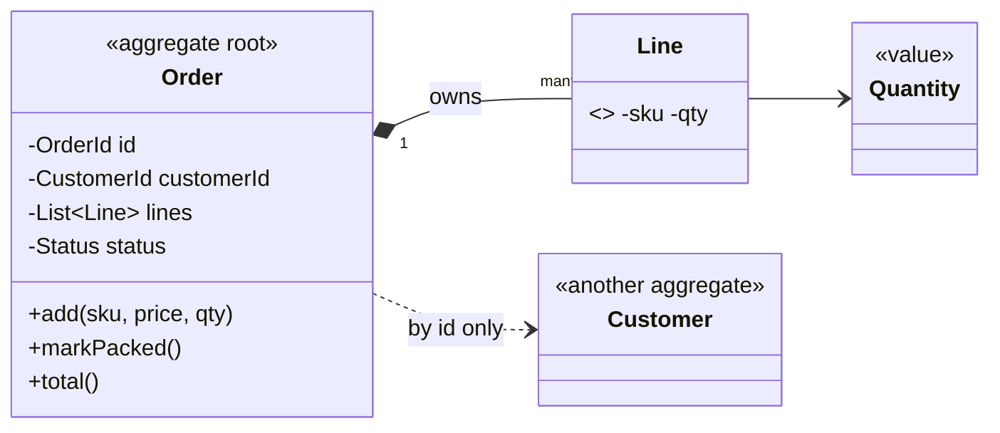
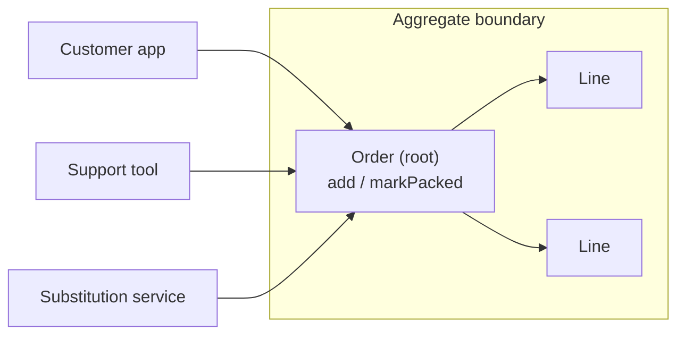
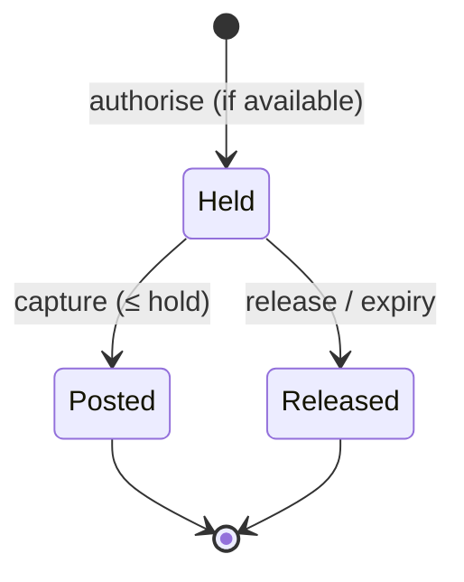
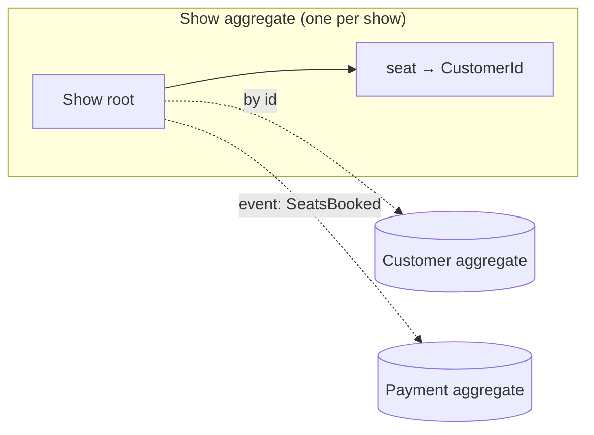

---
tags:
  - Enterprise
  - Advanced
---

# Aggregate

<span class="badge badge--intermediate">🟡 Intermediate → 🔴 Advanced</span>
<span class="badge badge--category">Enterprise / DDD</span>
<span class="badge badge--interview">Interview frequency ⭐⭐⭐⭐</span>

!!! abstract "TL;DR"
    **An Aggregate is a cluster of objects (a root entity plus the entities and values inside it) that is loaded, changed and saved as one unit, so its business rules are always true. Outsiders may only talk to the root.**
    Use it to decide *what must be consistent immediately* (inside one aggregate, one transaction) versus *eventually* (between aggregates, via events).

---

## See It in Motion

<iframe class="motion-embed" src="../../motion/index.html?p=aggregate&amp;embed=1" title="Animated walkthrough of the Aggregate pattern" loading="lazy"></iframe>

Press **Play** to watch the calls travel between objects, or step through with **Next** and **Back**. Switch to **Without it** to see what goes wrong without the pattern. [Open the full explorer with all 75 patterns](../motion/index.html#aggregate){ target=_blank }

## 1. Intent & Problem It Solves

**The problem in plain English:** an order has lines. A rule says "max 4 dozen mangoes per order during the flash sale" and "COD orders can't exceed INR 20,000". If any code can grab `order.getLines()` and add to it, or update `order_line` rows directly, those rules are only as strong as the most careless caller. In the other direction, if you make the boundary too big (a `Customer` that contains every order ever), every new order loads thousands of objects and two phones ordering at once conflict.

**Definition (Eric Evans, *DDD*; Vaughn Vernon, *Effective Aggregate Design*):**
> A cluster of associated objects treated as a unit for the purpose of data changes. Each aggregate has a **root** and a **boundary**. Outside objects may hold references only to the root. Invariants within the boundary are enforced on every change.

**Vernon's four rules of thumb:**

1. Model **true invariants** inside the boundary (rules that must hold at the end of every transaction).
2. Design **small** aggregates.
3. Reference other aggregates **by identity** only.
4. Use **eventual consistency** (domain events) between aggregates.

## 2. Real-World Analogy

!!! example "A sealed tiffin box"
    A tiffin (lunch box) has several compartments, but you hand over, carry and wash it **as one thing**. Nobody reaches in to swap the dal while it's in the delivery bag. The dabbawala doesn't carry your whole kitchen, just the tiffin (small aggregate), and the label on it is your address, not your house (reference by id).

## 3. Structure



| Concept | Responsibility |
|---|---|
| **Aggregate root** | The only entry point; public methods enforce all invariants |
| **Internal entities / values** | Can't be referenced or modified from outside (no public constructors, read-only views) |
| **Boundary** | One transaction changes one aggregate; one repository per root |
| **References to other aggregates** | By id (`CustomerId`), never by object |

## 4. Naive Approach (Without the Pattern)

```java
Order order = orderRepo.findById(id);
order.getLines().add(new OrderLine("ALPHONSO-1DZ", 5));   // bypasses the flash-sale limit
orderLineRepo.save(new OrderLine(orderId, "TV-32", 1));    // bypasses the COD cap, and the order total is now wrong
```

- :material-close-circle:{ style="color:#e53935" } Invariants checked "somewhere", so in practice nowhere.
- :material-close-circle:{ style="color:#e53935" } Repositories per table let anyone change part of the cluster.
- :material-close-circle:{ style="color:#e53935" } No clear transaction boundary, so concurrent changes interleave.

---

## 5. Three Real-World Examples

### Example 1: The Order Aggregate (Grocery)

**Scenario:** During the Alphonso mango sale, each order may have at most 4 dozen, cash-on-delivery orders are capped at INR 20,000, and nothing can be added once the order is packed. Orders are edited by the customer app, customer-support tools and the substitutions service; all of them must obey the rules.

**Design:**



**Full Code:**

=== "Order.java"

    ```java
    --8<-- "code/enterprise/src/main/java/com/handbook/enterprise/aggregate/grocery/Order.java"
    ```

    1.  `Line`'s constructor is **private**: only `Order` can create lines.
    2.  The customer is another aggregate, so it's referenced **by id**.
    3.  Every invariant is checked in the root's command method, against the whole aggregate's state.
    4.  Callers get a **read-only view**; they can look but not touch.

=== "OrderAggregateDemo.java"

    ```java
    --8<-- "code/enterprise/src/main/java/com/handbook/enterprise/aggregate/grocery/OrderAggregateDemo.java"
    ```

**Output:**

```text
--8<-- "code/outputs/enterprise/aggregate/grocery/OrderAggregateDemo.txt"
```

**Why an aggregate here:**

- Rules that span lines (per-SKU limit, total cap) need the **whole cluster** to evaluate.
- One root means one place to read the rules, and one place to test them.
- The repository saves `Order` as a unit, so lines and totals never diverge.

---

### Example 2: Card Account with Holds (Banking)

**Scenario:** A credit card with a INR 50,000 limit receives pre-authorisations (hotel, fuel), captures (often for less than the hold) and reversals. The invariant is **posted balance + open holds ≤ limit**, and it must hold even with authorisations arriving from different payment networks at the same moment. The account and its holds therefore form one aggregate, saved with a version number.

**Design:**



**Full Code:**

=== "CardAccount.java"

    ```java
    --8<-- "code/enterprise/src/main/java/com/handbook/enterprise/aggregate/banking/CardAccount.java"
    ```

    1.  The limit check uses posted amounts **and** all open holds, which is only possible because the holds live inside the aggregate.
    2.  Capture moves money from a hold to posted; it can't exceed the hold.

=== "CardAccountDemo.java"

    ```java
    --8<-- "code/enterprise/src/main/java/com/handbook/enterprise/aggregate/banking/CardAccountDemo.java"
    ```

**Output:**

```text
--8<-- "code/outputs/enterprise/aggregate/banking/CardAccountDemo.txt"
```

**Why an aggregate here:**

- The invariant spans several objects (account + holds), so they belong together.
- The `version` makes concurrent authorisations on the same card **serialize** via optimistic locking: one wins, the other reloads and re-checks.
- Statements and rewards are separate aggregates that react to events, so they don't bloat this one.

---

### Example 3: Seats in a Show (Entertainment)

**Scenario:** A ticketing platform sells seats for 12,000 shows a day; a blockbuster's first-day shows sell out in minutes. A booking for several seats must be **all-or-nothing** (a family of four doesn't want three seats), no seat may be sold twice, and a show can't exceed capacity. Customers and payments are separate aggregates referenced by id.

**Design:**



**Full Code:**

=== "Show.java"

    ```java
    --8<-- "code/enterprise/src/main/java/com/handbook/enterprise/aggregate/cinema/Show.java"
    ```

    1.  The aggregate stores **ids** of other aggregates, never `Customer` objects.
    2.  Check everything first, then mutate: a multi-seat booking is atomic **within** the aggregate.

=== "ShowDemo.java"

    ```java
    --8<-- "code/enterprise/src/main/java/com/handbook/enterprise/aggregate/cinema/ShowDemo.java"
    ```

**Output:**

```text
--8<-- "code/outputs/enterprise/aggregate/cinema/ShowDemo.txt"
```

**Why an aggregate here:**

- "No double booking" is a true invariant of **one show**, so one show is the boundary.
- Different shows never contend: the platform scales by spreading shows across shards.
- Payment happens afterwards, driven by a `SeatsBooked` [domain event](domain-events.md); if it fails, a compensating action releases the seats.

---

??? example "Unit Tests: `AggregateTest.java`"

    ```java
    --8<-- "code/enterprise/src/test/java/com/handbook/enterprise/aggregate/AggregateTest.java"
    ```

## 6. Variations & Modern Java Take

| Variation | Notes |
|---|---|
| **Mutable root, private internals** | Classic OO style (Examples 1–3) with JPA `@Entity` + `@OneToMany(cascade = ALL, orphanRemoval = true)` |
| **Immutable aggregates** | Records with methods returning a new aggregate version; repository saves the new version |
| **Event-sourced aggregates** | State rebuilt from events; commands emit new events after checking invariants ([Event Sourcing](../microservices/event-sourcing.md)) |
| **Sealed state types** | `sealed interface OrderState permits Open, Packed, Delivered`: illegal transitions don't compile |
| **Spring Data `AbstractAggregateRoot`** | `registerEvent(...)` inside the root; events published on `save()` |
| **jMolecules** | `@AggregateRoot`, `@Entity`, `@ValueObject` annotations + ArchUnit rules to verify DDD structure |

## 7. Where It Lives in Real Frameworks

| Where | Aggregates |
|---|---|
| Spring Data | One repository per aggregate root; `AbstractAggregateRoot`, `@DomainEvents`; Spring Data JDBC is explicitly aggregate-oriented (saves the whole aggregate) |
| JPA | Cascades and `orphanRemoval` approximate the boundary; `@Version` for concurrency |
| Axon Framework | `@Aggregate`, `@CommandHandler`, `@EventSourcingHandler` |
| Event stores | One stream per aggregate instance (`order-ORD-9`), with expected-version appends |

## 8. Pros, Cons & Trade-offs

| ✅ Pros | ❌ Cons |
|---|---|
| Invariants enforced in one place, always | Choosing boundaries is hard and domain-specific |
| Clear transaction and locking unit | Cross-aggregate rules become eventually consistent |
| Small aggregates scale and rarely conflict | More events and coordination code |
| Maps naturally to microservices, shards and event streams | ORMs push toward big object graphs; you must resist |

## 9. Pitfalls & Anti-Patterns

!!! danger "Giant aggregates"
    `Customer` containing all orders, addresses, payments and reviews: slow loads, huge saves and constant optimistic-lock conflicts. See the coding challenge.

!!! danger "Exposing internals"
    Returning a mutable `List<Line>` or public setters on internal entities lets callers break invariants. Return read-only views and expose intention-revealing commands.

!!! warning "Modifying two aggregates in one transaction"
    Tempting and sometimes acceptable inside one service, but it hides coupling and fails across services. Prefer one aggregate per transaction plus domain events.

!!! warning "Object references across aggregates"
    `@ManyToOne Customer customer` inside `Order` invites lazy-loading and cascades across boundaries. Store `CustomerId`.

## 10. Senior / Architect Deep Dive (10–15 yrs)

**Finding the boundary.** Ask: "Which rules must be true *at the end of this transaction*, and which can be true *a few seconds later*?" Only the first group justifies putting objects together. "Show can't be double-booked" is immediate; "customer gets a confirmation email" can be eventual.

**Concurrency is the real test.** If two users regularly modify the same aggregate at the same time and get version conflicts, the aggregate is too big or the operations should be commutative. Seat booking per show is fine; "one aggregate for the whole cinema chain" is not.

**Aggregates and services.** An aggregate never spans services. A service usually owns a few aggregate types; each is a natural unit for sharding (by aggregate id), for event streams and for idempotency keys.

!!! bug "War story: the shopping cart that couldn't take two items"
    A grocery app modelled `Customer` as one aggregate containing carts, orders, addresses and wallet. When households shared an account, two phones adding items at the same time hit optimistic-lock failures on `Customer`; the app retried silently and dropped items. Order placement for long-time customers took 1.8 s because it loaded five years of history.
    **Fix:** `Cart`, `Order`, `Wallet` became separate aggregates referencing `CustomerId`; the wallet balance update moved to an event handler.
    **Lesson:** small aggregates, references by id, events in between.

## 11. Related Patterns & Comparisons

| | Aggregate | Entity | Value Object | Repository |
|---|---|---|---|---|
| What | Consistency boundary around a cluster | Object with identity | Immutable, equal by value | Loads/saves aggregates |
| Relationship | Contains entities and values | May be a root or internal | Lives inside aggregates | One per aggregate root |

See also [Domain Events](domain-events.md) (how aggregates talk) and [Saga](../microservices/saga.md) (multi-aggregate business processes).

## 12. Interview Corner

=== "🟢 Beginner / Service Companies"

    **Q1. What is an aggregate root?**

    The single entity through which a cluster of objects is accessed and changed, e.g. `Order` for its lines.

    **Q2. Why can't other code modify order lines directly?**

    The root enforces rules that involve all lines (limits, totals); direct changes would bypass them.

    **Q3. How many repositories does an aggregate have?**

    One, for its root.

    **Q4. How should an Order refer to its Customer?**

    By `CustomerId`, not by holding the `Customer` object.

    **Q5. Give an example invariant.**

    "Order total must equal the sum of its lines" or "a seat can't be booked twice for the same show".

=== "🟡 Mid-Level"

    **Q1. How do you pick aggregate boundaries?**

    Group objects that share a **true invariant** needing immediate consistency; keep everything else separate and connect with events.

    **Q2. Why keep aggregates small?**

    Faster loads, smaller transactions and fewer concurrency conflicts.

    **Q3. How do you handle concurrent changes to one aggregate?**

    Optimistic locking with a version on the root; on conflict, reload and re-run the command.

    **Q4. A rule spans two aggregates. What now?**

    Rethink the boundary, or accept eventual consistency: one aggregate emits an event, the other reacts, with compensations if needed.

    **Q5. How does JPA support aggregates?**

    Cascades, `orphanRemoval`, `@Version`, and only exposing a repository for the root.

=== "🔴 Senior / FAANG / SAP"

    **Q1. "Design aggregates for a ride-hailing trip."**

    `Trip` (states, fare, driver/rider ids), `Driver` (availability), `Payment` separate. Matching changes `Driver` and creates `Trip` via an event-driven saga, not one transaction.

    **Q2. "Hot aggregate: a flash-sale product's stock receives 5,000 writes per second."**

    Split stock into buckets (sharded counters), reserve via a queue/single writer, or move to an atomic Redis counter with reconciliation. One aggregate row can't take that rate.

    **Q3. "How do aggregates map to event sourcing?"**

    One event stream per aggregate instance; commands validated against state rebuilt from that stream; appends with expected version.

    **Q4. "Two aggregates in one transaction inside one service: ever OK?"**

    Pragmatically, sometimes (same database, rare, low contention). Document it; it becomes a problem when you split the service or scale writes.

    **Q5. "How do you enforce aggregate rules in a large codebase?"**

    Package-private internals, no public setters, jMolecules/ArchUnit rules (repositories only for roots, no cross-aggregate object references).

=== "💻 Coding Challenge"

    **Problem:** A `Customer` aggregate holds a list of every past order. Show the cost of placing one order for a loyal customer, and redesign the boundary.

    ??? success "Solution"

        === "AggregateSizeDemo.java"

            ```java
            --8<-- "code/enterprise/src/main/java/com/handbook/enterprise/aggregate/sizing/AggregateSizeDemo.java"
            ```

        **Output:**

        ```text
        --8<-- "code/outputs/enterprise/aggregate/sizing/AggregateSizeDemo.txt"
        ```

        **Key points to say:** there's no invariant that needs *all* orders and the customer in one transaction, so `Order` is its own aggregate referencing `CustomerId`. Lists like "order history" become queries (or a read model), not aggregate contents.

!!! info "Behavioural tie-in (STAR) for experienced candidates"
    - **S:** Shared household accounts lost cart items and order placement took 1.8 s for loyal customers.
    - **T:** Remove the conflicts and the latency without a rewrite.
    - **A:** Split the `Customer` mega-aggregate into `Cart`, `Order` and `Wallet` aggregates referenced by id; moved wallet updates to domain events; added a "no cross-aggregate references" ArchUnit rule.
    - **R:** Lock conflicts dropped 99%; order placement p95 went from 1.8 s to 140 ms.

## 13. Quick Revision Card

!!! tip "Remember in 30 seconds"
    - **Cluster + root + boundary**; outsiders talk to the root only.
    - Boundary = **true invariants** that must hold at commit.
    - **Small**; reference other aggregates **by id**.
    - One aggregate per transaction; **events** between aggregates.
    - One repository per root; `@Version` on the root.

    ```java
    order.add("ALPHONSO-1DZ", 89_900, 2);   // root checks limits, totals, status
    ```

## Practice

- [ ] Add `removeLine(sku)` to `Order` that is only allowed while `OPEN`.
- [ ] Add hold expiry to `CardAccount` (holds older than 7 days are released).
- [ ] Add `cancel(CustomerId)` to `Show` that only frees that customer's seats.

---

[:material-arrow-left: Value Object](value-object.md){ .md-button }
[Next: Domain Events :material-arrow-right:](domain-events.md){ .md-button .md-button--primary }
